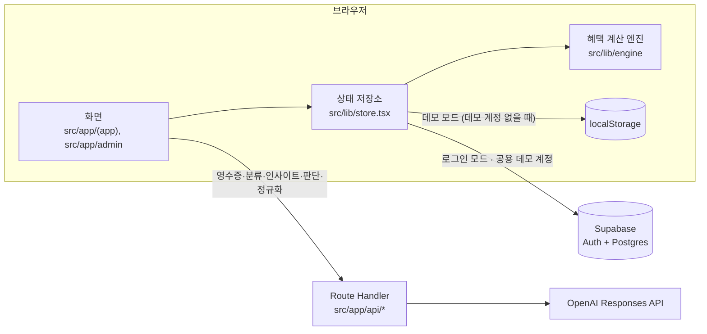

# 카드셈 — 카드 혜택 가계부

가진 카드의 혜택을 결제마다 계산해서 **받은 혜택**과 **놓친 혜택**을 보여 주는 한국어 가계부 웹 앱입니다. 2인 팀 프로젝트로 만들었고 Next.js 16과 Supabase를 씁니다.

## 팀 구성과 기여

2인 팀 프로젝트입니다. 원래 팀 저장소(비공개)에서 포트폴리오용으로 옮겨 온 저장소라 이전 커밋 기록은 들어 있지 않습니다.

| 담당 | 영역 |
| --- | --- |
| **개발자 A (hlim99)** · 프론트엔드, 혜택 계산 로직 | 혜택 계산 엔진(`src/lib/engine`), 카드 상품 데이터와 결제 카드 매칭(`src/lib/data`), 사용자 화면 전체(`src/app/(app)`), 어드민 화면(`src/app/admin`), 데모·로그인 모드 상태 관리(`src/lib/store.tsx`), 디자인 시스템과 차트(`src/components`), 월간·통계 집계, 알림, 엑셀 내보내기 |
| **개발자 B** · 백엔드, DB | Supabase DB 설계(스키마, RLS, 마이그레이션, ERD), 데이터 동기화(`src/lib/db.ts`), 이메일·카카오 로그인과 관리자 권한, 배포와 데모 계정 |
| **공동** · AI 기능 | OpenAI 연동과 프롬프트 설계(`src/lib/ai/server.ts`), 영수증·결제 문자·명세서 인식, 가맹점 업종 분류, 월간 인사이트, 정성 혜택 판단, 약관 → 혜택 규칙 정규화(`src/app/api/*`) |

## 무엇을 해결하나

카드사 앱은 자기 카드만 보여 줍니다. 그래서 카드를 여러 장 쓰는 사람은 결제마다 어느 카드가 유리했는지 알기 어렵습니다. 카드셈은 보유 카드 전체의 혜택 규칙으로 결제 한 건 한 건을 다시 계산합니다.

테스트용 고정 장부(`src/lib/data/fixtures.ts`)의 실제 계산 결과를 예로 들겠습니다.

> 9월 3일 08:42, 스타벅스 강남역점 6,100원을 신한 Point Plan으로 결제했습니다.
>
> | 보유 카드 | 이 결제의 혜택 | 근거 규칙 |
> | --- | ---: | --- |
> | 신한 Point Plan (결제한 카드) | 30원 | 일상 생활비 적립 (건당 금액 구간별) |
> | 신한 Mr.Life | **610원** | Time 할인 Night · 식음료 10% (21:00~09:00) |
> | 현대 ZERO Edition3 | 73원 | 국내외 가맹점 1.2% M포인트 적립 |
>
> → Mr.Life가 최적 카드였고, **놓친 혜택은 580원**입니다.

혜택 금액은 LLM(대규모 언어 모델)이 아니라 규칙 엔진(`src/lib/engine/index.ts`)이 계산합니다. AI는 영수증 읽기, 가맹점 업종 분류, 월간 인사이트 문장, 금액으로 셀 수 없는 혜택 판단, 약관 원문 정리에만 씁니다.



- **Route Handler**: Next.js에서 서버 쪽 API를 만드는 파일(`route.ts`)입니다. AI 키는 서버에만 있고 브라우저는 `/api/*`만 부릅니다.
- **localStorage**: 브라우저에 데이터를 저장하는 공간입니다. 그 기기와 그 브라우저에만 남습니다.

## 주요 기능

`src/app/(app)`처럼 괄호로 감싼 폴더는 **라우트 그룹**입니다. 폴더 이름이 URL에 나타나지 않습니다. 코드 주석의 `RCP-01`, `TRX-03` 같은 표시는 기획 문서(요구사항 정의서)의 요구사항 번호입니다.

### 사용자 화면

| 화면 | 경로 | 기능 |
| --- | --- | --- |
| 첫 주소 | `/` | 로그인 없이 `/home`으로 이동합니다 |
| 홈 | `/home` | 이번 달 혜택 요약, 카드별 실적·한도, 놓친 혜택이 큰 결제, AI 인사이트, 최근 거래 |
| 거래 내역 | `/transactions` | 달별 목록과 필터. `?cat=`, `?card=`, `?unclassified=1`로 필터를 주소에 담습니다 |
| 지출·수입 등록 | `/transactions/new` | 가맹점 업종 자동 분류, 고른 카드가 요구하는 조건 필드(결제 시각·자동납부 등)만 표시, 예상 혜택과 더 유리한 카드 미리보기. `?id=`면 수정 |
| 거래 상세 | `/transactions/[id]` | 계산 근거, 보유 카드 비교, 정성 혜택 판단(AI) |
| 거래 검색 | `/transactions/search` | 가맹점명·메모·품목명으로 검색 |
| 일괄 편집 | `/transactions/bulk` | 여러 거래의 카테고리 변경·삭제 |
| 카테고리 관리 | `/transactions/categories` | 2단계 카테고리 추가·이름 변경·삭제·순서 변경 |
| 반복 거래 | `/transactions/recurring` | 매월·매주 생기는 거래(구독료·급여 등) 규칙 |
| 환불 기록 | `/transactions/refund` | 전체 취소·부분 환불을 원거래에 연결. `?orig=`로 원거래 지정 |
| 영수증 인식 | `/receipt` | 영수증·결제 문자 캡처·카드 명세서(JPEG·PNG·WebP·GIF·HEIC 이미지 또는 PDF, 12MB 이하)를 읽어 거래로 저장. 모바일 하단 `+` → 촬영·앨범에서 시작 |
| 월간 요약 | `/monthly` | 수입·지출·순수입·받은 혜택, 카테고리별·일별 집계 |
| 통계 | `/stats/trend`, `/stats/share` | 12개월 추이, 지출 비중 |
| 내 카드 | `/cards` | 보유 카드 목록과 이번 달 실적 |
| 카드 등록 | `/cards/add` | 카탈로그 카드 등록, 패키지 선택 |
| 카드 직접 추가 | `/cards/custom` | 목록에 없는 카드를 정률 혜택 하나로 추가 |
| 카드 상세 | `/cards/[id]` | 업종별 결제, 최근 6개월 혜택, 혜택 한도, 카드번호 앞 6자리, 전월 실적 산정과 실적 보정 |
| 혜택 규칙 | `/cards/[id]/rules` | 그 카드의 규칙 전체(조건·한도) |
| 알림 | `/notifications` | 실적 구간 임박, 놓친 혜택 큰 결제. 저장하지 않고 매번 계산합니다 |
| 설정 | `/settings` | 계정, 데모 데이터 초기화, 로그인·로그아웃 |
| 엑셀 내보내기 | `/settings/export` | 기간·열을 골라 `.xlsx` 또는 `.csv`로 내려받기. `?from=`·`?to=`로 기간 지정 |
| 회원 탈퇴 | `/settings/withdraw` | 로그인 모드는 본인 장부 삭제, 데모 모드는 데모 데이터 초기화 |
| 로그인 · 가입 · 온보딩 | `/login`, `/signup`, `/onboarding`, `/welcome` | 이메일·비밀번호와 카카오 로그인, 비밀번호 재설정, 가입, 첫 예산 설정. 카카오로 처음 들어오면 `/welcome`에서 닉네임(필수)과 쓰는 카드(건너뛰기 가능)를 받습니다 |

### 어드민 화면 (혜택 규칙 관리)

| 화면 | 경로 | 기능 |
| --- | --- | --- |
| 카드 상품 | `/admin/cards` | 카드 상품 목록 (`/admin`도 여기로). 줄을 누르면 그 카드의 규칙 화면 |
| 원문 입력 | `/admin/input` | 약관 원문을 붙여 넣거나 출처 URL만 넣고 "AI로 규칙 만들기" (URL만 넣으면 서버가 그 페이지를 읽어 카드명·카드사·원문까지 채움, 스크립트로 그리는 페이지는 못 읽음) → 검수 없이 바로 카드 상품에 반영 |
| 카드 규칙 | `/admin/rules` | 카드의 규칙을 펼쳐 조건·한도·원문·JSON 전체 보기, 원문 입력으로 반영한 카드 삭제 (메뉴에는 없고 카드 상품에서 들어감) |

### API (Route Handler)

| 경로 | 하는 일 | 파일 |
| --- | --- | --- |
| `POST /api/ocr` | 영수증·문자·명세서 → 거래 목록 JSON | `src/app/api/ocr/route.ts` |
| `POST /api/classify` | 가맹점명 → 업종 (사전에 있으면 사전, 없으면 LLM) | `src/app/api/classify/route.ts` |
| `POST /api/insight` | 월 집계값 → 2~3문장 인사이트 | `src/app/api/insight/route.ts` |
| `POST /api/judge` | 결제 1건 × 카드의 정성 혜택 판단 | `src/app/api/judge/route.ts` |
| `POST /api/normalize` | 혜택 원문 → 규칙(`BenefitRule[]`) 초안 | `src/app/api/normalize/route.ts` |

화면 사이의 흐름은 [01. 서비스 개요와 화면 지도](docs/01-overview.md)에 있습니다.

## 빠른 시작

### 1. 준비물

| 도구 | 버전 | 근거 |
| --- | --- | --- |
| Node.js | **22.x(22.12 이상) 또는 24.x** (권장: 22 LTS·24 LTS) | `package.json`에 `engines` 필드는 없습니다. 설치되는 패키지가 요구합니다. vitest 5.0.1은 `^22.12.0 \|\| ^24.0.0 \|\| >=26.0.0`이라 23.x·25.x는 범위 밖입니다. openai 7.20.0과 @supabase/supabase-js 2.117.2는 `>=22.0.0`, next 16.3.5는 `>=20.9.0`입니다. 개발 환경은 Node 22.16.0입니다 |
| pnpm | 10.19.0 | `package.json`의 `packageManager` |

### 2. 설치

```bash
corepack enable   # package.json에 적힌 pnpm 10.19.0을 쓰게 합니다
pnpm install
```

**Corepack**은 `package.json`의 `packageManager`에 적힌 pnpm 버전을 자동으로 받아 쓰게 하는 도구입니다. Node 22·24에는 함께 들어 있습니다. Node 25부터는 빠져 있으므로 그 버전에서는 `corepack enable` 전에 `npm install -g corepack`을 먼저 실행합니다.

### 3. 환경변수 (`.env.local`)

저장소 루트에 `.env.local`을 만듭니다. 이 파일은 `.gitignore`의 `.env*`에 걸려 커밋되지 않습니다. **변수가 하나도 없어도 앱은 데모 모드로 실행됩니다.**

| 변수 | 필요한 때 | 읽는 곳 | 없으면 |
| --- | --- | --- | --- |
| `OPENAI_API_KEY` | AI 기능 전부 | `openai` SDK가 `new OpenAI()`에서 직접 읽습니다 (`src/lib/ai/server.ts`) | LLM을 불러야 하는 요청은 502와 "OpenAI API 키가 없어요" 안내를 돌려줍니다. 가맹점 사전에 있는 업종 분류는 키 없이도 됩니다. 홈·월간 요약의 인사이트는 템플릿 문장으로 대신합니다 |
| `OPENAI_MODEL` | 모델을 바꿀 때 (선택) | `src/lib/ai/server.ts`, `src/lib/ai/judge.ts` | `gpt-5.5` |
| `NEXT_PUBLIC_SUPABASE_URL` | 로그인 모드 | `src/lib/supabase.ts` | 둘 중 하나라도 없으면 `SUPABASE_READY=false`. 로그인 없이 데모 모드로만 동작합니다 |
| `NEXT_PUBLIC_SUPABASE_ANON_KEY` | 로그인 모드 | `src/lib/supabase.ts` | 위와 같음 |
| `NEXT_PUBLIC_DEMO_EMAIL` | 데모 장부를 서버에 저장할 때 (선택) | `src/lib/supabase.ts`의 `DEMO_EMAIL`, `src/app/api/demo/route.ts` | 데모 장부를 이 브라우저 localStorage에만 저장합니다 |
| `DEMO_PASSWORD` | 위와 같음. 서버에서만 읽습니다 | `src/app/api/demo/route.ts` | 위와 같음 |

```dotenv
# AI 기능 (영수증 인식 · 업종 분류 · 인사이트 · 정성 혜택 판단 · 규칙 정규화)
OPENAI_API_KEY=sk-...
# OPENAI_MODEL=gpt-5.5

# 로그인 모드 (Supabase 프로젝트 설정 → API에서 복사)
NEXT_PUBLIC_SUPABASE_URL=https://<project-ref>.supabase.co
NEXT_PUBLIC_SUPABASE_ANON_KEY=...

# 공용 데모 계정 (선택. 비우면 데모는 브라우저에만 저장)
NEXT_PUBLIC_DEMO_EMAIL=demo@example.com
DEMO_PASSWORD=...
```

`NEXT_PUBLIC_`으로 시작하는 변수는 브라우저 코드에도 들어갑니다. anon 키는 공개용 키이고, 데이터 보호는 RLS가 맡습니다(아래 참고). 값을 바꾼 뒤에는 개발 서버를 다시 시작합니다.

- 프로덕션 빌드(`pnpm build` → `pnpm start`)는 `NEXT_PUBLIC_` 값이 빌드할 때 번들에 박힙니다. 값을 바꾼 뒤 다시 `pnpm build`합니다.

### 4. 실행

```bash
pnpm dev
```

http://localhost:3000 을 열면 `/home`으로 이동합니다. 로그인하지 않아도 "데모 사용자"의 빈 장부로 바로 시작합니다. 거래·카드를 직접 넣어 보면 됩니다.

## 데모 모드와 로그인 모드

화면 코드는 두 모드를 구분하지 않습니다. 둘 다 `src/lib/store.tsx`의 `useStore()`로 같은 상태와 액션을 씁니다. 차이는 데이터가 어디에 저장되는지입니다.

| | 데모 모드 | 로그인 모드 |
| --- | --- | --- |
| 조건 | Supabase 환경변수가 없거나, 있어도 로그인하지 않음 | Supabase 환경변수가 있고 `/login`에서 로그인함 |
| 데이터 위치 | 공용 데모 계정이 설정돼 있으면 그 계정의 Supabase 행(모든 방문자가 함께 씀). 아니면 이 브라우저의 localStorage (`cardsem-demo-v5` 키) | Supabase Postgres. RLS로 본인 행만 읽고 씁니다 |
| 처음 데이터 | 빈 장부: 기본 카테고리 27개와 총예산 150만 원만 있고 거래·카드·반복 거래는 없습니다 (`src/lib/store.tsx`의 `seed()`) | 첫 로그인 때 기본 카테고리 27개와 총예산 150만 원을 넣습니다 (`src/lib/db.ts`의 `loadAll`). 데모와 같은 시작 상태입니다 |
| 오늘 날짜 | 실제 오늘 | 실제 오늘 |
| 쓰기 | 상태가 바뀔 때마다 localStorage에 저장 | 화면을 먼저 바꾸고 같은 변경을 DB에 순서대로 보냅니다(낙관적 업데이트). 실패하면 알림 배너를 띄우고 DB 상태를 다시 읽습니다 |
| 직접 추가한 카드 | 장부와 함께 localStorage | `card_products` 테이블 (`owner_id` = 본인) |
| 어드민 화면 | 누구나 열 수 있음 (시연용). 단, Supabase 환경변수가 있으면 원문 정규화(`/api/normalize`)는 관리자 로그인이 필요합니다. 환경변수가 없을 때만 끝까지 시연됩니다 | `app_metadata.role = "admin"`인 사용자만. 다른 사용자에게는 화면을 가리고 어드민 링크를 숨깁니다 |
| 초기화·탈퇴 | 설정 → 데모 데이터 초기화 (빈 장부로 비움) | 회원 탈퇴 → 본인 장부를 DB에서 지우고 로그아웃 |
| 로그아웃하면 | — | 데모 장부로 돌아갑니다 |

### 공용 데모 계정

로그인하지 않은 방문자의 데모 장부를 서버에 저장하려면 공용 데모 계정을 하나 만듭니다.

1. Supabase 대시보드의 Authentication → Users → Add user에서 데모용 이메일·비밀번호로 사용자를 만듭니다. **Auto Confirm User**를 켭니다.
2. `.env.local`에 `NEXT_PUBLIC_DEMO_EMAIL`과 `DEMO_PASSWORD`를 넣고 개발 서버를 다시 시작합니다.

이후 세션이 없는 방문자는 자동으로 이 계정에 붙습니다. `/api/demo`가 서버에서 로그인해 토큰만 돌려주므로 비밀번호는 브라우저 번들에 들어가지 않습니다. 이 계정에는 미리 채워 두는 데이터가 없습니다. 첫 방문 때 `loadAll`이 일반 새 계정처럼 기본 카테고리와 총예산 150만 원만 넣습니다. 화면은 계속 데모로 보이고(이름 "데모 사용자"), 오늘 날짜는 실제 오늘입니다. 로그인 실패 같은 이유로 붙지 못하면 "데모 서버에 연결하지 못해 이 브라우저에만 저장해요" 배너를 띄우고 localStorage 데모로 돕니다.

- **RLS(Row Level Security, 행 단위 보안)**: Postgres가 행마다 "이 사용자가 읽고 쓸 수 있는가"를 검사하는 기능입니다. 장부 테이블은 `auth.uid() = user_id`인 행만 통과합니다.
- **낙관적 업데이트**: 서버 응답을 기다리지 않고 화면부터 바꾸는 방식입니다.

## 스크립트

| 명령 | 실제 실행 | 설명 |
| --- | --- | --- |
| `pnpm dev` | `next dev` | 개발 서버 (기본 http://localhost:3000) |
| `pnpm build` | `next build` | 프로덕션 빌드 |
| `pnpm start` | `next start` | 빌드 결과 실행 |
| `pnpm lint` | `eslint` | ESLint 검사. 설정은 `eslint.config.mjs` (`.next/`, `.claude/` 등 제외) |
| `pnpm test` | `vitest run` | `src/**/*.test.ts`를 한 번 실행 (`vitest.config.ts`). 엔진 경계값(`src/lib/engine/engine.test.ts`), 집계·내보내기(`src/lib/report.test.ts`) 등 |

## 기술 스택

| 영역 | 기술 | 버전 (`package.json`) | 쓰는 곳 |
| --- | --- | --- | --- |
| 프레임워크 | Next.js (App Router, Route Handler) | 16.3.5 | `src/app/` |
| UI | React | 19.2.8 | 화면 전체 |
| 언어 | TypeScript | ^5 | 전체 |
| 스타일 | Tailwind CSS v4 | ^4 | `src/app/globals.css`의 `@theme` 토큰 |
| 인증·DB | Supabase (`@supabase/supabase-js`) | ^2.117.2 | `src/lib/supabase.ts`, `src/lib/db.ts`, `supabase/` |
| AI | OpenAI SDK (Responses API 구조화 출력) + zod | openai ^7.20.0, zod ^4.6.5 | `src/lib/ai/server.ts`, `src/lib/ai/judge.ts` |
| 이미지 변환 | heic-convert (아이폰 HEIC → JPEG) | ^2.1.0 | `src/app/api/ocr/route.ts` |
| 테스트 | Vitest | ^5.0.1 | `src/**/*.test.ts` |
| 차트 · 엑셀 | 외부 라이브러리 없이 직접 구현 | — | `src/components/charts.tsx`, `src/lib/xlsx.ts` |
| 글꼴 · 아이콘 | Pretendard(jsDelivr CDN), Material Symbols Rounded(Google Fonts) | — | `src/app/layout.tsx` |

`@typesafe-ai/sdk`는 `package.json`에 남아 있지만 지금 `src/`에서 import하는 곳이 없습니다. 정성 혜택 판단도 OpenAI로 합니다. 고른 이유와 자세한 쓰임은 [02. 기술 스택](docs/02-tech-stack.md)을 보세요.

## 폴더 구조

```text
src/
├─ app/
│  ├─ (app)/            사용자 화면. layout.tsx가 AppShell(사이드바·로딩·동기화 오류 배너)로 감쌉니다. 모바일 하단 탭은 각 화면의 Screen nav
│  ├─ admin/            어드민 5개 화면 + admin.ts(검수 공용 계산)
│  ├─ api/              Route Handler 5개: ocr · classify · insight · judge · normalize
│  ├─ login/ signup/ onboarding/   셸 밖 화면
│  ├─ layout.tsx        루트 레이아웃: 글꼴, DemoProvider(상태 저장소)
│  ├─ page.tsx          / → /home
│  └─ globals.css       디자인 토큰
├─ components/          ui.tsx(공용 부품) · shell.tsx(화면 틀·메뉴) · domain.tsx(거래 행·혜택 배지·카드 비교) · charts.tsx · perk-judge.tsx
└─ lib/
   ├─ engine/           혜택 계산 엔진 (React 없는 순수 함수)
   ├─ data/             cards.ts(카드 7종 규칙) · merchants.ts(업종 사전·기본 카테고리) · fixtures.ts(테스트용 고정 장부) · match-card.ts · txn-rules.ts
   ├─ ai/               server.ts(OpenAI 호출) · judge.ts · judge.core.ts · client.ts(브라우저 → /api) · receipt-jobs.ts
   ├─ store.tsx         앱 상태와 액션 (DemoProvider, useStore)
   ├─ db.ts             Supabase 읽기·쓰기
   ├─ supabase.ts       Supabase 클라이언트
   └─ stats.ts · export.ts · xlsx.ts · chart.ts · notify.ts · recurring.ts · format.ts · labels.ts · types.ts
supabase/
├─ schema.sql           최종 스키마 (테이블 10개 + RLS)
├─ migrations/          원격 프로젝트에 적용한 마이그레이션
│                       (20261005080000은 원격에 SQL로 직접 적용해 기록에 없음. db push 전에 docs/10 참고)
└─ seed.sql             기본 카드 7종 · 규칙 31건 (cards.ts에서 생성)
docs/                   설계 문서 (아래 목록)
```

데이터가 화면에서 엔진·DB·AI로 흐르는 길은 [03. 구조와 데이터 흐름](docs/03-architecture.md)에 있습니다.

## 문서

전체 목차는 [docs/README.md](docs/README.md)입니다. 처음이라면 01 → 02 → 03 순서로 읽기를 권합니다.

| 문서 | 내용 |
| --- | --- |
| [01. 서비스 개요와 화면 지도](docs/01-overview.md) | 풀려는 문제, 화면 구성과 이동 |
| [02. 기술 스택](docs/02-tech-stack.md) | 쓴 기술과 고른 이유 |
| [03. 구조와 데이터 흐름](docs/03-architecture.md) | 폴더 구조, 상태 저장소, 데이터 흐름 |
| [04. 혜택 계산 엔진](docs/04-benefit-engine.md) | 결제 한 건의 혜택 계산 순서, 놓친 혜택 |
| [05. 영수증 인식과 AI](docs/05-receipt-ai.md) | 영수증 → 거래, 업종 분류, 카드 매칭 |
| [06. 정성 혜택 판단](docs/06-perks-jev.md) | 라운지·바우처처럼 금액으로 못 셈하는 혜택 |
| [07. 데이터 모델과 ERD](docs/07-data-model.md) | 테이블, 관계, RLS |
| [08. 월간 요약 · 통계 · 엑셀 내보내기](docs/08-reports-stats-export.md) | 집계 규칙, 차트, 파일 구조 |
| [09. 디자인 시스템](docs/09-design-system.md) | 색·글꼴 토큰, 공용 컴포넌트 |
| [10. 개발 · 테스트 · 배포](docs/10-development.md) | 환경변수, 테스트, DB 마이그레이션 |
| [용어집](docs/glossary.md) | 전월 실적, 실적 구간, 통합 한도, BIN 등 |

## Supabase 준비 (요약)

로그인 모드를 쓸 때만 필요합니다. 자세한 절차는 [10. 개발 · 테스트 · 배포](docs/10-development.md)를 보세요.

1. Supabase 프로젝트를 만듭니다.
2. SQL 편집기에서 `supabase/schema.sql`을 한 번 실행합니다. 빈 DB라면 `supabase/migrations/`를 순서대로 실행해도 결과가 같습니다(`schema.sql` 첫머리 주석).
3. `supabase/seed.sql`을 실행합니다. 기본 카드 7종과 규칙 31건이 들어갑니다. `user_cards`·`transactions`·`recurring_rules`의 `card_id`가 `card_products`를 외래 키로 가리키므로, 이 단계를 건너뛰면 기본 카드 등록과 카드 결제 저장이 실패합니다.
4. 프로젝트의 URL과 anon 키를 `.env.local`에 넣고 개발 서버를 다시 시작합니다.
5. 인증은 이메일·비밀번호만 씁니다. 비밀번호 재설정 메일의 링크는 `<접속 주소>/login`으로 돌아옵니다(`src/app/login/page.tsx`의 `redirectTo`). 그래서 Supabase Auth의 URL 설정(Site URL·Redirect URLs)에 `http://localhost:3000`을 넣어 둡니다. 배포하면 그 주소도 Site URL·Redirect URLs에 추가합니다([4.3 Auth 설정](docs/10-development.md#43-auth-설정)). 가입 때 메일 확인을 요구할지도 이 프로젝트 설정을 따릅니다.
6. 관리자는 Supabase에서 사용자의 `app_metadata`에 `role: "admin"`을 넣어 지정합니다. 사용자가 스스로 바꿀 수 없는 값입니다. RLS 정책(카드·규칙·가맹점 사전 쓰기)과 `/api/normalize`가 이 값을 봅니다.

```sql
-- 예: 관리자 지정 (다시 로그인해야 새 토큰에 반영됩니다)
update auth.users
set raw_app_meta_data = raw_app_meta_data || '{"role":"admin"}'
where email = 'admin@example.com';
```

## 알려진 한계

코드에서 확인한 것만 적었습니다.

| 영역 | 한계 | 근거 |
| --- | --- | --- |
| 어드민 | 데모 모드(로그인 안 함)에서는 `/admin/**`을 누구나 엽니다. 시연용으로 일부러 열어 두었습니다. 로그인 모드에서 관리자가 아닌 사용자를 막는 것도 화면을 가리는 것뿐이고, 실제 보호는 RLS와 `/api/normalize`의 토큰 확인입니다 | `src/app/admin/layout.tsx`, `src/components/shell.tsx`의 `AppShell` |
| 어드민 | Supabase 환경변수가 없는 배포에서는 `/api/normalize`도 누구나 호출합니다. 반대로 환경변수가 있으면 데모 모드(로그인 안 함)에서도 `/admin/input`의 LLM 초안 만들기가 403 "관리자만 쓸 수 있어요"로 실패합니다. 브라우저는 세션이 있을 때만 토큰을 붙이기 때문입니다 | `src/app/api/normalize/route.ts`, `src/lib/ai/client.ts` |
| 어드민 | 원문 입력으로 반영한 카드는 반영한 사람의 "직접 추가 카드"(`custom_…`)로 저장됩니다. 데모는 그 브라우저, 로그인은 본인 소유 `card_products` 행입니다. 다른 사용자의 카드 목록에는 들어가지 않습니다. 검수 단계가 없어 AI가 만든 규칙이 그대로 반영되니, 틀리면 카드 규칙 화면에서 삭제하고 다시 만듭니다 | `src/app/admin/input/page.tsx`의 `run`, `src/app/admin/admin.ts`의 `approvedCard` |
| 카드 데이터 | 기본 카드 7종은 코드(`src/lib/data/cards.ts`)에서 읽습니다. DB의 `card_products`·`benefit_rules` 시드는 외래 키와 조회용이고 앱 계산에 쓰지 않습니다. Simple Plan+ 규칙은 약관 확인 전이라 계산하지 않습니다(`supported: false`) | `src/lib/store.tsx`의 `catalog`, `src/lib/data/cards.ts` |
| AI API | `/api/ocr`, `/api/classify`, `/api/insight`, `/api/judge`에는 인증 확인이 없습니다. 주소를 알면 누구나 서버의 OpenAI 키로 호출할 수 있습니다 | `src/app/api/*/route.ts` |
| 혜택 금액 | 약관을 옮긴 규칙으로 계산한 추정치(참고값)입니다. 실제 청구 금액과 다를 수 있습니다 | `src/lib/engine/index.ts` |
| 외화 | 원화 금액을 입력하지 않은 외화 거래는 고정 환율로 셈한 참고값입니다. 1 USD ≈ 1,380원, 1 JPY ≈ 9.2원 (`FX_APPROX`) | `src/lib/engine/index.ts` |
| 공휴일 | 공휴일 표는 2026·2027년만 있습니다. "공휴일 제외" 조건이 그 밖의 해에는 맞지 않습니다 | `src/lib/engine/index.ts`의 `HOLIDAYS` |
| 업종 기억 | 사용자가 고친 가맹점 업종은 로그인해도 이 기기 localStorage(`cardsem-industry-hints:<사용자 id 또는 demo>`, 계정별)에만 남습니다. 다른 기기와 동기화되지 않습니다 | `src/lib/store.tsx` |
| 알림 | 알림은 저장하지 않고 매번 계산합니다. 읽음 표시는 기기별 localStorage입니다. `notifications` 테이블은 쓰지 않습니다 | `src/lib/notify.ts` |
| 업종 AI 분류 | LLM 분류 결과 캐시는 서버 프로세스 메모리에만 있습니다. 서버를 다시 시작하면 사라집니다. `merchant_categories` 테이블은 쓰지 않습니다 | `src/lib/ai/server.ts`의 `classifyCache` |
| 영수증 | 원본 파일을 저장하지 않습니다(`receipts.storage_path = 'not_stored'`). 인식 작업 목록은 새로고침하면 사라집니다. 파일 내용은 인식을 위해 OpenAI로 보내집니다 | `src/lib/db.ts`, `src/lib/ai/receipt-jobs.ts` |
| 로그인 | 소셜 로그인은 카카오만 됩니다. Google·Apple 버튼은 꺼져 있습니다. 카카오는 Supabase 대시보드에서 공급자를 켜야 동작합니다([10](docs/10-development.md) 4.3.1) | `src/app/login/page.tsx`, `src/app/welcome/page.tsx` |
| 공용 데모 계정 | 모든 방문자가 같은 장부를 씁니다. 누가 지우거나 바꾸면 다른 방문자에게도 보이고, 초기화도 모두에게 적용됩니다. 다른 방문자의 변경은 새로고침해야 보입니다. 세션 토큰을 가진 방문자는 이 계정의 비밀번호도 바꿀 수 있어서, 그러면 새 방문자는 브라우저 데모로 돌아갑니다. 데모 계정에서는 로그아웃을 부르지 않습니다(전체 세션이 끊겨 다른 방문자까지 튕기기 때문) | `src/lib/store.tsx`, `src/app/api/demo/route.ts` |
| 회원 탈퇴 | 장부만 지우고 로그인 계정(`auth.users`)은 남습니다. 계정 삭제에는 서버 관리자 키가 필요합니다 | `src/app/(app)/settings/withdraw/page.tsx`, `src/lib/store.tsx`의 `deleteAccount` |

## Windows 메모

코드에는 셸 스크립트나 OS별 경로가 없어서 Windows에서도 그대로 실행됩니다. 두 가지만 주의합니다.

1. **pnpm 설치**: `corepack enable` 또는 `npm install -g pnpm@10.19.0`. Node.js는 22.x(22.12 이상) 또는 24.x를 씁니다(위 표). Node 25 이상이면 `corepack enable` 전에 `npm install -g corepack`이 필요합니다.
2. **`.env.local`은 UTF-8로 저장**: Windows PowerShell 5.1의 `echo ... > .env.local`은 UTF-16으로 저장해서 키를 읽지 못합니다. 메모장에서 UTF-8로 저장하거나 아래처럼 만드세요.

```powershell
Set-Content -Path .env.local -Encoding utf8 -Value @(
  "OPENAI_API_KEY=sk-...",
  "NEXT_PUBLIC_SUPABASE_URL=https://<project-ref>.supabase.co",
  "NEXT_PUBLIC_SUPABASE_ANON_KEY=..."
)
pnpm install
pnpm dev
```
