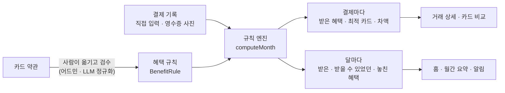
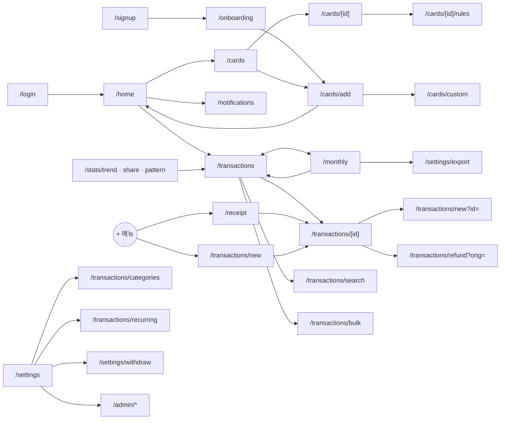
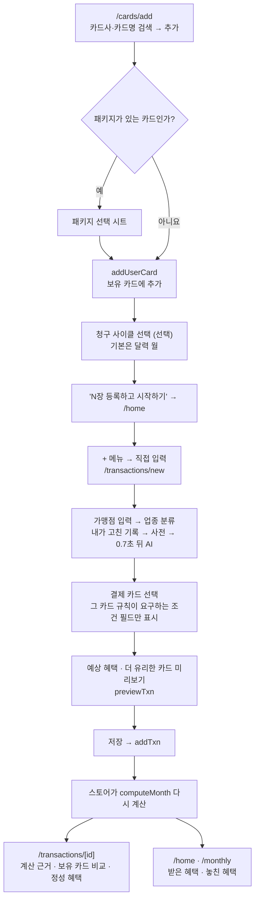
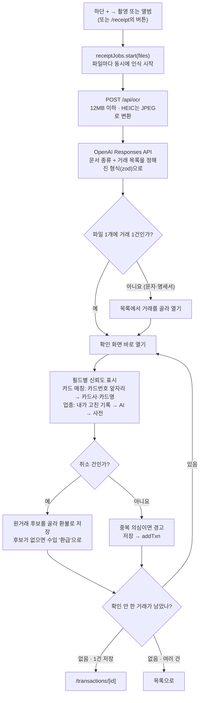
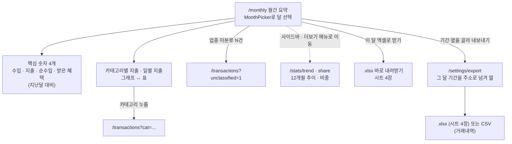
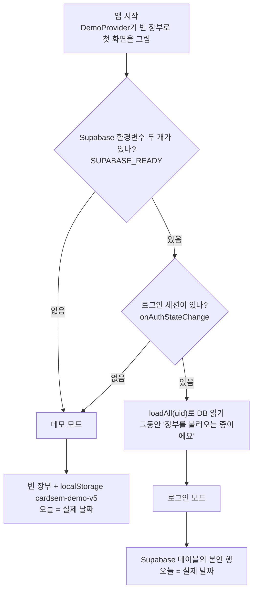

# 01. 서비스 개요와 화면 지도

카드셈은 **보유한 카드 전부의 혜택을 결제마다 계산해서, 받은 혜택과 놓친 혜택을 보여 주는 가계부 웹 앱**입니다. 이 문서는 카드셈이 어떤 문제를 풀고, 어떤 화면이 있으며, 화면들이 어떻게 이어지는지를 설명합니다. 기술 선택은 [02. 기술 스택](02-tech-stack.md), 폴더 구조와 데이터 흐름은 [03. 구조와 데이터 흐름](03-architecture.md)에서 이어집니다.

| 항목 | 내용 |
| --- | --- |
| 형태 | 웹 앱. 모바일(하단 탭)과 데스크톱(왼쪽 사이드바) 화면을 함께 지원합니다 |
| 화면 수 | `page.tsx` 35개 (사용자 화면 26 · 어드민 5 · 진입·계정 4) |
| 혜택 금액 계산 | 규칙 엔진 `src/lib/engine/index.ts`. AI(LLM)는 금액을 계산하지 않습니다 |
| AI가 하는 일 | 영수증 읽기, 가맹점 업종 분류, 월간 요약 문장, 정성 혜택 판단, 약관 원문 → 규칙 변환 |
| 데이터 저장 | 로그인 전: 브라우저 저장소(데모 모드). 로그인 후: Supabase DB |

> 용어: **LLM**은 글을 읽고 쓰는 대형 언어 모델(여기서는 OpenAI 모델)입니다. **규칙 엔진**은 약관을 코드로 옮긴 규칙을 정해진 순서대로 적용해 금액을 내는 순수 함수 묶음입니다.

---

## 1. 문제 — 혜택을 다 기억하지 못해 아무 카드나 씁니다

카드마다 혜택 조건이 다릅니다. 테스트용 고정 장부(2·7장)의 카드 3장만 봐도 이렇습니다(`src/lib/data/cards.ts`).

| 카드 | 대표 혜택 | 조건 |
| --- | --- | --- |
| 신한 Mr.Life | 주말 3대 할인마트 10% · 밤 시간(21:00~09:00) 택시·식음료 10% · 공과금 10% | 전월 실적 30만 원 이상부터, 실적 구간별 월 한도 |
| 신한 Point Plan | 일상 생활비 적립 0.5~3%(결제 한 건의 금액 구간별) · 주말 음식점 1천 포인트 | 전월 실적 구간별 통합 한도, 일·월 횟수 제한 |
| 현대 ZERO Edition3 (포인트형) | 국내외 가맹점 1.2% 적립 | 실적·한도 없음 |

결제할 때마다 "지금 몇 시인지, 주말인지, 이번 달 한도가 남았는지, 전월 실적이 어느 구간인지"를 따져 카드를 고르기는 어렵습니다. 그래서 손에 잡히는 카드로 결제하고, 더 받을 수 있던 혜택을 모른 채 지나갑니다. 카드사 앱은 자기 카드만 보여 주므로 카드끼리 비교해 주지도 않습니다(온보딩 화면 문구).

테스트용 고정 장부(`src/lib/data/fixtures.ts`)에 실제로 이런 결제가 있습니다.

> 9월 3일 오전 8시 42분, 스타벅스 6,100원을 **Point Plan**으로 결제 → 0.5% 적립 **30원**.
> 같은 결제를 **Mr.Life**로 했다면 밤 시간 식음료 10% 할인으로 **610원**. 이 결제에서 **580원**을 놓쳤습니다.

(엔진 `computeMonth`로 직접 계산해 확인한 값입니다. 혜택 금액은 화면에서도 항상 "참고값"으로 표시합니다.)

## 2. 페르소나 — 데모 사용자

데모 모드에서 화면에 보이는 이름은 **데모 사용자**입니다(`src/lib/store.tsx`의 `DEMO_USER = { name: "데모 사용자" }`). 데모 장부는 비어 있는 상태로 시작하므로([7장](#7-데모-데이터)), 아래 카드·거래는 데모 화면에 보이는 데이터가 아닙니다. 테스트가 계산 결과를 고정하는 **테스트용 고정 장부**(`src/lib/data/fixtures.ts`)의 내용이고, 이 문서들의 예시 숫자도 모두 이 장부에서 나옵니다.

| 항목 | 값 | 코드 |
| --- | --- | --- |
| 보유 카드 | 신한 Mr.Life(청구 사이클 10일), 신한 Point Plan, 현대 ZERO Edition3 (포인트형) | `SEED_USER_CARDS` |
| 수입 | 매월 10일 급여 2,400,000원 (계좌이체) | 거래 `i000`~`i002`, 반복 규칙 `rc_salary` |
| 고정 지출 | 넷플릭스 매월 1일 17,000원(ZERO), SKT 통신요금 매월 10일 65,000원(Mr.Life) | `SEED_RECURRING` |
| 예산 | 총 150만 원 · 식비 50만 · 카페 5만 · 교통 34만 · 쇼핑 40만 · 구독 7만 | `SEED_BUDGETS` |
| 자주 쓰는 곳 | 스타벅스 강남역점, 이마트 역삼점, CU 역삼점, 주유소(SK에너지·GS칼텍스), 배달앱, 카카오T 택시 | `fixtures.ts`의 거래 행 |

카드 3장을 쓰지만 결제마다 유리한 카드를 고르지는 않는 사용자입니다. 고정 장부의 9월 한 달 동안 받은 혜택은 18,468원이고, 보유 카드를 결제마다 잘 골랐다면 21,713원까지 받을 수 있었습니다(놓친 혜택 3,245원. 월 한도 배분을 근사로 계산한 값입니다). 다른 카드가 더 유리했던 결제는 8건이고, 결제 1건씩 비교한 차액을 더하면 2,981원입니다. 두 숫자는 계산 방식이 달라 서로 맞지 않습니다([04](04-benefit-engine.md)).

## 3. 카드셈의 해결 방식

1. **약관을 계산할 수 있는 규칙으로 옮겨 둡니다.** 카드 상품 카탈로그(`CARDS`, 7종)의 규칙 하나하나가 대상 업종·가맹점·요일·시간대·실적 구간·한도를 담습니다. 규칙의 모양은 [04. 혜택 계산 엔진](04-benefit-engine.md)에서 설명합니다.
2. **결제 한 건마다 보유 카드 전부로 계산합니다.** 실제로 쓴 카드의 혜택과, 다른 보유 카드였다면 받았을 혜택을 함께 냅니다. 그래서 "이 결제엔 ○○ 카드가 최적이었어요"를 말할 수 있습니다.
3. **달 단위로 받은 혜택과 놓친 혜택을 합칩니다.** 월 한도를 여러 결제가 나눠 쓰는 것까지 고려합니다.
4. **기록하는 수고를 줄입니다.** 영수증·결제 문자·카드 명세서 사진을 AI가 읽어 거래로 바꾸고, 가맹점 이름으로 업종을 자동 분류합니다([05. 영수증 인식과 AI](05-receipt-ai.md)).
5. **가계부 기능을 함께 둡니다.** 카테고리, 예산, 월간 요약, 통계, 엑셀 내보내기가 같은 집계 함수를 씁니다([08. 월간 요약 · 통계 · 엑셀 내보내기](08-reports-stats-export.md)).

원칙 두 가지를 지킵니다.

- **금액은 규칙 엔진만 계산합니다.** AI는 읽기·분류·요약·판단만 맡습니다.
- **혜택 금액은 참고값입니다.** 실제 카드사 청구 할인액과 다를 수 있어 화면마다 그렇게 적습니다.

## 4. 핵심 기능

괄호 안은 해당 화면 코드 주석에 적힌 요구사항 ID입니다.

| 영역 | 기능 | 화면 |
| --- | --- | --- |
| 카드 | 카탈로그에서 보유 카드 등록·해제, 패키지 선택, 청구 사이클, 카드번호 앞 6자리, 전월 실적 보정 | `/cards`, `/cards/add`, `/cards/[id]` |
| 카드 | 목록에 없는 카드 직접 추가 (CARD-02) | `/cards/custom` |
| 거래 기록 | 지출·수입 입력, 외화(KRW·USD·JPY), 할부·무이자, 카드가 요구하는 조건 필드(결제 시각·자동납부·간편결제·결제 경로·주유량) (TRX-02) | `/transactions/new` |
| 거래 기록 | 가맹점 → 업종 자동 분류: 내가 고친 기록 → 가맹점 사전 → AI (TRX-03) | `/transactions/new`, `/transactions/[id]` |
| 거래 기록 | 영수증·결제 문자·명세서 인식 (RCP-01~06) | `/receipt`, 하단 + 메뉴 |
| 거래 기록 | 취소·부분 환불 (TRX-11), 반복 거래 (TRX-09), 검색 (TRX-12), 일괄 편집, 카테고리 관리 (TRX-13) | `/transactions/*` |
| 혜택 | 결제별 계산 근거, 보유 카드 비교, "입력하면 최대 N원" 안내 | `/transactions/[id]`, `/transactions/new` |
| 혜택 | 받은·받을 수 있었던·놓친 혜택과 달성률 (BNF-03) | `/home`, `/monthly` |
| 혜택 | 라운지·바우처처럼 금액으로 셈하지 않는 정성 혜택 판단 | `/transactions/[id]` ([06](06-perks-jev.md)) |
| 가계부 | 홈 대시보드, 월간 요약 (RPT-06), 통계 2종 (RPT-07~08) | `/home`, `/monthly`, `/stats/*` |
| 가계부 | 앱 안 알림 (RPT-10), AI 인사이트 (RPT-03), 엑셀 내보내기 (RPT-04) | `/notifications`, `/home`·`/monthly`, `/settings/export` |
| 계정 | 이메일 로그인·가입·비밀번호 재설정 (ACC-01), 회원 탈퇴 (ACC-02), 로그인 없는 데모 모드 | `/login`, `/signup`, `/settings/withdraw` |
| 어드민 | 혜택 원문 입력 → LLM 정규화 → 검수 → 반영 (DAT-01·02·05) | `/admin/*` |

---

## 5. 화면 지도

### 5.1 주소와 파일의 관계

Next.js는 `src/app` 아래 폴더 구조가 곧 주소(라우트)입니다. 폴더 안의 `page.tsx` 하나가 화면 하나입니다.

- `(app)`처럼 **괄호로 감싼 폴더는 주소에 나타나지 않는 묶음**(라우트 그룹)입니다. `src/app/(app)/cards/page.tsx`의 주소는 `/cards`입니다.
- `[id]`처럼 **대괄호 폴더는 주소의 값이 들어가는 자리**입니다. `/cards/shinhan_mrlife`는 `src/app/(app)/cards/[id]/page.tsx`가 그립니다.
- `(app)`과 `admin`의 `layout.tsx`는 화면을 `AppShell`(사이드바·로딩 화면·동기화 알림 틀, `src/components/shell.tsx`)로 감쌉니다. `/login`, `/signup`, `/onboarding`은 이 틀 밖에 있습니다.
- 모바일 하단 탭(`BottomNav`)은 `AppShell`이 아니라 각 화면이 `<Screen nav>`로 켤 때만 나옵니다. 켠 화면은 홈·내역·월간 요약·내 카드·통계·설정 6곳입니다. 거래 상세 같은 하위 화면에는 하단 탭이 없고, 어드민은 하단 탭 대신 위쪽 메뉴 칩 줄(`AdminTabs`)을 씁니다.
- `/`(서버에서 `redirect`만 함)를 빼면 모든 화면이 클라이언트 컴포넌트(브라우저에서 그려지는 컴포넌트)이고, 데이터는 `src/lib/store.tsx`의 `useStore()`에서 꺼냅니다. 자세한 흐름은 [03](03-architecture.md)에 있습니다.

### 5.2 메뉴

| 어디에 | 무엇이 있나 |
| --- | --- |
| 데스크톱 사이드바 (폭 768px 이상) | 홈 · 거래 내역 · 월간 요약 / **카드·혜택**: 내 카드 / **분석**: 통계 · 엑셀 내보내기 / 아래쪽: 어드민 · 설정 · 사용자 이름 |
| 모바일 하단 탭 (`<Screen nav>`를 켠 화면에만) | 홈 · 내역 · **+** · 카드 · 더보기 |
| + 메뉴 (`AddMenu`) | 촬영 · 앨범(영수증·문자·PDF) → `/receipt`, 직접 입력 → `/transactions/new` |
| 더보기 시트 | 월간 요약 · 통계 · 엑셀 내보내기 · 알림 · 설정 |
| 데스크톱 머리글 버튼 | 홈: 영수증 등록 · 거래 추가 / 거래 내역: 엑셀 내보내기 · 거래 추가 (+ 메뉴는 모바일에만 있습니다) |
| 내역·월간 요약 위쪽 | 두 화면을 오가는 전환 막대 (`ViewSwitch`) |
| 화면 제목 자리의 달 이동 (`MonthPicker`) | 스토어의 "선택한 달"(`month`)을 바꿉니다. 달을 다루는 화면(홈·내역·월간 요약·통계·일괄 편집 등)이 이 값을 함께 씁니다. 알림은 오늘이 속한 달, 검색·환불은 전체 기간을 봅니다 |

어드민 링크는 데모 모드에서는 누구에게나, 로그인 모드에서는 관리자(`app_metadata.role = "admin"`)에게만 보입니다.

### 5.3 전체 화면 목록 (35개)

#### 진입 · 계정

| 경로 | 화면 이름 | 하는 일 | 관련 문서 |
| --- | --- | --- | --- |
| `/` | 시작 | 바로 `/home`으로 보냅니다 (`redirect`) | [03](03-architecture.md) |
| `/login` | 로그인 (ACC-01) | 이메일·비밀번호 로그인, 비밀번호 재설정 메일, "로그인 없이 데모 보기". Supabase 환경변수가 없으면 로그인 대신 데모로 보라고 안내합니다 | [03](03-architecture.md), [10](10-development.md) |
| `/signup` | 회원가입 | 이름·이메일·비밀번호와 약관 동의. 세션이 바로 생기면 `/onboarding`, 이메일 확인이 필요하면 "메일을 확인해주세요" | [03](03-architecture.md), [10](10-development.md) |
| `/welcome` | 소셜 가입 절차 | 카카오 로그인 뒤 돌아오는 화면. 1 닉네임(2~12자, 필수, 카카오 닉네임이 기본값) → 2 쓰는 카드 고르기(건너뛰기 가능) → 홈. 닉네임은 `user_metadata.nickname`에 저장하고, 이미 있으면 바로 홈으로 갑니다. 닉네임 없이 나갔다 온 카카오 사용자는 `AppShell`이 이 화면으로 돌려보냅니다 | [10](10-development.md) 4.3.1 |
| `/onboarding` | 온보딩 | 1 소개 → 2 총예산 정하기 → 3 카드 등록(`/cards/add`로 이동) | [08](08-reports-stats-export.md) |

#### 홈 · 거래

| 경로 | 화면 이름 | 하는 일 | 관련 문서 |
| --- | --- | --- | --- |
| `/home` | 홈 | 이번 달 지출·수입·받은 혜택·놓친 혜택 타일, 카드별 실적·한도, 놓친 혜택이 큰 결제 3건, AI 인사이트, 최근 거래 4건 | [04](04-benefit-engine.md), [08](08-reports-stats-export.md) |
| `/transactions` | 거래 내역 | 선택한 달의 거래를 날짜별로 묶어 보여 줍니다. 구분·카드·카테고리·결제수단·업종 미분류·검색어로 거르고 지출·혜택·놓침 합계를 냅니다. `?cat=`, `?card=`, `?unclassified=1`로 필터를 받습니다 | [03](03-architecture.md), [04](04-benefit-engine.md) |
| `/transactions/new` | 지출·수입 등록, 거래 수정 (TRX-02·03) | 새 거래 입력. `?id=`면 수정, `?type=income`이면 수입. 업종 자동 분류, 카드가 요구하는 조건 필드만 표시, 예상 혜택과 더 유리한 카드 미리보기, 외화·할부 | [04](04-benefit-engine.md), [05](05-receipt-ai.md) |
| `/transactions/[id]` | 거래 상세 | 계산 근거(적용 규칙과 공식), 조건 미입력 안내, 보유 카드 비교, 정성 혜택 판단, 업종 바로 고치기, 원거래·환불 연결, 수정·삭제 | [04](04-benefit-engine.md), [06](06-perks-jev.md) |
| `/transactions/refund` | 환불 기록 (TRX-11) | 원거래를 골라 전체 취소·부분 환불을 기록하고, 혜택·실적이 어떻게 바뀌는지 미리 보여 줍니다. `?orig=`로 원거래를 지정합니다 | [04](04-benefit-engine.md), [08](08-reports-stats-export.md) |
| `/transactions/bulk` | 일괄 편집 | 선택한 달 거래를 여러 건 골라 카테고리를 바꾸거나 삭제합니다 | [03](03-architecture.md) |
| `/transactions/search` | 거래 검색 (TRX-12) | 전체 기간에서 가맹점·메모·품목을 찾고 순지출 합계를 보여 줍니다 | [03](03-architecture.md) |
| `/transactions/categories` | 카테고리 관리 (TRX-13) | 지출·수입 카테고리(상위·하위 2단계)의 추가·이름 변경·순서·삭제. 지운 카테고리의 거래는 '기타'로 옮깁니다 | [07](07-data-model.md) |
| `/transactions/recurring` | 반복 거래 (TRX-09) | 매월·매주 반복 규칙의 등록·수정·삭제. 지난 회차를 거래로 자동 생성합니다 | [03](03-architecture.md), [07](07-data-model.md) |
| `/receipt` | 영수증·문자·명세서로 등록 (RCP-01~06) | 이미지·PDF 여러 개 → AI 인식 → 파일별 진행 상황 → 거래 1건씩 확인·저장 | [05](05-receipt-ai.md) |
| `/notifications` | 알림 (RPT-10) | 오늘이 속한 달 기준으로 실적 구간 임박(다음 구간의 90% 이상), 놓친 혜택이 큰 결제(1,000원 이상, 상위 3건)를 보여 줍니다. 알림은 저장하지 않고 매번 계산합니다(`src/lib/notify.ts`) | [04](04-benefit-engine.md), [08](08-reports-stats-export.md) |

#### 카드 · 혜택

| 경로 | 화면 이름 | 하는 일 | 관련 문서 |
| --- | --- | --- | --- |
| `/cards` | 내 카드 | 보유 카드마다 전월 실적 구간, 지금 쌓고 있는 실적 창의 진행 막대, 규칙별 남은 한도 | [04](04-benefit-engine.md) |
| `/cards/add` | 보유 카드 등록 | 카탈로그 검색·추가·해제, 패키지 선택(삼성 taptap O), 청구 사이클 선택, "N장 등록하고 시작하기" → 홈 | [04](04-benefit-engine.md) |
| `/cards/[id]` | 카드 상세 | 실적과 구간, 실적 보정, 업종별 결제, 최근 6개월 받은 혜택, 혜택 한도, 규칙 요약·패키지 변경, 정성 혜택, 카드번호 앞 6자리, 청구 사이클, 등록 해제 | [04](04-benefit-engine.md), [06](06-perks-jev.md) |
| `/cards/[id]/rules` | 혜택 규칙 | 그 카드의 규칙 전체를 종류별로 거르고 대상·지급·한도·조건·약관 원문을 보여 줍니다 | [04](04-benefit-engine.md) |
| `/cards/custom` | 카드 직접 추가 (CARD-02) | 목록에 없는 카드를 "전 가맹점 정률 혜택 1개 + 월 한도 + 전월 실적 조건"으로 추가합니다 | [04](04-benefit-engine.md), [07](07-data-model.md) |

#### 분석

| 경로 | 화면 이름 | 하는 일 | 관련 문서 |
| --- | --- | --- | --- |
| `/monthly` | 월간 요약 (RPT-06) | 수입·지출·순수입·받은 혜택과 지난달 대비, 카테고리별·일별·결제수단·카드별 지출, AI 인사이트, "이 달 엑셀로 받기" | [08](08-reports-stats-export.md) |
| `/stats/trend` | 통계 · 추이 (RPT-07) | 선택한 달까지 12개월의 수입·지출, 카테고리 추이 | [08](08-reports-stats-export.md) |
| `/stats/share` | 통계 · 비중 (RPT-08) | 카테고리·카드·결제수단별 지출 비중 | [08](08-reports-stats-export.md) |
| `/settings/export` | 엑셀 내보내기 (RPT-04) | 기간·열을 골라 `.xlsx`(시트 4장) 또는 CSV로 내려받습니다. 파일은 브라우저에서 만듭니다 | [08](08-reports-stats-export.md) |

통계 두 화면은 `src/app/(app)/stats/layout.tsx`가 제목과 탭(추이·비중)을 함께 그립니다. `/stats` 자체에는 `page.tsx`가 없어서, 메뉴는 `/stats/trend`로 연결합니다.

#### 설정

| 경로 | 화면 이름 | 하는 일 | 관련 문서 |
| --- | --- | --- | --- |
| `/settings` | 설정 | 계정 표시, 카드·카테고리·반복 거래·예산·알림·엑셀 내보내기 바로가기, 어드민(데모 또는 관리자), 데모 데이터 초기화(데모만), 로그인·로그아웃, 회원 탈퇴 | [03](03-architecture.md) |
| `/settings/withdraw` | 회원 탈퇴 (ACC-02) | 지워질 데이터 개수를 보여 주고 동의를 받습니다. 로그인 모드는 DB의 본인 장부를 지운 뒤 로그아웃, 데모 모드는 데모 장부를 빈 장부로 비웁니다(공용 데모 계정이면 서버 장부) | [07](07-data-model.md) |

#### 어드민

| 경로 | 화면 이름 | 하는 일 | 관련 문서 |
| --- | --- | --- | --- |
| `/admin` | (카드 상품으로 이동) | 현황 대시보드는 2026-10-12에 뺐습니다 | |
| `/admin/cards` | 카드 상품 | 카드 목록(카드사·규칙 수·확인일). 줄의 "보기"로 그 카드의 규칙 화면 | [04](04-benefit-engine.md) |
| `/admin/input` | 카드 원문 입력 (DAT-01·02) | 카드사 페이지의 혜택 원문을 붙여 넣고 "AI로 규칙 만들기" → 검수 없이 바로 카드로 반영하고 카드 규칙 화면으로. 구조 등급은 묻지 않고 규칙 모양으로 정합니다(`gradeOf`) | [05](05-receipt-ai.md), [04](04-benefit-engine.md) |
| `/admin/rules` | 카드 규칙 (DAT-05) | 규칙마다 펼쳐서 조건·한도·원문·규칙 JSON 전체를 봅니다. 원문 입력으로 반영한 카드는 "카드 삭제" | [04](04-benefit-engine.md) |

### 5.4 화면이 부르는 서버 API

화면은 대부분 브라우저 안에서 계산합니다. 이 앱의 서버(Next.js Route Handler, `src/app/api/*/route.ts`)를 부르는 곳은 AI 기능 다섯 군데와 공용 데모 계정 로그인(`/api/demo`)뿐입니다. AI 라우트는 모두 OpenAI API를 씁니다. 로그인 모드의 DB 읽기·쓰기와 로그인 자체는 브라우저가 Supabase에 직접 보냅니다.

| API | 하는 일 | 부르는 화면 | 관련 문서 |
| --- | --- | --- | --- |
| `POST /api/ocr` | 영수증·문자·명세서 파일 → 거래 목록 | `/receipt`, 하단 + 메뉴 | [05](05-receipt-ai.md) |
| `POST /api/classify` | 가맹점 이름 → 업종 (사전에 있으면 사전, 없으면 LLM) | `/transactions/new` | [05](05-receipt-ai.md) |
| `POST /api/insight` | 집계값만 받아 요약 문장 생성 | `/home`, `/monthly` | [05](05-receipt-ai.md) |
| `POST /api/judge` | 결제 한 건과 카드의 정성 혜택 → 받을 수 있는지, 돈인지 | `/transactions/[id]` | [06](06-perks-jev.md) |
| `POST /api/demo` | 서버 환경변수의 공용 데모 계정으로 로그인해 세션 토큰만 돌려줌 (비밀번호는 브라우저에 안 감) | 로그인하지 않은 모든 화면 (스토어가 자동으로) | [03](03-architecture.md) 3.3 |
| `POST /api/normalize` | 약관 원문 → 혜택 규칙 JSON. Supabase 환경변수가 설정된 배포에서는 로그인한 관리자만 부를 수 있습니다(데모 모드여도 403. `/admin/input`은 버튼을 막고 안내합니다). 환경변수가 없을 때만 누구나 부를 수 있습니다 | `/admin/input` | [05](05-receipt-ai.md) |

### 5.5 화면 연결

---

## 6. 대표 사용자 흐름

### 6.1 카드 등록 → 결제 기록 → 혜택 확인

1. **카드 등록** — `/cards/add`에서 카드를 추가하면 `addUserCard`가 보유 카드 목록(`userCards`)에 넣습니다. 삼성 taptap O처럼 패키지를 고르는 카드는 시트에서 패키지를 먼저 고릅니다. 청구 사이클을 정하면 전월 실적을 "지난달 1일~말일" 대신 "지난달 N일~이번 달 N−1일"로 셉니다([용어집](glossary.md)의 실적 창).
2. **결제 기록** — `/transactions/new`에서 가맹점을 입력하면 `resolveIndustry`가 업종(혜택 매칭에 쓰는 분류, 28종)을 정합니다. 결제 카드를 고르면 엔진의 `requiredFields`가 그 카드 규칙에 필요한 조건 필드만 보여 줍니다. 오른쪽 미리보기는 `previewTxn`으로 예상 혜택과 더 유리한 카드를 계산합니다.
3. **혜택 확인** — 저장하면 스토어의 거래 배열이 바뀌고, 엔진(`computeMonth`)이 그 달을 다시 계산합니다. 저장 직후 이동하는 거래 상세에서 적용된 규칙과 계산식을 봅니다.

테스트용 고정 장부의 실제 결과 예시입니다(엔진으로 확인).

| 결제 | 결제 카드 | 결과 |
| --- | --- | --- |
| 9/15(화) 23:55 카카오T 택시 12,500원 | Mr.Life | Night 택시 10%, 대상 금액 1만 원까지 → **1,000원**. 보유 카드 중 최적 |
| 9/5(토) 이마트 역삼점 84,000원 | Mr.Life | 주말 마트 10%, 대상 금액 5만 원까지 → 5,000원이지만 월 한도 3,000원(30~50만 원 구간)에 걸려 **3,000원** |
| 9/20 스타벅스 강남역점 6,100원 (결제 시각 없음) | Mr.Life | **0원**. 카드 비교 메모: "결제 시각 입력 시 최대 610원" |

### 6.2 영수증으로 기록

1. **파일 고르기** — 하단 + 메뉴의 촬영·앨범(`AddMenu`)이나 `/receipt`의 버튼으로 이미지·PDF를 여러 개 고릅니다. 작업 목록은 `src/lib/ai/receipt-jobs.ts`의 모듈 변수에 있어서 다른 화면에 다녀와도 남고, 새로고침하면 사라집니다.
2. **인식** — `/api/ocr`이 파일을 OpenAI 모델에 보내고, 구조화 출력(응답을 정해진 JSON 형식으로 받는 기능)으로 가맹점·날짜·시각·금액·품목·카드사·카드번호 앞자리·취소 여부를 받습니다. 원본 이미지는 저장하지 않습니다.
3. **확인** — 모델이 확신하지 못한 필드는 "신뢰도 낮음", 추론한 필드는 "추론"으로 표시됩니다. 결제 카드는 `matchCard`가 카드번호 앞자리(BIN, [용어집](glossary.md))를 등록한 카드와 먼저 맞춰 보고, 없으면 카드사·카드명으로 추정합니다.
4. **저장** — 사용자가 확인한 값만 `addTxn`으로 거래가 됩니다. 이후는 6.1의 3단계와 같습니다.

프롬프트와 판단 규칙은 [05. 영수증 인식과 AI](05-receipt-ai.md)에서 자세히 다룹니다.

### 6.3 월말 요약 · 통계 · 엑셀

1. **월간 요약** — `/monthly`는 `monthSummary`(`src/lib/stats.ts`)로 그 달 숫자를 만들고, 받은 혜택은 엔진 결과(`calc.received`)를 씁니다. 카테고리를 누르면 그 카테고리의 거래 내역으로 갑니다.
2. **통계** — `/stats/*`는 추이·비중을 보여 줍니다. 받은·놓친 혜택은 홈과 월간 요약의 "결제수단·카드별" 표에서 봅니다.
3. **엑셀** — "이 달 엑셀로 받기"는 그 달 전체를 바로 `.xlsx`로 내려받습니다. `/settings/export`에서는 기간과 열을 고를 수 있고, 시트는 거래내역 · 월별 요약 · 카테고리별 지출 · 카드별 혜택 4장입니다. CSV는 거래내역 시트만 담습니다. 파일은 `buildExport`(`src/lib/export.ts`)와 `buildXlsx`(`src/lib/xlsx.ts`)로 브라우저에서 만들어 서버로 거래를 보내지 않습니다.

화면 숫자와 파일 숫자가 같은 함수에서 나오므로 항상 같습니다. 집계 규칙(환불을 어느 달에 넣는지 등)은 [08](08-reports-stats-export.md)에 있습니다.

---

## 7. 데모 데이터

로그인하지 않으면 **빈 장부**로 시작합니다. 기본 카테고리 27개(`DEFAULT_CATEGORIES`, `src/lib/data/merchants.ts`)와 총예산 150만 원만 있고, 거래·카드·반복 거래는 없습니다(`src/lib/store.tsx`의 `seed()`). 로그인 계정의 첫 장부(`db.ts`의 `loadAll`)와 같은 상태입니다. "오늘"은 실제 오늘이고, 처음 보이는 달은 오늘이 속한 달입니다.

미리 채워 둔 예시 데이터는 앱에 없습니다. 대신 테스트가 쓰는 **테스트용 고정 장부** `src/lib/data/fixtures.ts`가 있습니다. 앱(데모 포함)은 이 파일을 불러오지 않고, 엔진·리포트·알림·카드 통계·거래 규칙 테스트만 `SEED_TXNS`·`SEED_USER_CARDS`·`SEED_BUDGETS`·`TODAY`를 가져다 씁니다. 7.1~7.4절은 이 고정 장부의 내용이고, 문서 곳곳의 예시 숫자가 여기서 나옵니다.

### 7.1 기준 날짜와 기간 (테스트용 고정 장부)

| 항목 | 값 |
| --- | --- |
| 기준일 (`TODAY`) | **2026-09-20**. 테스트에서만 쓰는 고정 날짜입니다. 앱은 데모도 실제 오늘을 씁니다 |
| 주로 보는 달 | 2026년 9월 |
| 거래 기간 | 2026-07-10 ~ 2026-09-20 |
| 카드 | 신한 Mr.Life(청구 사이클 10일), 신한 Point Plan, 현대 ZERO Edition3 (포인트형). 세 장 모두 `addedAt` 2026-08-01 |
| 카드 카탈로그 | 7종 (`CARDS`). 보유 3장 외에 삼성 taptap O, 롯데 LOCA LIKIT 2.0, 우리 카드의정석2 SUPER, 신한 Simple Plan+ |

### 7.2 거래 49건

| 달 | 카드 결제 | 수입 | 현금 | 환불 | 합계 |
| --- | --- | --- | --- | --- | --- |
| 2026-07 | 4 | 1 | - | - | 5 |
| 2026-08 | 18 | 1 | - | - | 19 |
| 2026-09 | 22 | 1 | 1 | 1 | 25 |
| **합계** | **44** | **3** | **1** | **1** | **49** |

- 카드 결제 44건은 `rows` 배열에서 만들고 id는 `t001`~`t044`입니다. 업종은 가맹점 사전(`classifyMerchant`)으로, 카테고리는 업종 기본값으로 채웁니다. 결제수단은 모두 신용카드입니다.
- 나머지 5건: 급여 `i000`~`i002`(7·8·9월 10일), 현금 `c001`(9/4 김밥천국 8,500원), 부분 환불 `r001`(9/19 무신사 29,000원. 9/12 무신사 89,000원 결제에 연결).
- 반복 규칙 3개(넷플릭스·급여·SKT, `SEED_RECURRING`)는 마지막 생성일이 9/1·9/10이라, `TODAY` 기준으로는 새로 생기는 거래가 없습니다(다음 회차가 모두 `TODAY` 뒤).
- 그 밖에 예산 6개(`SEED_BUDGETS`)가 있고, 카테고리는 기본 카테고리 27개를 씁니다.

### 7.3 왜 7월 후반부터인가

고정 장부의 주인공 달은 **9월**입니다. 7월 후반과 8월 거래는 9월의 전월 실적을 채우려고 넣었습니다(`fixtures.ts` 주석).

| 카드 | 9월 혜택을 정하는 실적 창 | 실적 | 9월 적용 구간 |
| --- | --- | --- | --- |
| Mr.Life (사이클 10일) | 7/10 ~ 8/9 | 404,200원 | 30만 이상 50만 미만 |
| Point Plan | 8월 | 524,500원 | 40만 이상 80만 미만 |
| ZERO Edition3 | 8월 | 106,000원 | 구간이 하나뿐 (실적 조건 없음) |

그래서 이 장부로 8월을 계산하면 두 카드의 전월 실적이 0원이라 가장 낮은 구간(Mr.Life "30만원 미만", Point Plan "40만원 미만")으로 계산되어 받은 혜택이 3,272원으로 적게 나옵니다. 8월 혜택을 정하는 실적 창(Mr.Life 6/10~7/9, Point Plan 7월)에 그 카드로 결제한 거래가 고정 장부에 없기 때문입니다.

### 7.4 9월 숫자

고정 장부를 그대로 넣었을 때 9월 화면에 나올 숫자입니다(`monthSummary`·`computeMonth`·`deriveNotifications`로 계산해 확인).

| 항목 | 값 |
| --- | --- |
| 수입 · 지출 · 순수입 | 2,400,000원 · 696,100원 · 1,703,900원 |
| 받은 혜택 · 받을 수 있었던 혜택 · 놓친 혜택 | 18,468원 · 21,713원 · 3,245원 (한도 배분 근사) |
| 다른 카드가 더 유리했던 결제 | 8건, 결제별 차액 합 2,981원 (`missedTop`. 위 3,245원과 계산 방식이 다릅니다) |
| 예산 사용률 | 총 46% · 식비 59% · 카페 55% · 교통 37% · 쇼핑 30% · 구독 24% (모두 80% 미만) |
| 알림 | 1건: "한국전력 전기요금 결제에서 혜택 1,000원을 놓쳤어요" (9/10, 더 유리한 카드 Mr.Life) |
| 카드 실적 진행 | Mr.Life "9/10~10/9 실적 · 11월 구간용" 128,200원 / Point Plan "9월 실적 · 10월 구간용" 269,100원 / ZERO "조건 없음" |

고정 장부에는 엔진의 여러 경우를 보여 주려는 결제가 들어 있고, 의도는 `fixtures.ts`의 행 주석에 적혀 있습니다. 엔진으로 확인한 9월 결과 몇 가지입니다.

| 결제 | 보여 주는 것 | 결과 |
| --- | --- | --- |
| 9/6(일) 을지로 골목집 48,000원 · Point Plan | 두 규칙이 함께 적용(중복 허용) | 일상 적립 336원 + 주말 음식점 1,000원 = 1,336원 |
| 9/10 한국전력 전기요금 52,000원 · Point Plan · 자동납부 | 2만 원당 1천 포인트 | 2,000원. 일상 적립은 제외 업종(전기요금)이라 빠짐 |
| 9/12 무신사 89,000원 · ZERO · 3개월 무이자 할부 | 할부는 총액으로 계산, 부분 환불 반영 | 9/19 부분 환불 29,000원을 뺀 60,000원 × 1.2% = 720원 |

결제 시각을 넣지 않은 결제(9/20 스타벅스)는 6.1절 표에 있습니다. 현금 결제(9/4 김밥천국)는 혜택 계산 대상이 아닌 경우를 보여 줍니다.

### 7.5 되돌리기

데모 데이터는 공용 데모 계정(`NEXT_PUBLIC_DEMO_EMAIL`)이 설정돼 있으면 Supabase에, 아니면 이 브라우저의 localStorage(브라우저가 사이트별로 주는 작은 저장 공간) 키 `cardsem-demo-v5`에 저장됩니다. **설정 → 데모 데이터 초기화**(`reset`)를 누르면 이 키와 데모 알림 읽음 기록을 지우고 빈 장부로 돌아갑니다. 공용 데모 계정이면 서버의 장부를 모두 지운 뒤(`deleteAllMine`) 기본 카테고리와 총예산 150만 원만 다시 넣으므로, 모든 방문자의 데모 장부가 함께 비워집니다. 데모의 시작 장부를 바꾸면 `store.tsx`의 `KEY` 버전을 올려 예전 저장본을 무시하게 합니다(v5에서 예시 데이터를 뺐습니다).

---

## 8. 데모 모드와 로그인 모드

카드셈은 **로그인 없이도 동작**합니다(어드민의 LLM 정규화는 예외일 수 있습니다. 아래 표의 어드민 행). 데이터를 어디서 읽고 어디에 쓰는지는 스토어(`src/lib/store.tsx`의 `DemoProvider`)만 바꿉니다. 화면 쪽에서 `me`로 나뉘는 곳은 설정·탈퇴 화면의 메뉴와 문구, 어드민 링크·원문 입력의 관리자 확인, 알림 읽음 기록 정도입니다. 모드 전환 과정과 브라우저 저장소 키 전체는 [03. 구조와 데이터 흐름 3.3~3.4절](03-architecture.md#33-데모-모드와-로그인-모드)에 있습니다.

`SUPABASE_READY`는 `.env.local`에 `NEXT_PUBLIC_SUPABASE_URL`과 `NEXT_PUBLIC_SUPABASE_ANON_KEY`가 **둘 다** 있을 때만 참입니다(`src/lib/supabase.ts`). 로그인 상태는 스토어의 `me`로 구분합니다. `me`가 `null`이면 데모 모드입니다.

| | 데모 모드 | 로그인 모드 |
| --- | --- | --- |
| 언제 | Supabase 환경변수가 없거나, 있어도 로그인하지 않았을 때 | 이메일로 로그인했을 때 (`/login`, `/signup`) |
| 사용자 | 데모 사용자 (`DEMO_USER`) | 가입할 때 넣은 이름 (없으면 이메일 앞부분) |
| 데이터 위치 | 공용 데모 계정이 설정돼 있으면 그 계정의 Supabase 행(모든 방문자가 함께 씀). 아니면 이 브라우저의 localStorage `cardsem-demo-v5` | Supabase(인증·DB 서비스) 테이블. RLS(행 단위 권한)로 본인 행만 읽고 씁니다 |
| 처음 데이터 | 빈 장부: 기본 카테고리 27개 + 총예산 150만 원. 거래·카드 없음 | 첫 로그인에 카테고리가 0개면 기본 카테고리 27개와 총예산 150만 원을 넣습니다(`loadAll`) |
| "오늘" | 실제 로컬 날짜 | 실제 로컬 날짜 |
| 처음 보이는 달 | 오늘이 속한 달 | 오늘이 속한 달 |
| 저장 방식 | 상태가 바뀔 때마다 localStorage에 통째로 저장 | 화면을 먼저 바꾸고(낙관적 업데이트) 같은 변경을 DB에 순서대로 보냅니다. 실패하면 화면 아래에 "서버와 맞추지 못했어요" 알림을 띄우고 DB 상태로 다시 읽습니다 |
| 읽는 동안 | 환경변수가 없으면 없음. 있으면 세션을 확인하는 동안 잠깐 로딩 화면 | `AppShell`이 전체 화면 로딩만 보여 줍니다(데모 장부가 잠깐 비치지 않게) |
| 반복 거래 회차 생성 | 실제 오늘 기준 | 실제 오늘 기준 |
| 어드민 | 누구나 열 수 있음 (시연용). 단, Supabase 환경변수가 있는 배포에서는 "LLM 정규화 실행"이 막힙니다(`/api/normalize`가 관리자 토큰만 받음) | 관리자(`app_metadata.role = "admin"`)만 |
| 설정의 초기화·탈퇴 | "데모 데이터 초기화"(빈 장부로 비움), 탈퇴 = 데모 장부 비우기(공용 데모 계정이면 서버 장부, 아니면 이 브라우저) | 로그아웃, 탈퇴 = DB의 본인 장부 삭제 후 로그아웃 |

두 모드 모두 이 기기에만 남는 것이 있습니다. 사용자가 고친 가맹점 업종 기억(`cardsem-industry-hints:<사용자 id 또는 demo>`, 계정마다 따로)과 알림 읽음 표시(`cardsem-read-notices:<사용자 id 또는 demo>`)입니다.

AI 기능은 모드와 별개로 서버의 `OPENAI_API_KEY`가 있어야 켜집니다. 키가 없으면 영수증 화면의 파일이 "실패 · OpenAI API 키가 없어요…"로 표시되고, 지출 등록의 AI 업종 분류는 "분류 실패 · 직접 골라주세요"가 됩니다. 다만 업종 분류는 가맹점 사전에 있는 이름이면 키 없이도 됩니다. 홈·월간 요약의 인사이트는 템플릿 문장으로 대신합니다. 정성 혜택이 있는 카드의 거래 상세에서는 정성 혜택 판단이 "판단 실패"로, 어드민 원문 입력의 LLM 정규화는 오류 메시지로 끝납니다. 혜택 계산은 AI와 무관하게 항상 동작합니다. 환경변수 설정은 [10. 개발 · 테스트 · 배포](10-development.md)에, 테이블 구조는 [07. 데이터 모델과 ERD](07-data-model.md)에 있습니다.
