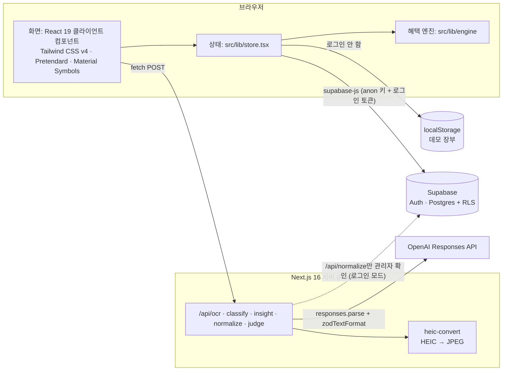

# 02. 기술 스택

카드셈은 **Next.js 하나**로 화면과 서버 API를 함께 만듭니다. 로그인과 데이터 저장은 **Supabase**가, 영수증 읽기·업종 분류처럼 "읽고 판단하는 일"은 **OpenAI**가 맡습니다. 혜택 **금액 계산**은 AI가 아니라 직접 만든 규칙 엔진이 합니다.

이 문서는 기술마다 네 가지를 적습니다.

- **무엇인가**: 처음 보는 사람을 위한 짧은 설명
- **왜 골랐나**: 이 프로젝트에서 그 기술이 필요한 이유
- **어디에 쓰였나**: 실제 파일
- **주의점**: 처음 만지는 사람이 자주 걸리는 곳

폴더 구조와 데이터 흐름은 [03. 구조와 데이터 흐름](03-architecture.md)에, 실행 방법·환경변수·배포는 [10. 개발 · 테스트 · 배포](10-development.md)에 있습니다. 파일 경로는 모두 저장소 루트 기준입니다.

---

## 1. 한눈에 보기



| 하는 일 | 맡는 기술 | 대표 파일 |
| --- | --- | --- |
| 화면 그리기 | React 19, Next.js App Router (클라이언트 컴포넌트) | `src/app/**/page.tsx` |
| 스타일 | Tailwind CSS v4 + 디자인 토큰 | `src/app/globals.css` |
| 로그인 | Supabase Auth | `src/lib/supabase.ts`, `src/app/login/page.tsx` |
| 데이터 저장 | Supabase Postgres(로그인) / localStorage(데모) | `src/lib/db.ts`, `src/lib/store.tsx` |
| 영수증·문자·명세서 읽기, 업종 분류, 인사이트, 약관 정규화, 정성 혜택 판단 | OpenAI Responses API + zod | `src/lib/ai/server.ts`, `src/lib/ai/judge.ts` |
| 혜택 금액 계산 | 직접 만든 규칙 엔진 (AI 안 씀) | `src/lib/engine/index.ts` |
| 그래프 · 엑셀 파일 | 직접 만든 SVG 차트 · xlsx 작성기 | `src/components/charts.tsx`, `src/lib/xlsx.ts` |

---

## 2. 버전 표

`package.json`에 적힌 범위와, `pnpm-lock.yaml`대로 설치된 `node_modules`의 실제 버전입니다 (2026-10-09 확인). `^`는 "호환되는 새 버전까지 허용"이라는 뜻이고, 실제로 깔리는 버전은 lockfile이 고정합니다.

**실행에 필요한 패키지 (`dependencies`)**

| 패키지 | `package.json` | 설치된 버전 | 용도 |
| --- | --- | --- | --- |
| `next` | `16.3.5` | 16.3.5 | 앱 프레임워크 |
| `react`, `react-dom` | `19.2.8` | 19.2.8 | UI |
| `@supabase/supabase-js` | `^2.117.2` | 2.117.2 | 로그인 · DB |
| `openai` | `^7.20.0` | 7.20.0 | AI 호출 (서버에서만) |
| `zod` | `^4.6.5` | 4.6.5 | AI 응답 스키마 |
| `heic-convert` | `^2.1.0` | 2.1.0 | HEIC 사진 → JPEG (서버에서만) |
| `server-only` | `^0.0.1` | 0.0.1 | "서버 전용 파일" 표시 |
| `@typesafe-ai/sdk` | `^0.6.0` | 0.6.0 | **현재 코드에서 쓰지 않음** ([11절](#11-typesafe-ai-sdk-jev)) |

**개발에만 필요한 패키지 (`devDependencies`)**

| 패키지 | `package.json` | 설치된 버전 | 용도 |
| --- | --- | --- | --- |
| `typescript` | `^5` | 5.9.3 | 타입 검사 |
| `tailwindcss`, `@tailwindcss/postcss` | `^4` | 4.3.3 | 스타일 |
| `vitest` | `^5.0.1` | 5.0.1 | 테스트 |
| `vite` | `^8.3.0` | 8.3.0 | vitest의 peer 의존성 |
| `eslint` | `^9` | 9.39.5 | 코드 규칙 검사 |
| `eslint-config-next` | `16.3.5` | 16.3.5 | Next 기본 규칙 묶음 |
| `@types/node` | `^20` | 20.19.43 | Node 타입 |
| `@types/react`, `@types/react-dom` | `^19` | 19.3.0 | React 타입 |
| `@types/heic-convert` | `^2.1.1` | 2.1.1 | heic-convert 타입 |

**도구**

| 도구 | 버전 | 근거 |
| --- | --- | --- |
| pnpm | 10.19.0 | `package.json`의 `packageManager` 필드 |
| Node.js | 22.12 이상 (22 LTS 또는 24) | 설치된 패키지의 `engines`: `vitest` 5.0.1은 `^22.12.0 \|\| ^24.0.0 \|\| >=26.0.0`, `openai` 7.20.0과 `@supabase/supabase-js` 2.117.2는 `>=22.0.0`. `next` 16만 보면 20.9 이상 ([10. 개발 · 테스트 · 배포](10-development.md)) |

`next`, `react`, `react-dom`, `eslint-config-next`는 `^` 없이 정확한 버전으로 적혀 있습니다. 올릴 때는 함께 올립니다.

---

## 3. Next.js 16 (App Router)

### 무엇인가

React로 웹 앱을 만드는 프레임워크입니다. 라우팅, 서버 API, 빌드 도구를 한 번에 줍니다.

- **App Router**: `src/app` 아래 폴더 구조가 곧 URL입니다. `page.tsx`는 화면, `layout.tsx`는 여러 화면이 같이 쓰는 틀입니다.
- **Route Handler**: 폴더 안의 `route.ts`가 `POST(req: Request)` 같은 함수를 내보내면 그 경로의 서버 API가 됩니다. 웹 표준 `Request`/`Response`를 씁니다.
- **라우트 그룹**: 괄호로 감싼 폴더는 URL에 들어가지 않습니다. `src/app/(app)/home/page.tsx`의 주소는 `/home`입니다.

### 왜 골랐나

- 화면과 서버 API를 저장소 하나, 배포 하나로 관리합니다. 별도 백엔드 서버가 없습니다.
- AI 키를 브라우저에 보내지 않으려면 서버가 한 겹 필요합니다. 데이터는 Supabase가 맡기 때문에 서버가 할 일은 AI 호출 다섯 가지뿐이고, Route Handler로 충분합니다 (`src/lib/ai/client.ts` 첫 주석: "AI 키는 서버에만 있다").

### 어디에 쓰였나

| 종류 | 파일 | 내용 |
| --- | --- | --- |
| 화면 35개 | `src/app/**/page.tsx` | 34개가 클라이언트 컴포넌트입니다. `src/app/page.tsx`만 서버에서 `/home`으로 `redirect`합니다 |
| 레이아웃 | `src/app/layout.tsx` | `<html lang="ko">`, 글꼴 `<link>`, `metadata`·`viewport`, 전체를 `DemoProvider`(상태)로 감쌈 |
| | `src/app/(app)/layout.tsx`, `src/app/admin/layout.tsx` | 사이드바·하단 탭인 `AppShell`로 감쌈 |
| | `src/app/(app)/stats/layout.tsx` | 통계 탭 3개 (클라이언트 컴포넌트) |
| Route Handler 5개 | `src/app/api/{ocr,classify,insight,normalize,judge}/route.ts` | 모두 `POST`, 모두 `runtime = "nodejs"`. `ocr`은 `maxDuration = 90`, `normalize`는 `120`(초) |
| 설정 | `next.config.ts` | 비어 있음 (기본값 그대로) |

#### 클라이언트 컴포넌트가 대부분인 이유

파일 첫 줄에 `"use client"`가 있으면 클라이언트 컴포넌트입니다. 브라우저에서 상태·이벤트·`localStorage`를 쓸 수 있습니다.

카드셈의 장부 데이터는 브라우저에 있습니다. 데모 모드는 `localStorage`에, 로그인 모드는 supabase-js가 브라우저에 보관한 세션으로 DB를 읽습니다. 로그인 세션을 쿠키로 보내지 않으므로 서버는 누가 로그인했는지 모릅니다. 그래서 서버 컴포넌트가 데이터를 미리 읽을 수 없고, 화면은 `src/lib/store.tsx`의 `DemoProvider`(React Context)에서 데이터를 받습니다. 서버 컴포넌트인 레이아웃 3개는 클라이언트 컴포넌트(`AppShell`, `DemoProvider`)를 감싸기만 합니다.

#### `PageProps` · `LayoutProps` 전역 타입

```tsx
// src/app/(app)/cards/[id]/page.tsx
export default function CardDetailPage({ params }: PageProps<"/cards/[id]">) {
  const { id } = use(params); // params는 Promise
```

- import 없이 쓰는 전역 타입입니다. 경로 문자열(`"/cards/[id]"`)에서 `params`의 모양을 알아냅니다.
- Next 16에서 `params`와 `searchParams`는 **Promise**입니다. 동기로 꺼내는 방식은 없어졌습니다. 서버 컴포넌트는 `await`, 클라이언트 컴포넌트는 React의 `use()`로 꺼냅니다.
- 쓰는 곳: `PageProps`는 동적 경로 화면 3개(`cards/[id]`, `cards/[id]/rules`, `transactions/[id]`), `LayoutProps`는 레이아웃 4개. 라우트 그룹은 경로에 들어가지 않으므로 `src/app/(app)/layout.tsx`도 `LayoutProps<"/">`입니다.
- 이 타입은 `routes.d.ts` 파일에 생깁니다. `next build`·`next typegen`은 `.next/types/`에, `next dev`는 `.next/dev/types/`에 만듭니다. `next-env.d.ts`가 마지막으로 만든 쪽을 import하고, `tsconfig.json`의 `include`에는 두 경로가 모두 있습니다. `.next`와 `next-env.d.ts`는 모두 `.gitignore` 대상입니다.

#### `useSearchParams`는 `<Suspense>` 안에서

`useSearchParams()`는 주소의 `?cat=food` 같은 쿼리를 읽는 훅입니다. `next build`는 화면을 미리 HTML로 만들어 두는데(정적 렌더), 쿼리는 실제 요청 때만 알 수 있습니다. 그래서 이 훅을 쓰는 컴포넌트를 `<Suspense>`로 감싸 "이 안은 브라우저에서 그린다"고 알려야 합니다. 감싸지 않으면 `next build`가 "Missing Suspense boundary with useSearchParams" 오류로 멈춥니다. `next dev`에서는 감싸지 않아도 잘 보여서 빌드 때 늦게 발견됩니다.

```tsx
// src/app/(app)/transactions/page.tsx
/* useSearchParams는 Suspense 안에서 (없으면 next build의 정적 렌더가 실패) */
export default function TransactionsPage() {
  return <Suspense><TransactionList /></Suspense>;
}
```

이 모양을 쓰는 화면은 6개입니다: `settings/export`, `transactions`, `transactions/new`, `transactions/refund`, `admin/input`, `admin/rules`.

#### "이 버전은 다르다" 경고

`AGENTS.md`(그리고 이를 불러오는 `CLAUDE.md`)는 "This is NOT the Next.js you know"로 시작합니다. 블로그 글이나 AI의 학습 데이터에 있는 Next.js와 API·규칙·파일 구조가 다를 수 있으니, 코드를 쓰기 전에 **`node_modules/next/dist/docs/`의 해당 문서를 읽으라**는 경고입니다. 이 블록은 `next dev`가 다시 써 넣습니다(`node_modules/next/dist/server/lib/generate-agent-files.js`). 지워도 다시 생깁니다.

이 프로젝트에서 실제로 부딪힌 차이와 근거 문서입니다. 문서 경로는 `node_modules/next/dist/docs/01-app/` 아래입니다.

| 바뀐 점 | 이 프로젝트에서 | 근거 문서 |
| --- | --- | --- |
| `params`·`searchParams`가 Promise, 동기 접근 제거 | 클라이언트 페이지에서 `use(params)` | `03-api-reference/03-file-conventions/page.md`, `02-guides/upgrading/version-16.md` |
| `PageProps`·`LayoutProps` 전역 타입 | 위 설명 | `01-getting-started/03-layouts-and-pages.md` |
| `useSearchParams`는 Suspense 필요 | 7개 화면 | `03-api-reference/04-functions/use-search-params.md` |
| `next lint` 명령 제거, `next build`가 린트를 돌리지 않음 | `"lint": "eslint"` | `01-getting-started/01-installation.md` |
| `middleware` → `proxy`로 이름 변경 | 쓰지 않음 (관리자 확인은 API에서) | `03-api-reference/03-file-conventions/middleware.md` |
| Edge 런타임 deprecated, `nodejs`가 기본값 | 5개 `route.ts` 모두 `runtime = "nodejs"`를 적어 둠. 기본값이라 지워도 동작은 같음 (근거 문서는 export를 지우라고 권함). `ocr`은 Node에서만 되는 `Buffer`·`heic-convert`를 씀 | `03-api-reference/03-file-conventions/02-route-segment-config/runtime.md` |
| Turbopack이 `next dev`·`next build`의 기본 번들러 | 스크립트에 옵션 없음 | `02-guides/upgrading/version-16.md` |
| Node.js 20.9 이상 | | `02-guides/upgrading/version-16.md` |

### 주의점

- **막 clone한 상태에서는 `PageProps`를 못 찾습니다.** `.next/types`(또는 `.next/dev/types`)가 아직 없기 때문입니다. `pnpm exec tsc --noEmit` 전에 `pnpm exec next typegen`(또는 `pnpm dev` 한 번)을 돌립니다.
- 새 화면에서 `useSearchParams`를 쓰면 반드시 `<Suspense>`로 감쌉니다. `pnpm dev`로는 확인되지 않습니다.
- 서버 레이아웃에서 로그인 여부로 화면을 막을 수 없습니다(세션이 브라우저에만 있음). 권한은 Supabase RLS와 API의 토큰 확인이 지킵니다 (`src/app/admin/layout.tsx` 주석).
- `next build`는 TypeScript 오류가 있으면 실패합니다(`typescript.ignoreBuildErrors` 기본값 `false`). 린트는 따로 `pnpm lint`로 돌립니다.
- `next dev`는 `.next/dev`에 따로 출력하고, 같은 프로젝트에서 `next dev`를 두 개 띄우지 못하게 잠급니다(`version-16.md`의 "Concurrent dev and build").

---

## 4. React 19

### 무엇인가

화면을 컴포넌트(함수)로 나눠 만드는 UI 라이브러리입니다. 상태가 바뀌면 그 상태를 쓰는 컴포넌트를 다시 그립니다.

### 왜 골랐나

Next.js 16 App Router가 React 19.2를 기준으로 동작합니다(`version-16.md`의 "React 19.2"). `react`, `react-dom` 모두 19.2.8로 고정했습니다.

### 어디에 쓰였나

| 기능 | 파일 | 하는 일 |
| --- | --- | --- |
| `use()` | 동적 경로 화면 3개 | Promise인 `params` 꺼내기 |
| Context | `src/lib/store.tsx` (`DemoProvider`, `useStore`) | 거래·카드·예산·카테고리·반복 규칙과 계산 결과를 앱 전체에 공급 |
| `useSyncExternalStore` | `src/lib/ai/receipt-jobs.ts`, `src/lib/notify.ts`, `src/app/admin/admin.ts` | 컴포넌트 밖의 모듈 변수·`localStorage`·`sessionStorage`를 구독. 서버 렌더용 값(세 번째 인자)을 따로 줘서 첫 렌더가 서버와 같게 함 |
| `useEffectEvent` (19.2) | `src/components/ui.tsx`의 `useDialog` | `onClose`를 Effect 의존성에서 빼서, 인라인 화살표 함수를 넘겨도 Effect가 다시 돌지 않게 함 |

### 주의점

- **`setState` 업데이터 함수는 나중에(렌더 때) 실행될 수 있습니다.** 업데이터 안에서 만든 값을 바로 DB로 보내면 아직 `undefined`일 수 있습니다. 보낼 값은 업데이터 밖에서 만듭니다 (`src/lib/store.tsx`의 "보낼 값은 반드시 업데이터 밖에서 만들 것" 주석).
- **하이드레이션 불일치.** 하이드레이션은 서버가 만든 HTML에 브라우저의 React가 붙는 과정입니다. 이때 브라우저의 첫 렌더 결과가 서버 HTML과 같아야 합니다. 그래서 `localStorage`는 마운트 뒤 `useEffect`에서 읽고(`store.tsx`), 천 단위 쉼표는 로캘을 `ko-KR`로 고정한 `num()`(`src/lib/format.ts`)을 씁니다. 서버(Node)와 브라우저의 기본 로캘이 다를 수 있기 때문입니다.
- `eslint-config-next`에 들어 있는 `eslint-plugin-react-hooks` 7의 `react-hooks/set-state-in-effect` 규칙은 Effect 안의 `setState`를 경고합니다. 마운트 뒤 저장소를 읽는 것처럼 의도한 곳 5군데만 주석으로 껐습니다 (`store.tsx`, `src/lib/ai/client.ts` 2곳, `src/app/login/page.tsx`, `src/app/admin/input/page.tsx`).

---

## 5. TypeScript

### 무엇인가

자바스크립트에 타입을 붙인 언어입니다. 실행 전에 컴파일러(`tsc`)가 "이 필드는 없다", "숫자 자리에 문자열을 넣었다" 같은 오류를 찾습니다.

### 왜 골랐나

혜택 규칙(`BenefitRule`)처럼 필드가 많은 데이터를 엔진, 화면, DB 변환(`db.ts`), AI 정규화(`server.ts`)가 함께 씁니다. 필드 이름 하나가 틀려도 실행 전에 잡힙니다.

### 어디에 쓰였나

- `tsconfig.json`: `strict: true`, 경로 별칭 `"@/*": ["./src/*"]`, `moduleResolution: "bundler"`, `noEmit: true`(JS 출력은 Next가 맡음). `.claude` 폴더는 검사에서 뺍니다.
- `src/lib/types.ts`: 공용 타입 (`Transaction`, `BenefitRule`, `CardProduct`, `UserCard`, `PerkJudgment` …).
- zod 스키마에서 타입을 뽑아 씁니다. 스키마와 타입이 한 곳에 있어 어긋나지 않습니다.

  ```ts
  // src/lib/ai/server.ts
  export type ReceiptResult = z.infer<typeof TxnItem>;
  export type DocResult = z.infer<typeof DocSchema>;
  ```

- `src/lib/ai/client.ts`는 `import type { DocResult } from "./server"`로 **타입만** 가져옵니다. 타입은 컴파일 때 사라지므로 서버 코드가 브라우저 번들에 들어가지 않습니다.

### 주의점

- 타입 검사는 `pnpm exec tsc --noEmit`입니다 (`package.json`에 스크립트는 없음). 막 clone했다면 먼저 `pnpm exec next typegen` ([3절 주의점](#주의점)).
- `@/` 별칭은 Next와 `tsc`만 압니다. Vitest 설정에는 별칭이 없어서, 테스트가 import하는 모듈(엔진·집계처럼 `src/lib` 아래 순수 모듈, `src/app/admin/admin.ts`, `src/app/(app)/cards/card-stats.ts`)은 상대 경로로 import합니다.
- 클라이언트 코드는 서버 전용 모듈(`server.ts`, `judge.ts`)에서 값을 import하면 안 됩니다. 타입만 `import type`으로 가져옵니다 ([10절](#10-openai-responses-api와-zod-구조화-출력)).

---

## 6. Tailwind CSS v4

### 무엇인가

`bg-primary`, `px-4`, `rounded-btn`처럼 짧은 클래스 이름을 붙여 스타일을 주는 CSS 도구입니다. 소스 파일에서 실제로 쓴 클래스만 골라 CSS를 만듭니다. v4는 설정 파일(`tailwind.config.js`) 대신 **CSS 안의 `@theme` 블록**으로 색·글자 크기 같은 디자인 값을 정합니다.

### 왜 골랐나

디자인 시스템의 토큰 CSS(`globals.css` 주석: `tokens/colors.css`, `typography.css`, `layout.css` 이식)를 `@theme`으로 옮기면 그 이름 그대로 클래스가 생깁니다. 화면 코드가 임의의 색·크기 대신 토큰 이름만 쓰게 하기 쉽습니다. 토큰 목록과 사용 규칙은 [09. 디자인 시스템](09-design-system.md)에 있습니다.

### 어디에 쓰였나

- `postcss.config.mjs`: 플러그인은 `@tailwindcss/postcss` 하나입니다.
- `src/app/globals.css`: Tailwind 설정 전부가 여기 있습니다.

| 블록 | 하는 일 |
| --- | --- |
| `@import "tailwindcss";` | Tailwind 불러오기 |
| `@theme { … }` | 색·글꼴·글자 크기·둥글기·그림자·레이아웃 토큰 |
| `@theme static { … }` | 차트 색 (아래 설명) |
| `@layer base` | `body` 글꼴·배경, 키보드 포커스 테두리(`:focus-visible`) 등 태그 기본값 |
| `@layer components` | `.input-box`, `.card-base` (아래 설명) |
| `@utility` | 직접 만든 유틸리티: `msr`, `msr-fill`(아이콘), `pb-nav`, `pb-safe`, `bottom-above-nav`(모바일 하단 탭 여백), `no-scrollbar` |

`@theme` 변수 이름의 앞부분(네임스페이스)이 어떤 클래스가 생길지 정합니다.

| `@theme` 변수 | 생기는 클래스 예 |
| --- | --- |
| `--color-primary: #6b43f2` | `bg-primary`, `text-primary`, `border-primary` |
| `--text-label: 14px` (+ `--text-label--line-height`, `--text-label--font-weight`) | `text-label` (크기·줄 높이·굵기를 한 번에) |
| `--radius-btn: 10px` | `rounded-btn` |
| `--shadow-1` | `shadow-1` |
| `--container-content: 1120px` | `max-w-content` |
| `--spacing-btn-lg: 52px`, `--spacing-header: 72px` | `h-btn-lg`, `md:h-header` |

#### `@theme static`이 필요한 이유

Tailwind v4는 `@theme` 변수 가운데 **소스에서 쓰인 것만** `:root`의 CSS 변수로 내보냅니다. "쓰였다"는 것은 클래스 이름(`bg-primary`)이나 변수 이름(`--color-primary`)이 소스 파일에 **글자 그대로** 있다는 뜻입니다.

차트 색은 코드에서 이름을 조립합니다.

```ts
// src/lib/chart.ts
export const CHART_COLORS = [1, 2, 3, 4, 5, 6, 7].map((i) => `var(--color-chart-${i})`);
```

소스에 `--color-chart-2`~`7` 같은 완성된 글자가 없으므로(`var(--color-chart-1)`만 `src/components/charts.tsx`의 `BarList` 기본 색과 `src/lib/report.test.ts`에 그대로 있음), 보통 `@theme`에 두면 이 변수들이 CSS에 나오지 않고 차트 색이 빠집니다. `@theme static`은 쓰였는지와 상관없이 항상 내보냅니다.

이 문서를 쓰면서 프로젝트의 `@tailwindcss/postcss` 4.3.3으로 작은 CSS를 직접 컴파일해 확인했습니다.

| 선언 | 소스에서 쓴 모양 | CSS 변수가 나왔나 |
| --- | --- | --- |
| `@theme`의 `--color-x` | 어디에도 없음 | 안 나옴 |
| `@theme`의 `--color-y` | `"var(--color-y)"` 글자 그대로 | 나옴 |
| `@theme`의 `--color-chart-2` | `` `var(--color-chart-${i})` `` | 안 나옴 |
| `@theme static`의 `--color-chart-1` | `` `var(--color-chart-${i})` `` | 나옴 |

#### `@layer components`에 둔 기본값

`src/components/ui.tsx`의 `cx()`는 클래스 문자열을 이어 붙이기만 합니다. HTML에서 클래스를 적은 순서는 결과에 영향이 없고, **CSS 파일 안의 순서**가 이깁니다. 컴포넌트 기본값 `h-12`와 호출부의 `h-10`이 둘 다 유틸리티면, Tailwind가 뒤에 내보낸 쪽이 이깁니다. 호출부가 이긴다는 보장이 없습니다.

그래서 덮어쓸 수 있는 기본값(입력칸 `.input-box`, 카드 `.card-base`)은 `@layer components`에 둡니다. components 층은 utilities 층보다 항상 우선순위가 낮으므로 호출부의 `className`이 항상 이깁니다. 클래스 충돌을 풀어 주는 `tailwind-merge` 같은 라이브러리를 쓰지 않는 이유입니다.

### 주의점

- `tailwind.config.js`는 없습니다. 새 토큰은 `globals.css`의 `@theme`에 추가합니다.
- 클래스 이름을 조립하면(`` `bg-${color}` ``) CSS가 만들어지지 않습니다. 완성된 이름을 씁니다. `ui.tsx`도 버튼 종류별 클래스를 `Record`에 완성된 이름으로 적어 둡니다.
- 코드에서 색을 동적으로 고르려면 `style`에 CSS 변수를 넣고, 그 변수는 `@theme static`에 둡니다.

---

## 7. pnpm

### 무엇인가

npm과 같은 역할의 패키지 관리자입니다. 패키지를 컴퓨터의 한 저장소에 두고 프로젝트에는 링크만 걸어서, 설치가 빠르고 디스크를 덜 씁니다.

### 왜 골랐나

`package.json`의 `packageManager` 필드가 `pnpm@10.19.0`을 지정하고, lockfile도 `pnpm-lock.yaml` 하나뿐입니다. 팀원 모두 pnpm으로 설치해야 같은 버전이 깔립니다. pnpm은 `package.json`에 직접 적지 않은 패키지를 import하지 못하게 막아서, 다른 패키지에 딸려 온 의존성을 모르고 쓰는 일이 없습니다.

### 어디에 쓰였나

| 명령 | 실행되는 것 | 하는 일 |
| --- | --- | --- |
| `pnpm install` | | 의존성 설치 |
| `pnpm dev` | `next dev` | 개발 서버 |
| `pnpm build` | `next build` | 프로덕션 빌드 |
| `pnpm start` | `next start` | 빌드 결과 실행 |
| `pnpm lint` | `eslint` | 코드 규칙 검사 |
| `pnpm test` | `vitest run` | 테스트 한 번 실행 |

### 주의점

- `npm install`이나 `yarn`을 섞어 쓰지 않습니다. 다른 lockfile이 생기고 버전이 달라집니다.
- pnpm 10은 의존성의 설치 스크립트(postinstall 등)를 기본으로 실행하지 않습니다. 이 프로젝트에서는 `pnpm ignored-builds`가 `unrs-resolver` 하나를 보여 줍니다. 작성 시점에 `pnpm lint`, `tsc`, `pnpm test`는 모두 정상 동작했습니다.
- Windows에서 설치하는 방법(`npm install -g pnpm` 또는 `corepack enable`)은 저장소 `README.md`에 있습니다.

---

## 8. Vitest와 ESLint

### Vitest

**무엇인가.** Vite 기반 테스트 도구입니다. TypeScript 파일을 따로 컴파일하지 않고 바로 실행하고, `describe`/`it`/`expect`로 테스트를 씁니다.

**왜 골랐나.** 혜택 계산, 월 집계, 반복 회차, 카드 매칭처럼 숫자와 규칙이 정확해야 하는 순수 함수가 많습니다. 작성 시점에 전체 테스트가 1초 안팎에 끝납니다.

**어디에 쓰였나.** `vitest.config.ts`는 `src/**/*.test.ts`만 모읍니다. 작성 시점(2026-10-09) 12개 파일, 193건입니다. 테스트가 계속 늘고 있으니 정확한 수는 `pnpm test` 결과를 봅니다.

| 테스트 파일 | 지키는 것 |
| --- | --- |
| `src/lib/engine/engine.test.ts` | 혜택 엔진 경계값 ([04](04-benefit-engine.md)) |
| `src/lib/report.test.ts` | 월 집계 · 엑셀 숫자 ([08](08-reports-stats-export.md)) |
| `src/lib/data/match-card.test.ts` | 영수증 → 결제 카드 매칭 ([05](05-receipt-ai.md)) |
| `src/lib/recurring.test.ts` | 반복 거래 회차(`dueDates`, `materialize`), `newId`, `validCategory`, `db.ts`(가짜 Supabase: 1000건 넘는 거래 페이지 읽기, 예산 저장, 거래·카드 쓰기) |
| `src/lib/data/txn-rules.test.ts` | 환불 가능액, 검색, 실적 창, 수정 화면 예상 혜택 |
| `src/lib/data/cards.test.ts`, `src/lib/data/deleteCategory.test.ts` | 카드 규칙 데이터, 카테고리 삭제 |
| `src/lib/notify.test.ts` | 알림 계산 |
| `src/lib/ai/judge.test.ts`, `src/lib/ai/receipt-jobs.test.ts` | 정성 혜택 state·답 해석, 영수증 작업 목록 |
| `src/app/admin/admin.test.ts`, `src/app/(app)/cards/card-stats.test.ts` | 어드민 원문 대조, 카드 화면 통계 |

**주의점.**

- `.tsx` 컴포넌트 테스트와 브라우저 환경(jsdom)은 설정돼 있지 않습니다. 화면 테스트는 없고, 화면 로직은 순수 함수로 빼서 테스트합니다 (예: `card-stats.ts`, `admin.ts`, `judge.core.ts`).
- `import "server-only"`가 있는 파일(`src/lib/ai/server.ts`, `src/lib/ai/judge.ts`)은 테스트에서 import하면 오류가 납니다. `server-only` 패키지는 서버 컴포넌트용 조건(`react-server`) 밖에서 import되면 바로 오류를 던집니다. 그래서 정성 혜택 판단의 순수 부분을 `judge.core.ts`로 나눴습니다.
- `@/` 별칭이 설정돼 있지 않습니다 ([5절](#5-typescript)).
- `vite`는 vitest 5의 peer 의존성이라 `devDependencies`에 직접 적혀 있습니다.
- 실행하면 "`vitest.config.ts`를 CommonJS로 읽는다"는 Vite 경고가 한 번 나옵니다(`package.json`에 `"type": "module"`이 없음). 테스트 결과에는 영향이 없습니다.
- 한 파일만: `pnpm exec vitest run src/lib/engine/engine.test.ts`

### ESLint

**무엇인가.** 버그가 되기 쉬운 코드 패턴을 실행 전에 경고하는 검사기입니다.

**왜 골랐나.** `create-next-app`이 만든 설정에 `.claude/**` 무시만 더해 씁니다. Next 전용 규칙(이미지·글꼴·링크), React Hooks 규칙, TypeScript 규칙이 들어 있습니다.

**어디에 쓰였나.** `eslint.config.mjs`(flat config 형식)가 `eslint-config-next/core-web-vitals`와 `eslint-config-next/typescript`를 펼쳐 넣고, `.next/**`, `out/**`, `build/**`, `next-env.d.ts`, `.claude/**`를 검사에서 뺍니다.

**주의점.**

- Next 16에는 `next lint`가 없고 `next build`도 린트를 돌리지 않습니다. `pnpm lint`를 직접 돌립니다.
- 규칙을 끈 곳에는 이유를 적어 둡니다. `src/app/layout.tsx`는 CDN 글꼴을 `<link>`로 직접 불러서 `@next/next/no-page-custom-font`·`@next/next/google-font-display`를, `src/app/(app)/receipt/page.tsx`는 blob 주소 미리보기라 `@next/next/no-img-element`를 끕니다. `set-state-in-effect`는 [4절](#4-react-19).
- `eslint-config-next` 버전은 `next`와 같게 맞춥니다 (지금 둘 다 16.3.5).

---

## 9. Supabase

### 무엇인가

Postgres 데이터베이스, 로그인(Auth), 테이블을 바로 부를 수 있는 REST API(PostgREST)를 묶은 호스팅 서비스입니다.

- **Auth**: 이메일·비밀번호 가입과 로그인, 비밀번호 재설정 메일
- **Postgres**: 관계형 데이터베이스. 테이블 구조는 [07. 데이터 모델과 ERD](07-data-model.md)
- **RLS (Row Level Security)**: 행 단위 권한. "이 행은 `user_id`가 지금 로그인한 사람일 때만 보인다" 같은 조건을 DB가 직접 검사합니다
- **supabase-js**: 브라우저에서 테이블을 읽고 쓰는 자바스크립트 라이브러리

### 왜 골랐나

- 백엔드 서버를 따로 만들지 않고 로그인과 사용자별 저장을 해결합니다.
- 권한을 DB(RLS)가 지키므로 브라우저가 DB를 직접 불러도 남의 데이터는 보이지 않습니다.
- 환경변수가 없으면 꺼지고 `localStorage` 데모 모드로 돕니다. 계정 없이도 시연할 수 있습니다.

### 어디에 쓰였나

| 파일 | 내용 |
| --- | --- |
| `src/lib/supabase.ts` | `createClient(NEXT_PUBLIC_SUPABASE_URL, NEXT_PUBLIC_SUPABASE_ANON_KEY)`. 둘 다 있으면 `SUPABASE_READY = true`. Auth 오류 문구를 한국어로 바꾸는 `authErrorMessage` |
| `src/lib/db.ts` | 테이블 행(snake_case) ↔ 앱 타입(camelCase) 변환, 로그인 직후 전부 읽기(`loadAll`), 쓰기 함수 |
| `src/lib/store.tsx` | `onAuthStateChange`로 로그인·로그아웃 감시, 화면을 먼저 바꾸고(낙관적 업데이트) DB 쓰기를 순서대로 보냄 |
| `src/app/login/page.tsx`, `src/app/signup/page.tsx` | `signInWithPassword`, `resetPasswordForEmail`, `updateUser`, `signUp` |
| `src/lib/ai/client.ts` | `getSession()`의 토큰을 `Authorization` 헤더에 붙여 `/api/*` 호출 |
| `src/app/api/normalize/route.ts` | `auth.getUser(token)`으로 `app_metadata.role === "admin"`인지 확인 |
| `supabase/schema.sql`, `supabase/migrations/`, `supabase/seed.sql` | 스키마 · RLS 정책 · 카드 시드 |

RLS 정책은 이렇게 생겼습니다.

```sql
-- supabase/schema.sql
create policy "own rows" on transactions for all using (auth.uid() = user_id) with check (auth.uid() = user_id);
```

`using`은 읽기·수정·삭제할 수 있는 행의 조건, `with check`는 새로 쓰는 행의 조건입니다. 그래서 `db.ts`는 `transactions`를 읽을 때 `user_id` 조건을 붙이지 않아도 본인 행만 받습니다. 쓸 때는 `user_id`를 항상 붙입니다(`txnRow` 위 주석: "user_id는 RLS용으로 항상 붙인다").

관리자 권한은 `(auth.jwt() -> 'app_metadata' ->> 'role') = 'admin'`으로 검사합니다. `app_metadata`는 사용자가 스스로 바꿀 수 없는 값입니다 (`store.tsx`의 `Me` 주석).

### 주의점

- **anon 키는 공개 값입니다.** `NEXT_PUBLIC_` 접두어가 붙은 환경변수는 브라우저 번들에 그대로 들어갑니다. 보안은 전적으로 RLS에 달려 있습니다. 새 테이블을 만들면 RLS를 켜고 정책을 꼭 추가합니다. 이 프로젝트에는 service_role(관리자) 키가 없어서, 회원 탈퇴 때 로그인 계정(`auth.users`) 행은 지우지 못합니다.
- **세션은 브라우저에 있습니다.** supabase-js가 세션을 `localStorage`에 둡니다. 서버(레이아웃·서버 컴포넌트)는 로그인 여부를 모릅니다. 서버에서 사용자를 확인해야 하면 `/api/normalize`처럼 토큰을 헤더로 받아 `auth.getUser(token)`을 부릅니다.
- **한 번에 최대 1000행.** PostgREST는 초과분을 오류 없이 자릅니다. `db.ts`의 `readAll`이 `range`로 페이지를 넘겨 끝까지 읽고, 같은 날짜 행이 경계에서 빠지지 않게 `id`를 두 번째 정렬 키로 씁니다.
- 비밀번호 재설정 메일이 `/login`으로 돌아오려면 Supabase 대시보드 Auth 설정의 Redirect URLs에 `<사이트>/login`이 있어야 합니다 (`login/page.tsx` 주석).
- 기본 카드 카탈로그는 아직 코드(`src/lib/data/cards.ts`)에서 읽습니다. `card_products`의 기본 카드 행은 어드민 편집용 시드입니다 (`db.ts` 첫 주석).
- Storage(파일 저장), Realtime, Edge Functions는 쓰지 않습니다. 영수증 원본 이미지는 저장하지 않고(`receipts.storage_path`에 `'not_stored'`), 반복 거래도 서버 크론 없이 앱에서 만듭니다.
- 스키마를 바꿀 때 마이그레이션 파일과 `schema.sql`을 함께 고치고 원격 버전을 맞추는 방법은 [10. 개발 · 테스트 · 배포](10-development.md)에 있습니다.

---

## 10. OpenAI Responses API와 zod 구조화 출력

### 무엇인가

- **OpenAI Responses API**: 글·이미지·PDF를 입력으로 받아 모델의 답을 돌려주는 API입니다. 공식 SDK(`openai` 패키지)의 `client.responses.parse()`를 씁니다.
- **구조화 출력(Structured Outputs)**: 답을 자유로운 글이 아니라, 정해 준 JSON 스키마 모양으로만 받는 기능입니다.
- **zod**: TypeScript 스키마 라이브러리입니다. 스키마 하나로 실행 중 값 검증, TypeScript 타입(`z.infer`), JSON Schema 변환을 모두 합니다.
- **`zodTextFormat(schema, name)`** (`openai/helpers/zod`): zod 스키마를 Responses API의 `text.format`(엄격 모드 JSON Schema)으로 바꿉니다. `responses.parse()`가 응답을 그 스키마로 해석해 `res.output_parsed`에 넣어 줍니다.

### 왜 골랐나

- 비전 모델이 영수증 사진과 PDF를 직접 읽습니다. 글자만 뽑는 별도 OCR 단계가 없습니다.
- 결과를 확인 화면의 칸에 바로 채워야 하므로 모양이 고정돼야 합니다. 예를 들어 업종은 `z.enum`으로 28개 업종 키 중 하나 또는 `null`만 허용합니다.
- 스키마와 TypeScript 타입이 같은 곳에서 나옵니다.

### 어디에 쓰였나

모든 호출은 `src/lib/ai/server.ts`의 `parse()` 한 함수를 거칩니다.

```ts
// src/lib/ai/server.ts
export async function parse<T extends z.ZodType>(schema: T, name: string, instructions: string, content: OpenAI.Responses.ResponseInputContent[]): Promise<z.infer<T> | null> {
  const res = await client().responses.parse({ model: MODEL, instructions, input: [{ role: "user", content }], text: { format: zodTextFormat(schema, name) } });
  if (res.incomplete_details?.reason === "content_filter") throw new Error("문서를 읽을 수 없어요");
  return res.output_parsed as z.infer<T> | null;
}
```

| 기능 | 함수 | 스키마 | Route Handler | 부르는 화면 |
| --- | --- | --- | --- | --- |
| 영수증·결제 문자·명세서 → 거래 목록 | `ocrDocument` | `DocSchema` | `/api/ocr` | `/receipt`, 하단 + 메뉴 (`src/lib/ai/receipt-jobs.ts`) |
| 가맹점 → 업종 (사전에 없을 때) | `classifyMerchantAI` | `ClassifySchema` | `/api/classify` | 거래 등록 (`transactions/new`) |
| 월간 인사이트 2~3문장 | `monthlyInsight` | `InsightSchema` | `/api/insight` | 홈, 월간 요약 (`useInsight`) |
| 약관 원문 → 혜택 규칙 | `normalizeRules` | `NormalizeSchema` | `/api/normalize` | 어드민 원문 입력 |
| 정성 혜택 판단 | `judgePerks` (`src/lib/ai/judge.ts`) | `JudgeSchema` | `/api/judge` | 거래 상세 (`PerkJudge`) |

이미지는 `{ type: "input_image", image_url: "data:<형식>;base64,…", detail: "high" }`로, PDF는 `{ type: "input_file", filename, file_data: "data:application/pdf;base64,…" }`로 보냅니다. 프롬프트와 각 필드의 뜻은 [05. 영수증 인식과 AI](05-receipt-ai.md), 정성 혜택 판단은 [06. 정성 혜택 판단](06-perks-jev.md)에 있습니다.

### 주의점

- 키는 `OPENAI_API_KEY`, 모델은 `OPENAI_MODEL`(기본 `"gpt-5.5"`)입니다. 둘 다 서버에서만 읽습니다.
- **`.optional()` 대신 `.nullable()`을 씁니다.** 엄격 모드 JSON Schema는 모든 필드가 있어야 해서, `openai` SDK는 `.nullable()` 없이 `.optional()`만 쓴 필드를 만나면 오류를 던집니다. `server.ts`에는 `.optional()`이 하나도 없고 "없으면 null"인 필드는 모두 `.nullable()`입니다.

  ```ts
  industry: z.enum(industries).nullable().describe("가맹점 업종 (업종 후보 중 하나). 가맹점명·품목으로 판단할 수 없으면 null"),
  ```

- `.describe()` 문구는 JSON Schema의 설명으로 모델에 전달됩니다. 즉 프롬프트의 일부입니다. 고치면 인식 결과가 달라질 수 있습니다.
- `new OpenAI()`는 키가 없으면 생성할 때 오류를 던집니다. 그래서 모듈 맨 위가 아니라 호출할 때 `client()`로 만듭니다. 키 없이 빌드해도 죽지 않게 하기 위해서입니다.
- 오류는 `aiErrorMessage`가 한국어 문구(키 없음, 키가 틀림, 요청이 많음, 연결 실패)로 바꿔 상태 코드 502로 돌려줍니다.
- `server.ts`와 `judge.ts`는 맨 위에서 `import "server-only"`를 합니다. 클라이언트 컴포넌트가 이 파일을 import하면 빌드가 실패해서, 키가 브라우저로 새는 실수를 막습니다. 브라우저는 `src/lib/ai/client.ts`의 `aiOcr`·`aiClassify` 같은 함수로 Route Handler를 부릅니다.
- **금액 계산은 모델에 맡기지 않습니다** (`server.ts` 첫 주석). 인사이트에는 집계값만 보냅니다.
- 업종 분류 결과는 서버 프로세스 메모리의 `Map`에 캐시합니다. 서버를 다시 시작하면 사라지고, 서버가 여러 대면 서로 공유하지 않습니다 (`ponytail` 주석: `merchant_categories` 테이블로 옮길 자리).
- 응답이 오래 걸릴 수 있어 `/api/ocr`은 `maxDuration = 90`, `/api/normalize`는 `120`(초)입니다. 배포 플랫폼이 이 값을 실행 제한으로 씁니다.
- 요청 본문은 zod로 검증하지 않고 타입 단언(`as`)으로 받습니다. 서버가 직접 검사하는 것은 파일 크기·형식(`/api/ocr`)과 필수 값이 있는지 정도입니다.
- **AI API는 대부분 인증이 없습니다.** `/api/ocr`, `/api/classify`, `/api/insight`, `/api/judge`는 토큰을 확인하지 않습니다. `/api/normalize`도 Supabase 환경변수가 없는 데모 모드에서는 열려 있습니다(`route.ts` 주석: "데모 모드는 열어 둔다"). 배포하면 URL만 알아도 서버의 `OPENAI_API_KEY`로 비용을 쓸 수 있습니다. 공개 배포 때는 사용량 제한이나 토큰 확인이 필요합니다.
- 호출마다 비용이 듭니다. 인사이트는 `localStorage`, 정성 혜택 판단은 `sessionStorage`에 결과를 캐시해 같은 입력이면 다시 부르지 않습니다 (`client.ts`).

---

## 11. TypeSafe AI SDK (Jev)

### 무엇인가

`@typesafe-ai/sdk`는 TypeSafe AI의 System One API(`POST /v1/systemone`)를 부르는 SDK입니다. 이 API는 글을 쓰지 않습니다. 상태(`state`)와 질문(`questions`)을 주면 답을 확률로 돌려줍니다. 질문 형식은 `noul`(예/아니오, "예"일 확률 0~1), `choice`(선택지마다 확률), `score`가 있습니다. 기본 모델 이름이 `jev-latest`여서 이 프로젝트 문서에서는 "Jev"라고 부릅니다. 키는 `TYPESAFE_API_KEY` 환경변수에서 읽습니다 (`node_modules/@typesafe-ai/sdk/dist/index.d.mts`).

### 왜 골랐나

정성 혜택 판단(라운지·바우처처럼 금액으로 셈하지 않는 혜택)은 "이번 결제로 받을 수 있나(예/아니오)"와 "돈·상품·서비스 중 무엇인가(선택)"만 정하면 됩니다. 문장을 쓸 필요가 없으므로, 글을 쓰지 않고 정해진 선택지에 확률만 주는 판단 전용 모델이 맞는다고 보고 골랐습니다. 이 계획은 예전 `README.md`(커밋 `a68c1e1` 때)에 적혀 있었고 지금 README에는 없습니다. 계획 원문은 [06. 정성 혜택 판단](06-perks-jev.md#6-jevtypesafe-ai-계획과-현재-코드) 6절에 옮겨 두었습니다.

### 어디에 쓰였나 — 현재 코드에는 쓰이지 않습니다

- `package.json`의 `dependencies`에 `^0.6.0`으로 있고 `node_modules`에도 설치돼 있습니다.
- 하지만 `src` 아래에서 이 패키지를 import하는 곳이 없습니다. `TYPESAFE_API_KEY`를 읽는 코드도 없습니다.
- 정성 혜택 판단은 지금 **OpenAI 구조화 출력 한 경로**입니다 (`src/lib/ai/judge.ts`의 `JudgeSchema`). 결과 타입 `PerkJudgment.engine`(`src/lib/types.ts`)도 `"openai"` 하나뿐이고, 화면 배지는 `OpenAI · <모델 이름>`입니다.

입력과 답의 모양은 Jev의 질문 형식과 그대로 대응합니다.

| 지금 (`judge.ts`, `judge.core.ts`) | Jev에서 대응하는 것 |
| --- | --- |
| `buildState()`가 만드는 결제·카드·혜택 묶음 | `state` |
| `eligible` (받을 수 있을 확률 0~1) | `noul` 질문의 확률 |
| `form` (`money`·`goods`·`service`·`none`) | `choice` 질문의 선택지 |

### 주의점

- 예전 `README.md`와 06 문서 6절의 계획("`TYPESAFE_API_KEY`가 있으면 `@typesafe-ai/sdk`로 호출하고, 키가 없으면 OpenAI로 대신")은 현재 코드와 다릅니다. 지금은 항상 OpenAI이고 `OPENAI_API_KEY`만 있으면 됩니다.
- 쓰지 않는 의존성입니다. 지울지, 다시 연결할지 팀이 정해야 합니다. 계획과 현재 코드의 차이, 다시 연결할 때 바꿀 곳은 [06. 정성 혜택 판단](06-perks-jev.md#6-jevtypesafe-ai-계획과-현재-코드)에 정리돼 있습니다.

---

## 12. heic-convert

### 무엇인가

아이폰 기본 사진 형식인 HEIC/HEIF를 JPEG·PNG로 바꾸는 Node 라이브러리입니다. 내부에서 `heic-decode`가 libheif를 WebAssembly로 빌드한 `libheif-js`(`wasm-bundle`)로 디코딩하고, `jpeg-js`가 JPEG를 만듭니다. C++ 네이티브 모듈을 컴파일할 필요가 없습니다.

### 왜 골랐나

아이폰으로 찍은 영수증은 HEIC 파일입니다. `/api/ocr`이 모델에 보내는 형식은 JPEG·PNG·WebP·GIF·PDF뿐입니다(`route.ts`의 `TYPES`). 그래서 HEIC는 서버에서 JPEG로 바꾼 뒤 보냅니다.

### 어디에 쓰였나

`src/app/api/ocr/route.ts` 한 곳입니다.

1. 빈 파일은 400, 12MB를 넘으면 413으로 거절합니다.
2. `TYPES`에 없는 형식이면 `isHeic`으로 HEIC인지 봅니다. MIME에 `heic`/`heif`가 있거나, 확장자가 `.heic`/`.heif`이거나, 파일 4~8바이트가 `ftyp`이고 8~12바이트가 `heic`·`heix`·`hevc`·`hevx`·`mif1`·`msf1`로 시작하면 HEIC로 봅니다.
3. `convert({ buffer, format: "JPEG", quality: 0.88 })`로 바꾸고 `image/jpeg`로 보냅니다.
4. 그래도 형식을 모르면 415로 거절합니다.

### 주의점

- 서버의 Node 런타임에서만 씁니다 (`Buffer` 사용, `runtime = "nodejs"`).
- 브라우저가 HEIC 파일의 MIME을 비워 보내는 경우가 있어서, 확장자와 파일 앞부분 바이트로도 판별합니다.
- `route.ts` 주석은 "순수 JS 디코더"라고 적었지만, 실제 디코더는 위에서 말한 WebAssembly 번들입니다. 네이티브 의존성이 없다는 점은 같습니다.

---

## 13. 글꼴: Pretendard · Material Symbols

### 무엇인가

- **Pretendard**: 한글과 영문을 함께 쓰는 무료 글꼴입니다. 굵기를 파일 하나에서 바꾸는 가변 글꼴(Pretendard Variable)을 씁니다.
- **Material Symbols Rounded**: 구글의 아이콘 글꼴입니다. `receipt_long` 같은 이름을 글자로 쓰면 합자(ligature)로 아이콘이 그려집니다. 채움(`FILL`)·굵기(`wght`)·두께 보정(`GRAD`)·크기 최적화(`opsz`) 축을 가진 가변 글꼴입니다.

### 왜 골랐나

디자인 시스템이 이 두 글꼴을 씁니다 (`layout.tsx` 주석 "디자인 시스템과 동일하게", `globals.css`의 "Type — Pretendard 단일"). 아이콘은 SVG 파일을 하나씩 두지 않고 이름만으로 씁니다.

### 어디에 쓰였나

| 파일 | 내용 |
| --- | --- |
| `src/app/layout.tsx` | `<head>`의 `<link>` 2개. Pretendard v1.3.9 `dynamic-subset`(cdn.jsdelivr.net, 화면에 쓰인 글자 범위의 조각만 받음)과 Material Symbols Rounded(fonts.googleapis.com, 축 `opsz,wght,FILL,GRAD@24,400,0..1,0`, `display=block`) |
| `src/app/globals.css` | `--font-sans`(Pretendard 다음에 시스템 글꼴), `--font-icon`. `@utility msr`가 `font-variation-settings`를 `FILL 0, wght 400, GRAD 0, opsz 24`로 고정, `msr-fill`은 `FILL 1` |
| `src/components/ui.tsx` | `<Icon name="…" size={20} fill />` → `<span aria-hidden className="msr">이름</span>` |

### 주의점

- `next/font`를 쓰지 않고 CDN `<link>`를 직접 넣었습니다. 그래서 ESLint 규칙 2개를 껐습니다 ([8절](#eslint)). 배포 때 직접 호스팅(셀프 호스팅)으로 바꿀 자리라는 `ponytail` 주석이 있습니다.
- 인터넷이 안 되면 글꼴은 시스템 글꼴로 바뀌고, 아이콘 자리에는 이름 글자가 보일 수 있습니다. `.msr`에 `overflow: hidden`을 둬서 상자 밖으로 넘치지는 않습니다. `display=block`은 글꼴을 받는 동안 잠깐 글자를 숨기는 설정입니다.
- 아이콘 글꼴은 `opsz 24 · wght 400 · GRAD 0` 한 가지만 받습니다. 다른 굵기를 줘도 바뀌지 않고, 바꿀 수 있는 것은 `FILL`(0~1)뿐입니다.
- 아이콘 이름은 그냥 문자열입니다. 오타를 타입이 잡지 못하므로 Material Symbols 목록의 이름을 정확히 씁니다.

---

## 14. 라이브러리 대신 직접 만든 것

기준은 하나입니다. **필요한 기능이 작고, 라이브러리를 들이면 번들 크기나 맞춤 비용이 더 커질 때** 직접 만들었습니다. 디자인 토큰, 한국 날짜, 두 가지 저장 모드처럼 이 프로젝트에 맞춰야 하는 부분이 특히 그렇습니다.

| 만든 것 | 파일 | 흔히 쓰는 대안 | 직접 만든 이유 |
| --- | --- | --- | --- |
| SVG 차트 (막대, 꺾은선, 도넛, 가로 막대 목록, 범례, 정렬 표) | `src/components/charts.tsx`, `src/lib/chart.ts` | Recharts, Chart.js | 번들이 늘지 않습니다. 색은 CSS 변수(`@theme static`)를 그대로 씁니다. 모든 그래프에 같은 숫자의 표 보기(`ViewToggle`), 키보드 포커스 툴팁, 막대·점마다 `aria-label`을 둡니다. `ResizeObserver`로 폭을 재서 픽셀 단위로 그려 글자가 찌그러지지 않습니다 |
| `.xlsx` 작성기와 CSV | `src/lib/xlsx.ts` | SheetJS, ExcelJS | 필요한 기능은 시트 여러 장, 굵은 머리글, 숫자·날짜·퍼센트 서식, 첫 줄 고정, 자동 필터, `SUM` 합계 행뿐입니다. OOXML 최소 구성 파일 몇 개를 문자열로 만들고, 압축 없는 zip(CRC32 포함)으로 묶습니다. zip 시각을 고정해 같은 입력이면 같은 바이트가 나와 테스트하기 쉽습니다. CSV는 엑셀 한글 깨짐을 막는 UTF-8 BOM을 붙이고, `=`·`+`·`-`·`@`로 시작하는 값 앞에 `'`를 붙여 수식 주입을 막습니다 |
| 반복 거래 생성 | `src/lib/recurring.ts` | 서버 크론, rrule, date-fns | 규칙은 "매월 N일(그 달에 없으면 말일)"과 "매주 N요일" 두 가지뿐입니다. 앱이 데이터를 읽은 직후와 규칙을 저장할 때 브라우저에서 `materialize()`가 밀린 회차를 거래로 만듭니다. `lastGeneratedAt`을 기준으로 이어서 만들므로 사용자가 지운 회차는 다시 생기지 않습니다. 두 기기가 동시에 만들어도 DB 유일 색인 `transactions_recurring_once (user_id, recurring_id, date)`와 `upsert`(`ignoreDuplicates`)로 한 번만 들어갑니다 |
| 날짜·금액 표시 | `src/lib/format.ts`, `src/lib/recurring.ts`의 `ymd` | date-fns, dayjs | 날짜를 `"YYYY-MM-DD"` 문자열로 다뤄 비교·정렬이 문자열 비교로 끝납니다. `toISOString()`은 UTC라 한국 0~9시에 전날이 나와서, 로컬 날짜를 만드는 `ymd()`를 씁니다. 금액은 `won()`, 쉼표는 `ko-KR` 고정 `num()` |
| 앱 상태 저장소 | `src/lib/store.tsx`, `src/lib/ai/receipt-jobs.ts`, `src/lib/notify.ts` | Redux, Zustand, TanStack Query | 데모(`localStorage`)와 로그인(Supabase) 두 모드, 낙관적 업데이트, 순서를 지키는 DB 쓰기 줄, 실패 뒤 다시 읽기를 한 파일에서 다룹니다. 작은 공유 상태는 React 내장 `useSyncExternalStore`로 충분합니다 |
| UI 컴포넌트 | `src/components/ui.tsx` | shadcn/ui, MUI, clsx + tailwind-merge | 디자인 시스템 토큰을 그대로 씁니다. `cx()`는 이어 붙이기만 하고, 덮어쓰기 충돌은 `@layer components`로 풉니다 ([6절](#layer-components에-둔-기본값)) |
| 혜택 계산 엔진 | `src/lib/engine/index.ts` | 계산을 LLM에 맡기는 방식 | 같은 입력이면 항상 같은 금액이 나와야 하고, 경계값을 테스트로 지키고, 계산 근거를 화면에 보여 줘야 합니다 ([04. 혜택 계산 엔진](04-benefit-engine.md)) |
| uuid 생성 | `src/lib/db.ts`의 `newId` | `uuid` 패키지 | `crypto.randomUUID`는 https와 localhost에서만 있습니다. `http://192.168.x.x` 같은 주소에서는 `crypto.getRandomValues`로 RFC 4122 v4 uuid를 직접 만듭니다 |

직접 만든 만큼 기능을 더할 때도 직접 고쳐야 합니다. 코드에 남겨 둔 한계와 다음 단계는 이렇습니다.

- `.xlsx` 압축이 필요해지면 브라우저 내장 `CompressionStream("deflate-raw")`로 바꿉니다 (`xlsx.ts` 주석).
- 반복 거래는 서버 크론이 없어서, 앱을 열지 않으면 거래가 생기지 않습니다. 다음에 열 때 밀린 회차를 한꺼번에 만듭니다. 앱을 켜 둔 채 자정을 넘기면 새 회차는 다음 로드 때 생깁니다 (`store.tsx` 주석).
- 새 차트 종류가 필요하면 `charts.tsx`에 직접 그립니다. 그래프마다 표 보기를 함께 두는 규칙은 [08. 월간 요약 · 통계 · 엑셀 내보내기](08-reports-stats-export.md)와 [09. 디자인 시스템](09-design-system.md)에 있습니다.

---

## 15. 환경변수 요약

| 이름 | 읽는 곳 | 없으면 |
| --- | --- | --- |
| `NEXT_PUBLIC_SUPABASE_URL`, `NEXT_PUBLIC_SUPABASE_ANON_KEY` | `src/lib/supabase.ts` (브라우저와 서버) | Supabase가 꺼지고 `localStorage` 데모 모드로 동작 |
| `NEXT_PUBLIC_DEMO_EMAIL`, `DEMO_PASSWORD` | `src/lib/supabase.ts`, `src/app/api/demo/route.ts` (비밀번호는 서버만) | 데모 장부를 서버 대신 `localStorage`에 저장 |
| `OPENAI_API_KEY` | `openai` SDK가 서버에서 자동으로 읽음 | AI 기능 화면에 "API 키가 없어요" 안내. 인사이트는 미리 정한 문장으로 대신함 |
| `OPENAI_MODEL` | `src/lib/ai/server.ts`, `src/lib/ai/judge.ts` | `"gpt-5.5"` |

`.env.local`에 넣고 개발 서버를 다시 시작합니다. 자세한 설정은 [10. 개발 · 테스트 · 배포](10-development.md)에 있습니다.

---

관련 문서: [01. 서비스 개요와 화면 지도](01-overview.md) · [03. 구조와 데이터 흐름](03-architecture.md) · [05. 영수증 인식과 AI](05-receipt-ai.md) · [07. 데이터 모델과 ERD](07-data-model.md) · [09. 디자인 시스템](09-design-system.md) · [용어집](glossary.md)
