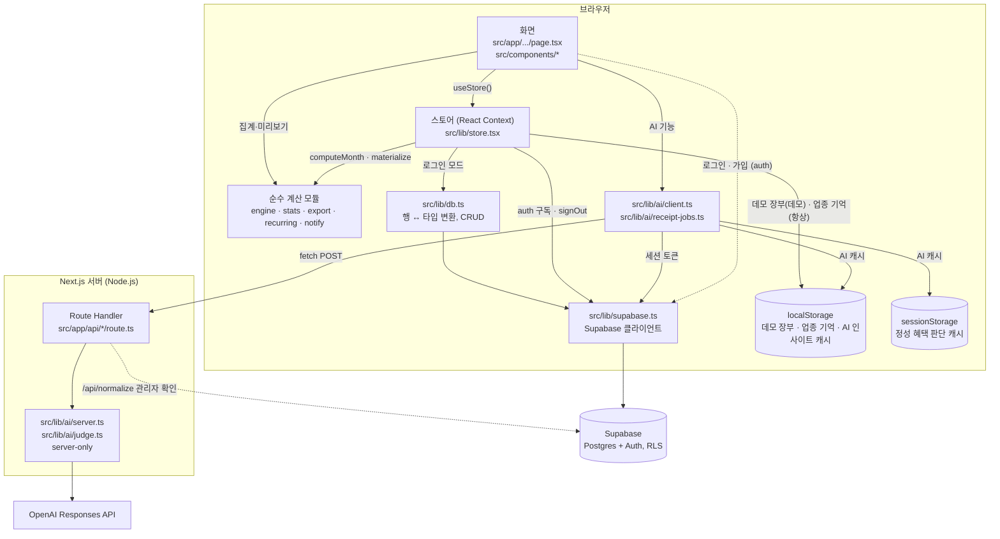
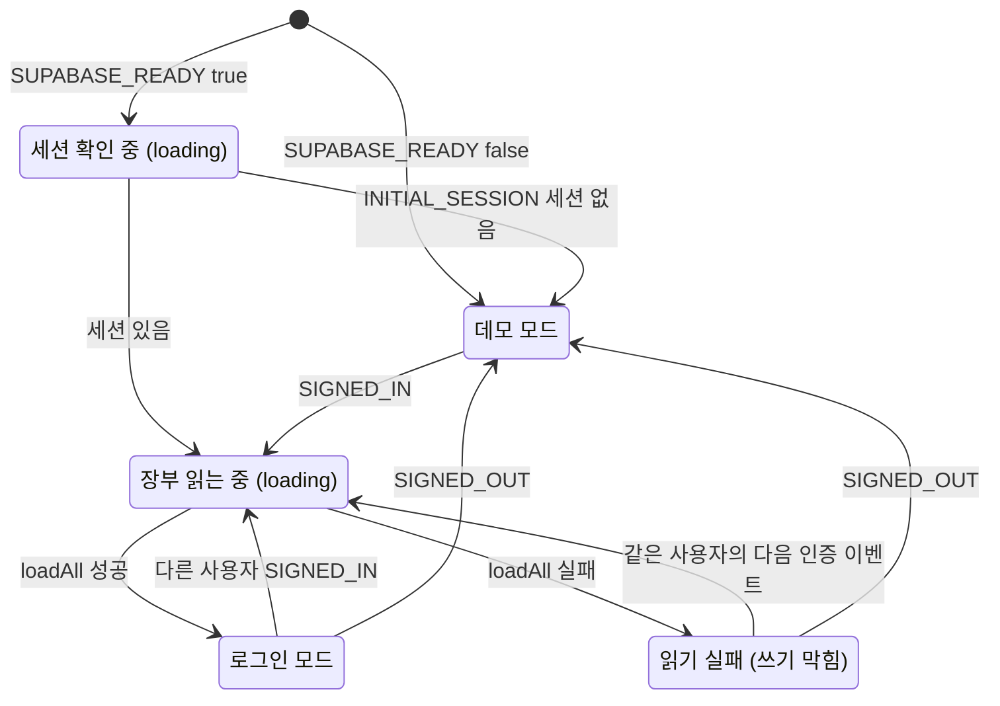
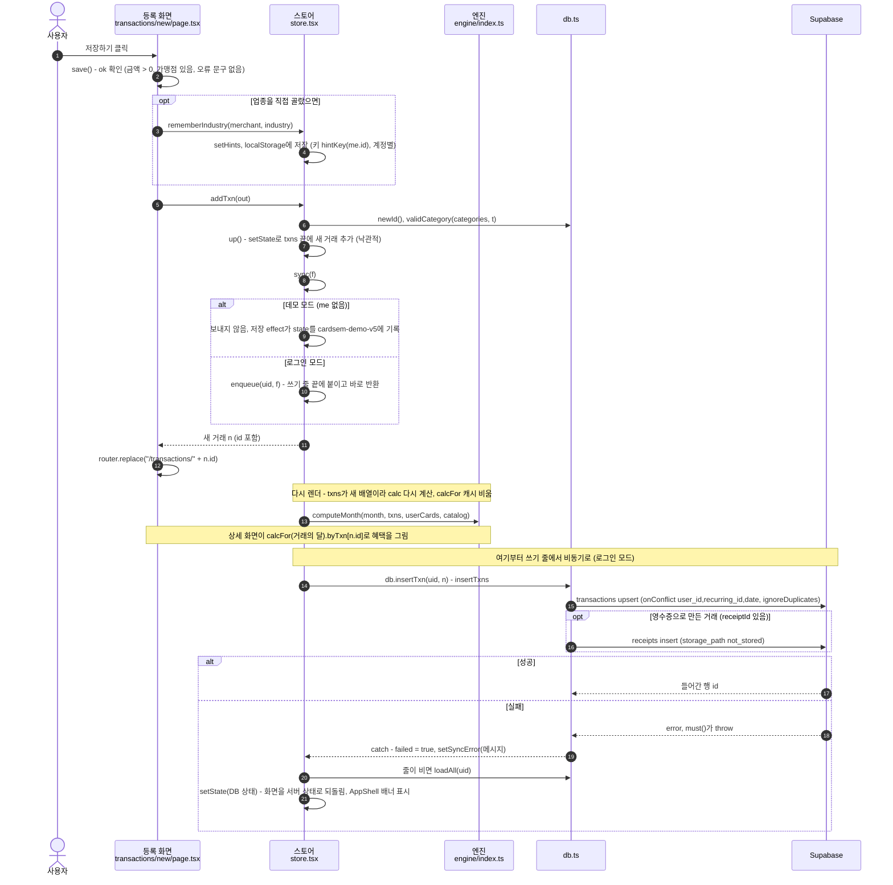

# 03. 구조와 데이터 흐름

이 문서는 "폴더가 어떻게 나뉘고, 버튼을 누르면 데이터가 어디로 가는가"를 설명합니다. 코드를 처음 여는 사람이 길을 잃지 않게 지도 역할을 합니다. 계산 규칙 자체는 [04. 혜택 계산 엔진](04-benefit-engine.md), 테이블 설계는 [07. 데이터 모델과 ERD](07-data-model.md)에서 다룹니다.

먼저 알아 둘 말 네 가지입니다.

| 용어 | 뜻 |
| --- | --- |
| 클라이언트 컴포넌트 | 파일 첫 줄에 `"use client"`가 있는 React 컴포넌트. 브라우저에서 실행됩니다. 이 앱의 화면(`page.tsx`)은 거의 전부 클라이언트 컴포넌트입니다. |
| React Context | 컴포넌트 트리 전체에 값을 내려 주는 React 기능. 어느 화면이든 `useStore()` 한 줄로 같은 상태를 읽습니다. |
| Route Handler | 서버에서 도는 HTTP 엔드포인트. `src/app/api/<이름>/route.ts`에서 `POST` 함수를 내보내면 `/api/<이름>` 주소가 됩니다. |
| RLS (Row Level Security) | Postgres가 행마다 "이 사용자가 읽고 쓸 수 있나"를 검사하는 기능. 장부 테이블은 `auth.uid() = user_id`인 행만 통과합니다. |

한 줄로 요약하면 이렇습니다. **화면은 스토어 하나만 보고, 스토어가 로컬 상태를 먼저 바꾼 뒤 로그인 상태면 같은 변경을 Supabase에 보냅니다. 혜택·집계 계산은 DB가 아니라 브라우저의 순수 함수가 합니다. AI 호출만 서버(Route Handler)를 거칩니다.**

---

## 1. 폴더 구조

```text
cardsem/
├─ src/
│  ├─ app/                          # 화면과 서버 API (Next.js App Router: 폴더 경로 = 주소)
│  │  ├─ layout.tsx                 # 루트 레이아웃. 모든 화면을 DemoProvider(스토어)로 감싼다
│  │  ├─ page.tsx                   # "/" → "/home" 으로 redirect
│  │  ├─ globals.css                # Tailwind + 디자인 토큰(@theme)
│  │  ├─ (app)/                     # 사용자 화면 묶음. 괄호 폴더는 주소에 나타나지 않는다 (route group)
│  │  │  ├─ layout.tsx              # AppShell: 사이드바·하단 탭·로딩 화면·동기화 오류 배너
│  │  │  ├─ home/ calendar/ monthly/ report/ budget/ notifications/ receipt/
│  │  │  ├─ transactions/           # 목록, [id] 상세, new 등록·수정, refund, recurring, bulk, search, categories
│  │  │  ├─ cards/                  # 목록, [id] 상세, [id]/rules, add, custom + card-stats.ts(카드 화면 계산)
│  │  │  ├─ stats/                  # layout.tsx(탭) + trend, share, pattern
│  │  │  └─ settings/               # 설정, export(엑셀 내보내기), withdraw(회원 탈퇴)
│  │  ├─ admin/                     # 어드민: cards, input, rules (+ / → cards로 이동) + admin.ts(공용 로직)
│  │  ├─ api/                       # Route Handler 5개: classify, ocr, insight, judge, normalize
│  │  └─ login/ signup/ onboarding/ # AppShell 밖에 있는 화면
│  ├─ components/                   # 여러 화면이 같이 쓰는 컴포넌트
│  └─ lib/                          # 상태·계산·데이터·AI·DB
│     ├─ store.tsx                  # 스토어 (React Context)
│     ├─ db.ts  supabase.ts         # Supabase 연결과 CRUD
│     ├─ types.ts                   # 도메인 타입
│     ├─ engine/index.ts            # 혜택 계산 엔진
│     ├─ stats.ts export.ts xlsx.ts chart.ts recurring.ts notify.ts format.ts labels.ts
│     ├─ data/                      # cards.ts merchants.ts fixtures.ts(테스트 전용) match-card.ts txn-rules.ts
│     └─ ai/                        # client.ts receipt-jobs.ts server.ts judge.ts judge.core.ts
├─ supabase/                        # schema.sql, seed.sql, migrations/ (SQL 8개)
└─ docs/                            # 이 문서들 + erd/cardsem_erdcloud.sql
```

### 폴더별 역할

| 폴더·파일 | 역할 | 실행 위치 |
| --- | --- | --- |
| `src/app/(app)/**/page.tsx` | 사용자 화면. `useStore()`로 상태를 읽고 액션을 부릅니다. | 브라우저 |
| `src/app/admin/**` | 카드 혜택 원문 → 규칙 정규화 → 검수 → 반영. 공용 계산은 `admin.ts` | 브라우저 |
| `src/app/api/*/route.ts` | AI 호출용 Route Handler. 브라우저에 없는 키(`OPENAI_API_KEY`)를 씁니다. | 서버(Node.js) |
| `src/app/layout.tsx`, `(app)/layout.tsx`, `admin/layout.tsx` | 서버 컴포넌트지만 하는 일은 클라이언트 컴포넌트(`DemoProvider`, `AppShell`)를 끼워 넣는 것뿐입니다. | 서버 렌더 후 브라우저 |
| `src/components/ui.tsx` | 버튼·카드·칩·시트·입력 같은 기본 UI ([09. 디자인 시스템](09-design-system.md)) | 브라우저 |
| `src/components/shell.tsx` | `AppShell`, `Screen`(화면 틀), `Sidebar`, `BottomNav`, `AddMenu`(+ 메뉴), `MonthPicker`, `ViewSwitch`, `Loading` | 브라우저 |
| `src/components/domain.tsx` | 거래 행, 카드 행, 혜택 배지 | 브라우저 |
| `src/components/charts.tsx` | SVG 차트·표 ([08](08-reports-stats-export.md)) | 브라우저 |
| `src/components/perk-judge.tsx` | 거래 상세의 "정성 혜택 판단" 카드 ([06](06-perks-jev.md)) | 브라우저 |
| `src/lib/store.tsx` | 앱 상태 전부와 쓰기 액션. 이 문서 3장 | 브라우저 |
| `src/lib/db.ts` | 테이블 행(snake_case) ↔ 타입(camelCase) 변환과 CRUD. CRUD는 스토어만 부릅니다(화면은 순수 함수 `validCategory`만 씀). | 브라우저 |
| `src/lib/supabase.ts` | Supabase 클라이언트 하나와 `SUPABASE_READY` 플래그, Auth 오류 문구 | 양쪽 |
| `src/lib/engine/index.ts` | 혜택 계산 (`computeMonth`, `calcCard`, `previewTxn` …) ([04](04-benefit-engine.md)) | 양쪽에서 쓸 수 있음 |
| `src/lib/stats.ts`, `export.ts`, `xlsx.ts`, `chart.ts` | 가계부 집계, 내보내기 시트, `.xlsx` 작성, 차트 눈금 ([08](08-reports-stats-export.md)) | 브라우저 |
| `src/lib/recurring.ts` | 반복 거래 회차 계산 (`materialize`, `dueDates`, `nextFrom`) | 브라우저 |
| `src/lib/notify.ts` | 앱 안 알림을 데이터에서 매번 계산 (`deriveNotifications`) + 읽음 표시 훅 | 브라우저 |
| `src/lib/data/cards.ts` | 기본 카드 카탈로그 `CARDS`와 `cardById`·`cardLabel` | 양쪽 |
| `src/lib/data/merchants.ts` | 업종 28종, 가맹점 사전, 기본 카테고리, 업종 기억 키 | 양쪽 |
| `src/lib/data/fixtures.ts` | 테스트용 고정 장부 (카드 3장, 2026년 7~9월 거래, `TODAY = "2026-09-20"`). 앱은 불러오지 않고 테스트만 씀 | 테스트 |
| `src/lib/data/match-card.ts`, `txn-rules.ts` | 영수증 값 ↔ 보유 카드·기존 거래 맞추기, 환불·검색 같은 거래 규칙 | 브라우저 |
| `src/lib/ai/client.ts` | 브라우저 → `/api/*` 호출 헬퍼와 캐시 훅 (`useInsight`, `usePerkJudgment`) | 브라우저 |
| `src/lib/ai/receipt-jobs.ts` | 영수증 인식 작업 목록 (모듈 변수 + `useSyncExternalStore`) | 브라우저 |
| `src/lib/ai/server.ts`, `judge.ts` | OpenAI 호출. `import "server-only"` (6장) | 서버 |
| `src/lib/ai/judge.core.ts` | 정성 혜택 판단의 순수 부분 (state 조립, 답 해석). 테스트 대상 | 서버(테스트에서도 import) |
| `supabase/schema.sql` | 스키마 최종 모양. 빈 DB에 이 파일 하나만 돌려도 됩니다. | DB |
| `supabase/migrations/` | 같은 스키마를 시간순 변경으로 나눈 SQL 8개 ([10](10-development.md)) | DB |
| `supabase/seed.sql` | 카드 상품·혜택 규칙 시드 (`cards.ts`에서 생성) | DB |

`*.test.ts`는 테스트하려는 파일 옆에 둡니다. `vitest.config.ts`가 `src/**/*.test.ts`만 모읍니다.

---

## 2. 레이어 — 누가 누구를 부르나

화살표는 "import해서 호출한다"는 뜻입니다. 저장소(원통)로 가는 화살표는 "읽고 쓴다"는 뜻입니다.



지켜지는 규칙은 다음과 같습니다.

1. **화면은 DB를 직접 부르지 않습니다.** 장부 데이터는 전부 스토어를 거칩니다. 예외는 로그인·가입·비밀번호 재설정 화면(`login`, `signup`)이 `supabase().auth.*`를 직접 부르는 것뿐입니다. `db.ts`에서 화면이 가져다 쓰는 것은 순수 함수 `validCategory` 하나입니다(`transactions/new`).
2. **순수 계산 모듈은 DB를 모릅니다.** 거래·카드 배열을 받아 숫자를 돌려줄 뿐입니다. 그래서 데모 모드와 로그인 모드의 계산 결과가 똑같고, 화면 없이 vitest로 테스트합니다. (`notify.ts`의 읽음 표시 훅 `useReadNotices`만 React 훅입니다.)
3. **화면도 순수 모듈을 직접 부릅니다.** 예를 들어 월간 요약은 `monthSummary(txns, month, categories)`를 직접 부르고, 거래 등록 화면은 `previewTxn`으로 예상 혜택을 미리 계산합니다. 스토어가 들고 있는 계산은 혜택 계산(`calc`, `calcFor`)뿐입니다.
4. **AI 키는 서버에만 있습니다.** 브라우저는 `lib/ai/client.ts`로 `/api/*`에 POST하고, Route Handler가 `lib/ai/server.ts`를 불러 OpenAI를 호출합니다. 금액 계산은 AI에 맡기지 않습니다.
5. 정성 혜택 판단 기능의 이름은 Jev([06](06-perks-jev.md))지만, 현재 코드의 `/api/judge`는 `lib/ai/judge.ts` → `server.ts`의 `parse()`로 **OpenAI Responses API**를 부릅니다. 응답의 `engine` 값도 `"openai"` 하나뿐입니다. `package.json`에 `@typesafe-ai/sdk`가 있지만 `src`에서 import하는 곳은 없습니다.

---

## 3. 스토어 상세 (`src/lib/store.tsx`)

`DemoProvider`가 루트 레이아웃(`src/app/layout.tsx`)에서 모든 화면을 감쌉니다. 화면은 `useStore()`로 아래 값을 받습니다. `DemoProvider` 밖에서 부르면 오류를 던집니다.

### 3.1 State — 저장되는 데이터 여섯 가지

```ts
type State = { txns: Transaction[]; userCards: UserCard[]; budgets: Budget[]; categories: Category[]; recurring: RecurringRule[]; customCards: CardProduct[] };
```

| 필드 | 타입 | 내용 | 로그인 모드의 테이블 |
| --- | --- | --- | --- |
| `txns` | `Transaction[]` | 거래 (수입·지출·환불) | `transactions` (+ `receipts`에서 `receiptId` 복원) |
| `userCards` | `UserCard[]` | 보유 카드와 카드별 설정(패키지, 실적 보정, 청구 사이클, BIN) | `user_cards` |
| `budgets` | `Budget[]` | 예산. `categoryId`가 없으면 총예산 | `budgets` |
| `categories` | `Category[]` | 사용자 카테고리 (상위·하위 2단계) | `categories` |
| `recurring` | `RecurringRule[]` | 반복 거래 규칙 | `recurring_rules` |
| `customCards` | `CardProduct[]` | 직접 추가한 카드 (id가 `custom_`으로 시작) | `card_products` (`owner_id` = 본인, `custom_def`에 정의 전체) |

알림은 State에 없습니다. `lib/notify.ts`가 이 데이터에서 매번 계산합니다. DB의 `notifications` 테이블은 앱이 읽지 않습니다.

### 3.2 State 밖에서 스토어가 내주는 값

| 이름 | 내용 |
| --- | --- |
| `me` | 로그인 사용자 `{ id, email, name, admin }`. `null`이면 데모 모드(공용 데모 계정에 붙어 있어도 `null`). `name`은 `user_metadata.name` → 이메일 앞부분 → `"사용자"` 순, `admin`은 `app_metadata.role === "admin"` |
| `demoShared` | 데모 장부가 공용 데모 계정(서버)에 있으면 `true`. 설정·탈퇴 화면 문구가 이 값으로 바뀝니다 |
| `loading` | 로그인 상태 확인·DB 읽기 중이면 `true` (3.6) |
| `syncError`, `clearSyncError` | DB 읽기·쓰기 실패 메시지와 닫기 (3.5) |
| `today` | 오늘 날짜 `YYYY-MM-DD` (3.7) |
| `month`, `setMonth` | 화면들이 함께 보는 "선택한 달" `YYYY-MM` (3.7) |
| `calc`, `calcFor(ym)` | 혜택 계산 결과 (3.8) |
| `catalog` | 기본 카드 + 직접 추가한 카드 (3.9) |
| `industryHints`, `rememberIndustry` | 업종 기억 (3.10) |
| 쓰기 액션 | `addTxn`, `updateTxn`, `deleteTxns`, `addUserCard`, `removeUserCard`, `updateUserCard`, `setBudgets`, `setCategories`, `deleteCategory`, `addRecurring`, `updateRecurring`, `deleteRecurring`, `addCustomCard`, `removeCustomCard` |
| 계정 액션 | `reset`(데모 초기화), `signOut`, `deleteAccount`(회원 탈퇴) |

### 3.3 데모 모드와 로그인 모드

화면은 두 모드를 구분하지 않습니다. 차이는 스토어 안에서 "데이터를 어디서 읽고 어디에 쓰느냐"뿐입니다.

| | 데모 모드 | 로그인 모드 |
| --- | --- | --- |
| 조건 | `me === null` (로그인 안 함, 또는 Supabase 환경변수 없음) | Supabase 세션이 있음 |
| 처음 데이터 | `localStorage`의 `cardsem-demo-v5`, 없으면 빈 장부 `seed()` (기본 카테고리 + 총예산 1,500,000원, 거래·카드·반복 규칙 없음. 로그인 첫 장부와 같음) | `loadAll(uid)` (`db.ts`에서 `db` 객체와 따로 export하는 함수) |
| 쓰기 | 상태만 바꾸고, effect가 상태 전체를 `cardsem-demo-v5`에 저장 | 상태를 바꾸고 같은 변경을 `db.*`로 보냄 |
| 오늘 | 실제 오늘 (로컬 날짜) | 실제 오늘 (로컬 날짜) |

`.env.local`에 `NEXT_PUBLIC_SUPABASE_URL`과 `NEXT_PUBLIC_SUPABASE_ANON_KEY`가 모두 있어야 `SUPABASE_READY`가 `true`가 되고 로그인을 쓸 수 있습니다. 없으면 앱은 데모 모드로만 돕니다.

**공용 데모 계정.** `NEXT_PUBLIC_DEMO_EMAIL`도 있으면 데모 장부를 localStorage 대신 그 계정의 DB 행에 둡니다. 스토어는 DB에 붙은 계정을 `acct`로 들고, 그 이메일이 데모 계정이면 화면에 내주는 `me`만 `null`로 둡니다. 그래서 화면은 데모로 보이고 DB 쓰기는 로그인 모드와 똑같이 `db.*`로 갑니다.

1. 세션이 없으면(`INITIAL_SESSION`·`SIGNED_OUT`) `signInDemo()`가 `POST /api/demo`를 부릅니다. 이 라우트는 서버 환경변수 `DEMO_PASSWORD`로 로그인해 토큰만 돌려주고, 브라우저는 `auth.setSession`으로 받습니다.
2. 이어서 오는 `SIGNED_IN`에서 평소처럼 `loadAll`로 읽습니다. 데모 계정에 미리 채워 두는 데이터는 없습니다. 처음 붙은 계정이면 `loadAll`이 일반 새 계정처럼 기본 카테고리와 총예산 1,500,000원만 넣습니다.
3. 오늘 날짜와 반복 회차 생성은 로그인 모드처럼 실제 오늘 기준입니다.
4. 라우트가 실패하면 `demoFailed`를 세우고 localStorage 데모로 돌아갑니다. 같은 접속에서는 다시 시도하지 않습니다.
5. `reset`과 데모의 `deleteAccount`(둘 다 `resetDemo`)는 `deleteAllMine` 뒤 기본 카테고리(`setCategories`)와 총예산 1,500,000원(`setBudgets`)만 다시 넣어 빈 장부로 되돌립니다. `signOut`은 데모 계정이면 부르지 않습니다. Supabase 기본 로그아웃은 그 계정의 모든 세션을 끊기 때문입니다.

모드 전환은 `supabase().auth.onAuthStateChange` 구독 한 곳에서 처리합니다(`useEffect`에서 한 번만 구독). 첫 이벤트는 `INITIAL_SESSION`입니다.



- `loadedFor`(ref)는 "지금 state가 담고 있는 사용자 id"입니다(`null` = 데모). 사용자 id가 **바뀔 때만** 다시 읽습니다. 탭에 돌아올 때마다 오는 같은 사용자의 `SIGNED_IN`, `TOKEN_REFRESHED`, `USER_UPDATED`는 `me`의 이름·이메일·관리자 여부만 갱신합니다. 진행 중인 낙관적 변경을 DB 값으로 덮지 않기 위해서입니다.
- 사용자가 바뀌면 `loading = true`, `me = null`, `state = empty()`로 비운 뒤 `loadAll`을 부릅니다. 비우는 이유는 읽는 동안 데모 장부가 남의 장부처럼 보이지 않게 하려는 것입니다.
- `loadAll`은 테이블을 `Promise.all`로 한 번에 읽습니다. `transactions`와 `receipts`는 PostgREST의 한 요청 최대 1000행 제한 때문에 1000행씩 페이지를 넘겨 끝까지 읽습니다. 첫 로그인(카테고리 0개)이면 기본 카테고리와 총예산 1,500,000원을 `upsert(ignoreDuplicates)`로 넣습니다.
- `SIGNED_OUT`이면 `demoState()`(이 브라우저의 데모 장부)로 돌아가고 선택한 달도 실제 오늘의 달로 돌립니다.

### 3.4 브라우저 저장소 키 전부

| 키 | 저장소 | 정의한 곳 | 내용 | 지우는 때 |
| --- | --- | --- | --- | --- |
| `cardsem-demo-v5` | localStorage | `store.tsx` `KEY` | 데모 장부 State 전체 (6개 필드). 데모의 시작 장부를 바꾸면 버전 숫자를 올려 예전 데모 상태를 무효화 (v5: 예시 데이터 제거) | `reset`, 데모 모드의 `deleteAccount`(옛 `cardsem-demo-*` 키 포함) |
| `cardsem-industry-hints:<사용자 id 또는 demo>` | localStorage | `store.tsx` `hintKey()` | 업종 기억 `{ 가맹점 키: 업종 }`. **로그인 모드에서도 이 기기에만, 계정별로** | `deleteAccount`(지금 계정 키) |
| `cardsem-read-notices:<사용자 id 또는 demo>` | localStorage | `notify.ts` `readKey()` | 읽은 알림 id 목록 (최근 300개) | `reset`(demo 키), `deleteAccount`(지금 사용자 키) |
| `cardsem-insight:<home 또는 monthly>:<YYYY-MM>:<해시>` | localStorage | `ai/client.ts` `useInsight` | AI 인사이트 응답. 집계값이 같으면 다시 부르지 않음 | 지우는 코드 없음 |
| `cardsem-judge:<해시>` | sessionStorage | `ai/client.ts` `usePerkJudgment` | 정성 혜택 판단 응답. 거래 내용이 같으면 다시 부르지 않음 | 탭을 닫을 때 |
| `cardsem-normalized` | sessionStorage | `admin/admin.ts` `DRAFT_KEY` | 어드민 LLM 정규화 초안 | 검수에서 반영 후·버리기 (`clearDraft`) |
| `cardsem-admin-draft` | localStorage | `admin/admin.ts` `FORM_KEY` | 어드민 원문 입력 폼 임시 저장 | 검수에서 반영 후 |
| `cardsem-custom-cards` | localStorage | (예전 버전이 쓰던 키) | 지금은 쓰지 않음 | 데모 모드의 `deleteAccount` |
| `cardsem-industry-hints` (뒤에 `:` 없음) | localStorage | (예전 버전이 쓰던 키) | 지금은 쓰지 않음 | 데모 모드의 `deleteAccount` |
| `sb-<프로젝트 ref>-auth-token` | localStorage | supabase-js 기본값 | 로그인 세션 토큰 | 로그아웃 |

모든 읽기·쓰기는 `try { … } catch { /* 무시 */ }`로 감쌉니다. 사생활 보호 모드처럼 저장소를 못 쓰는 브라우저에서도 화면이 깨지지 않게 하려는 것입니다.

스토어 밖에 있는 상태도 두 가지 있습니다. 영수증 인식 작업 목록(`lib/ai/receipt-jobs.ts`)은 모듈 변수라 다른 화면에 갔다 와도 남지만 새로고침하면 사라집니다. 다른 계정이나 데모로 바뀌어도 지웁니다(`receiptJobs.own(me?.id ?? "demo")`가 이전 작업의 주인과 다르면 `clear()`). 로그아웃은 페이지를 새로 고치지 않아 모듈 변수가 다음 사용자에게 남기 때문입니다. 어드민 초안은 위 표의 두 키에 있습니다.

### 3.5 낙관적 업데이트와 쓰기 줄, `syncError`

**낙관적 업데이트(optimistic update)**: 서버 응답을 기다리지 않고 화면부터 바꾸는 방식입니다. 모든 쓰기 액션이 같은 두 단계를 거칩니다.

```ts
// 1) 로컬 상태를 먼저 바꾼다
up((s) => ({ txns: [...s.txns, n] }));
// 2) 로그인 상태면 같은 변경을 DB에 보낸다 (데모면 아무것도 안 함)
sync((uid) => db.insertTxn(uid, n));
```

- `up(f)`는 `setState((s) => ({ ...s, ...f(s) }))`입니다. 항상 **새 배열**을 만듭니다. 엔진의 캐시(3.8)가 배열 참조로 동작하기 때문에 지켜야 하는 전제입니다.
- DB에 보낼 값은 반드시 업데이터 **밖에서** 만듭니다. React는 업데이터를 렌더 때 늦게 실행할 수 있어서, 안에서 만들면 `sync`가 아직 비어 있는 값을 보낼 수 있습니다.
- `sync(f)`는 `me`가 없으면 바로 끝납니다. 장부 읽기에 실패한 상태(`loadFailed`)면 보내지 않고 `"장부를 아직 불러오지 못해 저장하지 않았어요"`를 남깁니다. 읽기에 실패한 빈 state를 기준으로 만든 값(예: 빈 카테고리 목록에서 고른 카테고리)을 보내면 서버와 어긋난 값이 저장되기 때문입니다.
- 보낼 작업은 `enqueue(uid, f)`로 **쓰기 줄**(Promise 체인 하나)에 붙어 순서대로 나갑니다. "추가 직후 삭제"가 서버에서 뒤집히지 않게 하려는 것입니다. 직접 추가한 카드처럼 FK 순서가 중요한 쓰기(카드 행 → 보유 행)도 이 줄 덕분에 순서가 지켜집니다.
- 줄의 작업이 실패하면 `failed = true`, `syncError = 오류 메시지`가 됩니다. **줄이 비었을 때** `loadAll(uid)`로 DB 상태를 다시 읽어 화면을 되돌립니다. 실패한 변경이 화면에만 남아 "저장된 것처럼" 보이지 않게 하려는 것입니다. 되돌리는 동안 새 쓰기가 들어오면 그게 끝난 뒤 다시 읽습니다.
- `syncError`는 다음 쓰기가 성공해도 지워지지 않습니다. 쓰기 실패 뒤의 되돌리기 읽기(`loadAll`)가 성공해도 배너는 닫히지 않습니다. 배너는 `AppShell`의 배너("서버와 맞추지 못했어요")에서 닫기(`clearSyncError`)를 누르거나, 새로고침하거나, 인증 이벤트로 장부를 다시 읽는 데(`apply()`의 `loadAll`. 로그인·계정 전환·읽기 실패 뒤 재시도) 성공해야 사라집니다. 배너에는 새로고침 버튼도 있습니다.
- 되돌리기 읽기마저 실패하면 메시지가 "저장에 실패했고 서버 내용도 다시 불러오지 못했어요. … 새로고침해 주세요"로 바뀝니다.
- `signOut`과 `deleteAccount`는 `await q.current.chain`으로 보내는 중인 쓰기가 끝나기를 기다린 뒤 진행합니다. 세션이 먼저 사라지면 남은 요청이 RLS에 거부되기 때문입니다.
- `db.deleteTxns`, `deleteCard`, `deleteRecurring`에는 `user_id` 조건이 없습니다. 그래도 RLS가 본인 행만 통과시키므로 남의 행에는 닿지 않습니다.

액션별로 덧붙는 동작은 이렇습니다.

| 액션 | 로컬에서 하는 일 | DB로 보내는 것 |
| --- | --- | --- |
| `addTxn(t)` | `id = newId()`, `categoryId = validCategory(…)`로 새 거래를 만들어 추가하고 돌려줌 | `db.insertTxn` (영수증 거래면 `receipts` 행도) |
| `updateTxn(id, patch)` | 카테고리·구분이 바뀌면 `validCategory`로 검사. `categoryId`·`cardId`·`payType`이 바뀌면 그 거래의 환불 거래에도 같은 값 | `db.updateTxn` (patch에 키가 있는 필드만. 카드·메모처럼 비울 수 있는 필드의 `undefined`는 `null`로) + 환불 거래마다 한 번 |
| `deleteTxns(ids)` | 그 거래와 그 거래의 환불 거래를 함께 제거 | `id in (…) or original_txn_id in (…)` 삭제 |
| `setBudgets(b)` | 같은 카테고리가 두 번이면 마지막 값만. 직전 state와 비교해 이번에 뺀 예산을 `removed`로 만듦 | upsert 후 이번에 뺀 예산(`removed`)만 삭제 (다른 탭·기기가 만든 행은 건드리지 않음) |
| `setCategories(c)` | 직전 state와 비교해 이번에 뺀 카테고리를 `removed`로 만듦 | `setBudgets`와 같은 방식: upsert(상위 먼저) 후 `removed`만 삭제 |
| `deleteCategory(id)` | 하위 카테고리까지 지우고 거래·반복 거래는 구분별 '기타'로, 딸린 예산 삭제 | `moveCategory` → `setCategories` 순서 |
| `removeCustomCard(id)` | 보유 해제, 그 카드로 기록한 거래·반복 거래는 남기고 `cardId`만 비움 | 거래·반복 `card_id = null` → `user_cards` 삭제 → `card_products` 삭제 |

`validCategory`는 사용자 카테고리에 없는 id(지웠거나 수입·지출 구분이 다른 id)를 업종에 맞는 카테고리 → 상위 → '기타' 순으로 바꿉니다. 로그인 모드에서 없는 카테고리 id는 FK 위반으로 저장이 거부되므로, 거래와 반복 규칙은 쓰기 전에 항상 이 함수를 거칩니다.

### 3.6 로딩

- `loading`의 처음 값은 `SUPABASE_READY`입니다. Supabase 환경변수가 없으면 처음부터 `false`(데모)이고, 있으면 첫 인증 이벤트를 받을 때까지 `true`입니다.
- 장부를 읽는 동안(`setState(empty())` 뒤) state는 비어 있습니다. 세션을 확인하는 동안(첫 인증 이벤트 전)에는 state에 데모 데이터가 들어 있습니다(첫 렌더는 `seed()`, 마운트 뒤에는 `demoState()`). 두 경우 모두 `AppShell`과 온보딩 화면이 전체 화면 `Loading`("장부를 불러오는 중이에요")으로 가리므로 화면에는 보이지 않습니다.
- 주소로 직접 들어온 화면에 "찾을 수 없어요"가 잘못 뜨지 않게 실제로 막는 것은 `AppShell`의 `Loading`입니다. `(app)` 아래 화면은 `loading` 동안 그려지지 않습니다. 화면 안의 가드(거래 상세 `if (!t && loading) return null`, 거래 수정 폼 `Gate`의 `if (loading) return null`)는 이중 안전장치입니다.
- 예외: Supabase 환경변수가 없는 데모는 `loading`이 처음부터 `false`이고 첫 렌더가 빈 장부 `seed()`입니다. 그래서 직접 추가한 데모 거래의 상세·수정 주소로 바로 들어오면 "거래를 찾을 수 없어요"가 한 프레임 보였다가, 마운트 effect가 `demoState()`를 넣으면 바뀝니다.
- 데모 장부는 `localStorage`를 마운트 후에만 읽을 수 있습니다(서버 렌더와 첫 화면이 달라지지 않게). 그래서 첫 렌더는 빈 장부 `seed()`로 그리고, 마운트 effect에서 `demoState()`로 바꿉니다. 저장 effect는 `hydrated && !me && !loading`일 때만 돕니다. 로그인 장부나 읽는 중의 빈 state가 데모 키에 저장되지 않게 하려는 것입니다.

### 3.7 오늘 날짜와 선택한 달

```ts
const today = realToday(); // realToday = ymd(new Date())
```

- 데모와 로그인 모두 실제 오늘입니다. `ymd()`(`lib/recurring.ts`)가 로컬 날짜로 만듭니다. `toISOString()`은 UTC라 한국 0~9시에 하루 전 날짜가 나와서 쓰지 않습니다.
- 렌더할 때마다 계산하므로 자정을 넘기면 다음 렌더부터 새 날짜가 됩니다.
- 서버 쪽은 `kstToday()`(`lib/ai/server.ts`, UTC + 9시간)를 씁니다. 영수증 인식 프롬프트의 "오늘은 …"과, `/api/judge`에 `today`가 없을 때의 기본값입니다.
- `month`(선택한 달)는 처음에 실제 오늘의 달이고, 로그인 읽기가 끝날 때와 로그아웃할 때도 실제 오늘의 달로 돌아갑니다. `MonthPicker`(머리글의 ‹ › 버튼)가 `setMonth`로 바꿉니다. 주소에는 들어가지 않으므로, 월간 요약에서 `/transactions?cat=…`로 넘어가도 같은 달을 봅니다.

### 3.8 계산 캐시 — `calc`와 `calcFor`

혜택 계산(`computeMonth`)은 한 달의 결제를 모두 시간순으로 다시 돌리므로 가볍지 않습니다. 스토어는 두 가지로 결과를 재사용합니다.

| 이름 | 범위 | 다시 계산하는 때 |
| --- | --- | --- |
| `calc` | 선택한 달 `month` | `useMemo` — `month`, `txns`, `userCards`, `catalog` 중 하나라도 바뀌면 |
| `calcFor(ym)` | 아무 달 | 달마다 `Map`에 저장. `txns`·`userCards`·`catalog` **배열 참조**가 하나라도 바뀌면 `Map`을 통째로 비움 |

```ts
// store.tsx (요약)
const calcFor = (ym: string) => {
  const c = cache.current;
  if (c.key[0] !== state.txns || c.key[1] !== state.userCards || c.key[2] !== catalog) cache.current = { key: [state.txns, state.userCards, catalog], map: new Map() };
  const m = cache.current.map;
  if (!m.has(ym)) m.set(ym, computeMonth(ym, state.txns, state.userCards, catalog));
  return m.get(ym)!;
};
```

`calcFor`를 쓰는 곳의 예입니다. 지난달 비교(홈·리포트·월간 요약), 월별 추이(통계·추이 12개월, 카드 상세 6개월), 알림 화면과 홈의 안 읽음 점(오늘이 속한 달), 엑셀 내보내기(`buildExport`), 거래 검색, 환불 기록, 거래 등록 미리보기(거래 날짜의 달이 선택한 달과 다를 때). 거래 상세는 다른 달일 때만이 아니라 항상 `calcFor(거래가 속한 달)`을 씁니다. 엔진 안에도 거래 배열 참조를 키로 쓰는 `WeakMap` 캐시가 두 개 있습니다. 환불 합계 색인(`refundsOf`)과 연간 횟수 누적(`yearCountsUntil`)입니다. 셋 다 "배열을 제자리에서 고치지 않고 새 배열로 바꾼다"는 전제에 기대므로 스토어의 `up()`이 이를 지킵니다. 자세한 계산은 [04](04-benefit-engine.md)에 있습니다.

### 3.9 `catalog`와 직접 추가한 카드

```ts
const catalog = useMemo(() => [...CARDS, ...state.customCards], [state.customCards]);
registerCustomCards(state.customCards); // 렌더마다 호출
```

- **계산은 항상 `catalog`로 합니다.** `CARDS`는 `lib/data/cards.ts`에 코드로 들어 있는 기본 카드입니다. 앱은 기본 카드를 DB에서 읽지 않습니다. 어드민 화면도 `catalog`를 읽으므로, DB의 `card_products`·`benefit_rules` 기본 행(`owner_id` null)을 읽는 코드는 현재 없습니다.
- 그래도 기본 카드 행은 `card_products`에 꼭 있어야 합니다. `user_cards`·`transactions`·`recurring_rules`의 `card_id`가 `card_products(id)`를 FK(외래 키, 다른 테이블의 행을 가리키는 열)로 참조하기 때문입니다. `supabase/seed.sql`을 실행하지 않았거나, `cards.ts`에 카드를 더한 뒤 `seed.sql`을 다시 만들어 실행하지 않으면, 로그인 모드에서 그 카드 등록과 결제 저장이 FK 위반으로 실패합니다([10. 개발 · 테스트 · 배포](10-development.md)).
- `cardById`, `cardLabel`은 컴포넌트·알림 어디서나 부르는 모듈 함수라 스토어를 볼 수 없습니다. 그래서 스토어가 렌더마다 `registerCustomCards`로 지금 목록을 모듈 변수에 알려 줍니다. 이 등록은 브라우저에서만 일어나므로 **서버(Route Handler)의 `cardById`는 기본 카드만 찾습니다.**
- 저장 위치: 데모는 장부와 함께 `cardsem-demo-v5`에, 로그인은 `card_products`에 `owner_id = 본인`, `custom_def = CardProduct 전체`로 둡니다. 같은 테이블이라 `transactions`·`recurring_rules`·`user_cards`의 `card_id` FK가 그대로 성립합니다. DB CHECK가 사용자 카드 id를 `custom_`으로 시작하게 강제합니다.
- `addCustomCard`를 부르는 곳은 두 곳입니다. 카드 직접 추가(`cards/custom`)와 어드민 원문 입력의 "AI로 규칙 만들기"(`admin/input`, AI가 만든 규칙으로 바로 만든 `custom_…` 카드)입니다. 그래서 어드민에서 반영한 카드도 반영한 사람의 `catalog`에만 보입니다.

### 3.10 업종 기억

사용자가 거래의 업종을 직접 고치면 같은 가맹점은 다음부터 그 업종으로 분류합니다(업종 분류 1순위, `resolveIndustry`).

- `rememberIndustry(merchant, industry)`는 `merchantKeys(merchant)`가 만든 키마다 업종을 적어 localStorage의 `hintKey(me?.id)` = `cardsem-industry-hints:<사용자 id 또는 demo>`에 저장합니다. 키는 공백을 뺀 소문자 전체 이름과, 이름에 공백이 있으면 첫 단어(2글자 이상)입니다. "스타벅스 강남점"을 고치면 `스타벅스강남점`과 `스타벅스` 두 키가 생겨 "스타벅스 역삼점"에도 적용됩니다.
- 부르는 곳: 거래 등록·수정 저장(업종을 직접 골랐을 때), 거래 상세의 업종 바로 고치기, 영수증 확인 화면.
- 로그인 모드에서도 DB가 아니라 이 기기에, 계정별로 따로 둡니다. 계정(또는 데모)이 바뀌면 로딩이 끝난 뒤 그 계정의 기억을 다시 읽습니다. 기기 간 동기화는 아직 없습니다(코드의 `ponytail:` 주석).

### 3.11 반복 거래 자동 생성 시점

반복 규칙에서 아직 만들지 않은 회차를 거래로 만드는 일은 `materialize(rules, txns, today)`(`lib/recurring.ts`)가 하고, 스토어의 `generate()`가 결과에 `id`와 검증한 카테고리를 붙입니다. 서버 크론은 없고 **브라우저가 다음 세 시점에** 부릅니다.

| 시점 | 기준 날짜 | 범위 |
| --- | --- | --- |
| 데모 장부를 만들 때 (마운트·로그아웃 때 `demoState()`) | 실제 오늘 | 모든 규칙. 데모 초기화·탈퇴는 반복 규칙이 없는 빈 장부라 만들 회차가 없음 |
| 로그인 후 `loadAll` 직후 | 실제 오늘 | 모든 규칙. 만든 거래와 바뀐 규칙은 쓰기 줄로 DB에 보냄 |
| 규칙을 추가·수정할 때 (`addRecurring`, `updateRecurring` → `saveRule`) | `today` | 그 규칙 하나 |

- 각 규칙은 `nextFrom(r)`부터 오늘까지만 봅니다. 처음이면 시작일, 아니면 마지막 생성일(`lastGeneratedAt`)이 든 기간의 다음 기간(매월: 다음 달 1일, 매주: 7일 뒤)입니다. 그래서 사용자가 지운 회차가 다시 생기지 않습니다.
- 예시(vitest로 확인): 매월 25일, 시작일 2026-07-25인 규칙을 2026-09-20에 저장하면 7/25와 8/25 거래 두 건이 바로 생기고 `lastGeneratedAt = 2026-08-25`가 됩니다. 다음 탐색 시작은 9/1이라 9/20에는 더 생기지 않고, 9/25 이후에 앱을 열면 9/25 회차가 생깁니다.
- 로그인 모드의 DB 순서는 **규칙 → 거래(`recurring_id` FK) → 마지막 생성일 갱신**입니다(`saveRule`). 거래는 `(user_id, recurring_id, date)` 유일 색인에 `upsert(ignoreDuplicates)`로 넣어, 두 기기가 같은 회차를 만들어도 한 번만 들어갑니다. 실제로 들어간 행 수가 모자라면(다른 기기가 먼저 넣음) 줄이 빈 뒤 다시 읽어 그쪽 id로 맞춥니다.
- 앱을 켜 둔 채 자정을 넘기면 새 회차는 다음 로드 때 생깁니다.
- `deleteRecurring`은 규칙만 지웁니다. 이미 만든 거래는 남고 반복 표시(`recurringId`)만 빠집니다(DB는 FK `on delete set null`).

---

## 4. 버튼 하나가 지나가는 길 — 거래 저장

거래 등록 화면(`/transactions/new`)에서 "저장하기"를 누르면 아래 순서로 함수가 불립니다. 로그인 모드 기준이고, 데모 모드의 차이는 `alt`에 적었습니다.



저장 버튼을 누르기 **전**, 입력하는 동안에도 몇 가지가 돕니다.

1. 가맹점을 칠 때마다 `onMerchant` → `resolveIndustry(이름, null, industryHints)`가 업종을 정합니다(업종 기억 → 가맹점 사전). 업종에 맞춰 카테고리도 바꿉니다(사용자가 카테고리를 직접 고르기 전까지).
2. 사전에 없고 두 글자 이상이면 0.7초 뒤 `aiClassify` → `POST /api/classify`를 부릅니다. 늦게 온 응답은 순번(`req`)으로 버립니다.
3. 카드를 고르면 `requiredFields(card, variantId)`가 그 카드 규칙이 요구하는 조건 필드(결제 시각·자동납부 등)만 보여 줍니다.
4. 렌더마다 `previewTxn(draft, calc 또는 calcFor(ym), …)`가 보유 카드 전체로 예상 혜택과 더 유리한 카드를 계산합니다. 수정 중이면 `excludeId`로 이 거래가 이미 쓴 한도를 빼고 계산합니다.

수정(`?id=`가 있을 때)이면 다이어그램의 `addTxn` 대신 `updateTxn(editId, out)`이 불리고, 원거래의 카테고리·카드·결제수단이 바뀌면 그 환불 거래도 같은 값으로 바뀝니다(3.5 표).

---

## 5. Route Handler (`src/app/api/*/route.ts`)

다섯 개 모두 `POST`만 받고 `export const runtime = "nodejs"`입니다. 브라우저는 `lib/ai/client.ts`의 `post()`로 부릅니다. `post()`는 로그인 모드면 Supabase 세션 토큰을 `Authorization: Bearer …`로 붙이고, 응답이 JSON이 아니면(플랫폼의 413·504 등) 상태 코드로 안내 문구를 만듭니다.

| 경로 | 입력 | 출력 | 쓰는 서버 함수 | 부르는 곳 |
| --- | --- | --- | --- | --- |
| `/api/classify` | JSON `{ merchant }` (앞뒤 공백을 뺀 2글자 이상, 아니면 400) | `{ industry, confidence, source: "dict" \| "llm" }` | `classifyMerchant`(사전) → 없으면 `classifyMerchantAI` | 거래 등록 화면 (`aiClassify`) |
| `/api/ocr` | `multipart/form-data`의 `file` (JPEG·PNG·WebP·GIF·PDF, HEIC는 JPEG로 변환, 12MB 이하) | `{ kind, transactions[], ms }` | `ocrDocument` | 영수증 작업 목록 (`receipt-jobs.ts` → `aiOcr`) |
| `/api/insight` | JSON 집계값 (홈·월간 요약이 만든 객체) | `{ text, actions[] }` | `monthlyInsight` | 홈·월간 요약 (`useInsight`) |
| `/api/judge` | JSON `{ txn, cardId, today }` | `{ judgments[], engine: "openai", model }` | `judgePerks`(`lib/ai/judge.ts`) → `parse` | 거래 상세의 `PerkJudge` (`usePerkJudgment`) |
| `/api/normalize` | JSON `{ rawText, cardId, cardName }` + 로그인 모드면 `Authorization` | `{ rules: BenefitRule[] }` | `normalizeRules` | 어드민 원문 입력 (`aiNormalize`) |

`maxDuration`(플랫폼이 허용할 최대 실행 시간, 초)은 `/api/ocr`가 90, `/api/normalize`가 120입니다. 나머지는 설정하지 않았습니다.

### 키가 없거나 실패할 때

OpenAI 클라이언트는 호출할 때 만듭니다(`const client = () => new OpenAI()`). `OPENAI_API_KEY`가 없으면 그때 SDK가 오류를 던지고, `aiErrorMessage`가 "OpenAI API 키가 없어요. .env.local에 OPENAI_API_KEY를 넣고 서버를 다시 시작해주세요."로 바꿔 **502**로 돌려줍니다. 키 없이도 되는 부분과 화면 반응은 이렇습니다.

| 경로 | 키 없이도 되는 것 | 실패하면 화면은 |
| --- | --- | --- |
| `/api/classify` | 가맹점 사전에 있는 이름 → `source: "dict"`로 200 | 업종 배지 "분류 실패 · 직접 골라주세요" |
| `/api/ocr` | 파일 검사 (없음·빈 파일 400, 12MB 초과 413, 형식 415) | 작업이 `failed`가 되고 "재시도"·"직접 입력" 버튼 |
| `/api/insight` | 없음 | `useInsight`가 화면이 만든 대체 문장(`fallback`)을 보여 줌 |
| `/api/judge` | 카드에 정성 혜택(`perks`)이 없으면 OpenAI를 부르지 않고 빈 목록 | "판단 실패" 배지와 오류 문구, 혜택 설명(`detail`)은 그대로 |
| `/api/normalize` | Supabase가 설정돼 있으면 **키 확인보다 먼저** 관리자 확인: 토큰이 없거나 `app_metadata.role`이 `admin`이 아니면 403. Supabase 미설정(데모 전용)이면 이 확인 없이 열림. 원문이 비면 400 | 입력 화면에 오류 문구 |

그 밖의 오류도 `aiErrorMessage`가 한국어 한 줄로 바꿉니다(잘못된 키, 요청 한도 초과, 연결 실패, 그 밖의 API 오류). `/api/judge`는 `cardById(cardId)`로 카드를 찾는데, 서버에는 기본 카드만 등록돼 있어 모르는 id면 400입니다(3.9).

---

## 6. 서버 전용 코드 (`server-only`)

`src/lib/ai/server.ts`와 `src/lib/ai/judge.ts`는 첫 줄 근처에 `import "server-only"`가 있습니다. `server-only` 패키지는 "이 파일을 클라이언트 컴포넌트가 import하면 **빌드 오류**를 내라"는 표시입니다. API 키를 쓰는 코드가 실수로 브라우저 번들에 들어가는 것을 빌드 단계에서 막습니다.

| 파일 | 서버 전용인 이유 | 누가 import하나 |
| --- | --- | --- |
| `src/lib/ai/server.ts` | `OPENAI_API_KEY`로 OpenAI 호출 (`parse`, `ocrDocument`, `classifyMerchantAI`, `monthlyInsight`, `normalizeRules`), 오류 문구 `aiErrorMessage`, `kstToday` | Route Handler 5개 전부 + `judge.ts` |
| `src/lib/ai/judge.ts` | `parse`로 OpenAI 호출 (`judgePerks`) | `/api/judge` |

알아 둘 점입니다.

- 브라우저 쪽 파일(`lib/ai/client.ts`, `receipt-jobs.ts`, `src/app/(app)/receipt/page.tsx`)은 `server.ts`에서 **타입만** 가져옵니다(`import type { DocResult } …`, `import type { ReceiptResult } …`). 타입 import는 컴파일할 때 지워지므로 서버 코드가 번들에 들어가지 않고 빌드 오류도 나지 않습니다.
- `judge.core.ts`에는 `server-only`가 없습니다. 네트워크 없는 순수 부분(`buildState`, `toJudgments`)이라 vitest가 바로 import해 테스트합니다.
- 환경변수: `NEXT_PUBLIC_`로 시작하지 않는 변수는 브라우저 번들에 들어가지 않습니다. `OPENAI_API_KEY`, `OPENAI_MODEL`(기본 `"gpt-5.5"`)은 서버에서만 읽힙니다. `NEXT_PUBLIC_SUPABASE_URL`, `NEXT_PUBLIC_SUPABASE_ANON_KEY`는 일부러 브라우저에 들어갑니다. anon 키는 공개해도 되는 키이고 데이터 보호는 RLS가 맡습니다.
- 서버 메모리 캐시: `classifyMerchantAI`는 가맹점명(소문자)별 결과를 프로세스 메모리 `Map`에 둡니다. 서버를 다시 시작하면 사라집니다.
- 로그인 세션은 브라우저 `localStorage`에 있어서 서버는 누가 로그인했는지 모릅니다. 서버가 사용자를 확인하는 곳은 토큰을 직접 받아 `supabase().auth.getUser(token)`으로 검사하는 `/api/normalize` 하나입니다. 같은 이유로 `admin/layout.tsx`는 서버에서 막지 않고, `AppShell`이 관리자가 아니면 화면만 가립니다. 가리는 대상은 로그인한 비관리자뿐입니다(`admin && me && !me.admin`). 데모 모드(로그인 안 함)에서는 어드민 화면이 누구에게나 열리고, 사이드바도 "어드민" 링크를 보여 줍니다(`admin/layout.tsx` 주석의 "알려진 한계"). 진짜 보호는 RLS와 이 서버 확인입니다.

---

## 7. 화면 간 쿼리 파라미터 규약

다른 화면으로 "조건을 들고" 넘어갈 때 쓰는 주소 규약입니다. 현재 코드에서 `useSearchParams().get(…)`으로 읽는 것 전부입니다. `useSearchParams`를 쓰는 화면은 모두 `<Suspense>`로 감쌉니다(없으면 `next build`의 정적 렌더가 실패).

| 주소 | 파라미터 | 읽는 화면 | 보내는 곳 | 동작 |
| --- | --- | --- | --- | --- |
| `/transactions` | `?cat=<카테고리 id>` | 거래 목록 | 월간 요약 카테고리 행, 통계·비중(하위가 없는 카테고리 조각, "○○ 거래 보기"), 목록의 필터 시트 | 상위 id면 하위 카테고리까지, 하위 id면 그 카테고리만 |
| `/transactions` | `?card=<카드 id>` | 거래 목록 | 카드 상세 "이 카드 거래 보기", 목록의 카드 칩 | 그 카드 거래만. 보유하지 않은 카드 id여도 칩으로 표시 |
| `/transactions` | `?unclassified=1` | 거래 목록 | 월간 요약 "업종 미분류 N건 · 확인하기", 목록의 칩 | `isUnclassified`(업종을 모르거나 '기타'인 카드 결제)만 + 안내 문구 |
| `/transactions/new` | `?id=<거래 id>` | 거래 등록·수정 | 거래 상세의 "수정", 품목 "추가", 미계산 조건 "입력" | 수정 모드. 없는 id면 "거래를 찾을 수 없어요" |
| `/transactions/new` | `?type=income` | 거래 등록·수정 | (현재 이 값을 붙여 보내는 링크는 없음) | 수입 등록으로 시작. 그 밖의 값이면 지출 |
| `/transactions/refund` | `?orig=<거래 id>` | 환불 기록 | 거래 상세 "환불·취소 기록" (남은 환불 가능액이 있을 때) | 원거래를 미리 고름. 우선순위: 화면에서 고른 값 → `?orig` → 가장 최근 후보 |
| `/settings/export` | `?from=YYYY-MM-DD&to=YYYY-MM-DD` | 엑셀 내보내기 | 월간 요약 "기간·열을 골라 내보내기" | 기간 초기값. 형식(`/^\d{4}-\d{2}-\d{2}$/`)이 틀리면 선택한 달 1일~말일 |
| `/admin/input` | `?issuer=<카드사>&name=<카드명>` | 어드민 원문 입력 | 카드 규칙 화면의 "원문 다시 입력" (`inputHref`) | 그 카드의 빈 폼. 없으면 임시 저장 폼, 그것도 없으면 빈 폼 |
| `/admin/rules` | `?id=<카드 id>` | 어드민 카드 규칙 | 카드 상품의 "보기", 원문 입력의 반영 직후, 이 화면의 카드 선택 | 그 카드. 없으면 `shinhan_mrlife` → 첫 카드. 모르는 id면 "이 카드의 규칙이 없어요" |

거래 목록의 세 필터(`cat`, `card`, `unclassified`)는 함께 쓸 수 있습니다. 목록 안에서 칩을 누르면 `router.replace(…, { scroll: false })`로 주소만 바꾸므로 새로고침해도 필터가 남습니다. 구분(전체·지출·수입), 결제수단, 검색어는 주소에 없고 화면 상태입니다.

주소 경로 자체에 값이 들어가는 동적 경로도 세 개입니다. Next.js 16에서는 `params`가 Promise라서 `use(params)`로 꺼냅니다.

| 경로 | 값 | 화면 |
| --- | --- | --- |
| `/transactions/[id]` | 거래 id | 거래 상세 |
| `/cards/[id]` | 카드 id | 카드 상세 |
| `/cards/[id]/rules` | 카드 id | 카드의 혜택 규칙 전체 |

이 밖에 `/login`은 쿼리가 아니라 **해시**(`#…type=recovery`)를 읽습니다. 비밀번호 재설정 메일의 링크로 돌아왔을 때 새 비밀번호 폼을 띄웁니다.

---

## 관련 문서

- [01. 서비스 개요와 화면 지도](01-overview.md) — 화면 목록과 이동 경로
- [04. 혜택 계산 엔진](04-benefit-engine.md) — `computeMonth`, 원장, 놓친 혜택
- [05. 영수증 인식과 AI](05-receipt-ai.md) — `/api/ocr`와 확인 화면
- [06. 정성 혜택 판단 (Jev)](06-perks-jev.md) — `/api/judge`
- [07. 데이터 모델과 ERD](07-data-model.md) — 테이블, FK, RLS 정책
- [10. 개발 · 테스트 · 배포](10-development.md) — 환경변수, 마이그레이션, 테스트 실행
- [용어집](glossary.md)
