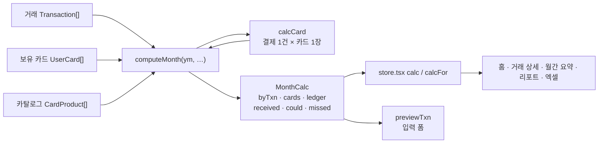
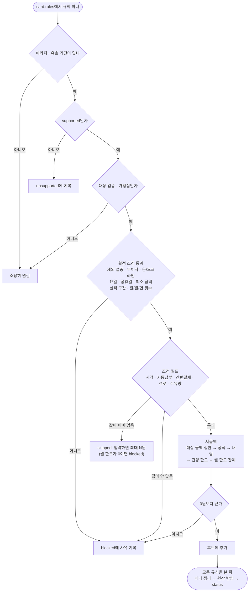
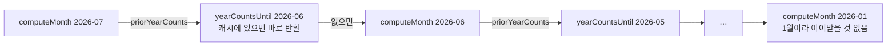
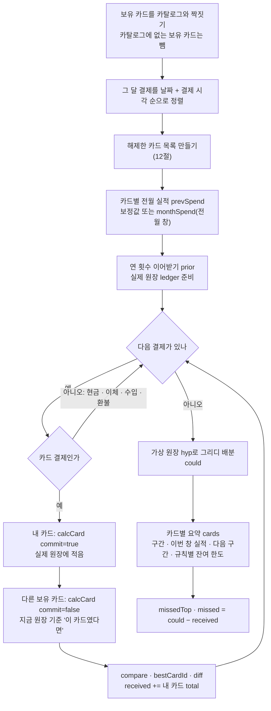
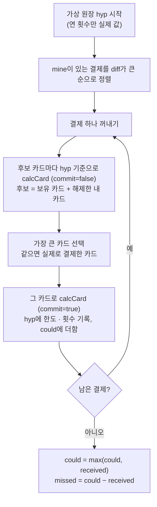

# 04. 혜택 계산 엔진

결제 한 건에 카드 혜택이 얼마 붙는지, 한 달 동안 받은 혜택과 놓친 혜택이 얼마인지 계산하는 부분입니다. 코드는 `src/lib/engine/index.ts` 한 파일(464줄)에 있습니다.

이 파일은 화면·DB·네트워크를 건드리지 않습니다. 그래서 화면(스토어), 테스트, 입력 폼 미리보기가 같은 코드를 그대로 씁니다. 파일 첫 줄 주석은 "순수 함수, 부수효과 없음 (BNF-07)"이라고 적어 둡니다. 순수 함수는 같은 입력에 항상 같은 결과를 내고, 넘겨받은 값이나 바깥 상태를 바꾸지 않는 함수입니다. 엄밀히 보면 이 파일은 두 가지가 다릅니다.

- `calcCard`는 넘겨받은 원장(`ledger`)을 직접 고칩니다. `commit=true`면 한도 사용액과 횟수를 더합니다. `commit=false`여도 빈 횟수 항목은 생길 수 있습니다 (19절).
- 모듈 안에 거래 배열 참조를 키로 쓰는 캐시 두 개가 있습니다(`WeakMap`: 객체를 키로 쓰는 Map). 환불 합 색인 `refundIndex`(11절)와 연 횟수 `yearCache`(8.4절)입니다. 계산 결과는 바꾸지 않지만, 거래 배열을 제자리에서 고치면 낡은 값을 씁니다 (19절).

혜택 금액은 약관을 옮긴 규칙으로 계산한 **참고값**입니다. 실제 카드사 청구 금액과 다를 수 있습니다.

관련 코드

| 파일 | 역할 |
| --- | --- |
| `src/lib/engine/index.ts` | 엔진 전체: 실적 창, 구간 판정, `calcCard`, `computeMonth`, `previewTxn` |
| `src/lib/types.ts` | `CardProduct`, `BenefitRule`, `UserCard`, `Transaction` 타입 |
| `src/lib/data/cards.ts` | 카드 카탈로그 `CARDS`(7종, 규칙 31건), 화면용 실적 진행 `spendProgress` |
| `src/lib/data/merchants.ts` | 업종 목록 `INDUSTRY`, 가맹점 사전 분류 `classifyMerchant` |
| `src/lib/data/fixtures.ts` | 테스트용 고정 장부: 카드 3장과 2026년 7~9월 거래(`SEED_TXNS`·`SEED_USER_CARDS`, 기준일 `TODAY = "2026-09-20"`). 앱(데모 포함)은 쓰지 않고, 이 문서의 예시 숫자가 여기서 나옵니다 |
| `src/lib/format.ts` | 요일 계산 `dowOf`, 요일 이름 `DOW` |
| `src/lib/engine/engine.test.ts` | 엔진 테스트 55개 |
| `src/lib/data/cards.test.ts` | 카드 데이터가 약관대로 계산되는지 (Point Plan) |

목차

1. [한눈에 보기](#1-한눈에-보기)
2. [데이터 모델](#2-데이터-모델)
3. [실적 창과 전월 실적](#3-실적-창과-전월-실적)
4. [구간 판정](#4-구간-판정)
5. [결제 한 건 계산 (calcCard)](#5-결제-한-건-계산-calccard)
6. [지급액 계산 5가지](#6-지급액-계산-5가지)
7. [상한: 대상 금액 · 건당 · 월 한도](#7-상한-대상-금액--건당--월-한도)
8. [원장: 한도와 횟수](#8-원장-한도와-횟수)
9. [월 특례](#9-월-특례)
10. [중복과 배타 (stacking)](#10-중복과-배타-stacking)
11. [환불](#11-환불)
12. [해제한 카드](#12-해제한-카드)
13. [외화](#13-외화)
14. [무이자 할부](#14-무이자-할부)
15. [한 달 계산 (computeMonth)](#15-한-달-계산-computemonth)
16. [저장 전 미리보기 (previewTxn)](#16-저장-전-미리보기-previewtxn)
17. [고정 장부 거래로 따라가는 계산](#17-고정-장부-거래로-따라가는-계산)
18. [테스트가 지키는 것](#18-테스트가-지키는-것)
19. [알려진 한계](#19-알려진-한계)

---

## 1. 한눈에 보기

엔진의 입력은 네 가지입니다.

| 입력 | 타입 | 예 |
| --- | --- | --- |
| 계산할 달 | `string` "YYYY-MM" | `"2026-09"` |
| 거래 전체 | `Transaction[]` | 고정 장부(`fixtures.ts`)의 카드 결제 44건 + 수입·현금·환불 5건 |
| 보유 카드 | `UserCard[]` | Mr.Life, Point Plan, ZERO |
| 카드 카탈로그 | `CardProduct[]` | `CARDS` + 사용자가 직접 추가한 카드 |



- `computeMonth`가 한 달 전체를 계산합니다. 안에서 결제마다 `calcCard`를 부릅니다.
- `calcCard`는 결제 한 건을 카드 한 장으로 계산합니다. 규칙마다 조건을 보고 금액을 정합니다.
- `previewTxn`은 아직 저장하지 않은 결제를 보유 카드 전체로 계산해 봅니다.
- 스토어(`src/lib/store.tsx`)는 보고 있는 달을 `useMemo`로 계산한 `calc`와, 다른 달을 계산해 캐시하는 `calcFor`를 화면에 내줍니다. 스토어 구조는 [03. 구조와 데이터 흐름](03-architecture.md)을 보세요.

내보내는 함수와 값

| 이름 | 하는 일 |
| --- | --- |
| `ymOf`, `prevYm`, `nextYm`, `daysInMonth`, `fmtYm`, `dow` | 날짜 도우미. `dow`는 `format.ts`의 `dowOf`를 다시 내보낸 것(0=일 … 6=토) |
| `isHoliday` | 2026·2027년 공휴일 표에 있는 날인지 |
| `resolveTier`, `tierLabel` | 실적으로 구간 고르기, 구간 이름("30~50만원") |
| `industryOf` | 거래의 업종 (`merchantIndustry`, 없으면 가맹점 사전) |
| `FX_APPROX`, `approxKrw`, `krw` | 외화를 원화로 |
| `spendOverrideOf` | 그 달에 적용할 사용자 실적 보정값 |
| `isCardExpense` | 혜택 계산 대상인 카드 결제인지 |
| `effectiveAmount` | 환불을 뺀 유효 금액 |
| `spendWindow`, `spendWindowLabel`, `CYCLE_DAYS` | 실적 창(날짜 범위)과 표기, 고를 수 있는 청구 사이클 시작일 |
| `monthSpend` | 실적 창 안의 카드 실적 |
| `requiredFields`, `COND_LABEL` | 카드가 요구하는 조건 필드와 그 이름 |
| `Ledger`, `emptyLedger` | 원장 타입과 빈 원장 |
| `monthlyCapOf` | 규칙의 이번 달 한도 (구간 한도 + 월 특례) |
| `timeIn` | 시각이 시간대 안인지 (자정 넘김 포함) |
| `calcCard` | 결제 1건 × 카드 1장 계산 |
| `computeMonth` | 한 달 계산 |
| `previewTxn` | 저장 전 미리보기 |
| `Check`, `Applied`, `Skipped`, `CardCalc`, `TxnResult`, `CardMonth`, `MonthCalc` | 결과 타입 |

---

## 2. 데이터 모델

타입은 모두 `src/lib/types.ts`에 있습니다. DB 테이블과의 대응은 [07. 데이터 모델과 ERD](07-data-model.md)를 보세요.

### 2.1 CardProduct — 카드 상품

| 필드 | 타입 | 뜻 | 엔진이 쓰나 |
| --- | --- | --- | --- |
| `id` | string | 카드 id. 예 `"shinhan_mrlife"` | 씀 (원장 키, 비교) |
| `issuer`, `name` | string | 카드사, 상품 이름 | 안 씀 (화면용) |
| `type` | `"credit"` \| `"check"` | 신용 / 체크 | 안 씀 |
| `color` | string | 카드 아트 색 | 안 씀 |
| `grade` | `"A"`~`"D"` | 계산 난이도. A 무실적·무한도 정률, B 단일 실적+단일 월 한도, C 구간별 한도·요일·시간대, D 통합 한도·구간별 적립률·중복/배타 (`GRADE_DESC`) | 안 씀 |
| `annualFee` | number? | 연회비 | 안 씀 |
| `tiers` | `SpendTier[]` | 전월 실적 구간. 실적 조건이 없는 카드는 `[{min:0,max:null}]` 하나 | 씀 |
| `spendExcludes` | `Industry[]` | 전월 실적에서 빼는 업종 | 씀 |
| `variants` | 배열? | 패키지 목록 (taptap O의 p1/p2) | 직접은 안 씀. 규칙의 `variantId`로 거름 |
| `perks` | `Perk[]`? | 정성 혜택. 계산하지 않음 → [06. 정성 혜택 판단](06-perks-jev.md) | 안 씀 |
| `sourceUrl`, `checkedAt` | string | 약관 출처와 확인일 | 안 씀 |
| `reviewStatus` | `"approved"` \| `"pending"` \| `"none"` | 검수 상태 | 안 씀. 계산 여부는 규칙의 `supported`로 정함 |
| `rules` | `BenefitRule[]` | 혜택 규칙 | 씀 |

`SpendTier`는 `{ min: number; max: number | null }`입니다. "min 이상 max 미만"이고 `max: null`은 상한이 없다는 뜻입니다.

### 2.2 BenefitRule — 혜택 규칙

약관 한 조항을 계산할 수 있게 옮긴 것입니다.

| 묶음 | 필드 | 뜻 | 카탈로그 예 |
| --- | --- | --- | --- |
| 식별 | `id`, `cardId`, `name` | 규칙 id, 소속 카드, 화면용 짧은 이름 | `ml_mart`, "주말 3대 할인마트 10% 할인" |
| | `variantId?` | 이 패키지를 고른 사용자에게만 | `tt_p1_sb`의 `"p1"` |
| | `kind` | `"discount"` 할인 / `"cashback"` 캐시백 / `"point"` 적립. 계산은 같고 표시만 다름 | |
| 대상 | `target` | 아래 2.3 표 | |
| 지급 방식 | `rate?` | 정률. `0.1` = 10% | `ml_mart` |
| | `rateBands?` | 건당 금액 구간별 정률 `[{minAmount, rate}]` | `pp_domestic` |
| | `fixedAmount?` | 정액 | `pp_weekend` 1,000 |
| | `step?` | `{per, amount}` "per원당 amount원" | `pp_autopay` 2만원당 1천 |
| | `perUnit?` | `{unit: "liter", amount}` 리터당 | `ml_fuel` 60원 |
| 상한 | `eligibleAmountCap?` | 계산에 넣는 결제액 상한 ("1회 승인금액 5만원까지") | `ml_mart` 50,000 |
| | `perTxnCap?` | 결제 1건의 혜택 상한 | `ml_mart` 5,000 |
| 한도 | `limitsByTier` | 실적 구간별 `{tier, monthlyCap?, dailyCount?, monthlyCount?, yearlyCount?}` | 아래 4절 |
| 묶음 | `capGroupId?` | 월 한도를 함께 쓰는 규칙 묶음 | `ml_allday` |
| | `countGroupId?` | 일·월·연 횟수를 함께 세는 규칙 묶음 | `pp_weekend` |
| | `monthOverrides?` | `[{months, extraCap}]` 특정 달 한도 추가 | 5·12월 +10,000 |
| | `stacking?` | `[{ruleId, mode: "allow" \| "deny"}]` 중복 허용/배타 | `pp_domestic` |
| 기간·검수 | `validFrom?`, `validTo?` | 규칙이 유효한 결제일 (양끝 포함) | |
| | `rawText` | 근거가 된 약관 원문 | |
| | `supported` | `false`면 계산하지 않고 "계산 불가"로 표시 | `sp_all` |
| | `unsupportedReason?` | 계산 불가 사유 | "적립률 원문 확인 전 · 검수 대기" |
| | `confidence` | 규칙 추출 신뢰도 0~1. 엔진은 쓰지 않음 | |

지급 방식 필드는 하나만 채우는 것이 원칙입니다. 여러 개가 있으면 6절의 우선순위대로 하나만 씁니다.

### 2.3 BenefitRule.target — 대상 조건

| 필드 | 뜻 | 비어 있으면 |
| --- | --- | --- |
| `categories?` | 업종 목록 (`Industry`) | 업종을 보지 않음 |
| `merchants?` | 가맹점 이름 조각. 대소문자 무시, 부분 일치 | 가맹점을 보지 않음 |
| `channel?` | `"online"` / `"offline"` / `"any"` | 보지 않음 |
| `daysOfWeek?` | 요일 숫자 (0=일 … 6=토) | 보지 않음 |
| `holidayPolicy?` | `"exclude"`면 그 요일이어도 공휴일은 제외 | 공휴일을 보지 않음 |
| `timeRange?` | `{from, to}` "21:00"~"09:00" | 보지 않음 |
| `minAmount?` | 건당 최소 금액 | 보지 않음 |
| `excludes?` | 제외 업종, 또는 문자열 `"무이자할부"` | 제외 없음 |
| `autoPayOnly?` | 자동납부 건만 | 보지 않음 |
| `payMethods?` | 간편결제 수단 (`issuer_pay`, `samsung_pay`, `naver_pay`, `kakao_pay`, `card`) | 보지 않음 |
| `payChannels?` | 결제 경로 (`in_app`, `offline`, `web`) | 보지 않음 |

예: Mr.Life 주말 마트 규칙 (`src/lib/data/cards.ts`)

```ts
{ ...base, id: "ml_mart", cardId: "shinhan_mrlife", name: "주말 3대 할인마트 10% 할인", kind: "discount", rate: 0.1,
  target: { categories: ["mart"], merchants: ["이마트", "롯데마트", "홈플러스"], daysOfWeek: [0, 6], holidayPolicy: "exclude", excludes: ["gift_card"] },
  eligibleAmountCap: 50000, perTxnCap: 5000, limitsByTier: mlCaps(3000, 7000, 10000, { dailyCount: 1 }), … }
```

`mlCaps(3000, 7000, 10000, …)`는 30~50만원 구간 3,000원, 50~100만원 7,000원, 100만원 이상 10,000원 한도를 만듭니다. 30만원 미만 구간에는 행이 없으므로 혜택이 없습니다.

### 2.4 UserCard — 사용자가 보유한 카드

| 필드 | 뜻 | 엔진에서 |
| --- | --- | --- |
| `cardId` | 카탈로그 카드 id | 카드 찾기 |
| `variantId?` | 고른 패키지 | 규칙 거르기 |
| `spendTierOverride?` | 사용자가 직접 고친 전월 실적 | 3.4절 |
| `spendTierOverrideYm?` | 보정값을 적용할 달 "YYYY-MM" | 3.4절 |
| `statementCycleDay?` | 청구 사이클 시작일. 없으면 달력 월 | 3.1절 |
| `bin?` | 카드번호 앞 6자리 | 안 씀 (영수증 카드 매칭용 → [05. 영수증 인식과 AI](05-receipt-ai.md)) |
| `issuedAt?`, `addedAt` | 발급일, 등록일 | 안 씀 |

### 2.5 Transaction에서 엔진이 읽는 필드

| 필드 | 쓰는 곳 |
| --- | --- |
| `type`, `payType`, `cardId`, `originalTxnId` | 계산 대상인지 (`isCardExpense`) |
| `amount`, `currency`, `amountKrw` | 금액 (`krw`) |
| `date`, `paidAt` | 달·요일·공휴일·시간대, 처리 순서 |
| `merchant`, `merchantIndustry` | 대상 매칭 (`industryOf`) |
| `isAutoPay`, `payMethod`, `payChannel`, `fuelLiters` | 조건 필드 |
| `installmentMonths`, `isInterestFree` | 무이자 할부 제외 |

`categoryId`(가계부 카테고리)는 혜택 계산에 쓰지 않습니다. 업종(`merchantIndustry`)과 카테고리는 별개입니다. 업종은 `industryOf(t)`가 정합니다. 거래에 저장된 `merchantIndustry`가 먼저이고, 없으면 가맹점 이름 사전 `classifyMerchant`를 씁니다. 업종이 정해지는 과정은 [용어집](glossary.md)의 "업종 분류 3단계"를 보세요.

---

## 3. 실적 창과 전월 실적

대부분의 카드는 **전월 실적**(지난달 그 카드로 쓴 금액)에 따라 이번 달 혜택 크기가 정해집니다. 엔진은 이 금액을 `monthSpend`로 셉니다.

### 3.1 실적 창 (spendWindow)

실적 창은 실적을 세는 날짜 범위입니다. `spendWindow(ym, cycleDay)`는 **ym월에 끝나는 창**을 돌려줍니다.

| 경우 | 창 | 예 |
| --- | --- | --- |
| 사이클 없음 (`cycleDay` 없거나 1 이하) | 그 달 1일 ~ 말일 | `spendWindow("2026-02")` → 2/1 ~ 2/28 |
| 사이클 N일 | 전월 N일 ~ 당월 (N−1)일 | `spendWindow("2026-09", 10)` → 8/10 ~ 9/9 |
| 사이클 N일, 연 경계 | 같은 규칙 | `spendWindow("2026-01", 10)` → 2025-12-10 ~ 2026-01-09 |

- 창의 양끝 날짜는 포함합니다.
- N이 그 달의 날수보다 크면 말일로 줄입니다 (`Math.min(cycleDay, daysInMonth(…))`).
- 화면에서 고를 수 있는 시작일은 `CYCLE_DAYS = [5, 10, 13, 15, 20, 25]`입니다.
- 표기는 `spendWindowLabel`이 만듭니다. 달력이면 `"9월"`, 사이클 10일이면 `"8/10~9/9"`입니다.

9월 혜택을 계산할 때는 `prevYm("2026-09")` = 8월에 끝나는 창을 씁니다. 고정 장부의 Mr.Life는 사이클 10일이라 전월 실적 창이 7/10 ~ 8/9입니다.

### 3.2 monthSpend — 창 안의 실적

`monthSpend(txns, cardId, ym, card?, cycleDay?)`의 규칙입니다.

1. 창 안에 있고, 카드 결제이고(`isCardExpense`: 지출 + 환불 아님 + 신용/체크 + 카드 있음), 이 카드로 낸 결제만 셉니다.
2. 업종이 카드의 `spendExcludes`에 있으면 뺍니다. 업종을 모르는 결제는 셉니다.
3. 금액은 원화 환산액 `krw(t)`입니다. 할부는 총액입니다.
4. 환불은 **환불한 날이 창 안에 있을 때** 그 창에서 뺍니다. 원거래가 카드 결제이고(`isCardExpense`) 이 카드로 냈고 실적 제외 업종이 아닐 때만 뺍니다. 원거래 날짜는 창 밖(이전 창)이어도 됩니다 (11절). 예: 8/20 결제 30,000원을 9/3에 전액 환불하면 8월 실적은 30,000원 그대로이고, 9월 실적에서 30,000원을 뺍니다 (임시 테스트로 확인. 9월에 다른 결제가 없으면 0원).
5. 결과는 0 아래로 내려가지 않습니다.

수입·현금·계좌이체는 1번에서 빠집니다.

### 3.3 고정 장부로 확인한 전월 실적 (9월 계산 기준)

| 카드 | 사이클 | 전월 실적 창 | 전월 실적 | 구간 |
| --- | --- | --- | --- | --- |
| 신한 Mr.Life | 10일 | 7/10 ~ 8/9 | 404,200원 | 30~50만원 |
| 신한 Point Plan | 없음 | 8/1 ~ 8/31 | 524,500원 | 40~80만원 |
| 현대 ZERO Edition3 | 없음 | 8/1 ~ 8/31 | 106,000원 | 실적 조건 없음 |

Mr.Life 404,200원의 내역: 7/14 이마트 92,000 + 7/19 스타벅스 6,100 + 7/22 전기요금 47,000 + 7/26 SK에너지 55,000 (7월 후반 200,100원) + 8/3 스타벅스 6,100 + 8/5 이마트 128,000 + 8/8 GS칼텍스 70,000 (8월 초 204,100원).

Mr.Life를 달력 8월로 세면 440,400원입니다. 7월 후반 200,100원이 빠지고, 8/10 전기요금부터 8/29 SK에너지까지 236,300원이 들어오기 때문입니다. 두 경우 모두 30~50만원 구간이라 고정 장부에서는 구간이 같습니다 (테스트 "computeMonth가 사이클 카드의 전월 실적을 창 기준으로 잡는다").

### 3.4 전월 실적 보정 (spendTierOverride, spendTierOverrideYm)

앱에 모든 결제가 기록되지 않으면 계산한 실적이 카드사 숫자와 다를 수 있습니다. 그래서 사용자가 카드 상세 화면에서 전월 실적을 직접 고칠 수 있습니다.

```ts
export const spendOverrideOf = (uc: UserCard, ym: string) =>
  uc.spendTierOverride !== undefined && (!uc.spendTierOverrideYm || uc.spendTierOverrideYm === ym) ? uc.spendTierOverride : undefined;
```

- `spendTierOverrideYm`은 "이 보정값으로 혜택을 계산할 달"입니다. 그 달의 전월 실적만 바뀝니다.
- `spendTierOverrideYm`이 없는 예전 데이터는 모든 달에 적용합니다 (하위 호환).
- 보정값은 청구 사이클보다 우선합니다. `computeMonth`는 `spendOverrideOf(uc, ym) ?? monthSpend(…)` 순서로 정합니다.
- 카드 상세 화면(`src/app/(app)/cards/[id]/page.tsx`)의 "보정됨" 표시도 같은 함수를 씁니다.

예: `spendTierOverride: 1200000, spendTierOverrideYm: "2026-09"`이면 9월 계산의 전월 실적은 1,200,000원(100만원 이상 구간)입니다. 8월과 10월은 계산값을 씁니다.

### 3.5 이번 창 실적과 화면의 진행 막대

`computeMonth`의 카드 요약(`CardMonth.thisSpend`)은 **보고 있는 달에 끝나는 창**의 실적입니다. 고정 장부 9월의 Mr.Life는 8/10 ~ 9/9 창의 349,100원이고, 다음 구간(50만원)까지 69.8%입니다.

사이클 카드는 이 창이 달 중간에 이미 끝났을 수 있습니다. 그래서 카드 목록·상세·홈·알림은 `src/lib/data/cards.ts`의 `spendProgress`로 "지금 쌓고 있는 창"을 따로 계산합니다. 예를 들어 오늘이 9/20이면 9/10 ~ 10/9 창을 보여 줍니다.

---

## 4. 구간 판정

### 4.1 resolveTier — 실적으로 카드 구간 고르기

```ts
export const resolveTier = (spend: number, tiers: SpendTier[]): SpendTier =>
  tiers.find((t) => spend >= t.min && (t.max === null || spend < t.max)) ?? tiers[0];
```

Mr.Life 구간은 `[0~30만) [30~50만) [50~100만) [100만~)`입니다. 경계값은 위 구간에 들어갑니다.

| 전월 실적 | 구간 |
| --- | --- |
| 299,999원 | 0 ~ 30만원 |
| 300,000원 | 30 ~ 50만원 |
| 500,000원 | 50 ~ 100만원 |

어느 구간에도 맞지 않으면(구간 사이에 빈틈이 있는 데이터) 첫 구간을 씁니다.

`tierLabel`은 구간 이름을 만듭니다. `{0, null}`은 "실적 조건 없음", `{0, 300000}`은 "30만원 미만", `{300000, 500000}`은 "30~50만원", `{1000000, null}`은 "100만원 이상"입니다.

### 4.2 limitsFor — 규칙의 한도 행 찾기

카드 구간이 정해지면 규칙의 `limitsByTier`에서 그 구간 행을 찾습니다 (내부 함수 `limitsFor`).

1. 구간이 똑같은 행(`min`, `max`가 같음)을 찾습니다.
2. 없으면 **카드 구간의 시작(`min`)이 들어가는 더 넓은 행**을 찾습니다. 규칙이 카드보다 구간을 거칠게 나눈 경우입니다.
3. 그래도 없으면 이 구간에는 혜택이 없습니다. 차단 사유는 "전월 실적 30만원 미만 구간에는 혜택 없음"처럼 나옵니다.

2번 확인 (임시 테스트로 계산): Mr.Life 구간을 가진 카드에 `limitsByTier: [{ tier: {min: 300000, max: null}, monthlyCap: 1000 }]` 규칙 하나를 두면 이렇게 됩니다.

| 전월 실적 | 카드 구간 | 찾은 행 | 결과 |
| --- | --- | --- | --- |
| 200,000원 | 0~30만원 | 없음 | 차단 "전월 실적 30만원 미만 구간에는 혜택 없음" |
| 400,000원 | 30~50만원 | 30만원~ (2번) | 적용 |
| 1,200,000원 | 100만원~ | 30만원~ (2번) | 적용 |

어드민 검수에서 승인한 카드가 이 경우입니다. `src/app/admin/admin.ts`의 `tiersOf`는 규칙들이 쓰는 모든 경계값으로 카드 구간을 겹치지 않게 자릅니다. 그러면 "조건 없음" 규칙의 행 `{0, null}`은 잘린 구간 `{300000, null}`과 똑같지 않으므로 2번으로 찾힙니다. `src/app/admin/admin.test.ts`의 "조건 없음 규칙 + 30만원 이상 규칙 → 50만원에서 둘 다 적용"이 이 동작을 확인합니다.

---

## 5. 결제 한 건 계산 (calcCard)

```ts
calcCard(t, card, uc, prevSpend, ledger, ym, all, commit): CardCalc
```

| 인자 | 뜻 |
| --- | --- |
| `t` | 계산할 결제 |
| `card`, `uc` | 카드 상품과 사용자 카드 (패키지·사이클) |
| `prevSpend` | 전월 실적. 구간을 정함 |
| `ledger` | 원장. 이번 달 이미 쓴 한도와 횟수 (8절) |
| `ym` | 계산하는 달. 월 한도와 월 특례를 정함 |
| `all` | 거래 전체. 환불을 찾는 데 씀 |
| `commit` | `true`면 결과를 원장에 적음. `false`면 원장 복사본에만 적고 버림 |

결과 `CardCalc`

| 필드 | 뜻 |
| --- | --- |
| `total` | 이 카드로 받는 혜택 합계 |
| `applied` | 적용된 규칙. 규칙마다 `amount`, 공식 `formula`, 근거 `checks`, 남은 한도 `capRemainingAfter` |
| `skipped` | 조건 필드가 비어 계산 못 한 규칙과 "입력하면 최대 N원"(`maxExtra`) |
| `unsupported` | `supported: false` 규칙 |
| `blocked` | 대상이지만 조건·한도 때문에 막힌 규칙과 사유 |
| `tier`, `prevSpend` | 적용한 구간과 전월 실적 |
| `status` | `benefit` / `missing` / `capped` / `excluded` / `none` (5.4절) |

`checks`는 사람이 읽는 근거 문장 목록입니다. 거래 상세 화면(`src/app/(app)/transactions/[id]/page.tsx`)이 그대로 보여 줍니다.

### 5.1 흐름



### 5.2 판정 순서 (코드 순서 그대로)

순서가 결과를 바꿉니다. 예를 들어 실적 구간에 혜택이 없는 규칙은 시각을 몰라도 "입력하면 최대 N원"을 내지 않습니다. 구간 검사(11번)가 조건 필드 검사(13번)보다 먼저이기 때문입니다.

먼저 결제마다 한 번 구합니다: 구간 `tier = resolveTier(prevSpend, card.tiers)`, 유효 금액 `amount = effectiveAmount(t, all)`, 업종 `ind = industryOf(t)`, 요일 `d = dowOf(t.date)`.

그다음 `card.rules`를 순서대로 돌며 규칙마다 아래를 봅니다.

1. **패키지**: 규칙에 `variantId`가 있고 사용자 카드의 `variantId`와 다르면 조용히 넘깁니다.
2. **유효 시작일**: `t.date < validFrom`이면 조용히 넘깁니다.
3. **유효 종료일**: `t.date > validTo`이면 조용히 넘깁니다.
4. **검수 여부**: `supported`가 `false`면 `unsupported`에 넣고 넘깁니다. 사유는 `unsupportedReason`, 없으면 "구조상 계산 불가"입니다.
5. **대상 매칭**: 업종과 가맹점을 봅니다 (5.3절). 대상이 아니면 조용히 넘깁니다. 대상이면 첫 근거 "적용 규칙 · {이름}"을 남깁니다.
6. **제외 업종**: 업종이 `target.excludes`에 있으면 차단 "제외 업종 (전기요금)"처럼 한글 업종 이름으로 남깁니다. **업종을 모르면 이 검사를 하지 않습니다** (`if (ind && tg.excludes?.includes(ind))`).
    - 해외 결제는 따로 봅니다. 외화 결제(`currency`가 `KRW`가 아님)인데 업종이 `overseas`가 아니고 `excludes`에 `"overseas"`가 있으면 차단 "해외 결제 제외"입니다. 이 검사는 업종을 몰라도 합니다.
7. **무이자 할부**: 무이자이고 할부 2개월 이상이고 `excludes`에 `"무이자할부"`가 있으면 차단 "무이자 할부 · 약관상 제외" (14절). 업종과 관계없이 봅니다.
8. **온라인/오프라인**: `channel`이 `"online"`이나 `"offline"`이면 봅니다. 결제 경로가 `web`·`in_app`이거나 업종이 `online_shop`이면 온라인, 아니면 오프라인입니다. 다르면 차단 "온라인 결제만" / "오프라인 결제만".
9. **요일·공휴일**: `daysOfWeek`가 있으면 요일이 맞는지 봅니다. 안 맞으면 차단 "요일 조건 불일치". 맞아도 `holidayPolicy: "exclude"`이고 공휴일이면 차단 "공휴일 제외".
10. **건당 최소 금액**: 유효 금액이 `minAmount`보다 작으면 차단 "건당 최소 20,000원 미달".
11. **실적 구간**: `limitsFor`로 이 구간의 한도 행을 찾습니다 (4.2절). 없으면 차단 "전월 실적 {구간} 구간에는 혜택 없음". 있으면 근거 "전월 실적 30~50만원 구간 / 7/10~8/9 실적 404,200원 · 충족 (근사치)"를 남깁니다.
12. **횟수**: 원장의 횟수(`countGroupId`가 있으면 그 묶음)를 일 → 월 → 연 순서로 봅니다. 다 썼으면 차단 "일 1회 소진" / "월 5회 소진" / "연 12회 소진".
13. **조건 필드**: 순서대로 봅니다.
    - 시간대 `timeRange` → `paidAt`
    - 자동납부 `autoPayOnly` → `isAutoPay`
    - 간편결제 `payMethods` → `payMethod`
    - 결제 경로 `payChannels` → `payChannel`
    - 리터당 `perUnit` → `fuelLiters`

    값이 비어 있으면 `skipped`에 넣고 넘깁니다 (5.5절). 값이 조건에 안 맞으면 차단 "시간대 21:00~09:00 외", "자동납부 건만 적용", "결제 수단 조건 불일치", "결제 경로 조건 불일치"입니다.
14. **지급액**:
    1. `eligible = min(유효 금액, eligibleAmountCap)`
    2. `grossAmount`로 공식 계산 (6절). 계산할 방식이 없으면 조용히 넘깁니다.
    3. 소수점 아래를 버립니다 (`Math.floor`).
    4. `perTxnCap`보다 크면 깎습니다. 공식에 "→ 건당 한도 N원"이 붙습니다.
    5. 월 한도(`monthlyCapOf`)가 있으면 원장의 남은 한도를 봅니다. 남은 한도가 0이면 차단 "월 한도 N원 소진". 남은 한도보다 크면 깎고 "→ 잔여 한도 N원"이 붙습니다.
    6. 한도·횟수 근거를 남깁니다.
    7. 0원 이하면 차단 "계산 금액 0원". 아니면 **후보**에 올립니다.

모든 규칙을 본 뒤에는 이렇게 합니다.

15. **중복·배타**: 후보 중 `stacking`에 `"deny"`로 묶인 쌍은 금액이 큰 쪽만 남깁니다 (10절).
16. **원장 반영**: 남은 후보를 규칙 순서대로 원장에 적습니다. `commit`이 `false`면 원장 복사본에 적습니다. 적기 전에 두 가지를 다시 봅니다.
    - 횟수: 같은 결제 안에서 먼저 반영된 같은 `countGroupId` 규칙이 횟수를 썼으면 차단 "통합 횟수 소진".
    - 한도: 같은 결제 안에서 먼저 반영된 같은 `capGroupId` 규칙이 한도를 썼으면 남은 만큼으로 깎고, 0이면 차단 "통합 한도 소진".

    통과하면 한도 사용액을 더하고, 횟수(일·월·연)를 1씩 올리고, `applied`와 `total`에 넣습니다.
17. **상태**: 5.4절 표로 정합니다.

### 5.3 대상 매칭: 업종과 가맹점

```ts
const byMerchant = tg.merchants?.some((m) => t.merchant.toLowerCase().includes(m.toLowerCase()));
const ovs = ind === "overseas" || t.currency !== "KRW";
const byCat = ind ? !!tg.categories?.includes(ind) || (ovs && !!tg.categories?.includes("overseas")) : (ovs && !!tg.categories?.includes("overseas")) || !!byMerchant;
if ((tg.categories && !byCat) || (tg.merchants && !byMerchant)) continue;
```

| 규칙에 있는 것 | 업종을 앎 | 업종을 모름 |
| --- | --- | --- |
| 둘 다 없음 | 모든 결제가 대상 (`z1`, `pp_domestic`) | 대상. 제외 업종 검사도 건너뜀 (아래) |
| `categories`만 | 업종이 목록에 있어야 함 (외화 결제는 `"overseas"`도 맞음) | 대상 아님 (외화 결제는 `"overseas"`만 맞음) |
| `merchants`만 | 가맹점 이름이 맞아야 함 | 가맹점 이름이 맞아야 함 |
| 둘 다 | **둘 다** 맞아야 함 (AND) | 가맹점 이름만 맞으면 됨 |

- 둘 다 있을 때 AND인 이유: 가맹점 목록이 그 업종 안을 좁히기 때문입니다. "주말 3대 마트"는 마트 업종이면서 이마트·롯데마트·홈플러스여야 합니다. 그래서 이마트24(편의점)나 코스트코는 빠집니다.
- 업종을 모를 때 가맹점만 보는 이유: AI가 정규화한 규칙은 `categories`와 `merchants`를 함께 채웁니다. 사전에 없는 가맹점에도 그 규칙이 적용되게 하려는 것입니다.
- 가맹점은 부분 일치라 업종이 없으면 엉뚱한 이름에도 맞을 수 있습니다. 예를 들어 "쿠팡이츠"는 "쿠팡"을 포함합니다. Mr.Life Night 온라인쇼핑 규칙은 `categories: ["online_shop"]`도 있어서 배달 업종인 쿠팡이츠에는 붙지 않습니다 (테스트로 확인).
- 외화 결제(`ovs`)는 가맹점 업종과 별개로 해외 가맹점으로도 봅니다. 그래서 업종을 몰라도, 업종이 온라인쇼핑이어도 `categories: ["overseas"]`인 해외 규칙(`pp_overseas`, `lk_ovs`)에 맞습니다.
- 업종을 모르면 `excludes`의 업종 검사도 하지 않습니다 (5.2절 6번). 그래서 대상 조건이 없는 전 가맹점 규칙(`z1`, `pp_domestic`, `ws_all`, `lk_dom`)은 업종을 모르는 결제에 늘 붙습니다. 실제로는 세금·공과금인 결제여도 그렇습니다. 예: 사전에 없는 가맹점 10,000원을 ZERO로 내면 `z1` 120원, 같은 결제에 업종 `tax`를 주면 0원 "제외 업종 (국세·지방세)"입니다 (임시 테스트로 확인). 외화 결제의 "해외 결제 제외"와 무이자 할부 제외는 업종을 몰라도 봅니다.

### 5.4 상태 (status)

```ts
res.status = res.total > 0 ? "benefit" : res.skipped.length ? "missing"
  : res.blocked.some((b) => b.reason.includes("소진")) ? "capped"
  : res.blocked.some((b) => b.reason.includes("제외")) ? "excluded" : "none";
```

| status | 언제 | 예 |
| --- | --- | --- |
| `benefit` | 받은 혜택이 있음 | |
| `missing` | 혜택은 0인데 입력하면 받을 수 있는 규칙이 있음 | 시각 미입력 스타벅스 |
| `capped` | 사유에 "소진"이 있음 (한도·횟수) | 월 한도 소진 |
| `excluded` | 사유에 "제외"가 있음 | 제외 업종, 무이자 할부, 공휴일 제외 |
| `none` | 그 밖 | 대상 규칙 없음 |

상태는 사유 문구의 단어로 정합니다. 사유 문구를 바꿀 때 "소진"·"제외"를 빼면 상태가 바뀌므로 주의해야 합니다.

### 5.5 조건 필드와 "입력하면 최대 N원"

조건 필드는 영수증만으로 알 수 없어 사용자가 더 알려 줘야 하는 값입니다 (`CondField`: `paidAt`, `isAutoPay`, `payMethod`, `payChannel`, `fuelLiters`). 값이 비어 있으면 그 규칙만 건너뛰고 상한을 알려 줍니다 (BNF-05). 이 안내는 **확정 조건(5.2절 1~12번)을 모두 통과한 규칙에만** 나옵니다. 입력해도 못 받는 규칙에 "최대 N원"을 내지 않기 위해서입니다.

안의 함수 `miss(field)`가 상한을 계산합니다.

- 월 한도가 있으면 남은 한도를 봅니다. 0이면 `skipped`가 아니라 차단 "월 한도 N원 소진"으로 남깁니다 (상태 `capped`).
- `maxExtra = min(공식 금액, perTxnCap, 남은 한도)`를 내림합니다. 공식 금액은 `eligibleAmountCap`을 적용한 금액으로 계산합니다.
- 리터당 규칙은 주유량을 모르니 공식 금액을 무한대로 보고 `perTxnCap`과 남은 한도로만 정합니다. 둘 다 없으면 0입니다.

예: 주말 GS칼텍스 70,000원, 주유량 미입력, Mr.Life 30~50만원 구간 → `ml_fuel`의 `maxExtra`는 `perTxnCap` 3,750원 (임시 테스트로 확인).

`requiredFields(card, variantId)`는 카드의 지원 규칙이 요구하는 조건 필드 목록을 돌려줍니다. 거래 입력 화면(`src/app/(app)/transactions/new/page.tsx`)은 이 목록에 있는 필드만 묻습니다. 주유량은 업종이 주유소일 때만 묻습니다.

### 5.6 시간대 비교 (timeIn)

```ts
const minOf = (hhmm: string) => { const [h, m] = hhmm.split(":").map(Number); return h * 60 + (m || 0); };
export const timeIn = (hhmm: string, from: string, to: string) => {
  const [x, a, b] = [minOf(hhmm), minOf(from), minOf(to)];
  return a <= b ? x >= a && x < b : x >= a || x < b;
};
```

- 시각을 분으로 바꿔 비교합니다. "9:30"처럼 앞자리 0이 없어도 됩니다.
- `to`가 `from`보다 이르면 자정을 넘는 구간입니다. 21:00~09:00이면 23:55와 08:30은 안, 13:00과 9:30은 밖입니다.
- 끝 시각은 포함하지 않습니다. 09:00은 21:00~09:00 밖입니다.

### 5.7 공휴일 표

`HOLIDAYS`는 2026·2027년 공휴일(대체공휴일·선거일 포함) 40일입니다. 예: 2026-09-24~26 추석, 2027-02-06~09 설. 공휴일은 `daysOfWeek`가 있는 규칙에서 `holidayPolicy: "exclude"`일 때만 봅니다. 2026-09-26(토, 추석)의 이마트 결제는 Mr.Life 주말 마트 할인에서 빠집니다.

---

## 6. 지급액 계산 5가지

`grossAmount(rule, t, eligible, amount)`는 한도를 적용하기 전 금액을 냅니다. `eligible`은 대상 금액 상한을 적용한 금액, `amount`는 유효 금액 전체입니다. 아래 순서로 **처음 있는 방식 하나만** 씁니다.

| 순서 | 방식 | 공식 | 쓰는 금액 | 예 (카탈로그 규칙) | 결과 |
| --- | --- | --- | --- | --- | --- |
| 1 | `fixedAmount` 정액 | 정해진 금액 | 금액 무관 | Point Plan 주말 음식점 (`pp_weekend`), 48,000원 | 1,000 |
| 2 | `perUnit` 리터당 | 주유량 × 리터당 금액 | 주유량 | Mr.Life 주말 주유 (`ml_fuel`), 33.2L | 33.2 × 60 = 1,992 |
| 3 | `step` 금액당 | ⌊eligible ÷ per⌋ × amount | eligible | Point Plan 자동납부 (`pp_autopay`), 전기요금 52,000원 | ⌊52,000 ÷ 20,000⌋ = 2 × 1,000 = 2,000 |
| 4 | `rateBands` 구간별 정률 | eligible × (유효 금액이 들어가는 구간의 비율) | 구간은 `amount`, 곱은 `eligible` | Point Plan 일상 적립 (`pp_domestic`), 48,000원 | 3만원 이상 구간 0.7% → 336 |
| 5 | `rate` 정률 | eligible × rate | eligible | ZERO 1.2% (`z1`), 58,000원 | 696 |

- 결과는 `Math.floor`로 원 단위 아래를 버립니다. 0.7% × 48,000 = 336, 1.2% × 58,000 = 696입니다.
- `rateBands`는 `minAmount`가 큰 구간부터 보며 유효 금액이 `minAmount` 이상인 첫 구간을 고릅니다. Point Plan은 3만원 미만 0.5%, 3~10만원 0.7%, 10~30만원 1.0%, 30~100만원 2.0%, 100만원 이상 3.0%입니다. 맞는 구간이 없으면 0원(공식 "구간 없음")이 되어 "계산 금액 0원"으로 막힙니다.
- `step`은 나머지를 버립니다. 63,000원이면 3단위 = 3,000원입니다 (테스트 "계단식에서 딱 떨어지지 않는 금액").
- `perUnit`은 주유량이 없으면 계산하지 않습니다. 이때는 5.5절의 "입력하면 최대 N원"이 됩니다.
- 각 방식은 `formula` 문자열도 만듭니다. 예: `"52,000 ÷ 20,000 = 2단위 × 1,000원"`, `"48,000 × 0.7% (건당 30,000원 이상 구간)"`, `"33.2L × 60원"`, `"정액 1,000원"`.

위 예의 숫자는 모두 고정 장부 거래 또는 임시 테스트로 계산해 확인했습니다 (`pp_weekend`·`pp_domestic` = 9/6 을지로 골목집, `pp_autopay` = 9/10 한국전력, `z1` = 9/9 쿠팡).

---

## 7. 상한: 대상 금액 · 건당 · 월 한도

금액은 세 단계로 깎입니다. 순서는 **대상 금액 상한 → 공식 → 건당 한도 → 월 한도 잔여**입니다.

| 단계 | 필드 | 뜻 |
| --- | --- | --- |
| 1 | `eligibleAmountCap` | 공식에 넣는 결제액 상한. "1회 승인금액 5만원까지" |
| 2 | `perTxnCap` | 결제 1건 혜택의 상한 |
| 3 | 월 한도 (`limitsByTier[].monthlyCap` + 월 특례) | 이번 달 남은 한도. 원장에서 읽음 |

고정 장부 예: 9/5(토) 이마트 역삼점 84,000원, Mr.Life 30~50만원 구간 (`ml_mart`)

| 단계 | 계산 | 금액 |
| --- | --- | --- |
| 대상 금액 상한 | min(84,000, 50,000) | 50,000 |
| 공식 | 50,000 × 10% | 5,000 |
| 건당 한도 | min(5,000, 5,000) | 5,000 |
| 월 한도 잔여 | 30~50만원 구간 한도 3,000 − 사용 0 | **3,000** |

화면의 공식은 `"50,000 × 10% (대상 금액 50,000원까지) → 잔여 한도 3,000원"`입니다.

- 리터당(`perUnit`)은 결제액을 쓰지 않으므로 `eligibleAmountCap`이 계산에 영향을 주지 않습니다. 대신 `perTxnCap`이 상한 역할을 합니다. Mr.Life 주말 주유는 `perTxnCap: 3750`(10만원 ÷ 리터당 약 1,600원 ≈ 62.5L × 60원)입니다. 150,000원·80L 결제는 80 × 60 = 4,800원 → 건당 한도 3,750원입니다 (임시 테스트로 확인). 이때도 공식 문자열에는 "(대상 금액 100,000원까지)"가 붙습니다.
- 정액(`fixedAmount`)도 결제액을 쓰지 않습니다. 최소 금액 조건(`minAmount`)으로만 걸러집니다.

---

## 8. 원장: 한도와 횟수

**원장(Ledger)**은 이번 달 규칙별로 이미 쓴 한도와 횟수를 적어 두는 장부입니다. `computeMonth`가 달마다 새로 만들고, 결제를 시간순으로 넣으며 채웁니다.

```ts
export type Ledger = {
  used: Record<string, number>; // `${cardId}:${capGroupId ?? ruleId}` → 이번 달 소진액
  counts: Record<string, { day: Record<string, number>; month: number; year: number }>; // `${cardId}:${countGroupId ?? ruleId}`
};
```

| 칸 | 키 | 값 | 초기값 |
| --- | --- | --- | --- |
| `used` | `카드id:capGroupId` (없으면 `카드id:규칙id`) | 이번 달 준 혜택 합 | 달마다 0 |
| `counts[k].day` | 위와 같은 방식, `countGroupId` 기준 | 날짜별 적용 횟수 | 달마다 비움 |
| `counts[k].month` | | 이번 달 적용 횟수 | 달마다 0 |
| `counts[k].year` | | 올해 적용 횟수 | 같은 해 전월에서 이어받음 (8.4절) |

키에 카드 id가 들어가므로 카드끼리 한도가 섞이지 않습니다.

### 8.1 통합 한도 (capGroupId)

여러 규칙이 월 한도 하나를 함께 씁니다. Mr.Life "Time 할인 All Day"는 편의점·병원/약국·세탁소 세 규칙이 `capGroupId: "ml_allday"`로 한도를 함께 씁니다. 30~50만원 구간 한도는 10,000원입니다.

고정 장부 9월의 `shinhan_mrlife:ml_allday` 사용액은 2,900원입니다 (9/8 CU 480 + 9/11 약국 900 + 9/17 크린토피아 1,000 + 9/19 CU 520). 한도는 묶음으로 쓰지만 횟수(일 1회·월 5회)는 영역별로 셉니다. 그래서 이 규칙들은 `countGroupId`를 쓰지 않습니다.

### 8.2 통합 횟수 (countGroupId)

여러 규칙이 일·월·연 횟수를 함께 셉니다. 돈 한도 묶음(`capGroupId`)과는 따로 정합니다. Point Plan 주말 음식점(`pp_weekend`)과 주말 배달앱(`pp_delivery`)은 약관이 "음식점과 배달앱 통합 일 1회"라서 둘 다 `countGroupId: "pp_weekend"`입니다.

- 고정 장부의 9/6(일) 을지로 골목집에서 1회, 9/19(토) 요기요에서 2회째를 씁니다. 요기요의 근거 문장에 "이번 달 1회 사용 · 통합 횟수"가 나옵니다.
- 같은 묶음 규칙은 `limitsByTier`의 횟수 값이 같아야 합니다. 엔진은 규칙마다 자기 한도 행의 횟수로 검사하기 때문입니다 (데이터 규칙).
- 횟수는 두 번 검사합니다. 후보를 만들 때(5.2절 12번) 이전 결제가 쓴 횟수를 보고, 반영할 때(16번) 같은 결제에서 먼저 반영된 규칙이 쓴 횟수를 봅니다. 한 결제가 같은 묶음 규칙 두 개에 동시에 걸리면 두 번째는 "통합 횟수 소진"이 됩니다.

### 8.3 이번 달 한도 (monthlyCapOf)

```ts
export function monthlyCapOf(rule: BenefitRule, tier: SpendTier, ym: string): number | undefined
```

구간 한도 행의 `monthlyCap`에 그 달의 월 특례(9절)를 더합니다. 한도 행이 없거나 `monthlyCap`이 없으면 `undefined`(한도 없음)입니다. 달은 결제일이 아니라 계산하는 달 `ym`으로 정합니다.

### 8.4 연 횟수: 같은 해 이전 달을 이어서 센다

`yearlyCount`(예: taptap O 영화 "연 12회")는 1월부터 센 횟수가 필요합니다. 원장은 달마다 새로 만들기 때문에, 이번 달 원장의 `year`를 **전월 원장의 `year`에서 시작**합니다.



- `priorYearCounts(ym, …)`가 이어받을 값을 구합니다.
  1. `ym`이 "YYYY-MM" 형식(01~12월)이 아니면 빈 값입니다. 결제일을 비운 미리보기에서 `prevYm("")`이 끝없이 이어지는 것을 막습니다.
  2. 1월이면 빈 값입니다. 해가 바뀌면 0부터 셉니다.
  3. "보유 카드 + 그 해 결제에 쓰인 카드" 중에 연 횟수 규칙이 있는 카드가 없으면 빈 값입니다. 계산을 아끼기 위해서입니다. 같은 해 모든 달에서 판단 기준이 같아야 누적이 끊기지 않으므로 그 해 결제에 쓰인 카드까지 봅니다.
  4. 아니면 `yearCountsUntil(prevYm(ym))`로 전월 원장의 `year` 값을 가져옵니다.
- 전월 원장의 `year`는 이미 1월~전월 누적이므로 한 달씩만 거슬러 올라가면 됩니다. 재귀는 최대 11달입니다.
- `yearCountsUntil`은 결과를 캐시합니다. 거래 배열을 키로 한 `WeakMap`(키 객체가 사라지면 항목도 함께 사라지는 Map)에 달별로 저장하고, 보유 카드 배열과 카탈로그 배열이 같은 참조일 때만 다시 씁니다. 그래서 거래 배열을 제자리에서 고치지 않고 새 배열로 바꾼다는 전제가 있습니다. 스토어가 그렇게 합니다.
- 일·월 횟수와 한도 사용액은 이어받지 않습니다. 달마다 0부터입니다.

테스트 "영화 월 2회 × 8달 = 16번 결제해도 연 12회(6만원)까지만": 1~8월 매달 CGV 15,000원을 두 번 결제하면 1~6월 12회는 5,000원씩 받고, 7월 첫 결제부터 "연 12회 소진"으로 막힙니다. 8달 받은 혜택 합은 60,000원입니다. 2027-01의 영화는 다시 5,000원을 받습니다.

---

## 9. 월 특례

`monthOverrides: [{ months: [5, 12], extraCap: 10000 }]`처럼 특정 달에 한도를 늘립니다. Point Plan "가족행사월(5월, 12월) 한도 1만P 추가"가 이 예입니다.

- 테스트: 12월 무신사 1,500,000원, 40~80만원 구간. 3% 구간이라 45,000원이지만 한도 10,000 + 특례 10,000 = 20,000원입니다.
- 통합 한도 묶음의 규칙은 모두 같은 특례를 가져야 합니다. `monthlyCapOf`는 규칙마다 자기 특례로 한도를 계산하기 때문입니다. 한 규칙에만 특례가 있으면 나머지 규칙은 특례 없는 한도에서 먼저 막힙니다. 그래서 `src/lib/data/cards.ts`는 `PP_DAILY_OVERRIDES` 상수 하나를 `pp_domestic`·`pp_solpay`·`pp_overseas`에 함께 씁니다. `src/lib/data/cards.test.ts`가 "12월 국내 15,000 뒤 해외 5,000"으로 확인합니다.

---

## 10. 중복과 배타 (stacking)

한 결제에 여러 규칙이 걸리면 **기본은 모두 더합니다**. `stacking`이 없어도 중복 적용됩니다.

`stacking`의 `"deny"`(배타)만 계산을 바꿉니다. `"allow"`는 약관을 적어 둔 표시이고, 엔진은 읽지 않습니다.

```ts
for (const c of candidates) for (const s of c.rule.stacking ?? []) {
  if (s.mode !== "deny" || !alive.has(s.ruleId) || !alive.has(c.ruleId)) continue;
  const other = candidates.find((x) => x.ruleId === s.ruleId)!;
  const loser = other.amount > c.amount ? c : other;
  …
}
```

- 두 규칙이 모두 후보일 때만 처리합니다. 한쪽이 이미 대상이 아니거나 막혔으면 아무 일도 없습니다.
- 금액이 작은 쪽이 빠집니다. 사유는 "{남은 규칙 이름}와 중복 불가 · 큰 쪽만 적용"입니다.
- 금액이 같으면 `deny`를 적은 규칙(`c`)이 남고 `stacking`에 적힌 상대가 빠집니다. 상대가 `card.rules`에서 앞에 있어도 그렇습니다.
- 두 규칙이 서로 `deny`를 적었다면(`pp_domestic` ↔ `pp_autopay`) 금액이 같을 때 `card.rules`에서 먼저 나온 쪽이 남습니다. 후보는 규칙 순서대로 돌고, 먼저 본 규칙이 상대를 지우면 상대의 `deny`는 더 보지 않기 때문입니다.
- 비교 금액은 건당 한도와 월 한도 잔여까지 적용한 후보 금액입니다. 통합 한도 재확인(5.2절 16번)보다는 앞입니다.

확인 (임시 테스트로 계산): 규칙 A "전체 1%"(`stacking: [{ruleId: "B", mode: "deny"}]`)와 규칙 B "카페 정액 300원"이 있는 카드에서 스타벅스 결제를 계산했습니다.

| 결제액 | A | B | 결과 |
| --- | --- | --- | --- |
| 20,000원 | 200 | 300 | B 300만 적용, A 차단 |
| 30,000원 | 300 | 300 | 같음 → A 300만 적용, B 차단 (규칙 순서를 [B, A]로 두어도 같음) |
| 50,000원 | 500 | 300 | A 500만 적용, B 차단 |

고정 장부 예:

- 중복: 9/6(일) 을지로 골목집 48,000원, Point Plan. 일상 적립 336 + 주말 음식점 1,000 = **1,336원**.
- 배타: Point Plan 일상 적립(`pp_domestic`)과 자동납부 적립(`pp_autopay`, `pp_autopay_telecom`)은 서로 `deny`입니다. 다만 현재 데이터에서는 일상 적립이 도시가스·전기·이동통신을 **제외 업종**으로 이미 빼기 때문에, 두 규칙이 함께 후보가 되는 일이 없습니다. 9/10 한국전력 52,000원은 일상 적립이 "제외 업종 (전기요금)"으로 막히고 자동납부 2,000원만 받습니다.

---

## 11. 환불

환불은 원거래를 가리키는 지출 거래입니다 (`originalTxnId`). 금액은 양수 환불액입니다. 부분 취소도 같습니다.

| 무엇 | 기준 | 함수 |
| --- | --- | --- |
| 원거래의 혜택 | **원거래 기준** 유효 금액(결제액 − 그 결제의 환불 합)으로 다시 계산 | `effectiveAmount` |
| 카드 실적 | **환불한 날이 속한 실적 창**에서 뺌. 원결제 달은 소급해 바꾸지 않음 | `monthSpend` |
| 환불 거래 자체 | 혜택 계산 대상이 아님 | `isCardExpense`가 `false` |

```ts
export const effectiveAmount = (t: Transaction, all: Transaction[]) => Math.max(0, krw(t) - (refundsOf(all).get(t.id) ?? 0));
```

- `refundsOf(all)`은 "원거래 id → 환불 합계" 색인입니다. 거래 배열마다 한 번만 만들어 `WeakMap`에 둡니다. 결제마다 전체 이력을 훑지 않기 위해서입니다. 8.4절과 같은 전제(배열을 새로 바꿈)가 있습니다.
- 환불하면 원거래가 있던 달의 받은 혜택이 줄어듭니다. 카드사가 혜택을 회수하는 방식과 같습니다.
- 실적을 환불한 날 기준으로 빼는 것은 카드사 관행이고, 가계부 집계(`monthSummary`)도 환불을 환불한 달에 뺍니다. 집계 쪽은 [08. 월간 요약 · 통계 · 엑셀 내보내기](08-reports-stats-export.md)의 "환불은 어느 달에 들어가나"를 보세요.

고정 장부 예: 9/12 무신사 89,000원(ZERO, 3개월 무이자)을 9/19에 29,000원 부분 환불했습니다.

- 혜택: (89,000 − 29,000) × 1.2% = 60,000 × 1.2% = **720원**. 환불 전 금액이면 1,068원입니다.
- 실적: ZERO의 9월 실적은 9월 결제 206,500원 − 9/19 환불 29,000원 = 177,500원입니다.

테스트 예:

- 구간별 정률은 유효 금액으로 구간을 고릅니다. Point Plan 무신사 100,000원에 40,000원 환불이 있으면 60,000원 → 0.7% 구간 → 420원입니다 (환불이 없으면 1.0% → 1,000원).
- 9/30 결제 100,000원을 10/3에 전액 환불하고 10/2에 150,000원을 결제하면, 9월 실적은 100,000원 그대로이고 10월 실적은 150,000 − 100,000 = 50,000원입니다.

---

## 12. 해제한 카드

사용자가 카드를 목록에서 해제해도 그 카드로 낸 지난 결제는 남습니다. `computeMonth`는 이렇게 처리합니다.

| 경우 | 내 카드 혜택(`mine`) | 받은 혜택 | 비교·최적 카드 | 카드 요약 `cards` | 놓친 혜택 그리디 |
| --- | --- | --- | --- | --- | --- |
| 보유 카드 | 계산 | 더함 | 후보 | 있음 | 후보 |
| 해제했지만 카탈로그에 있음 | 기본 설정으로 계산 | 더함 | **후보 아님** | 없음 | 그 결제 자신에 한해 후보 |
| 카탈로그에도 없음 (지운 직접 추가 카드) | 없음 | 0 | 보유 카드끼리 비교만 | 없음 | 빠짐 (`diff` 0) |

- "기본 설정"은 `{ cardId, addedAt: "" }`입니다. 패키지·청구 사이클·실적 보정값을 알 수 없어서 패키지 규칙은 빠지고 실적은 달력 월로 셉니다.
- 해제한 카드를 비교·추천 후보에서 빼는 이유는 이미 없는 카드를 추천하지 않기 위해서입니다.
- 놓친 혜택 그리디에서 그 결제 자신에는 해제한 카드를 후보로 넣습니다. 그래야 받은 혜택이 받을 수 있던 혜택보다 커지지 않습니다.

고정 장부로 확인 (임시 테스트로 계산): 9월에서 Mr.Life를 보유 카드에서 빼면 받은 혜택은 18,468원 그대로이고, 받을 수 있었던 혜택은 21,713원 → 19,608원, 놓친 혜택은 3,245원 → 1,140원이 됩니다. Mr.Life가 다른 결제의 후보에서 빠졌기 때문입니다.

---

## 13. 외화

```ts
export const FX_APPROX: Record<Transaction["currency"], number> = { KRW: 1, USD: 1380, JPY: 9.2 };
export const approxKrw = (amount: number, currency: Transaction["currency"]) => Math.round(amount * (FX_APPROX[currency] ?? 1));
export const krw = (t: Transaction) => (t.currency === "KRW" ? t.amount : (t.amountKrw ?? approxKrw(t.amount, t.currency)));
```

- 엔진의 모든 금액(혜택, 실적, 환불 합)은 `krw(t)`를 씁니다.
- 원화 환산액 `amountKrw`가 있으면 그 값을 씁니다. 없으면 고정 환율로 채운 **참고값**입니다.
- 거래 입력 화면은 사용자가 입력한 원화 환산액만 저장합니다. 비워 두면 `krw()`가 대략 환율로 채우므로, 외화 금액을 고치면 환산액도 따라갑니다.

| 거래 | `krw` |
| --- | --- |
| USD 45.5, `amountKrw` 없음 | round(45.5 × 1,380) = 62,790원 |
| USD 45.5, `amountKrw` 61,000 | 61,000원 |
| USD 100, LOCA LIKIT 2.0 해외 2.0% | 138,000 × 2% = 2,760원 (임시 테스트로 확인) |

---

## 14. 무이자 할부

```ts
if (t.isInterestFree && (t.installmentMonths ?? 0) > 1 && tg.excludes?.includes("무이자할부")) { block("무이자 할부 · 약관상 제외"); continue; }
```

- 세 조건이 모두 맞을 때만 막습니다: 무이자 표시, **할부 2개월 이상**, 규칙의 `excludes`에 `"무이자할부"`.
- 일시불(1개월)에 무이자 표시가 남아 있는 예전 데이터는 막지 않습니다.
- 할부 결제의 금액은 총액입니다. 실적도 혜택도 총액으로 계산합니다.
- 상태는 `excluded`입니다 (사유에 "제외"가 있음).

고정 장부 예: 9/12 무신사 89,000원 3개월 무이자.

- ZERO(`z1`)는 제외 조항에 무이자할부가 없어 적용됩니다 (환불 반영 720원).
- 같은 결제를 Point Plan으로 했다면 일상 적립이 "무이자 할부 · 약관상 제외"로 막혀 0원입니다. 카드 비교 목록에 이 문구가 나옵니다.

---

## 15. 한 달 계산 (computeMonth)

```ts
computeMonth(ym, txns, userCards, catalog, opts?: { prior?: Record<string, number> }): MonthCalc
```

`opts.prior`는 이어받을 연 횟수를 이미 알 때 넘깁니다 (16절의 `excludeId`). 없으면 `priorYearCounts`로 구합니다.

### 15.1 흐름



### 15.2 단계

1. **카드 짝짓기**: `userCards`를 `catalog`와 짝짓습니다. 카탈로그에 없는 보유 카드는 뺍니다.
2. **그 달 결제 정렬**: 결제일이 `ym`인 거래를 `날짜 + (결제 시각 ?? "00:00")` 문자열 순으로 정렬합니다. 시각이 없는 결제는 그날 맨 앞입니다.
3. **해제한 카드**: 그 달 카드 결제 중 보유 카드가 아닌 카드를 모읍니다 (12절).
4. **전월 실적**: 카드마다 `spendOverrideOf(uc, ym) ?? monthSpend(txns, card.id, prevYm(ym), card, uc.statementCycleDay)`.
5. **원장 준비**: `prior`(연 횟수)를 넣은 원장을 만듭니다. 놓친 혜택용 가상 원장도 같은 값으로 시작합니다.
6. **결제마다 계산**: 카드 결제(`isCardExpense`)만 계산합니다 (TRX-02, TRX-08).
   - 해제한 카드로 낸 결제면 그 카드로 `mine`을 계산하고 원장에 적습니다.
   - 보유 카드마다 `calcCard`를 부릅니다. 결제한 카드만 `commit=true`이고, 나머지는 원장 복사본으로 계산합니다. 그래서 비교 금액은 "지금까지 실제로 쓴 한도를 기준으로, 이 결제만 이 카드로 했다면"입니다.
   - 비교 메모(`compare[].note`)는 이 순서로 정합니다: 받는 규칙 이름("A + B") → "{조건 필드 이름} 입력 시 최대 N원"(첫 `skipped`의 필드를 `COND_LABEL`로 바꾼 이름. 예: "결제 시각 입력 시 최대 610원", "주유량 입력 시 최대 3,750원") → 첫 차단 사유 → 업종이 없거나 `etc`면 "업종 미분류", 아니면 "대상 아님".
   - `received += mine.total`.
   - 최적 카드는 비교 금액이 가장 큰 보유 카드입니다. 같으면 `userCards` 순서상 앞 카드입니다. `diff = max(0, 최적 금액 − 내 카드 금액)`이고, `mine`이 없으면 0입니다.
7. **놓친 혜택 그리디**: 15.4절.
8. **카드 요약**: 보유 카드마다 구간, 전월 실적, 이번 창 실적(`thisSpend`), 다음 구간(`nextTier`: `min > 0`이고 이번 실적이 아직 못 미친 첫 구간), 진행률(`progressPct`), 규칙별 한도·사용액·잔여·이번 달 횟수를 만듭니다.
9. **missedTop**: `diff > 0`인 결제를 차액이 큰 순으로 정렬합니다.

### 15.3 결과 타입

`TxnResult` (결제 1건, `byTxn[거래 id]`)

| 필드 | 뜻 |
| --- | --- |
| `mine?` | 실제로 결제한 카드의 `CardCalc`. 카탈로그에 없는 카드면 없음 |
| `compare` | 보유 카드 전체의 `{cardId, amount, note}` (BNF-03) |
| `bestCardId?`, `bestAmount` | 이 결제 하나만 볼 때 가장 많이 주는 보유 카드와 금액 |
| `diff` | 최적 − 실제 (0 이상) |

`MonthCalc` (한 달)

| 필드 | 뜻 |
| --- | --- |
| `ym` | 계산한 달 |
| `byTxn` | 카드 결제별 `TxnResult`. 현금·이체·수입·환불은 없음 |
| `cards` | 보유 카드별 `CardMonth` (구간, 전월·이번 실적, 다음 구간, 진행률, 규칙별 한도) |
| `ledger` | 달 말 원장 |
| `received` | 받은 혜택 합계 |
| `could` | 받을 수 있었던 혜택 합계 (그리디 근사) |
| `missed` | `could − received` |
| `missedTop` | `{txnId, diff, bestCardId}`를 차액 큰 순으로 |

### 15.4 받은 · 받을 수 있었던 · 놓친 혜택

- **받은 혜택**(`received`): 실제로 결제한 카드의 혜택 합입니다.
- **받을 수 있었던 혜택**(`could`): 결제마다 보유 카드 중 가장 유리한 카드를 썼다면 받았을 합입니다.
- **놓친 혜택**(`missed`): 둘의 차이입니다.

`could`를 결제별 최적 금액의 단순 합으로 구하면 안 됩니다. 한도를 나눠 쓰는 결제끼리 같은 한도를 두 번 셀 수 있기 때문입니다. 예를 들어 이마트와 홈플러스 결제가 모두 "Mr.Life 마트 한도 3,000원"을 최적으로 꼽을 수 있습니다. 그래서 **그리디**(매 단계에서 지금 가장 좋아 보이는 선택을 하는 근사 방법)로 다시 배분합니다.



- 차액이 큰 결제가 먼저 한도를 가져갑니다. 그다음 결제는 줄어든 한도로 다시 계산합니다.
- 결제별 `diff`(그 결제만 바꿨을 때의 정확한 값)의 합과 월간 `missed`는 일부러 맞추지 않습니다. 월간 요약도 "놓친 혜택은 결제마다의 차액 합이라 월 배분값보다 클 수 있어요"라고 안내합니다.
- 가상 원장도 연 횟수는 실제 값으로 시작합니다. 이전 달의 가상 배분은 따로 남기지 않는 근사입니다.

고정 장부 9월 결과: **받은 혜택 18,468원, 받을 수 있었던 혜택 21,713원, 놓친 혜택 3,245원**. 결제별 `diff`의 합은 2,981원입니다. 둘이 다른 이유를 그리디 배분에서 볼 수 있습니다 (임시 테스트로 엔진과 같은 순서로 재현해 21,713원을 확인).

| 순서 | 결제 | diff | 실제 | 그리디 배분 |
| --- | --- | --- | --- | --- |
| 1 | 9/10 한국전력 52,000 | 1,000 | Point Plan 2,000 | Mr.Life 3,000 (공과금 한도 3,000을 가져감) |
| 4 | 9/13 홈플러스 62,000 (일) | 310 | Point Plan 434 | Mr.Life 3,000 (마트 한도 3,000을 가져감) |
| 11 | 9/5 이마트 84,000 (토) | 0 | Mr.Life 3,000 | ZERO 1,008 (마트 한도가 이미 없음) |
| 14 | 9/10 SKT 65,000 | 0 | Mr.Life 3,000 | Point Plan 3,000 (공과금 한도가 이미 없음 → 자동납부 이동통신) |

결제별 비교에서 홈플러스의 최적 카드는 ZERO(744원)입니다. 실제 원장에서는 9/5 이마트가 Mr.Life 마트 한도를 이미 다 썼기 때문입니다. 그리디에서는 홈플러스가 diff 순서로 먼저 와서 그 한도를 가져갑니다.

---

## 16. 저장 전 미리보기 (previewTxn)

```ts
previewTxn(draft, calc, userCards, catalog, all, opts?: { excludeId?: string }): { cardId: string; calc: CardCalc }[]
```

아직 저장하지 않은 결제 `draft`를 보유 카드마다 계산합니다. 원장은 그 달 계산 결과(`calc.ledger`, **달 말 원장**)를 쓰고, `commit=false`라 원장의 금액·횟수 값은 바꾸지 않습니다. 다만 빈 횟수 항목은 생길 수 있습니다 (19절).

| 쓰는 곳 | 하는 일 |
| --- | --- |
| `src/app/(app)/transactions/new/page.tsx` | 입력 중인 결제의 예상 혜택과 더 유리한 카드. 수정이면 `excludeId: editId` |

### excludeId — 자기 자신에게 막히지 않게

이미 저장된 결제를 다시 미리보기하면, 달 말 원장에는 그 결제가 쓴 한도·횟수가 이미 들어 있습니다. 그대로 계산하면 자기 자신 때문에 "일 1회 소진"이 됩니다. `excludeId`를 주면 이렇게 합니다.

1. 그 거래만 뺀 배열(`rest`)로 그 달을 다시 계산합니다 (`computeMonth`).
2. 이때 `prior`로 **원래 배열**로 구한 연 횟수를 넘깁니다. 뺀 거래는 그 달에만 있으므로 이전 달 연 횟수는 그대로입니다. 원래 배열은 캐시가 있어 1월부터 다시 계산하지 않습니다.
3. 그 거래에 딸린 **환불은 남깁니다**. `draft`가 같은 id를 쓰므로 유효 금액이 저장된 계산과 같게 나옵니다. 환불은 계산 대상이 아니고, 원거래가 빠진 동안 `monthSpend`도 그 환불을 빼지 않으므로 원장·실적에 영향이 없습니다.

| 예 | `excludeId` 없음 | `excludeId` 있음 |
| --- | --- | --- |
| 테스트: 9/21 CU 5,000원 (Mr.Life 일 1회) | 0원 (자기 자신에게 막힘) | 500원 |
| 테스트: 무신사 100,000원, 40,000원 부분 환불 (Point Plan) | | 420원 (저장값과 같음) |
| 테스트: 상반기 영화 12회 뒤 7월 영화 (taptap O) | | 0원 "연 12회 소진" (이전 달을 이어받음) |
| 고정 장부: 9/20 스타벅스 6,100원, 시각을 22:00으로 넣어 다시 보기 | | Mr.Life 610 · Point Plan 30 · ZERO 73 |

다른 id로 넘기는 `draft`(입력 폼의 `"draft"`)는 환불이 없는 새 결제로 봅니다.

달 말 원장을 쓰므로, 미리보기는 그 날짜 **뒤에** 있는 결제가 쓴 한도도 이미 쓴 것으로 봅니다. 예: 고정 장부 9월에 9/2 KT 통신요금 30,000원(자동납부)을 Mr.Life로 새로 미리보기하면 0원 "월 한도 3,000원 소진"입니다. 공과금 한도는 9/10 SKT가 썼으므로 9/2 시점에는 남아 있었고, 저장하면 날짜순 계산에서 이 결제가 3,000원(30,000 × 10%)을 먼저 받습니다. 같은 미리보기에서 Point Plan은 1,000원(1단위), ZERO는 360원입니다 (임시 테스트로 확인).

---

## 17. 고정 장부 거래로 따라가는 계산

아래 숫자는 `computeMonth("2026-09", SEED_TXNS, SEED_USER_CARDS, CARDS)`를 임시 테스트로 돌려 확인했습니다. 9월 처리 순서는 날짜 + 결제 시각 순이라 9/19는 요기요(19:45) → 메가MGC커피(21:30) → CU(23:10)입니다.

### 예시 A. 9/5(토) 이마트 역삼점 84,000원 · Mr.Life — 상한 세 단계

전월 실적 404,200원(7/10~8/9) → 30~50만원 구간.

| 단계 | 규칙 `ml_mart` | 근거 문장 (`checks`) |
| --- | --- | --- |
| 대상 매칭 | 업종 마트 ✓, 가맹점 "이마트" 포함 ✓ (AND) | 적용 규칙 · 주말 3대 할인마트 10% 할인 / 가맹점 이마트 역삼점 |
| 제외·무이자·채널 | 해당 없음 | |
| 요일·공휴일 | 토요일 ✓, 9/5는 공휴일 아님 | 요일 조건 / 토요일 · 충족 |
| 실적 구간 | 30~50만원 행: 월 한도 3,000, 일 1회 | 전월 실적 30~50만원 구간 / 7/10~8/9 실적 404,200원 · 충족 (근사치) |
| 횟수 | 오늘 0회 | |
| 지급액 | min(84,000, 50,000) × 10% = 5,000 → 건당 5,000 → 잔여 3,000 | 월 한도 3,000원 · 잔여 3,000원 / 3,000원 차감 후 0원 남아요 |
| | | 횟수 · 일 1회 / 이번 달 0회 사용 |

Mr.Life의 다른 규칙은 업종이 달라 조용히 넘어갑니다. 결과는 **3,000원**이고 원장 `shinhan_mrlife:ml_mart`가 3,000이 됩니다.

같은 결제의 비교: Point Plan 588원(84,000 × 0.7%), ZERO 1,008원(84,000 × 1.2%). 최적은 Mr.Life라 `diff`는 0입니다.

이 원장 때문에 9/13(일) 홈플러스 62,000원의 비교에서 Mr.Life는 "월 한도 3,000원 소진"으로 0원입니다.

### 예시 B. 9/19(토) 19:45 요기요 31,000원 · Point Plan (앱 결제, SOL페이) — 규칙 세 개, 통합 한도, 통합 횟수

전월 실적 524,500원(8월) → 40~80만원 구간. 업종은 배달앱(`delivery`).

| 규칙 | 판정 | 금액 |
| --- | --- | --- |
| `pp_domestic` 일상 적립 | 대상 조건 없음 → 대상. 배달앱은 제외 업종 아님. 31,000원은 3만원 이상 구간 0.7% | 217 |
| `pp_solpay` SOL페이 0.1% | 결제 수단 `issuer_pay` ✓ | 31 |
| `pp_overseas` 해외 1% | 업종이 해외가 아님 → 조용히 넘김 | |
| `pp_weekend` 주말 음식점 | 업종이 음식점이 아님 → 조용히 넘김 | |
| `pp_delivery` 주말 배달앱 | 업종 배달앱 ✓ + 가맹점 "요기요" ✓, 토요일 ✓, 2만원 이상 ✓, 통합 횟수 이번 달 1회(9/6 골목집) < 5회 ✓, SOL페이 ✓, 앱 결제 ✓ | 1,000 |
| `pp_autopay`, `pp_autopay_telecom` | 업종이 다름 → 조용히 넘김 | |

- 일상 적립과 SOL페이는 통합 한도 `pp_daily`(10,000원)를 함께 씁니다. 이 결제 전 사용액은 1,290원(9/3 30 + 9/6 336 + 9/13 434 + 9/14 490)이라 잔여 8,710원입니다. 반영 뒤 1,538원을 써서 8,462원이 남습니다.
- 주말 배달앱은 통합 한도 `pp_weekend`(5,000원)에서 9/6 1,000원을 쓴 뒤라 잔여 4,000원 → 반영 뒤 3,000원입니다. 통합 횟수 `pp_weekend`는 이번 달 2회가 됩니다.
- 배타(`deny`) 쌍은 후보에 없어 셋 다 적용됩니다.
- 결과는 **217 + 31 + 1,000 = 1,248원**입니다. 비교: Mr.Life 0원 "대상 아님", ZERO 372원.

### 예시 C. 9/20 스타벅스 강남역점 6,100원 · Mr.Life, 결제 시각 없음 — 조건 필드 누락

| 단계 | 규칙 `ml_night_restaurant` (Night 식음료 10%, 21:00~09:00) |
| --- | --- |
| 대상 매칭 | 업종 카페 ✓ (`categories: ["restaurant", "cafe"]`) |
| 실적 구간 | 30~50만원 행: Night 통합 한도 10,000원, 일 1회, 월 10회 |
| 횟수 | 통과 |
| 시간대 | `paidAt` 없음 → `miss("paidAt")` |
| 상한 | 공식 6,100 × 10% = 610, 건당 한도 1,000, 남은 한도 10,000 − 1,900(9/15 택시 1,000 + 9/19 메가MGC커피 900) = 8,100 → **최대 610원** |

결과: `total` 0원, `status` `missing`, 비교 메모 "결제 시각 입력 시 최대 610원". 결제별 최적은 ZERO 73원(6,100 × 1.2%)이라 `diff`는 73원입니다. 시각을 22:00으로 넣고 `excludeId`로 다시 보면 Mr.Life 610원입니다 (16절 표).

### 9월 원장 (달 말)

| 원장 키 | 사용액 | 이번 구간 월 한도 |
| --- | --- | --- |
| `shinhan_mrlife:ml_mart` | 3,000 | 3,000 |
| `shinhan_mrlife:ml_util` | 3,000 | 3,000 |
| `shinhan_mrlife:ml_allday` | 2,900 | 10,000 |
| `shinhan_mrlife:ml_night` | 1,900 | 10,000 |
| `shinhan_pointplan:pp_daily` | 1,538 | 10,000 |
| `shinhan_pointplan:pp_weekend` | 2,000 | 5,000 |
| `shinhan_pointplan:pp_autopay` | 2,000 | 5,000 |
| `hyundai_zero3:z1` | 2,130 | 없음 |

---

## 18. 테스트가 지키는 것

테스트는 vitest(Vite 기반 테스트 도구)로 돌립니다. `pnpm test`는 `vitest run`이고, `vitest.config.ts`가 `src/**/*.test.ts`만 모읍니다. 엔진만 돌리려면 `pnpm vitest run src/lib/engine`입니다. 실행 방법은 [10. 개발 · 테스트 · 배포](10-development.md)를 보세요.

`src/lib/engine/engine.test.ts` (55개)

| describe | 개수 | 지키는 것 |
| --- | --- | --- |
| 실적 구간 | 3 | 경계값(299,999 / 300,000 / 500,000), 구간에 혜택 없음, 실적에서 수입·환불·제외 업종 빼기 |
| 규칙 계산 | 8 | 대상 금액 상한 → 건당 한도, 자정 넘는 시간대, 조건 필드 누락 안내, 계단식 나머지, 구간별 정률, 리터당, 요일 + 공휴일 제외, 무이자 할부 제외 |
| 한도·횟수·중복 | 6 | 일 횟수, 통합 한도, 중복 허용 합산, 12월 특례, 부분 환불 재계산, 실적 보정 우선 |
| 월 계산 | 5 | 수입·현금·환불은 계산 대상 아님, `could ≥ received`, 카드 비교 메모, 고정 장부 환불 연결과 9월 합계 `[18468, 21713, 3245]`, 결제 1건 200ms 이내 (BNF-07) |
| 정성 혜택 (perks) | 3 | 정성 혜택이 있어도 계산은 규칙만 봄, 정성 혜택 id가 규칙 목록에 없음, 검수 대기 규칙은 `unsupported` |
| 실적 산정 창 | 6 | 달력 월, 사이클 창(연 경계 포함), 창 양끝 포함, 사이클 전월 실적 404,200 / 달력 440,400, 보정 > 사이클, 표기 |
| 업종과 가맹점이 둘 다 있으면 AND | 3 | 이마트24·코스트코·네이버쇼핑·쿠팡이츠·알뜰주유소 제외 |
| 통합 횟수 (countGroupId) | 1 | 음식점 + 배달앱 통합 일 1회 |
| 조건 필드 누락은 확정 조건을 통과한 규칙에만 안내 | 4 | 구간 없음·최소 금액 미달·횟수 소진·월 한도 소진이면 "최대 N원"을 내지 않음 |
| 연 횟수 한도는 같은 해 이전 달을 이어서 센다 | 1 | 연 12회, 해가 바뀌면 다시 |
| 전월 실적 보정은 지정한 달에만 | 1 | `spendTierOverrideYm`, 달 없는 예전 데이터 |
| 해제한 카드의 과거 결제 | 2 | 받은 혜택 유지·비교 제외, 카탈로그에 없는 카드는 놓친 혜택 0 |
| 기타 경계 | 6 | 환불한 날 기준 실적, "9:30" 시각, 2027년 공휴일, 외화 대략 환율, `excludeId` 두 가지 |
| 리뷰 회귀 | 5 | 잘못된 달 형식에서 무한 재귀 없음, `excludeId`의 연 횟수 이어받기, 한글 업종 사유·"업종 미분류", 같은 결제의 통합 횟수, 업종 모를 때 가맹점 일치 |
| 무이자 할부 제외 | 1 | 할부 2개월 이상 + 무이자만 제외 |

그 밖에 엔진을 부르는 테스트

| 파일 | 지키는 것 |
| --- | --- |
| `src/lib/data/cards.test.ts` | Point Plan: 통합 한도 특례가 그룹 전체에, SOL페이 제외 업종, 자동납부 영역별 월 1건, 음식점·배달앱 `countGroupId` |
| `src/app/admin/admin.test.ts` | 어드민 승인 카드(`approvedCard`)의 잘린 구간에서 `limitsFor`가 넓은 행을 찾기 |
| `src/lib/report.test.ts`, `src/lib/notify.test.ts` | 리포트·엑셀·알림이 `computeMonth` 결과를 쓰는 방식 |
| `src/app/(app)/cards/card-stats.test.ts` | `spendProgress`의 창·마감(사이클 카드는 마감되면 진행 중인 다음 창), 카드별 업종 행의 혜택 합 = 받은 혜택, 직접 추가 카드 계산, taptap O 소셜커머스에서 쿠팡이츠·쿠팡플레이 제외, 설정 없는 카드는 해제해도 혜택 "그대로" |
| `src/lib/data/txn-rules.test.ts` | 환불일이 다른 창이면 그 창의 `monthSpend`만 줄어듦, `excludeId` 미리보기 = 저장값(고정 장부 9월 카드 결제 전체, 부분 환불 원거래) |

테스트가 직접 확인하지 않는 것

- 배타(`deny`) 분기. 테스트 "중복 허용 쌍은 합산, 배타 쌍은 큰 쪽만"의 자동납부 경우는 일상 적립이 **제외 업종**으로 먼저 막힙니다. "중복 불가" 사유가 나오는 테스트는 없습니다. 10절의 표는 임시 테스트로 확인한 것입니다.
- `validFrom`·`validTo`로 규칙을 거르는 동작.
- 온라인/오프라인 `channel` 차단.

---

## 19. 알려진 한계

계산 기준

- **전월 실적은 근사치입니다.** 앱에 기록된 결제만 셉니다. 그래서 근거 문장에 "(근사치)"가 붙고, 사용자가 보정할 수 있습니다 (3.4절).
- **실적 창은 사용자 카드 단위입니다.** 카드 × 업종별 기준(교통은 전전월, 해외는 매입일 등)은 아직 없습니다 (코드 주석, 구현 계획서 15장 4번).
- **고를 수 있는 청구 사이클 시작일은 6개**(`CYCLE_DAYS`)뿐입니다.
- **공휴일 표는 2026·2027년만** 있습니다. 2028년 전에 추가하거나 공휴일 API로 바꿔야 합니다.
- **공휴일은 요일 규칙에서만 봅니다.** 평일 공휴일을 주말로 쳐 주는 약관은 표현할 수 없습니다. `holidayPolicy: "include"`는 "막지 않음"과 같습니다.
- **외화는 고정 환율**(USD 1,380, JPY 9.2)로 채운 참고값입니다. 결제일 환율 API는 아직 없습니다.
- **Mr.Life 주말 주유의 월 한도 11,250원은 근사입니다.** 약관의 "월 승인금액 30만원까지"를 약 187L × 60원으로 바꾼 값입니다.

놓친 혜택과 미리보기

- **`could`는 그리디 근사입니다.** 최적 배분을 보장하지 않습니다. 결제별 `diff`의 합과도 다릅니다 (15.4절).
- **가상 원장은 이전 달의 가상 배분을 남기지 않습니다.** 연 횟수는 실제 값으로 시작합니다.
- **미리보기는 달 말 원장을 씁니다.** 미리보는 날짜보다 뒤의 결제가 쓴 한도·횟수도 이미 쓴 것으로 봅니다.

데이터 규칙에 기대는 부분

- **같은 `capGroupId` 규칙은 같은 월 특례를, 같은 `countGroupId` 규칙은 같은 횟수 값을** 가져야 합니다. 엔진은 규칙마다 자기 값으로 계산합니다.
- **규칙 버전 교체는 데이터가 맞춰야 합니다.** 엔진은 규칙마다 `validFrom`·`validTo`만 봅니다. 새 버전을 넣어도 예전 규칙에 `validTo`가 없으면 두 버전이 함께 적용될 수 있습니다.
- **업종을 모르는 결제는 제외 업종 검사를 건너뜁니다** (5.3절). 업종 분류(사전·AI·사용자 입력)가 비면 세금·공과금 결제에도 전 가맹점 규칙(`z1`, `pp_domestic`, `ws_all`, `lk_dom`)이 붙습니다. 외화 결제의 "해외 결제 제외"와 무이자 할부 제외는 업종을 몰라도 봅니다.
- **가맹점 일치는 부분 문자열입니다.** `merchants`만 있는 규칙(예: taptap O 스타벅스, Mr.Life 인테이크몰)은 이름에 그 단어가 들어간 다른 가맹점에도 맞을 수 있습니다.
- **카드의 `reviewStatus`는 계산에 영향이 없습니다.** 계산할지는 규칙의 `supported`만 봅니다.
- **해제한 카드는 기본 설정으로 계산합니다.** 패키지·청구 사이클·실적 보정값을 알 수 없습니다. 정확하게 하려면 해지 일시를 남기는 방식(soft delete)이 필요합니다.
- **상태(`status`)는 사유 문구의 "소진"·"제외"로 정합니다.** 문구를 바꿀 때 함께 확인해야 합니다.
- **캐시는 배열 참조를 키로 씁니다** (`refundsOf`, `yearCountsUntil`). 거래 배열을 제자리에서 고치면 낡은 값을 쓸 수 있습니다. 스토어는 항상 새 배열로 바꿉니다.

표시의 작은 차이 (임시 테스트로 확인)

- **같은 결제에서 같은 통합 한도를 쓰는 두 번째 규칙의 근거 문장**은 이 결제 전 잔여를 기준으로 씁니다. 예시 B의 SOL페이 근거는 "31원 차감 후 8,679원 남아요"이지만, 실제 반영 뒤 잔여(`capRemainingAfter`)는 8,462원입니다. 금액 계산은 맞습니다.
- **리터당 규칙의 공식 문자열**에는 계산에 쓰지 않은 "(대상 금액 N원까지)"가 붙을 수 있습니다 (7절).
- **`commit=false`여도 원장에 0회짜리 횟수 항목이 생길 수 있습니다.** 횟수를 읽을 때(`counts(ledger, …)`) 넘겨받은 원장에 빈 항목을 만들기 때문입니다. 그래서 `previewTxn`은 스토어가 `useMemo`로 들고 있는 `calc.ledger`에 항목을 더할 수 있습니다. 예: 고정 장부 9월 계산 결과로 해외 결제를 미리보기하면 `shinhan_pointplan:pp_overseas` 빈 항목이 생깁니다. 값이 0이라 결과는 같습니다.
- **같은 날 결제의 처리 순서는 시각 문자열 비교**입니다. "9:30"처럼 앞자리 0이 없으면 "10:00"보다 뒤로 정렬됩니다. 저장 경로(입력 화면의 시각 입력, 영수증 `normTime`, DB 읽기 `hhmm`)가 "HH:MM"으로 맞추므로 보통은 생기지 않습니다.

---

### 부록: 코드 주석의 요구사항 번호

엔진 코드 주석은 구현 계획서의 요구사항 번호를 적어 둡니다.

| 번호 | 내용 | 엔진에서 |
| --- | --- | --- |
| BNF-03 | 보유 카드 비교 | `TxnResult.compare` |
| BNF-03·04 | 월간 놓친 혜택 | `computeMonth`의 그리디 |
| BNF-05 | 조건 필드가 비면 그 규칙만 건너뛰고 상한 안내 | `skipped`, `miss` |
| BNF-07 | 순수 함수, 결제 1건 200ms 이내 | 파일 전체, 성능 테스트 |
| BNF-08 | 중복·배타 | `stacking` deny 처리 |
| TRX-02, TRX-08 | 현금·계좌이체·수입·환불은 계산 대상 아님 | `isCardExpense` |
| TRX-07 | 카드가 요구하는 조건 필드 | `requiredFields` |
| TRX-11 | 취소·부분 환불 반영 | `effectiveAmount` |
