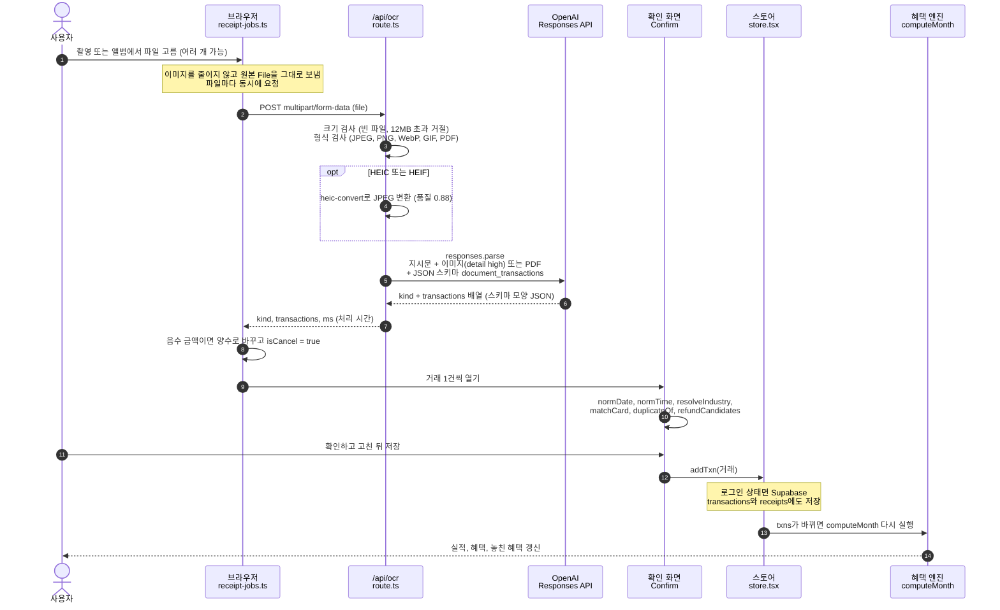
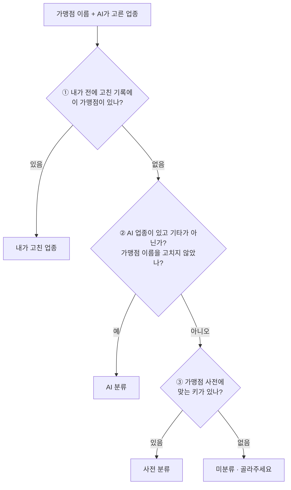
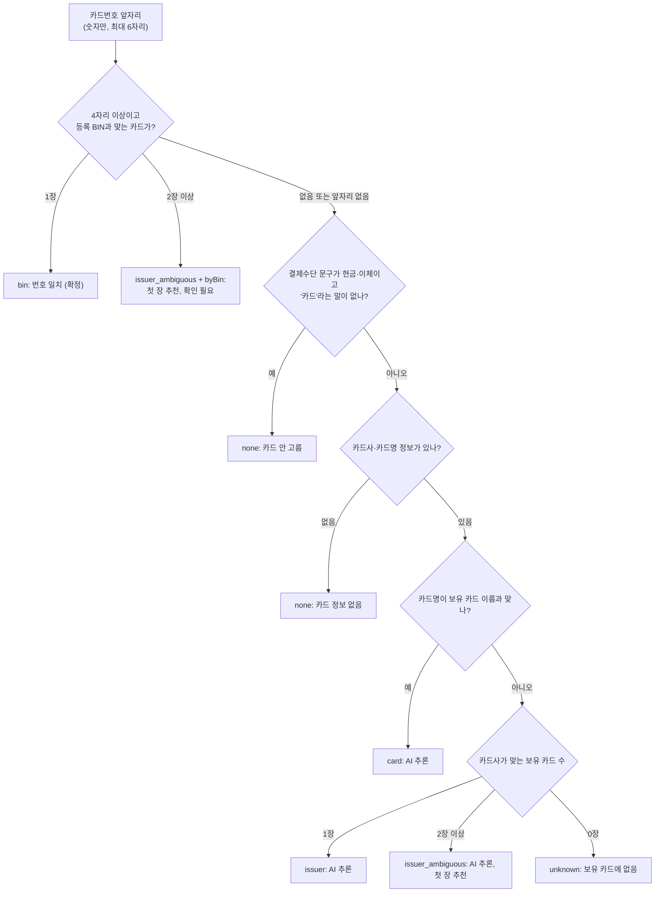

# 05. 영수증 인식과 AI

영수증 사진 한 장이 거래 한 건으로 저장되기까지를 설명합니다. 결제 승인 문자 캡처와 카드 명세서(이미지·PDF)도 같은 길로 들어옵니다.

먼저 원칙 세 가지를 말해 두겠습니다.

1. **AI는 읽고 분류만 합니다.** 가맹점·날짜·금액·품목·카드 정보를 읽고, 업종을 고릅니다.
2. **사용자가 확인해야 저장됩니다.** AI가 읽은 값은 확인 화면에 먼저 보이고, 사용자가 "확인하고 저장"을 눌러야 거래가 됩니다.
3. **혜택 금액은 AI가 셈하지 않습니다.** 저장된 거래로 규칙 엔진(`src/lib/engine`)이 계산합니다. 자세한 내용은 [04. 혜택 계산 엔진](04-benefit-engine.md)에 있습니다.

## 지도 교수님 질문과 답의 위치

| 질문 | 짧은 답 | 자세히 |
| --- | --- | --- |
| 영수증 이미지를 올리면 어떤 프롬프트를 거쳐 어떤 결과가 나오나? | 서버가 OpenAI Responses API에 **지시문 1개 + 이미지 + JSON 스키마**를 보냅니다. 모델은 스키마 모양의 JSON(문서 종류 + 거래 목록)만 돌려줍니다. | [1](#1-전체-흐름), [2](#2-모델에-보내는-요청), [3](#3-예시-영수증-한-장이-거래가-되기까지) |
| 가맹점·결제일·결제 시각·금액·업종·품목은 어떻게 나오나? | 업종을 뺀 다섯 개는 영수증에서 읽습니다. 날짜·시각은 코드가 형식을 다시 검사합니다. 금액은 화면에서 품목 합과 비교해 보여 줍니다. | [4](#4-각-값은-어디서-나오나) |
| 영수증에 적혀 있지 않은 업종은 어떻게 분류하나? | 3단계입니다. ① 사용자가 전에 고친 기록 → ② AI가 가맹점명·품목을 보고 고른 업종 → ③ 가맹점 사전. 셋 다 없으면 "미분류"로 두고 골라 달라고 합니다. | [5](#5-업종-분류--영수증에-없는-값을-정하는-법) |
| 업종·품목이 있을 때와 없을 때는? 사용자가 확인·수정할 수 있나? | 모든 칸을 확인 화면에서 고칠 수 있습니다. 값마다 "신뢰도 높음 / 신뢰도 낮음 / 추론 / 읽지 못함 / 수정함"을 표시합니다. 없는 값은 문서 종류별로 안내합니다. | [6](#6-값이-없거나-이상할-때), [8](#8-확인-화면의-표시) |

## 관련 코드

| 파일 | 역할 |
| --- | --- |
| `src/app/(app)/receipt/page.tsx` | 영수증 화면. 파일 고르기 → 처리 목록 → 확인·수정(`Confirm`) |
| `src/components/shell.tsx` | 모바일 하단 + 버튼의 `AddMenu`. 촬영·앨범에서 고르면 바로 인식을 시작 |
| `src/lib/ai/receipt-jobs.ts` | 인식 작업 목록(모듈 변수). 파일마다 `/api/ocr` 호출, 음수 금액 처리, 다음에 열 거래 순서(`nextOpen`) |
| `src/lib/ai/client.ts` | 브라우저 → Route Handler 호출 헬퍼(`aiOcr`, `aiClassify`, `aiInsight`, `aiJudge`, `aiNormalize`) |
| `src/app/api/ocr/route.ts` | 파일 크기·형식 검사, HEIC → JPEG 변환, `ocrDocument` 호출 |
| `src/lib/ai/server.ts` | OpenAI 호출(서버 전용). 지시문, 스키마(`DocSchema`), 오류 문구(`aiErrorMessage`) |
| `src/lib/data/match-card.ts` | 결제 카드 판별(`matchCard`), 날짜·시각 정리(`normDate`, `normTime`), 중복·환불 후보 |
| `src/lib/data/merchants.ts` | 업종 28종(`INDUSTRY`), 가맹점 사전(`classifyMerchant`), 업종 3단계(`resolveIndustry`) |

Route Handler는 Next.js에서 `app/api/**/route.ts` 파일로 만드는 서버 API입니다. OpenAI 키는 서버에만 있고, 브라우저는 이 API만 부릅니다.

---

## 1. 전체 흐름



흐름에서 짚을 점입니다.

- **들어오는 곳은 두 곳입니다.** `/receipt` 화면의 "촬영"·"앨범·파일" 버튼과, 모바일 하단 + 버튼의 `AddMenu`입니다. 둘 다 `receiptJobs.start(files)`를 부릅니다. 촬영은 한 장, 앨범은 여러 개를 고를 수 있습니다.
- **브라우저는 이미지를 줄이지 않습니다.** 현재 코드에는 이미지 축소·압축 단계가 없습니다. 고른 `File`을 그대로 `FormData`에 넣어 보냅니다(`aiOcr`).
- **파일마다 동시에 요청합니다.** `start()`가 파일마다 `run()`을 기다리지 않고 실행합니다. 읽기가 끝난 파일부터 확인할 수 있습니다.
- **"후처리"는 함수 하나가 아닙니다.** 음수 금액 처리는 `receipt-jobs.ts`의 `run()`에서, 나머지(날짜·시각 정리, 업종, 카드, 중복)는 확인 화면 `Confirm`이 열릴 때 합니다.
- **작업 목록은 화면 밖 모듈 변수에 있습니다.** 다른 화면에 다녀와도 결과가 남습니다. 새로고침하면 사라집니다. 이미지를 서버에 저장하지 않기 때문입니다.
- **저장하면 엔진이 다시 돕니다.** 스토어의 `calc`가 `useMemo(() => computeMonth(month, state.txns, …))`라서 거래 배열이 바뀌면 그 달 계산이 새로 됩니다.

### 1.1 `/api/ocr`가 거절하는 경우

| 조건 | 응답 | 화면 문구 |
| --- | --- | --- |
| `file` 필드 없음 | 400 | `file 필드가 필요해요` |
| 0바이트 파일 | 400 | `빈 파일이에요` |
| 12MB 초과 | 413 | `12MB 이하 파일만 받아요` |
| 형식이 목록에 없고 HEIC도 아님 | 415 | `JPEG·PNG·WebP·GIF·HEIC 이미지 또는 PDF만 받아요` |
| 그 밖의 오류: 요청 본문 해석, HEIC 변환, AI 호출, 응답 해석 중 오류 | 502 | `aiErrorMessage`가 만든 문구 ([12장](#12-api-키가-없을-때)) |

HEIC는 아이폰 기본 사진 형식입니다. 브라우저가 MIME 형식을 비워 보내기도 해서, 서버는 세 가지로 판별합니다. MIME에 `heic`/`heif`가 있거나, 파일 이름이 `.heic`/`.heif`로 끝나거나, 파일 앞 4~8바이트가 `ftyp`이고 8~12바이트가 `heic`·`heix`·`hevc`·`hevx`·`mif1`·`msf1` 중 하나이면 HEIC로 봅니다. 변환은 네이티브 의존성이 없는 순수 JS 라이브러리 `heic-convert`가 합니다.

배포 플랫폼이 요청 본문을 더 작은 크기에서 막으면 JSON이 아닌 413 응답이 옵니다. 이때 `client.ts`의 `post()`가 `파일이 너무 커요`로 바꿔 보여 줍니다.

### 1.2 파일 하나에서 거래가 여러 건 나올 때

결제 문자 캡처(`sms`)와 명세서(`statement`)는 거래가 여러 건 나옵니다.

- 파일을 1개만 골랐고 거래가 1건이면 확인 화면이 바로 열립니다. 파일을 여러 개 고르면 각 파일의 거래가 1건이어도 자동으로 열리지 않고, 목록에서 "확인하기"를 눌러 엽니다. "목록으로"를 누르면 그 작업은 다시 자동으로 열지 않습니다.
- 여러 건이면 목록에서 거래마다 골라 엽니다. 저장한 건은 다시 열 수 없고, 건너뛴 건은 다시 열 수 있습니다.
- 저장·건너뛰기 뒤에는 `nextOpen`이 다음 미확인 건을 엽니다. **취소 건은 맨 뒤로** 보냅니다. 같은 명세서의 원거래를 먼저 저장해야 취소 건의 원거래 후보로 보이기 때문입니다.
- 남은 건이 없고 처음부터 1건뿐이었으며 저장했다면 거래 상세(`/transactions/{id}`)로 갑니다. 그 밖에는 목록으로 돌아갑니다.

---

## 2. 모델에 보내는 요청

`ocrDocument()`(`src/lib/ai/server.ts`)가 공통 함수 `parse()`를 부릅니다. `parse()`는 OpenAI SDK의 `responses.parse`를 한 번 호출합니다.

```ts
// src/lib/ai/server.ts — parse()
client().responses.parse({
  model: MODEL,                       // process.env.OPENAI_MODEL ?? "gpt-5.5"
  instructions,                       // 아래 2.1의 지시문
  input: [{ role: "user", content }], // 이미지(또는 PDF) + 짧은 요청 문장
  text: { format: zodTextFormat(DocSchema, "document_transactions") }, // 2.2의 JSON 스키마
});
```

- **Responses API**는 OpenAI의 대화형 생성 API입니다. 여기서는 한 번 묻고 한 번 답을 받는 용도로만 씁니다.
- **구조화 출력(Structured Outputs)** 은 JSON 스키마를 함께 보내 그 모양으로만 답하게 하는 기능입니다. `zodTextFormat`이 zod 스키마를 `{ type: "json_schema", name: "document_transactions", strict: true, schema }`로 바꿉니다. `strict: true`라서 모든 필드가 항상 들어오고, 정해진 값 목록(enum) 밖의 값은 나오지 않습니다.
- **zod**는 TypeScript용 스키마 라이브러리입니다. 같은 정의로 타입(`ReceiptResult`)과 JSON 스키마를 함께 얻습니다.

`content`에는 두 항목이 들어갑니다.

| 순서 | 이미지일 때 | PDF일 때 |
| --- | --- | --- |
| 1 | `{ type: "input_image", image_url: "data:image/jpeg;base64,…", detail: "high" }` | `{ type: "input_file", filename: "파일이름.pdf", file_data: "data:application/pdf;base64,…" }` |
| 2 | `{ type: "input_text", text: "이 문서의 거래를 구조화해줘." }` | 같음 |

이미지는 `detail: "high"`(고해상도 분석)로 보냅니다. 입력 토큰을 더 쓰는 대신 작은 글씨를 읽기에 유리합니다. PDF는 `detail`을 지정하지 않아 기본값(`auto`)을 따릅니다.

응답 처리 규칙도 `parse()`와 `ocrDocument()`에 있습니다.

- 응답이 콘텐츠 필터로 끊기면(`incomplete_details.reason === "content_filter"`) `문서를 읽을 수 없어요` 오류를 냅니다.
- 스키마로 해석된 결과(`output_parsed`)가 없으면 `구조화 결과를 해석하지 못했어요` 오류를 냅니다.

### 2.1 지시문 전문

`src/lib/ai/server.ts`의 `ocrDocument()`에 있는 지시문을 그대로 옮깁니다. 한 줄짜리 문자열이고, `${…}` 두 곳은 호출할 때 채워집니다.

```text
한국어 결제 문서를 읽어 거래 목록으로 구조화한다. 먼저 종류를 판별한다: 영수증(receipt)이면 거래 1건에 품목까지, 결제 승인 문자·앱 알림 캡처(sms)면 화면에 보이는 승인 건마다 1건, 카드 명세서·이용내역(statement)이면 행마다 1건. 취소·환불 행은 isCancel=true. 결제수단 줄에 카드사·카드명이 있으면 반드시 cardIssuer·cardName에 옮긴다 — 카드번호가 가려져 있어도 카드사명은 읽는다. 합계는 품목 합과 세금 관계로 검산하고, 없는 값은 문맥으로 추론하되 inferred에 필드명을 적는다. 판독이 불확실하면 lowConfidence에 적는다. 카드번호는 보이는 앞자리(최대 6자리)만 cardNumberPrefix에 넣고, 뒷자리·승인번호·계좌번호는 어떤 필드에도 넣지 않는다. 오늘은 ${kstToday()}. 업종 후보: ${industryList}
```

채워지는 값은 다음과 같습니다.

| 자리 | 값 |
| --- | --- |
| `${kstToday()}` | 서버 시계 기준 **한국 날짜** `YYYY-MM-DD`. 서버 시계는 UTC라서 9시간을 더해 날짜를 구합니다. 그냥 UTC 날짜를 쓰면 한국 0~9시에 하루 전 날짜가 됩니다. 연도 없는 결제 문자의 날짜를 추론할 때 기준이 됩니다. |
| `${industryList}` | `INDUSTRY`의 28개 업종을 `키=이름`으로 이은 문자열 (아래) |

```text
cafe=카페, restaurant=음식점, delivery=배달앱, convenience=편의점, mart=대형마트, online_shop=온라인쇼핑, fashion=패션·트렌디숍, fuel=주유소, transit=대중교통, taxi=택시, movie=영화, telecom=이동통신, electric=전기요금, gas=도시가스, utility=수도·공과금, hospital=병원, pharmacy=약국, laundry=세탁소, subscription=구독, overseas=해외 가맹점, tax=국세·지방세, insurance=4대보험, apt_fee=아파트관리비, gift_card=상품권·선불충전, school=학교납입금, rail=철도, electronics=전자제품, etc=기타
```

지시문만이 프롬프트의 전부는 아닙니다. **스키마의 필드 설명(`.describe(…)`)도 JSON 스키마의 `description`으로 모델에 전달됩니다.** 예를 들어 "카드번호는 최대 6자리"는 지시문과 필드 설명 양쪽에 있고, "업종을 판단할 수 없으면 null"은 필드 설명(`industry`)에만 있습니다.

### 2.2 스키마 필드

최상위는 `{ kind, transactions }`입니다(`DocSchema`). 거래 하나의 모양은 `TxnItem`입니다.

| 필드 | 뜻 (스키마 설명 요약) | 예시 | 확인 화면에서 |
| --- | --- | --- | --- |
| `kind` | 문서 종류. `receipt`=영수증 1장, `sms`=결제 승인 문자·앱 알림 캡처, `statement`=명세서·이용내역, `unknown`=거래 정보 없음 | `"receipt"` | 제목("영수증 확인"), 품목 없음 안내 문구 |
| `transactions` | 이미지에 있는 거래 전부. 영수증은 1건 | `[…]` | 거래 1건 = 확인 화면 1장 |
| `merchant` | 가맹점명(지점명 포함) | `"이마트 성수점"` | 가맹점 칸 |
| `industry` | 업종 28종 중 하나. 판단할 수 없으면 `null` | `"mart"` | 업종 칸 (5장의 3단계를 거침) |
| `date` | 결제일 `YYYY-MM-DD`. 연도 없는 문자는 최근 날짜로 추론하고 `inferred`에 `date` | `"2026-09-19"` | 결제일 칸 |
| `paidAt` | 결제 시각 `HH:MM`(24시간) | `"14:32"` | 결제 시각 칸 |
| `items` | 품목 `{ name, qty, price(단가) }` 배열. 문자·명세서는 빈 배열 | `[{ "name": "바나나", "qty": 1, "price": 4480 }]` | 품목 목록 |
| `total` | 결제 금액(숫자, 양수) | `28190` | 금액 칸 |
| `tax` | 세금 | `796` | 표시·저장하지 않음 (지시문의 검산에만 쓰임) |
| `currency` | `KRW`·`USD`·`JPY` | `"KRW"` | 외화면 원화 환산액 칸이 생김 |
| `payMethodText` | 결제수단 줄 원문(카드번호·승인번호 숫자는 뺌) | `"신한카드 Mr.Life 일시불"` | 결제 카드 판별, 현금·이체 판별, 간편결제 판별 |
| `cardIssuer` | 카드 발급사를 15개 값으로 정규화. 매입사와 다르면 발급사. 없으면 `null` | `"신한"` | 결제 카드 판별 |
| `cardName` | 카드 상품명. 없으면 `null` | `"Mr.Life"` | 결제 카드 판별 |
| `cardNumberPrefix` | 가려지지 않은 카드번호 앞자리, 최대 6자리. 뒷 4자리·승인번호는 넣지 않음 | `"451842"` | BIN 대조 |
| `installmentMonths` | 할부 개월. 일시불이면 `null` | `null` | 할부 안내 문구, 저장 |
| `fuelLiters` | 주유 영수증의 리터 | `null` | 업종이 주유소면 주유량 칸 |
| `isCancel` | 취소·환불 건이면 `true` | `false` | 취소 모드(원거래 고르기) |
| `lowConfidence` | 판독이 불확실한 필드 이름 목록 | `["paidAt"]` | 가맹점·결제일·결제 시각·금액·품목 칸이면 붉게 "신뢰도 낮음 · 확인 필요". 그 밖의 필드는 상단 개수에만 반영 (8장) |
| `inferred` | 이미지에 없어 문맥으로 추론한 필드 이름 목록 | `[]` | 위 다섯 칸이면 파란 점선 "추론". 그 밖의 필드는 상단 개수에만 반영 |

`cardIssuer`의 값 목록은 `신한, 삼성, 현대, KB국민, 롯데, 우리, 하나, NH농협, BC, IBK기업, 씨티, 카카오뱅크, 토스뱅크, 케이뱅크, 기타`입니다.

`lowConfidence`·`inferred`는 자유 문자열이라 모델이 필드 이름을 `amount`·`합계`·`결제 시각`처럼 다르게 쓸 수 있습니다. `fieldKey()`가 정규식으로 화면 칸 이름에 맞춥니다(`amount`·`합계` → `total`, `결제 시각` → `paidAt`, `store` → `merchant` 등).

---

## 3. 예시: 영수증 한 장이 거래가 되기까지

아래 영수증과 모델 응답은 **설명을 위해 만든 가상의 예**입니다. 확인 화면 값·카드 판별 문구·혜택 계산 결과는 현재 코드의 함수(`matchCard`, `matchNote`, `resolveIndustry`, `computeMonth` 등)에 이 값을 넣어 실제로 돌려 확인했습니다. 사용자는 테스트용 고정 장부(`src/lib/data/fixtures.ts`)처럼 카드 3장(신한 Mr.Life, 신한 Point Plan, 현대 ZERO Edition3)을 등록했다고 가정합니다.

### 3.1 영수증

```text
           이마트 성수점
  서울 성동구 ○○로 ○○
  2026-09-19 14:32            ← 시각 인쇄가 흐림
  ----------------------------------
  서울우유 900ml    2   2,980   5,960
  특란 30구         1   8,990   8,990
  바나나            1   4,480   4,480
  신라면 5입        2   4,380   8,760
  ----------------------------------
  면세물품가액                  19,430
  과세물품가액                   7,964
  부가세                           796
  합계                          28,190
  ----------------------------------
  신한카드 Mr.Life  일시불
  카드번호  4518-42**-****-****
  승인번호  30012345
```

### 3.2 서버가 보내는 요청 (요약)

```json
{
  "model": "gpt-5.5",
  "instructions": "한국어 결제 문서를 읽어 거래 목록으로 구조화한다. … 오늘은 (요청한 날의 한국 날짜). 업종 후보: cafe=카페, …, etc=기타",
  "input": [{
    "role": "user",
    "content": [
      { "type": "input_image", "image_url": "data:image/jpeg;base64,/9j/4AAQ…", "detail": "high" },
      { "type": "input_text", "text": "이 문서의 거래를 구조화해줘." }
    ]
  }],
  "text": { "format": { "type": "json_schema", "name": "document_transactions", "strict": true, "schema": { "…": "2.2의 스키마" } } }
}
```

### 3.3 모델 응답 (가상)

```json
{
  "kind": "receipt",
  "transactions": [{
    "merchant": "이마트 성수점",
    "industry": "mart",
    "date": "2026-09-19",
    "paidAt": "14:32",
    "items": [
      { "name": "서울우유 900ml", "qty": 2, "price": 2980 },
      { "name": "특란 30구", "qty": 1, "price": 8990 },
      { "name": "바나나", "qty": 1, "price": 4480 },
      { "name": "신라면 5입", "qty": 2, "price": 4380 }
    ],
    "total": 28190,
    "tax": 796,
    "currency": "KRW",
    "payMethodText": "신한카드 Mr.Life 일시불",
    "cardIssuer": "신한",
    "cardName": "Mr.Life",
    "cardNumberPrefix": "451842",
    "installmentMonths": null,
    "fuelLiters": null,
    "isCancel": false,
    "lowConfidence": ["paidAt"],
    "inferred": []
  }]
}
```

승인번호와 카드번호 뒷자리는 어떤 필드에도 없습니다. `/api/ocr`는 이 JSON에 처리 시간 `ms`(밀리초)를 붙여 브라우저로 돌려줍니다.

### 3.4 후처리

| 단계 | 함수 (위치) | 이 예시의 결과 |
| --- | --- | --- |
| 음수 금액 처리 | `run()` (`receipt-jobs.ts`) | 28,190은 양수라 그대로 |
| 날짜 형식 | `normDate` | `2026-09-19` (실제 있는 날짜) |
| 시각 형식 | `normTime` | `14:32` |
| 필드 이름 맞춤 | `fieldKey` | `lowConfidence`의 `paidAt` → 결제 시각 칸 |
| 업종 | `resolveIndustry("이마트 성수점", "mart", 기록 없음)` | `mart`, 출처 `ai` |
| 카테고리 | `categoryForIndustry(categories, "mart")` | `food.mart` (식비 › 마트) |
| 품목 검산 | `Confirm`의 `itemSum` | 2×2,980 + 8,990 + 4,480 + 2×4,380 = 28,190 → 금액과 같음 |
| 결제 카드 | `matchCard(보유 카드 3장, 응답)` | `level: "card"`, Mr.Life. 후보 순서 Mr.Life → Point Plan → ZERO |
| 현금·이체 문구 | `payTypeHint` | 해당 없음 |
| 간편결제 | `payMethodOf` | 해당 없음 (`payMethod` 저장 안 함) |
| 중복 | `duplicateOf` | 처음 올릴 때는 없음 |

### 3.5 확인 화면

| 칸 | 값 | 표시 |
| --- | --- | --- |
| 상단 요약 | 파일 이름 · `영수증 · 낮은 신뢰도 1개 · 추론한 값 없음` | "원본 크게 보기" 링크 |
| 가맹점 | 이마트 성수점 | 초록 `신뢰도 높음` |
| 업종 (혜택 매칭용) | 대형마트 | 배지 `AI 분류`, 설명 "AI가 문서의 가맹점명·품목을 보고 분류했어요" |
| 카테고리 | 식비 › 마트 | `업종 기본값` |
| 결제일 | 2026-09-19 | 초록 `신뢰도 높음` |
| 결제 시각 | 14:32 | 붉은 칸, `신뢰도 낮음 · 확인 필요` |
| 금액 | 28,190원 | 초록 `신뢰도 높음`, 아래에 "품목 합계 28,190원 · 금액과 같아요" |
| 품목 | 4줄. 줄 끝에 `2 × 2,980원`처럼 수량 × 단가 | 이름은 고치기·지우기·추가 가능 |
| 결제 카드 | 신한 Mr.Life · 추천 | 배지 `AI 추론`, 설명 "앞자리 451842와 맞는 등록 카드가 없어 AI 추론 · 영수증의 신한카드 Mr.Life와 일치" |
| 후보 카드 | 칩 3개: 신한 Mr.Life · 추천 / 신한 Point Plan / 현대 ZERO Edition3 (포인트형) | 누르면 바로 바뀜 |
| 버튼 | 목록으로 / 건너뛰기 / **확인하고 저장** | |

이 예의 카드에는 BIN(카드번호 앞 6자리)을 등록하지 않아서 "AI 추론"이 됩니다. 카드 상세 화면(`/cards/{id}`)에서 Mr.Life에 `451842`를 등록해 두면 결과가 `level: "bin"`으로 바뀝니다. 그러면 초록 `번호 일치`와 "영수증 카드번호 앞자리 451842가 등록한 카드와 일치해요"가 보입니다.

### 3.6 저장되는 거래

"확인하고 저장"을 누르면 `addTxn`에 다음 값이 들어갑니다. `id`는 스토어가 붙입니다.

```ts
{
  type: "expense", merchant: "이마트 성수점",
  amount: 28190, currency: "KRW", date: "2026-09-19", paidAt: "14:32",
  merchantIndustry: "mart", categoryId: "food.mart",
  payType: "credit", cardId: "shinhan_mrlife",
  items: ["서울우유 900ml", "특란 30구", "바나나", "신라면 5입"], // 이름만 저장 (수량·단가는 저장하지 않음)
  receiptId: "doc_<작업 id>",                                     // 같은 파일에서 나온 거래는 같은 값 (브라우저 메모리에서만)
}
```

로그인 상태면 Supabase `transactions`에 거래 행을, `receipts`에 `storage_path: "not_stored"`, `status: "done"`인 행을 넣습니다. 이미지와 인식 원문은 넣지 않습니다. 테이블 구조는 [07. 데이터 모델과 ERD](07-data-model.md)에 있습니다.

`receiptId`가 같은 파일끼리 같은 값인 것은 브라우저 메모리에서만입니다. 로그인 모드에서는 거래마다 `receipts` 행이 하나씩 따로 생깁니다(`src/lib/db.ts`의 `insertTxns`). 다시 읽으면 `receiptId`가 그 행의 `id`로 바뀝니다. 그래서 같은 명세서에서 나온 거래도 서로 다른 `receiptId`가 되고, 같은 파일이었다는 정보는 남지 않습니다.

### 3.7 엔진 재계산 결과

테스트용 고정 장부(`src/lib/data/fixtures.ts`)의 거래에 이 거래를 더해 `computeMonth("2026-09", …)`로 계산한 결과입니다.

| 카드 | 이 결제의 혜택 | 이유 |
| --- | --- | --- |
| 신한 Mr.Life (실제 결제 카드) | 0원 | "주말 3대 할인마트 10% 할인" 대상이지만, 전월 실적 구간(30~50만 원)의 월 한도 3,000원을 9월 5일 이마트 역삼점 결제에서 이미 다 썼습니다(`월 한도 3,000원 소진`). |
| 신한 Point Plan | 140원 | 일상 생활비 적립 (건당 금액 구간별) |
| 현대 ZERO Edition3 | 338원 | 국내외 가맹점 1.2% 적립 (28,190 × 0.012 = 338.28 → 338) |

그래서 거래 상세에는 "이 결제엔 현대 ZERO Edition3 (포인트형)이 최적이었어요. 338원 더 받을 수 있었어요."가 보입니다. 이 거래의 차액 338원은 놓친 혜택 목록(`missedTop`)에 들어갑니다.

그 달의 놓친 혜택 합계(`missed`)는 거래별 차액을 더한 값이 아닙니다. 엔진이 가상 원장에서 차액이 큰 거래부터 한도를 다시 나눠(그리디) 계산합니다([04. 혜택 계산 엔진 15.4절](04-benefit-engine.md#154-받은--받을-수-있었던--놓친-혜택)). 이 예에서는 받은 혜택이 18,468원 그대로이고, 받을 수 있었던 혜택(`could`)이 21,713원 → 22,276원, 놓친 혜택이 3,245원 → 3,808원(+563원)이 됩니다.

AI는 이 계산에 전혀 관여하지 않습니다. AI가 정한 것은 업종 `mart`와 카드 후보뿐이고, 사용자가 저장한 값으로 엔진이 계산합니다.

---

## 4. 각 값은 어디서 나오나

| 필드 | 영수증에서 읽음 | 문맥으로 추론 | 코드의 후처리·검산 |
| --- | --- | --- | --- |
| 가맹점 | 상호·지점명 | — | 사용자가 이름을 고치면 AI 업종만 빼고 ① 기록 → ③ 사전 순서로 다시 판단 |
| 업종 | **적혀 있지 않음** | 모델이 가맹점명·품목을 보고 28종 중 하나를 고르거나 `null` | `resolveIndustry` 3단계. `etc`(기타)는 "판단 못 함"으로 보고 다음 단계로 |
| 결제일 | 거래 일시 줄 | 연도 없는 문자는 최근 날짜로 추론(`inferred`에 `date`) | `normDate`: `2026.9.5`·`2026/09/05` → `2026-09-05`. 2월 30일처럼 없는 날짜는 버림 |
| 결제 시각 | 거래 일시 줄 | — | `normTime`: `9:05` → `09:05`. `24:00` 이상이나 `오후 2:32` 같은 형식은 버림 |
| 금액 | 합계·결제금액 줄 | 지시문이 "품목 합과 세금 관계로 검산"하게 함 | 음수 → 양수 + 취소. 화면에서 품목 합과 비교 |
| 품목 | 품목 줄 (영수증만) | — | 이름만 저장 |
| 세금 | 부가세 줄 | — | 화면·저장에 쓰지 않음 |
| 통화 | 통화 기호·표기 | — | 외화면 원화 환산 참고값을 채움 |
| 결제수단 문구 | 결제수단 줄 (숫자 제외) | — | 현금·이체 판별(`payTypeHint`), 간편결제 판별(`payMethodOf`), 카드 판별 |
| 카드사 | 카드종류·발급사 줄, 문자 앞머리(`[신한카드]`), 명세서 헤더 | 15개 값으로 정규화 | `matchCard` 2순위 |
| 카드명 | 카드 상품명 | — | `matchCard`가 보유 카드 이름과 비교 |
| 카드번호 앞자리 | 가려지지 않은 앞자리(최대 6) | — | 숫자만 남기고 6자리로 자른 뒤 등록 BIN과 비교 |
| 할부 | 할부 개월 | — | 신용카드이고 2개월 이상일 때만 저장 |
| 주유량 | 리터 | — | 업종이 주유소일 때만 칸을 보이고 저장 |
| 취소 여부 | 취소·환불 표기 | — | 음수 금액도 취소로 바꿈. 취소 건은 지출(+)로 저장하지 않음 |
| 신뢰도 낮음·추론 | 모델의 자기 보고 | — | `fieldKey`로 화면 칸에 연결 |

주의할 점이 있습니다. "추론"과 "신뢰도 낮음"은 **모델이 스스로 적은 목록**입니다. 코드가 이미지와 다시 대조해 검증하지는 않습니다. 코드가 독립적으로 검사하는 것은 날짜·시각의 형식과 실재 여부, 품목 합과 금액의 일치, 카드번호 앞자리와 등록 BIN의 일치입니다.

---

## 5. 업종 분류 — 영수증에 없는 값을 정하는 법

영수증에는 "업종" 칸이 없습니다. 그런데 카드 혜택은 업종(카페·대형마트·주유소…)으로 정해집니다. 그래서 업종은 **판단**해야 하는 값입니다. 업종은 가계부 카테고리와 별개입니다. 업종은 혜택 계산에, 카테고리는 가계부 통계에 쓰입니다([용어집](glossary.md)).

### 5.1 3단계 (`resolveIndustry`)



| 순위 | 출처 | 화면 배지 | 배지 아래 설명 |
| --- | --- | --- | --- |
| ① | 사용자가 고친 기록 (`industryHints`) | `내가 고친 업종` | 전에 이 가맹점의 업종을 직접 고친 기록을 따랐어요 |
| ② | AI 응답의 `industry` | `AI 분류` | AI가 문서의 가맹점명·품목을 보고 분류했어요 |
| ③ | 가맹점 사전 (`classifyMerchant`) | `사전 분류` | 가맹점 이름을 업종 사전에서 찾아 분류했어요 |
| — | 셋 다 없음 | `미분류 · 골라주세요` | AI와 업종 사전 모두 업종을 찾지 못했어요. 카드 혜택 계산에 쓰이니 골라주세요 |
| — | 이 화면에서 직접 고름 | `내가 고친 업종` | 직접 고른 업종이에요 |

세부 규칙입니다.

- **AI 업종은 AI가 읽은 가맹점 이름 그대로일 때만 씁니다.** 사용자가 가맹점 이름을 고치면 AI의 판단 근거가 사라지므로, AI 업종만 빼고 ① 기록 → ③ 사전 순서로 다시 찾습니다(`resolveIndustry(고친 이름, null, industryHints)`). 이때 "AI 분류"라고 표시하지 않습니다.
- **`etc`(기타)는 미분류로 봅니다.** AI가 `etc`를 주거나 예전 기록이 `etc`이면 다음 단계로 넘어갑니다. 예: AI가 이마트 성수점에 `etc`를 주면 사전이 `mart`를 찾고 배지는 `사전 분류`가 됩니다. 업종 선택 목록에도 "기타"는 없습니다.
- **기록은 이렇게 남습니다.** 확인 화면에서 업종을 직접 골라 처음 값과 달라졌으면 저장할 때 `rememberIndustry`가 기억합니다. 키는 두 개입니다. 공백을 뺀 가맹점 전체 이름과, 이름에 공백이 있을 때 첫 단어(브랜드, 2글자 이상)입니다. 그래서 "스타벅스 강남점"을 고치면 "스타벅스 역삼점"에도 적용됩니다. 기록은 이 브라우저의 `localStorage`(`cardsem-industry-hints:<사용자 id 또는 demo>`)에만 있습니다. 계정(데모 포함)마다 따로 기억합니다. 거래 상세 화면에서 업종을 고쳐도 기록됩니다.

### 5.2 가맹점 사전 (`classifyMerchant`)

`src/lib/data/merchants.ts`의 `DICT_RAW`에 "키워드 → 업종" 쌍이 있습니다. 이름을 소문자로 바꾸고, 모든 키가 이름 안에서 처음 나오는 위치를 구합니다.

- **가장 앞에 나온 키**를 고릅니다. 이름 앞쪽이 대개 브랜드이기 때문입니다.
- 같은 위치에서 여러 키가 맞으면 **더 긴 키**를 고릅니다.
- `CU`·`KT`·`SRT`처럼 **영문·숫자로만 된 키는 앞뒤가 영문·숫자가 아닐 때만** 맞춥니다. JavaScript의 `\b`는 한글을 단어 문자로 보지 않아서 경계를 직접 정규식으로 씁니다.

현재 코드로 확인한 예입니다.

| 가맹점 이름 | 결과 | 이유 |
| --- | --- | --- |
| 투썸플레이스 홈플러스 강서점 | 카페 | 앞에 나온 "투썸"이 입점처 "홈플러스"보다 먼저 |
| 쿠팡플레이 | 구독 | 같은 위치에서 "쿠팡플레이"가 "쿠팡"보다 김 |
| 이마트24 성수점 | 편의점 | "이마트24"가 "이마트"보다 김 |
| 메가MGC커피 선릉점 | 카페 | "커피" 키 |
| Cucina 파스타 | 음식점 | "CU"는 뒤에 영문이 붙어 안 맞고, "파스타"가 맞음 |
| KTX 서울역 | 철도 | "KT"는 뒤에 "X"가 붙어 안 맞음 |
| 행복반찬 | (없음) | 맞는 키가 없음 → 미분류 |

### 5.3 업종이 정해진 뒤

- **카테고리 기본값**은 `categoryForIndustry`가 `INDUSTRY_TO_CATEGORY`로 정합니다. 업종을 바꾸면 카테고리도 따라 바뀌고, 카테고리를 직접 고르면 고정됩니다. 상품권·학교납입금, 그리고 미분류는 맞는 기본 카테고리가 없어 "기타"가 됩니다. 사용자가 지운 카테고리면 상위 카테고리 → "기타" 순서로 대신합니다.
- **미분류로 저장해도 됩니다.** 저장을 막지 않습니다. 이때 거래의 `merchantIndustry`는 비어 있습니다. 엔진의 `industryOf`는 비어 있으면 사전으로 한 번 더 찾고, 그래도 없으면 카드 비교에 "업종 미분류"라고 적습니다. 거래 상세 화면에서 나중에 업종을 고를 수 있습니다.
- **영수증 경로는 `/api/classify`를 부르지 않습니다.** 영수증 응답에 이미 AI 업종이 있기 때문입니다. `/api/classify`는 직접 입력 화면에서만 씁니다([11장](#11-다른-ai-기능)).

---

## 6. 값이 없거나 이상할 때

| 상황 | 화면 동작 | 사용자가 할 일 |
| --- | --- | --- |
| **업종을 못 정함** (AI `null`·`etc`, 사전·기록 없음) | 배지 `미분류 · 골라주세요` (주황). 카테고리는 "기타" | 업종을 고르면 저장 때 기억함. 그대로 저장도 가능 |
| **품목 없음 — 영수증** | "영수증에서 품목을 읽지 못했어요. 필요하면 직접 적어주세요" | "품목 추가"로 이름 입력 (선택) |
| **품목 없음 — 결제 문자·명세서** | "결제 문자·명세서에는 품목이 없어요" (스키마가 빈 배열로 받음) | 필요하면 "품목 추가" |
| **날짜 없음·형식 이상** (`normDate` 실패) | 오늘 날짜(데모·로그인 모두 기기의 오늘)로 채우고 붉은 `읽지 못함 · 확인 필요` | 날짜 확인. 칸을 비우면 "날짜를 입력해주세요"와 함께 저장 버튼이 꺼짐 |
| **연도 없는 결제 문자** | 모델이 서버의 한국 날짜 기준으로 최근 날짜를 추론. `inferred`에 `date`가 있으면 파란 점선 `추론` | 날짜 확인 |
| **시각 없음** | 회색 `읽지 못함` (선택 항목이라 붉게 표시하지 않음), 칸은 빈 값 | 시간대 혜택이 있는 카드라면 입력. 비워 두면 엔진이 그 규칙을 "결제 시각 입력 시 최대 ○원"으로 남김 ([04](04-benefit-engine.md)) |
| **금액이 품목 합과 다름** | 금액 아래 "품목 합계 ○원 · 금액과 달라요, 확인해주세요" (차이 0.01 미만이면 "금액과 같아요") | 영수증과 대조. 저장은 막지 않음 |
| **금액이 0이거나 빈칸** | 저장 버튼이 꺼짐 | 금액 입력 |
| **카드 정보 없음** | 결제 카드 기본값 "카드 선택 안 함 (현금)", 붉은 `확인 필요`, "영수증에 카드 정보가 없어요. 카드로 결제했다면 골라주세요" | 카드로 냈다면 고름 |
| **현금·계좌이체 문구** | 기본값을 현금 또는 계좌이체로, 초록 `신뢰도 높음`, "현금 결제로 읽었어요" / "계좌이체로 읽었어요" | 확인 |
| **보유하지 않은 카드** | 기본값 현금, 붉은 `확인 필요`, 예: "'롯데카드 LOCA LIKIT'는 보유 카드에 없어요. 카드로 결제했다면 골라주세요" | 카드 고르기 또는 카드 등록 |
| **외화** (`USD`·`JPY`) | 금액에 소수점 허용, 단위 표시. "원화 환산액" 칸을 1 USD ≈ 1,380원, 1 JPY ≈ 9.2원으로 미리 채우고 `참고값` 배지. 설명: "카드 명세서의 원화 청구액으로 고쳐주세요" | 명세서의 원화 청구액 입력. `amountKrw`로 저장 |
| **취소 영수증** (`isCancel`) | 주황 안내 "취소·환불 건으로 읽었어요…". 업종·카테고리·품목·카드 칸을 숨기고 원래 결제 후보를 보여 줌 | 원거래를 고르면 "환불로 저장", 후보가 없거나 "목록에 없어요"를 고르면 "수입으로 저장" |
| **명세서의 음수 금액 행** | `run()`이 양수 + 취소로 바꿈. 목록에 `취소` 배지와 `-` 금액 | 위 취소 영수증과 같음 |
| **중복 의심** | 주황 안내 "이미 같은 거래가 있어요 · 9/19 이마트 성수점 28,190원. 같은 문서를 다시 올렸다면 건너뛰어 주세요." 저장 버튼이 "그래도 저장"으로 바뀜. 여러 건 목록에는 `중복 의심` 배지 | 같은 문서면 건너뛰기. 같은 날 같은 커피 두 잔처럼 정상인 경우가 있어 막지는 않음 |
| **판독이 불확실** (`lowConfidence`) | 가맹점·결제일·결제 시각·금액·품목이면 붉은 칸 + `신뢰도 낮음 · 확인 필요`. 다른 필드는 상단 개수에만 반영 ([8장](#8-확인-화면의-표시)) | 원본과 대조 ("원본 크게 보기") |
| **거래 정보 없음** (거래 목록이 비었을 때. `kind`는 보지 않음) | 파일 줄에 "거래 정보를 찾지 못했어요" | 다른 파일 고르기. 목록 아래 `직접 입력` 버튼은 실패한 파일이 있을 때만 나오므로, 직접 입력은 `/transactions/new`에서 |
| **인식 실패** (키 없음, 네트워크, 형식 등) | 파일 줄에 "실패 · (오류 문구)", `재시도` 버튼, 목록 아래 `직접 입력` 버튼 | 재시도 또는 직접 입력 |
| **할부** | 신용카드이고 2개월 이상이면 "할부 N개월로 읽었어요. 무이자 여부는 저장 후 거래 수정에서 바꿀 수 있어요." | 무이자면 저장 후 수정 |
| **주유 영수증** | 업종이 주유소면 "주유량" 칸이 생기고 `fuelLiters`로 채움 | 확인 (리터당 할인 계산에 쓰임) |

취소 영수증의 원거래 후보(`refundCandidates`) 조건은 네 가지입니다.

1. 환불이 아닌 지출 거래
2. 비슷한 가맹점 (`similarMerchant`: `(주)`·공백·기호를 지운 뒤 한쪽이 다른 쪽을 포함하거나 앞 3글자 이상이 같음)
3. 아직 환불되지 않은 금액 ≥ 취소 금액
4. 취소일 이전 90일 이내

금액이 딱 맞는 것을 먼저, 그다음 최근 순으로 보여 줍니다. 원거래를 고르면 이름은 "원거래 가맹점 · 취소"(전액) 또는 "· 부분 환불"이 되고, 원거래의 카테고리·업종·결제수단·카드를 물려받습니다. 환불이 어느 달에 반영되는지는 [08. 월간 요약 · 통계 · 엑셀 내보내기](08-reports-stats-export.md)에 있습니다.

중복 판단(`duplicateOf`)은 같은 날짜, 같은 금액(같은 외화끼리는 원래 통화 금액, 그 밖에는 원화), 비슷한 가맹점입니다. 결제는 결제끼리, 취소 건은 저장된 환불·수입끼리만 비교합니다. 같은 날 결제하고 취소한 건을 중복으로 보지 않기 위해서입니다.

---

## 7. 결제 카드 판별

`matchCard(userCards, 응답)`가 보유 카드 중 하나를 고릅니다. 번호가 맞으면 확정하고, 아니면 이름으로 추론합니다.



- **BIN**은 카드번호 앞 6자리로, 카드사와 상품을 식별하는 번호입니다([용어집](glossary.md)). 사용자가 카드 상세 화면에서 선택해 등록합니다. 자릿수가 달라도 짧은 쪽이 긴 쪽의 앞부분이면 맞다고 봅니다(예: 예전에 등록한 4자리 BIN과 영수증의 6자리).
- **카드사**는 모델이 정규화한 `cardIssuer`를 믿습니다. `cardIssuer`가 없거나 `기타`이면 `payMethodText`에서 찾습니다. 이때 "삼성페이·카카오페이" 같은 간편결제 브랜드를 먼저 지웁니다. "삼성페이 신한카드"의 "삼성"을 삼성카드로 읽지 않기 위해서입니다.
- **현금·이체 문구를 먼저 거릅니다.** 은행 이름(신한·국민·우리·하나·농협)이 카드사 별칭과 겹치기 때문입니다. 예: "신한은행 계좌이체"는 신한카드로 읽지 않습니다.
- **카드명**은 보유 카드 이름에서 괄호 부분을 빼고, 소문자로 바꾸고, 공백·기호를 지운 뒤 비교합니다(예: `ZERO Edition3 (포인트형)` → `zeroedition3`).

위와 같은 카드 3장(신한 2장 + 현대 1장)으로 확인한 화면 문구입니다.

| 영수증 내용 | 결과 | 화면 태그 | 안내 문구 (`matchNote`) |
| --- | --- | --- | --- |
| 앞자리 451842, Mr.Life에 BIN 451842 등록 | `bin` | 초록 `번호 일치` | 영수증 카드번호 앞자리 451842가 등록한 카드와 일치해요 |
| 앞자리 4518 (4자리만 보임), Mr.Life에 BIN 451842·Point Plan에 BIN 451899 등록 | `issuer_ambiguous` + `byBin` | 붉은 `확인 필요` | 카드번호 앞자리 4518와 맞는 등록 카드가 여러 장이라 확인해주세요 |
| 신한카드 Mr.Life (BIN 미등록) | `card` | `AI 추론` | 앞자리 451842와 맞는 등록 카드가 없어 AI 추론 · 영수증의 신한카드 Mr.Life와 일치 |
| 신한카드 (카드명 없음) | `issuer_ambiguous` | `AI 추론` | 앞자리 451842와 맞는 등록 카드가 없어 AI 추론 · 신한 카드가 여러 장이라 확인해주세요 |
| 현금 | `none` | 초록 `신뢰도 높음` | 현금 결제로 읽었어요 |
| 결제수단 정보 없음 | `none` | 붉은 `확인 필요` | 영수증에 카드 정보가 없어요. 카드로 결제했다면 골라주세요 |
| 롯데카드 LOCA LIKIT | `unknown` | 붉은 `확인 필요` | '롯데카드 LOCA LIKIT'는 보유 카드에 없어요. 카드로 결제했다면 골라주세요 |

후보 순서(`candidates`)는 추천 카드 → 같은 카드사 카드 → 나머지 보유 카드입니다. 보유 카드가 2장 이상이고 결과가 `card`·`issuer`·`issuer_ambiguous`이면 후보를 칩으로 보여 줍니다. 결제수단 문구에 간편결제가 있으면 `payMethodOf`가 `samsung_pay`·`naver_pay`·`kakao_pay`·`issuer_pay`로 바꿔 저장합니다. "SOL페이 결제 시" 같은 혜택 조건에 쓰입니다. 이 값은 결제 카드를 골랐을 때만 저장합니다. 현금이나 계좌이체로 저장하면 간편결제 정보는 버려집니다.

---

## 8. 확인 화면의 표시

모든 값은 저장 전에 고칠 수 있습니다. 칸마다 아래 태그 중 하나가 붙습니다. 위에서부터 먼저 맞는 것을 보여 줍니다.

| 태그 | 색 | 조건 |
| --- | --- | --- |
| `수정함` | 보라 배지 | 사용자가 처음 값과 다르게 고침. 처음 값과 비교하므로 되돌리면 사라짐 |
| `읽지 못함 · 확인 필요` | 붉은 글자 + 붉은 칸 | 결제일을 읽지 못해 오늘 날짜로 채움 |
| `신뢰도 낮음 · 확인 필요` | 붉은 글자 + 붉은 칸 | 모델이 `lowConfidence`에 적은 필드 |
| `추론` | 파란 배지 + 파란 점선 칸 | 모델이 `inferred`에 적은 필드 |
| `신뢰도 높음` | 초록 글자 | 위 어디에도 해당하지 않음 |

이 태그는 가맹점·결제일·결제 시각·금액·품목에 붙습니다. 업종·카테고리·결제 카드는 따로 표시합니다.

카드·업종·통화 등 다른 필드의 `lowConfidence`·`inferred`는 상단의 "낮은 신뢰도 N개"·"추론 N개" 개수에만 반영되고, 칸에는 표시되지 않습니다. `fieldKey`가 `cardIssuer`·`cardName`을 `card`로, `industry`를 `industry`로 바꾸기는 하지만, 결제 카드 태그와 업종 배지는 이 목록을 보지 않기 때문입니다. 예를 들어 모델이 `lowConfidence`에 `cardName`을 적어도 결제 카드 칸은 붉게 되지 않습니다.

| 칸 | 표시 |
| --- | --- |
| 업종 | 출처 배지 (`내가 고친 업종` / `AI 분류` / `사전 분류` / `미분류 · 골라주세요`)와 설명. 직접 고르면 "· 저장하면 이 가맹점에 기억해요"가 붙음 |
| 카테고리 | `업종 기본값` 또는 `수정함`. "가계부 통계에 쓰여요. 업종과 따로 고를 수 있어요" |
| 결제 카드 | `번호 일치` / `확인 필요` / `AI 추론` / `신뢰도 높음` / `수정함`과 `matchNote` 문구 |
| 원화 환산액 (외화) | `참고값` 또는 `수정함` |

상단 요약 줄은 "낮은 신뢰도 N개", "추론 N개를 확인해주세요"처럼 개수를 보여 줍니다. "원본 크게 보기"는 브라우저 메모리의 이미지(blob URL)를 새 탭에 엽니다.

저장 버튼이 꺼지는 경우는 가맹점이 비었을 때, 금액이 0일 때, 날짜가 올바르지 않을 때, 원화 금액이 0일 때, 취소 건인데 원거래도 수입 처리도 고르지 않았을 때입니다.

저장한 뒤에도 고칠 수 있습니다. 거래 상세 화면에서 업종을 바로 고칠 수 있고, "수정"(`/transactions/new?id=…`)에서 나머지 값을 고칩니다.

### "이 값들은 어떻게 나왔나요?"

확인 화면 아래에 접힌 설명이 있습니다. 교수님 질문에 화면에서 바로 답하려고 넣었습니다. 내용은 다음 다섯 줄입니다.

1. AI(OpenAI)가 이미지·PDF를 직접 읽어 문서 종류(영수증·결제 문자·명세서)를 가리고, 가맹점·결제일·시각·금액·품목·카드 정보를 정해진 형식으로 꺼내요. 글자만 뽑는 OCR 단계를 따로 거치지 않아요.
2. 문서에 없어 앞뒤 내용으로 채운 값은 '추론', AI가 확실하지 않다고 한 값은 '확인 필요', 직접 고친 값은 '수정함'으로 보여요.
3. 업종은 ① 내가 전에 고친 기록 ② AI 분류 ③ 가맹점 사전(예: 스타벅스 → 카페) 순서로 정해요. 셋 다 없으면 미분류로 두고 골라달라고 해요. 업종은 카드 혜택 계산에, 카테고리는 가계부 통계에 쓰여요.
4. 품목은 영수증에서만 읽어요. 결제 문자·명세서에는 품목이 없어 비워 두고, 필요하면 직접 적을 수 있어요.
5. 카드는 카드번호 앞자리가 등록한 카드와 같으면 확정하고, 아니면 카드사·카드명으로 추론해요. 혜택 금액은 AI가 아니라 계산 엔진이 셈해요.

---

## 9. 개인정보

| 항목 | 처리 |
| --- | --- |
| 카드번호 | 지시문은 "보이는 앞자리(최대 6자리)만 `cardNumberPrefix`에 넣고, 뒷자리·승인번호·계좌번호는 어떤 필드에도 넣지 않는다"고 합니다. 스키마 설명은 범위가 더 좁습니다. `cardNumberPrefix`에는 "뒷 4자리·승인번호는 절대 넣지 않음", `payMethodText`에는 "카드번호·승인번호 숫자는 뺀 것"이라고만 적혀 있고, 계좌번호는 말하지 않습니다. `matchCard`도 숫자만 남겨 6자리로 자릅니다. 사용자 카드에 저장하는 BIN도 앞 6자리이고 선택 항목입니다. |
| 원본 이미지 — 카드셈 쪽 | 서버는 요청을 처리하는 동안 메모리에만 들고 있고 디스크·DB·스토리지에 쓰지 않습니다. 브라우저는 blob URL로 미리보기만 하고, 새로고침하면 사라집니다. 로그인 상태의 `receipts` 행은 `storage_path`가 `"not_stored"`이고, 인식 원문·구조화 결과 칸(`ocr_text`, `structured`, `confidence`, `inferred`)은 비워 둡니다. |
| 원본 이미지 — OpenAI 쪽 | 인식을 위해 이미지·PDF가 OpenAI API로 전송됩니다. 코드는 `responses.parse`에 `store` 옵션을 넘기지 않습니다. 설치된 SDK(`openai` 7.x)의 설명에 따르면 `store`를 생략하면 기본값 `true`이고, 응답 데이터가 최소 30일 보관됩니다. 보관을 원하지 않으면 `store: false`를 넘겨야 합니다(현재 코드에는 없음). |
| 인사이트 | 영수증 원문은 보내지 않습니다. 월간 요약(`monthly/page.tsx`)은 집계값만 보냅니다. 홈(`home/page.tsx`)은 집계값과 함께 놓친 혜택 상위 3건을 거래 단위로 보냅니다. 각 건에 가맹점명·금액·쓴 카드·최적 카드·차액이 들어가고, 한도를 다 쓴 혜택 규칙 이름도 함께 갑니다. 그래서 개별 결제의 가맹점과 금액이 OpenAI로 나갑니다. |
| API 키 | `OPENAI_API_KEY`는 서버 환경변수입니다. `server.ts`는 `import "server-only"`로 브라우저 번들에 들어가지 않게 막습니다. |
| 사용자 업종 기록 | 이 브라우저의 `localStorage`(`cardsem-industry-hints:<사용자 id 또는 demo>`)에만 있고 서버로 보내지 않습니다. 계정(데모 포함)마다 따로 기억합니다. |

---

## 10. 왜 전용 OCR 대신 비전 모델인가

"OCR"은 이미지에서 글자만 뽑는 기술입니다. 전용 OCR을 쓰면 글자 줄을 받은 뒤 가맹점·금액·카드를 찾는 규칙을 따로 짜야 합니다. 카드셈은 이 단계를 두지 않고, 이미지를 이해하는 생성 모델(비전 모델)에게 바로 구조화된 JSON을 받습니다.

| 비교 | 전용 OCR + 규칙 | 비전 모델 + 구조화 출력 (현재) |
| --- | --- | --- |
| 호출 | OCR 1회 + 파싱 규칙 + 업종 분류 | 파일당 1회 |
| 문서 종류 | POS 영수증 양식, 카드사별 문자 양식, 명세서 양식마다 규칙 필요 | 지시문 하나로 영수증·문자·명세서·PDF를 처리 |
| 업종 | 별도 분류 필요 | 같은 호출에서 가맹점명·품목을 보고 고름 |
| 결과 모양 | 파서가 보장 | 스키마(`strict: true`)가 보장 |
| 불확실성 | 글자 인식 신뢰도 | 모델이 `lowConfidence`·`inferred`로 자기 보고 |

약점과 이를 줄이는 장치도 있습니다.

| 약점 | 장치 |
| --- | --- |
| 모델이 틀린 값을 그럴듯하게 만들 수 있음 | 값 목록(enum) 제한, `normDate`·`normTime` 검사, 품목 합 비교, 카드번호 대조, **사용자 확인 없이는 저장하지 않음** |
| 금액 계산을 맡기면 위험 | 혜택 금액은 규칙 엔진만 계산 |
| 응답이 느릴 수 있음 | 파일마다 동시에 요청, 다른 화면에 다녀와도 작업 유지, 함수 실행 시간 상한 `maxDuration = 90`초 |
| 외부 전송 | 9장 참고 |

### 비용 감각

코드는 요청마다 걸린 시간(`ms`)만 재고, 토큰 사용량(`usage`)은 기록하지 않습니다. 그래서 실제 비용 숫자는 이 문서에 적지 않습니다. 비용을 재려면 `parse()`에서 응답의 `usage`를 기록하고 모델 단가를 곱하면 됩니다. 대신 **언제, 몇 번 부르는지**는 코드로 정확히 알 수 있습니다.

| 동작 | AI 호출 | 줄이는 장치 |
| --- | --- | --- |
| 파일 1개 인식 | 1회. 명세서에 거래가 20행이어도 1회 | 없음. "재시도"는 다시 1회 |
| 직접 입력의 업종 분류 | 사전·기록에 없을 때만, 입력이 0.7초 멈춘 뒤 1회 | 서버 메모리 캐시(같은 이름은 다시 부르지 않음) |
| 홈·월간 요약 인사이트 | 달과 집계값이 바뀔 때 1회 | 브라우저 `localStorage` 캐시 |
| 정성 혜택 판단 | 정성 혜택이 있는 카드로 낸 거래의 상세를 열 때 1회 | 브라우저 `sessionStorage` 캐시 |
| 약관 정규화 | 관리자가 실행할 때 1회 | 없음 |
| 혜택 계산·통계·내보내기 | 0회 | AI를 쓰지 않음 |

한 번의 인식 호출에는 고정 비용(지시문 + JSON 스키마)과 이미지 비용이 듭니다. 이미지를 `detail: "high"`로 보내고 브라우저에서 줄이지 않으므로, 이미지 쪽 입력 토큰을 줄일 여지가 있습니다.

---

## 11. 다른 AI 기능

모든 AI 호출은 `src/lib/ai/server.ts`의 같은 `parse()`(구조화 출력)를 씁니다. 모델도 같은 `OPENAI_MODEL`(기본 `gpt-5.5`)입니다.

| API | 쓰는 화면 | 입력 → 출력 | 지시문 요지 | 캐시 | 실패 시 |
| --- | --- | --- | --- | --- | --- |
| `POST /api/ocr` | 영수증 화면 | 파일 → `{ kind, transactions, ms }` | 이 문서 2장 | 없음 | 파일 줄에 실패 문구, 재시도 |
| `POST /api/classify` | 거래 직접 입력 (`/transactions/new`) | `{ merchant }` → `{ industry, confidence, source }` | "한국 가맹점명을 카드 혜택 매칭용 업종 하나로 분류한다. … 모르면 etc." | 서버 프로세스 메모리 `Map` | 배지 "분류 실패 · 직접 골라주세요" |
| `POST /api/insight` | 홈, 월간 요약 | 월간 집계값(홈은 놓친 혜택 상위 3건 포함) → `{ text, actions }` | 2~3문장 해요체, 이모지 금지, 집계값에 없는 숫자는 만들지 않음 | `localStorage` | 템플릿 문장과 오류 문구, 배지 "템플릿 문장" |
| `POST /api/normalize` | 어드민 원문 입력 | 약관 원문 → `BenefitRule[]` 초안 | 조항 하나당 규칙 하나, 표현 못 하는 조항은 `supported=false` | 없음 | 입력 화면에 오류 |
| `POST /api/judge` | 거래 상세의 정성 혜택 | 거래 + 카드 → 혜택별 판단 | [06. 정성 혜택 판단 (Jev)](06-perks-jev.md) | `sessionStorage` | 배지 "판단 실패" |

- **`/api/classify`** 는 가맹점 사전을 먼저 봅니다. 사전에 있으면 AI를 부르지 않고 `source: "dict"`, `confidence: 1`을 돌려줍니다. 이름이 2글자 미만이면 400입니다. 화면은 AI가 `etc`를 주면 미분류로 둡니다.
- **`/api/insight`** 결과 옆에는 "집계값만 사용"이라고 적습니다. 홈에서도 같은 문구가 나오지만, 홈은 놓친 혜택 상위 3건의 가맹점명·금액도 보냅니다([9장](#9-개인정보)).
- **`/api/normalize`** 는 로그인 모드(Supabase 설정됨)에서 `app_metadata.role`이 `admin`인 사용자만 부를 수 있습니다. 아니면 403 `관리자만 쓸 수 있어요`입니다. 데모 모드에서는 열려 있습니다. 정규화 결과는 검수 없이 바로 카드로 반영됩니다(2026-10-12부터, 시연 흐름 단순화). 틀리면 카드 규칙 화면에서 삭제하고 다시 만듭니다.
- 나머지 네 API(`ocr`, `classify`, `insight`, `judge`)는 로그인 여부를 확인하지 않습니다.

---

## 12. API 키가 없을 때

OpenAI 클라이언트는 호출하는 순간에 만듭니다(`const client = () => new OpenAI()`). 키가 없어도 빌드와 다른 화면은 정상입니다. AI가 필요한 순간에만 오류가 납니다.

| 기능 | 키가 없을 때 |
| --- | --- |
| 영수증 인식 | 502. 파일 줄에 "실패 · OpenAI API 키가 없어요. .env.local에 OPENAI_API_KEY를 넣고 서버를 다시 시작해주세요." `재시도`, `직접 입력` 버튼 |
| 직접 입력의 업종 분류 | 사전·기록에 있으면 정상(AI를 부르지 않음). 없으면 "분류 실패 · 직접 골라주세요" |
| 인사이트 | 템플릿 문장으로 대신하고 오류 문구를 작게 표시 |
| 약관 정규화 | 어드민 입력 화면에 오류 문구 |
| 정성 혜택 판단 | "판단 실패"와 오류 문구 |
| 혜택 계산, 통계, 예산, 엑셀 내보내기 | 영향 없음 |

`aiErrorMessage`가 오류를 한국어 문구로 바꿉니다. 위에서부터 먼저 맞는 것을 씁니다.

| 원인 | 문구 |
| --- | --- |
| 키가 틀림 (`AuthenticationError`) | OpenAI API 키가 올바르지 않아요. .env.local의 OPENAI_API_KEY를 확인하고 서버를 다시 시작해주세요. |
| 키가 없음 (오류 메시지에 `api key` 또는 `OPENAI_API_KEY`가 들어 있음, 대소문자 무시) | OpenAI API 키가 없어요. .env.local에 OPENAI_API_KEY를 넣고 서버를 다시 시작해주세요. |
| 요청 한도 초과 (`RateLimitError`) | 요청이 많아요. 잠시 후 다시 시도해주세요. |
| 연결 실패 (`APIConnectionError`) | AI 서버에 연결하지 못했어요. |
| 그 밖의 API 오류 (`APIError`) | AI 오류 (상태 코드): 메시지 |
| 그 밖의 오류 (예: `문서를 읽을 수 없어요`, `구조화 결과를 해석하지 못했어요`, HEIC 변환 실패, 요청 본문 해석 실패) | 오류 메시지 그대로 |
| 브라우저에서 요청 자체가 실패 (`client.ts`의 `post()`) | 네트워크 연결을 확인해주세요 |

`/api/ocr`에서는 이 표의 마지막 줄을 뺀 모든 경우가 502로 나갑니다([1.1](#11-apiocr가-거절하는-경우)).

환경변수 설정은 [10. 개발 · 테스트 · 배포](10-development.md)에 있습니다.

---

## 13. 알려진 한계

| 한계 | 영향 | 개선 방향 |
| --- | --- | --- |
| 브라우저에서 이미지를 줄이지 않음 | 큰 사진은 업로드가 느리고, 플랫폼 본문 크기 제한에 걸릴 수 있으며, 이미지 토큰이 많음 | 업로드 전에 캔버스로 긴 변을 줄여 JPEG로 다시 인코딩 |
| `store` 옵션 미지정 | OpenAI 쪽에 응답 데이터가 보관됨 (9장) | `responses.parse`에 `store: false` |
| 토큰 사용량을 기록하지 않음 | 비용을 숫자로 말할 수 없음 | `usage` 기록 |
| `ocr`·`classify`·`insight`·`judge` API에 로그인 확인 없음 | 주소를 아는 사람이 서버 키로 AI를 부를 수 있음 | `/api/normalize`처럼 세션 토큰 확인 |
| `similarMerchant`는 글자 비교 | "STARBUCKS"와 "스타벅스"처럼 표기가 다르면 환불 후보·중복을 못 잡음 | 별칭 사전 |
| BIN이 여러 카드와 맞을 때 카드명으로 좁히지 않음 | 첫 장을 추천만 하고 "확인 필요" | 실제로 헷갈리는 사례가 생기면 카드명 비교 추가 |
| `/api/classify` 캐시가 프로세스 메모리 | 서버가 재시작되면 사라지고, 인스턴스끼리 공유하지 않음 | DB `merchant_categories` 테이블로 이전 |
| 홈 인사이트가 놓친 혜택 상위 3건의 가맹점명·금액을 보냄 | "집계값만 사용"이라는 표시와 달리 개별 결제 정보가 OpenAI로 나감 (9장) | 가맹점명을 빼고 보내거나, 표시 문구를 고침 |
| lowConfidence·inferred가 카드·업종·통화 칸에는 표시되지 않음 | 모델이 불확실하다고 적어도 그 칸에는 표시가 없고, 상단 개수만 늘어남 (8장) | 결제 카드 태그·업종 배지에서도 `low`·`inf` 목록을 확인 |
| 업종 기록이 브라우저에만 있음 | 다른 기기에서는 처음부터 | 계정 데이터로 동기화 |
| 품목의 수량·단가, 세금은 저장하지 않음 | 품목별 통계를 낼 수 없음 | 저장 형식 확장 |
| 원본 이미지를 보관하지 않음 | 저장 후 원본을 다시 볼 수 없음 | 비공개 스토리지 버킷 (`receipts.storage_path` 자리) |
