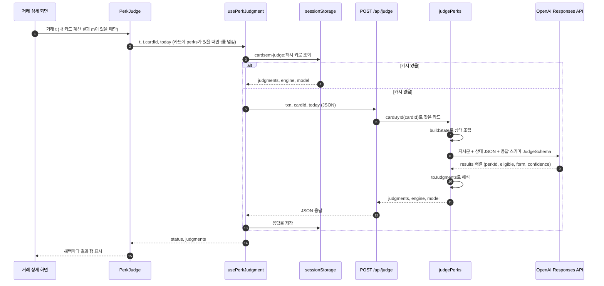
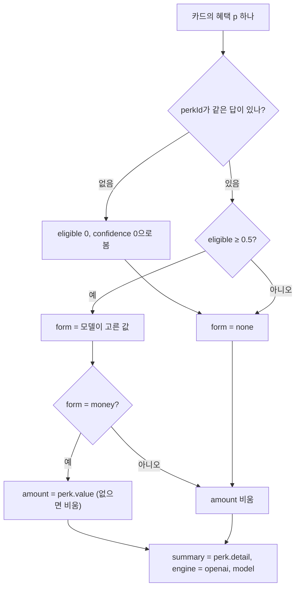

# 06. 정성 혜택 판단

공항 라운지, 생일 바우처, 우대금리, 연회비 면제처럼 **결제마다 금액으로 셈하지 않는 혜택**을 다루는 부분입니다. 이런 혜택은 계산 엔진에 넣지 않고 카드에 딸린 정보로만 둡니다. 거래 상세 화면에서는 AI가 결제 한 건을 보고 "이 결제로 받을 수 있나", "받는다면 돈인가 물건·서비스인가"만 판단합니다.

> **Jev에 대해 먼저 알아 둘 점**
> 커밋 `e098b98`의 메시지와 커밋 `a68c1e1` 때의 `README.md`(`git show a68c1e1:README.md`)는 이 기능을 "Jev(TypeSafe AI) 판단, 키가 없으면 OpenAI로 대신"이라고 설명했습니다. 지금 `README.md`는 OpenAI로만 판단한다고 고쳐졌고, [문서 목차](README.md)도 "Jev 연동은 계획만 있다"고 적습니다. Jev라는 이름은 이 문서의 파일 이름(`06-perks-jev.md`)에 남아 있습니다. **현재 코드에는 Jev 호출이 없습니다.** 판단은 항상 OpenAI 구조화 출력 한 경로로 합니다. 계획과 현재 코드의 차이는 [6절](#6-jevtypesafe-ai-계획과-현재-코드)에 정리했습니다. 이 문서의 나머지는 모두 현재 코드 기준입니다.

관련 코드

| 파일 | 역할 |
| --- | --- |
| `src/lib/types.ts` | `Perk`, `PerkKind`, `PerkForm`, `PerkJudgment` 타입 |
| `src/lib/data/cards.ts` | 카드별 `perks` 데이터, 종류별 라벨·아이콘 `PERK_KIND` |
| `src/components/perk-judge.tsx` | 거래 상세의 "정성 혜택 판단" 카드 (`PerkJudge`) |
| `src/lib/ai/client.ts` | `aiJudge`(요청), `usePerkJudgment`(요청 + sessionStorage 캐시) |
| `src/app/api/judge/route.ts` | `POST /api/judge` Route Handler |
| `src/lib/ai/judge.ts` | `judgePerks`: 지시문 + 응답 스키마로 OpenAI 호출 (서버 전용) |
| `src/lib/ai/judge.core.ts` | `buildState`(모델에 줄 상태 조립), `toJudgments`(답 해석). 네트워크 없는 순수 함수 |
| `src/lib/ai/server.ts` | 공통 OpenAI 호출 `parse`, 오류 문구 `aiErrorMessage`, `kstToday` |
| `src/lib/ai/judge.test.ts` | `buildState`·`toJudgments` 테스트 |

---

## 1. 정성 혜택이란

카드 혜택 중에는 "커피 10% 할인"처럼 결제 금액에서 바로 계산되는 것이 있고, "공항 라운지 연 2회 무료"처럼 결제 한 건의 금액으로는 셈할 수 없는 것이 있습니다. 카드셈은 앞의 것을 **혜택 규칙**(`BenefitRule`)으로, 뒤의 것을 **정성 혜택**(`Perk`)으로 나눠 둡니다.

- 정성(定性): 수치가 아니라 성질로 판단한다는 뜻입니다. 반대말은 정량(定量)입니다.
- 혜택 금액 계산은 규칙 엔진(`src/lib/engine`)이 맡고, AI는 금액을 계산하지 않습니다. 정성 혜택 판단에서도 AI는 확률과 선택지만 냅니다. 엔진은 [04. 혜택 계산 엔진](04-benefit-engine.md)을 보세요.

### 계산 불가 규칙(`supported: false`)과 무엇이 다른가

둘 다 "엔진이 금액을 안 낸다"는 점은 같지만 이유와 앞으로의 처리가 다릅니다. `src/lib/types.ts`의 `Perk` 주석과 `supabase/schema.sql`의 `benefit_rules` 주석도 이 둘을 섞지 말라고 적어 두었습니다.

| | 혜택 규칙 (`supported: true`) | 계산 불가 규칙 (`supported: false`) | 정성 혜택 (`Perk`) |
| --- | --- | --- | --- |
| 무엇인가 | 계산할 수 있게 옮긴 약관 조항 | 규칙으로 옮겼지만 아직 계산하지 못하는 조항 (원문 확인 전, 스키마로 표현 못 함) | 처음부터 결제마다 금액을 셈하는 혜택이 아님 |
| 어디에 있나 | `CardProduct.rules` | `CardProduct.rules` (+ `unsupportedReason`) | `CardProduct.perks` |
| 엔진 처리 | `calcCard`가 금액 계산 | `calcCard`가 `unsupported` 목록에 넣음 | 엔진이 읽지 않음 |
| 거래 상세 표시 | 계산 근거와 금액 | "규칙 미지원 · 조건 미입력과는 달라요" | "정성 혜택 판단" 카드 (AI) |
| 앞으로 | — | 검수·스키마 확장 후 계산 규칙이 됨 | 계속 정성 혜택 |
| 예 | `ws_all` 국내외 2.0% 청구할인 | `sp_all` Simple Plan+ 적립 ("적립률 원문 확인 전 · 검수 대기") | `rp_kw_k_master` Mastercard 공항 라운지·발레파킹 |

`src/lib/engine/engine.test.ts`의 "정성 혜택 (perks)" 테스트 3개가 이 구분을 지킵니다.

- 정성 혜택이 있는 카드(카드의정석2 SUPER)도 계산은 규칙만 보고, `unsupported`는 비어 있습니다. 무신사 5만 원 → 1,000원(5만 × 2%).
- 정성 혜택 id와 규칙 id가 겹치지 않습니다.
- 검수 대기 규칙(`sp_all`)은 `unsupported`로 남고, 그 카드에는 `perks`가 없습니다.

---

## 2. 데이터

### `Perk` — 카드에 딸린 정성 혜택 하나

`src/lib/types.ts`

| 필드 | 타입 | 뜻 |
| --- | --- | --- |
| `id` | string | 혜택 id. 판단 결과를 이 id로 맞춥니다 |
| `kind` | `PerkKind` | 종류 (아래 표) |
| `name` | string | 화면에 보이는 짧은 이름 |
| `detail` | string | 횟수·조건 설명 (2줄 이내). **판단 결과의 설명 문장으로도 그대로 씁니다** |
| `rawText` | string | 근거가 된 약관 원문 |
| `value` | number? | 돈 형태로 받을 때의 원화 가치 (연회비 면제 = 연회비). 없으면 금액을 표시하지 않습니다 |

`PerkKind`는 7가지이고, `src/lib/data/cards.ts`의 `PERK_KIND`가 라벨과 아이콘(Material Symbols 이름)을 정합니다.

| `kind` | 라벨 | 아이콘 |
| --- | --- | --- |
| `lounge` | 라운지·여행 | `flight` |
| `voucher` | 바우처·쿠폰 | `confirmation_number` |
| `rate` | 우대금리 | `savings` |
| `fee_waiver` | 연회비 | `credit_card_off` |
| `status` | 등급·멤버십 | `workspace_premium` |
| `installment` | 무이자 할부 | `calendar_month` |
| `etc` | 기타 | `star` |

### 카드 데이터 예시

기본 카드 17장 중 6장에 정성 혜택이 모두 18개 있습니다(2026-10-12). 모두 카드사 공식 상품 페이지의 문구를 `rawText`로 옮긴 것이고, 하나 나라사랑카드만 카드고릴라 정보라 카드가 "검수 대기"입니다. 예전에 있던 시연용 정성 혜택 6개(Point Plan·taptap O·카드의정석2 SUPER, 원문이 "(데모 예시)")는 2026-10-12에 지웠습니다.

| 카드 (`id`) | 정성 혜택 수 | 예 (`kind`) |
| --- | --- | --- |
| KB국민 나라사랑카드 (`kb_narasarang`) | 5 | GS리테일 POP(`status`), 상해보험(`etc`), 금융수수료 면제(`fee_waiver`) |
| 신한 나라사랑카드 체크 (`shinhan_narasarang`) | 3 | 경조사 지원(`etc`), Multi Membership(`status`) |
| 하나 나라사랑카드 (`hana_narasarang`) | 3 | 상해보험(`etc`), CGV 팝콘 세트(`voucher`) |
| 신한 Discount Plan+ (`shinhan_discountplan_plus`) | 4 | 매월 1일 할인율 2배(`etc`), 장보기 3만원 캐시백(`voucher`, `value` 30,000) |
| KB YOU Wish up (`kb_youwishup`) | 2 | 연 1회 쿠폰(`voucher`, `value` 20,000), Mastercard 라운지(`lounge`) |
| 쿠쿠 롯데카드 (`lotte_cuckoo`) | 1 | 쿠쿠 장기할부 월 캐시백(`installment`) |

나머지 11장에는 정성 혜택이 없습니다. 사용자가 직접 추가한 카드(`/cards/custom`, `src/app/(app)/cards/card-stats.ts`의 `customCardProduct`)도 `perks`를 만들지 않습니다.

데모는 카드 없이 시작하므로, 판단 카드를 보려면 위 카드 중 하나를 등록하고 그 카드로 결제를 넣어야 합니다. 판단 카드는 **정성 혜택이 있는 카드로 낸 결제의 상세 화면에만** 나옵니다.

```ts
// src/lib/data/cards-receipt-picks.ts (발췌)
perks: [
  { id: "rp_kw_k_coupon", kind: "voucher", name: "연 1회 쿠폰 (포인트리 2만점 / 영화관람권 2매)", value: 20000,
    detail: "발급 다음 해부터, 연회비 약정기간 이용실적 600만원 이상이면 포인트리 2만점이나 롯데시네마 관람권 2매 중 하나",
    rawText: "쿠폰 서비스 (2종 중 택1) 01. KB국민카드 포인트리 2만점 02. 롯데시네마 모바일 영화관람권 2매. …" },
  ...
]
```

DB에도 `card_products.perks`(jsonb, 기본값 `'[]'`) 열이 있고 `supabase/seed.sql`이 같은 6개를 넣습니다. 하지만 앱은 카드 카탈로그를 아직 DB가 아니라 `cards.ts`에서 읽습니다. 자세한 내용은 [07. 데이터 모델과 ERD](07-data-model.md)를 보세요.

### `PerkForm`과 `PerkJudgment` — 판단 결과

`PerkForm`은 "받는다면 어떤 형태인가"입니다.

| 값 | 화면 라벨 | 뜻 (`FORM_CRITERIA`, 모델에게도 이 문장을 줍니다) |
| --- | --- | --- |
| `money` | 돈 | 결제액 할인·캐시백·포인트·수수료 면제·연회비 면제처럼 원화 금액으로 정확히 표현되는 혜택 |
| `goods` | 상품·이용권 | 상품권·바우처·쿠폰·무료 음료·기념품처럼 물건이나 이용권을 받는 혜택 |
| `service` | 서비스·자격 | 공항 라운지·발렛파킹·보험·우대금리·회원 등급·무이자 할부처럼 금액이 아닌 서비스나 자격 |
| `none` | 해당 없음 | 이 결제와는 무관해서 이번에 받을 수 없는 혜택 |

`PerkJudgment`는 혜택 하나에 대한 판단 결과입니다. 모델은 숫자와 선택지만 내고, 사람이 읽는 문장과 금액은 카드 데이터에서 가져옵니다.

| 필드 | 어디서 오나 | 뜻 |
| --- | --- | --- |
| `perkId`, `name`, `kind` | `Perk` | 어떤 혜택인지 |
| `eligible` | 모델 | 이 결제로 받을 수 있을 확률 0~1 |
| `form` | 모델 (단, `eligible < 0.5`면 `none`으로 고정) | 받는다면 어떤 형태인지 |
| `confidence` | 모델 | `form` 선택의 신뢰도 0~1 |
| `amount` | `perk.value` | `form`이 `money`일 때만. `value`가 없으면 비어 있음 |
| `summary` | `perk.detail` | 돈이 아닐 때 보여 줄 2줄 설명 |
| `engine`, `model` | 서버 | 현재 `engine`은 `"openai"` 하나뿐. `model`은 모델 이름 |

---

## 3. 판단 흐름

거래 상세 화면에서 시작해 서버의 OpenAI 호출까지 한 방향으로 갑니다. 저장하는 곳은 브라우저의 sessionStorage뿐입니다.



단계별로 보면 다음과 같습니다.

1. **화면에 나올지 정하기** — `src/app/(app)/transactions/[id]/page.tsx`가 `{m && <PerkJudge t={t} />}`로 그립니다. `m`은 `calcFor(달).byTxn[t.id].mine`, 즉 "결제한 카드로 계산한 결과"입니다. 엔진은 카드 결제(지출, 환불 아님, 신용·체크, `cardId` 있음)이고 카드가 카탈로그에 있을 때만 `mine`을 만듭니다. 현금·계좌이체·수입·환불 거래에는 판단 카드가 없습니다.
2. **혜택이 있는 카드인지 보기** — `PerkJudge`는 `cardById(t.cardId)?.perks`가 비어 있으면 `null`을 돌려줍니다. 이때는 훅에도 `txn` 대신 `null`을 넘겨 요청을 보내지 않습니다.
3. **요청** — `usePerkJudgment(t, t.cardId, today)`가 캐시를 확인하고, 없으면 `aiJudge`로 `POST /api/judge`에 `{ txn, cardId, today }`를 보냅니다. `today`는 스토어 값이고, 데모·로그인 모두 실제 오늘입니다. 공통 `post()`는 로그인 상태면 Supabase 세션 토큰을 `authorization` 헤더에 붙이지만, `/api/judge`는 이 헤더를 확인하지 않습니다.
4. **Route Handler** — `src/app/api/judge/route.ts`(`runtime = "nodejs"`)가 `cardById(cardId)`로 카드를 찾습니다. `txn`이나 카드가 없으면 400을 돌려줍니다. `today`가 없으면(`undefined`·`null`) `kstToday()`(한국 날짜)를 씁니다. 코드가 `today ?? kstToday()`라서 빈 문자열 `""`은 그대로 모델에 넘어갑니다.
5. **판단** — `judgePerks(t, card, today)`가 `buildState`로 상태를 만들고, 공통 `parse()`로 OpenAI Responses API를 한 번 부릅니다. 혜택 수만큼 따로 부르지 않고, 한 번에 모든 혜택의 답을 배열로 받습니다. 카드에 `perks`가 없으면 호출 없이 `{ judgments: [], engine: "openai", model: "" }`를 돌려줍니다.
6. **해석** — `toJudgments`가 답을 `PerkJudgment[]`로 바꿉니다(5절).
7. **표시** — `PerkJudge`가 혜택마다 한 행씩 그립니다(9절).

---

## 4. 모델에 보내는 것 — 상태, 지시문, 응답 스키마

모델 입력은 세 덩어리입니다. 결제·카드·혜택을 담은 **상태(state) JSON**, 무엇을 판단할지 적은 **지시문(instructions)**, 답의 모양을 정한 **응답 스키마**입니다.

현재 코드에는 `buildQuestions` 같은 "질문 조립" 함수가 없습니다. 질문은 `judge.ts`의 지시문 문자열 하나와 `JudgeSchema`로 표현합니다.

### 상태 — `buildState(t, card, perks, today)`

`src/lib/ai/judge.core.ts`. 코드 값을 사람이 읽는 라벨로 바꿔서 넣습니다. 예를 들어 업종은 `cafe` 대신 "카페"로, 요일은 "목"으로 넣습니다.

| 경로 | 값 | 비고 |
| --- | --- | --- |
| `today` | 인자로 받은 오늘 날짜 | |
| `transaction.merchant` | `t.merchant` | |
| `transaction.industry` | `INDUSTRY[업종].label` | 업종이 없으면 "미분류" |
| `transaction.amountKrw` | `krw(t)` | 외화 결제는 원화 환산액 |
| `transaction.date`, `dayOfWeek` | `t.date`, `dowLabel(t.date)` | 요일은 "월"~"일" |
| `transaction.time` | `t.paidAt` | 없으면 "모름" |
| `transaction.installmentMonths`, `interestFree` | 할부 개월(없으면 0), 무이자 여부 | |
| `transaction.autoPay` | `t.isAutoPay` | |
| `transaction.payMethod` | `t.payMethod` | 없으면 `"card"` |
| `transaction.items` | 품목 이름 배열 | 없으면 빈 배열 |
| `card` | `issuer`, `name`, `annualFeeKrw` | 연회비가 없으면 0 |
| `perks[]` | `id`, `name`, `kind`, `detail`, `terms`(= `rawText`), `valueKrw`(= `value`, 없으면 `null`) | |

사용자 카드 정보(`UserCard`의 발급일·패키지 등)와 같은 달의 다른 결제는 넣지 않습니다. 한계는 10절에 적었습니다.

아래는 테스트용 고정 장부(`src/lib/data/fixtures.ts`)의 9월 3일 스타벅스 결제(`t025`, Point Plan)로 `buildState`를 실제로 돌린 결과입니다(`today`는 고정 장부의 기준일 `2026-09-20`). 2026-10-12 이전 데이터로 만든 예시라, 여기 나오는 Point Plan의 정성 혜택 2개(원문 "(데모 예시)")는 지금 카드 데이터에서 지워졌습니다. 상태의 모양을 보여 주는 용도로만 읽으세요.

```json
{
  "today": "2026-09-20",
  "transaction": {
    "merchant": "스타벅스 강남역점",
    "industry": "카페",
    "amountKrw": 6100,
    "date": "2026-09-03",
    "dayOfWeek": "목",
    "time": "08:42",
    "installmentMonths": 0,
    "interestFree": false,
    "autoPay": false,
    "payMethod": "card",
    "items": ["아이스 아메리카노 T", "샷 추가"]
  },
  "card": { "issuer": "신한카드", "name": "Point Plan", "annualFeeKrw": 15000 },
  "perks": [
    {
      "id": "pp_k_rate", "name": "제휴 적금 우대금리 +0.5%p", "kind": "rate",
      "detail": "제휴 적금 가입 후 카드를 월 30만원 이상 쓰면 만기에 우대금리를 더해줘요",
      "terms": "제휴 적금 우대금리 연 0.5%p (카드 월 30만원 이상 이용 시) (데모 예시)",
      "valueKrw": null
    },
    {
      "id": "pp_k_status", "name": "회원 등급 유지", "kind": "status",
      "detail": "연 1회 이상 결제하면 다음 해에도 등급이 내려가지 않아요",
      "terms": "연 1회 이상 이용 시 회원 등급 유지 (데모 예시)",
      "valueKrw": null
    }
  ]
}
```

이 JSON 문자열이 사용자 메시지(`input_text`) 하나로 들어갑니다.

### 지시문 — `judge.ts`

`judgePerks`가 넘기는 지시문의 요지는 다음과 같습니다(실제로는 한 줄짜리 문자열입니다).

1. `state.perks`의 혜택마다 **(1) 이 결제로 실제로 받을 수 있는 확률 `eligible`(0~1)** 을 낸다.
   - 결제의 가맹점·업종·금액·날짜·결제수단이 `detail`·`terms` 조건과 맞고, 이 결제가 그 혜택을 발생시키는 종류일 때만 높게 준다.
   - 연회비·등급·적금처럼 결제와 무관한 혜택은 낮게 준다.
2. **(2) 받는다면 어떤 형태인지 `form`** 을 고른다. 기준은 `FORM_CRITERIA` 네 문장을 `money=… / goods=… / service=… / none=…`로 이어 붙여 넣는다.
3. 글을 쓰지 말고 값만 낸다.
4. `perkId`는 `state.perks`의 `id`를 그대로 쓰고, 혜택 전부에 대해 하나씩 낸다.

### 응답 스키마 — `JudgeSchema`

구조화 출력(Structured Outputs)은 AI에게 JSON 스키마를 주고 그 모양으로만 답하게 하는 기능입니다. `parse()`가 zod 스키마를 `zodTextFormat`으로 바꿔 `responses.parse`에 넘깁니다. 모델 이름은 `OPENAI_MODEL` 환경변수이고, 없으면 `gpt-5.5`입니다.

```ts
// src/lib/ai/judge.ts
const JudgeSchema = z.object({
  results: z.array(z.object({
    perkId: z.string(),
    eligible: z.number().describe("이 결제로 받을 수 있을 확률 0~1"),
    form: z.enum(["money", "goods", "service", "none"]),
    confidence: z.number().describe("form 선택의 신뢰도 0~1"),
  })),
});
```

모델이 설명 문장을 쓰지 않게 한 이유는 `judge.ts` 머리 주석에 있습니다. 돈이면 금액은 카드 데이터(`perk.value`)가, 돈이 아니면 설명은 검수된 `perk.detail`이 맡습니다. 그래서 화면에 나오는 문장과 금액은 모두 사람이 미리 넣은 데이터이고, 모델은 그중 무엇을 보여 줄지만 고릅니다.

---

## 5. 답 해석 — `toJudgments(perks, answers, model)`

`src/lib/ai/judge.core.ts`. 카드의 혜택 목록(`perks`)을 기준으로 돌기 때문에 결과 개수는 항상 혜택 개수와 같습니다.



규칙을 정리하면 다음과 같습니다.

| 규칙 | 코드 |
| --- | --- |
| 답은 `perkId`로 찾습니다. 카드에 없는 `perkId`의 답은 버립니다 | `answers.find((x) => x.perkId === p.id)` |
| 답이 없으면 `eligible`과 `confidence`는 0입니다 | `a?.eligible ?? 0` |
| `eligible`이 0.5 이상일 때만 모델의 `form`을 씁니다. 아니면 `none`입니다 | `eligible >= 0.5 ? a?.form : "none"` |
| `amount`는 `form`이 `money`일 때만 `perk.value`입니다 | `form === "money" ? p.value : undefined` |
| `summary`는 항상 `perk.detail`입니다 | `summary: p.detail` |

가상의 답을 넣어 확인한 결과입니다(삼성 taptap O, 모델 이름 `gpt-5.5`). 실제 모델 출력이 아니라 해석 규칙을 보여 주는 예입니다. 예시에 쓴 taptap O의 정성 혜택(원문 "(데모 예시)")은 2026-10-12에 지웠습니다.

| 넣은 답 | 해석 결과 | 화면 |
| --- | --- | --- |
| `tt_k_fee`: eligible 0.62, form `money`, confidence 0.7 | form `money`, amount 10000 (`perk.value`) | "받을 수 있어요 · 62%", "돈" 배지, 10,000원 |
| `tt_k_voucher`: eligible 0.55, form `none` | form `none`, amount 없음 | "받을 수 있어요 · 55%", "해당 없음" 배지, `detail` 문장 |
| `perkId: "unknown"` (카드에 없는 id) | 버려짐 | — |

두 번째 줄처럼 확률은 0.5 이상인데 모델이 `none`을 고르면 "받을 수 있어요"와 "해당 없음"이 함께 보입니다. 코드는 이 경우를 따로 막지 않습니다.

`src/lib/ai/judge.test.ts`가 위 규칙을 검사합니다(5개).

| 묶음 | 테스트 |
| --- | --- |
| state | 결제·카드·혜택이 사람이 읽는 라벨로 들어감 (대한항공 → "해외 가맹점", 2026-09-19 → "토", `terms` = `rawText`) |
| state | 외화 결제는 원화 환산액으로 (USD 25, `amountKrw` 34500 → 34500) |
| 답 해석 | 받을 수 있고 서비스면 `detail`을 설명으로, 돈이면 `perk.value`를 금액으로 |
| 답 해석 | 확률이 0.5 미만이면 형태는 `none`, 답이 없으면 0으로 |
| 답 해석 | 돈이어도 `perk.value`가 없으면 금액은 비운다 |

```bash
pnpm test                                   # 전체
npx vitest run src/lib/ai/judge.test.ts     # 이 파일만
```

---

## 6. Jev(TypeSafe AI) 계획과 현재 코드

### 문서에 적힌 계획

커밋 `e098b98`의 메시지와 커밋 `a68c1e1` 때의 `README.md`(`git show a68c1e1:README.md`)는 이렇게 설명했습니다. 지금 `README.md`는 "정성 혜택 판단도 OpenAI로 합니다"로 고쳐져 있어서, 아래 문구는 지금 README에서는 찾을 수 없습니다.

- Jev(TypeSafe AI의 System One 모델)는 글을 쓰지 않고 정해진 선택지에 확률만 주는 모델이라 판단 전용으로 쓴다.
- `.env.local`에 `TYPESAFE_API_KEY`가 있으면 `@typesafe-ai/sdk`로 호출하고, `JEV_MODEL`로 버전을 고정할 수 있다.
- 키가 없으면 같은 질문을 OpenAI 구조화 출력으로 대신 묻고, 화면 배지에 어느 쪽인지 표시한다.
- 그때 `README.md`의 파일 표는 `judge.ts`를 "Jev 판단: state·질문 조립(noul/choice), 답 해석, OpenAI 대체 경로"라고 적었다.

### 현재 코드에서 확인한 것

| 항목 | 현재 코드 |
| --- | --- |
| `@typesafe-ai/sdk` | `package.json`에 `^0.6.0`으로 있고 `node_modules`에도 설치돼 있지만, `src` 아래에서 import하는 곳이 없습니다 |
| `TYPESAFE_API_KEY`, `JEV_MODEL` | `src` 아래에서 읽는 곳이 없습니다 |
| 질문 조립 (`buildQuestions`, noul/choice) | 없습니다. 지시문 문자열 + `JudgeSchema`만 있습니다 |
| 키에 따른 분기 | 없습니다. `judgePerks`는 항상 `parse()`(OpenAI)를 부릅니다 |
| `PerkJudgment.engine` 타입 | `"openai"` 하나뿐입니다 |
| 화면 배지 | 성공하면 항상 "OpenAI · 모델명"입니다 |
| 커밋 기록 | `judge.ts`를 바꾼 커밋은 `e098b98` 하나이고, 그 버전도 OpenAI만 부릅니다 |

즉 "키가 없으면 OpenAI로 대신"이 아니라 **항상 OpenAI**입니다. 필요한 키는 `OPENAI_API_KEY` 하나입니다.

### 연결한다면 어디에 붙나

설치된 SDK의 타입 선언(`node_modules/@typesafe-ai/sdk/dist/index.d.mts`)을 보면 호출 모양은 `client.systemOne({ state, questions })`입니다. 질문은 `noul`(예/아니오 → 예일 확률 0~1)과 `choice`(라벨 하나 + `confidence` + 라벨별 확률)로 만듭니다. 키는 `TYPESAFE_API_KEY` 환경변수에서 읽습니다. 기본 모델은 `TYPESAFE_DEFAULT_MODEL` 환경변수를 먼저 보고, 없으면 `jev-latest`입니다.

SDK는 계획에 적힌 `JEV_MODEL`을 읽지 않습니다. `JEV_MODEL`만 넣어서는 버전이 고정되지 않습니다. 버전을 고정하려면 `TYPESAFE_DEFAULT_MODEL`을 쓰거나, 코드에서 `JEV_MODEL`을 직접 읽어 `systemOne({ model })` 또는 클라이언트 옵션 `defaultModel`로 넘겨야 합니다.

현재 코드의 모양은 이 SDK에 맞춰져 있습니다.

| 지금 | Jev로 바꾸면 |
| --- | --- |
| `buildState()`의 JSON | `state`에 그대로 |
| 모델 답 `eligible` | 혜택마다 `noul` 질문의 확률 |
| 모델 답 `form`, `confidence` | 혜택마다 `choice` 질문(`FORM_CRITERIA`를 라벨 설명으로)의 `choice`, `confidence` |

`buildState`는 그대로 쓸 수 있습니다. 바꿀 곳은 다음과 같습니다.

| 파일 | 바꿀 것 |
| --- | --- |
| `src/lib/ai/judge.ts` | `judgePerks`의 호출부(`parse()` 대신 `systemOne`). 반환값의 `engine: "openai"`도 두 군데 고정돼 있습니다 |
| `src/lib/ai/judge.core.ts` | `toJudgments`가 판단마다 `engine: "openai"`를 고정으로 넣습니다. engine을 인자로 받게 바꿔야 합니다. 또 Jev 답은 질문 이름을 키로 한 객체(`answers`)라서, 이것을 `PerkAnswer[]`로 옮기는 변환을 더해야 합니다 |
| `src/lib/types.ts` | `PerkJudgment["engine"]` 타입 (지금 `"openai"` 하나) |
| `src/components/perk-judge.tsx` | 배지 문구 (지금 `OpenAI · {model}` 고정) |
| `src/lib/ai/server.ts` | `aiErrorMessage`는 OpenAI 오류 클래스만 구분합니다. TypeSafe SDK 오류(`AuthenticationError` 등)에 맞춘 문구가 없습니다 |

이 표들은 SDK 타입 선언을 읽고 정리한 것이며, 실제 Jev 호출로 확인하지는 않았습니다.

---

## 7. 키가 없거나 실패할 때

`src/lib/ai/server.ts`의 `client()`는 호출할 때마다 `new OpenAI()`를 만듭니다. 빌드할 때가 아니라 호출할 때 만들어서, 키가 없어도 빌드는 됩니다. 키가 없으면 이때 SDK가 `OPENAI_API_KEY`라는 단어가 든 오류를 던집니다. Route Handler는 모든 예외를 잡아 `aiErrorMessage(e)`의 문구로 502를 돌려줍니다. 아래 표의 알려진 오류는 한국어 사용자 문구로 바꾸지만, 그 밖의 예외는 원문 메시지가 그대로 나갑니다.

| 상황 | HTTP | 화면에 나오는 문구 |
| --- | --- | --- |
| `txn`이 없거나 `cardId`로 카드를 못 찾음 | 400 | txn과 cardId가 필요해요 |
| `OPENAI_API_KEY` 없음 | 502 | OpenAI API 키가 없어요. .env.local에 OPENAI_API_KEY를 넣고 서버를 다시 시작해주세요. |
| 키가 틀림 (`AuthenticationError`) | 502 | OpenAI API 키가 올바르지 않아요. … |
| 요청 한도 초과 (`RateLimitError`) | 502 | 요청이 많아요. 잠시 후 다시 시도해주세요. |
| OpenAI 연결 실패 (`APIConnectionError`) | 502 | AI 서버에 연결하지 못했어요. |
| 그 밖의 OpenAI 오류 (`APIError`) | 502 | AI 오류 (상태 코드): 원문 메시지 |
| 콘텐츠 필터로 응답이 끊김 | 502 | 문서를 읽을 수 없어요 (영수증 인식과 같은 `parse()` 문구) |
| 그 밖의 예외 (본문이 JSON이 아님, 낯선 업종 키로 `buildState`에서 난 TypeError 등) | 502 | 예외 원문 메시지. 영어일 수 있습니다 (예: `Cannot read properties of undefined (reading 'label')`) |
| 브라우저에서 `fetch` 자체가 실패 | — | 네트워크 연결을 확인해주세요 |
| 응답이 JSON이 아님 | — | 요청 실패 (상태 코드). 413이면 "파일이 너무 커요" |

실패하면 `usePerkJudgment`가 `status: "error"`와 문구를 돌려줍니다. 화면은 배지를 "판단 실패"로 바꾸고 문구를 주황색으로 보여 줍니다. 혜택 목록은 판단 없이 `perk.detail`만 보여 줍니다. 재시도 버튼은 없고, 실패한 결과는 캐시에 남기지 않으므로 화면에 다시 들어오면 다시 요청합니다.

모델이 빈 답(`output_parsed`가 `null`)을 주면 오류로 보지 않습니다. `results`를 빈 배열로 보고 해석하므로 모든 혜택이 "이 결제로는 못 받아요 · 0%"로 나옵니다. 이 결과는 성공으로 보고 캐시에 저장합니다. 그래서 탭을 닫거나 거래를 고치기 전까지는 다시 묻지 않습니다(8절).

OpenAI 키 설정과 다른 AI 기능의 오류 처리는 [05. 영수증 인식과 AI](05-receipt-ai.md), 환경변수 전체는 [10. 개발 · 테스트 · 배포](10-development.md)를 보세요.

---

## 8. 캐시

판단 결과는 브라우저의 **sessionStorage**에만 저장합니다. sessionStorage는 탭 하나가 열려 있는 동안만 남는 브라우저 저장소입니다. 서버 쪽 캐시나 DB 저장은 없습니다.

| 항목 | 내용 |
| --- | --- |
| 키 | `cardsem-judge:` + `hash(JSON.stringify({ txn, cardId, today }))` |
| 해시 | `client.ts`의 `hash`. 문자마다 `h * 31 + 문자 코드`를 32비트로 누적하고 36진수 문자열로 바꿉니다 |
| 값 | 응답 그대로 `{ judgments, engine, model }` |
| 언제 쓰나 | 키가 같으면 요청하지 않고 바로 `status: "done"` |
| 언제 다시 묻나 | 거래의 어떤 필드든 바뀌면(메모·카테고리 포함) 키가 바뀝니다. `today`가 바뀌어도(로그인 모드에서 날짜가 넘어감) 바뀝니다. 탭을 닫으면 사라집니다 |
| 실패 | 저장하지 않습니다. 단, 모델의 빈 답(`output_parsed`가 `null`)은 "모두 0%"인 성공으로 저장됩니다 |
| 저장소 오류 | 읽기·쓰기 예외는 무시합니다(비공개 창 등) |

거래 객체 전체가 키에 들어가므로, 판단과 관계없는 필드를 고쳐도 다시 요청합니다. 월간 인사이트(`useInsight`)는 비슷한 방식이지만 localStorage를 쓰는 점이 다릅니다.

---

## 9. 화면 표시

정성 혜택은 두 화면에 나옵니다.

| 화면 | 위치 | AI 사용 |
| --- | --- | --- |
| 카드 상세 `/cards/[id]` | "정성 혜택 N개" 카드. 종류 배지(`PERK_KIND` 라벨)와 `detail`. "금액으로 셈하지 않는 혜택이에요. 결제별 혜택 계산에는 들어가지 않아요." | 안 함 |
| 거래 상세 `/transactions/[id]` | 계산 근거 카드 바로 아래 "정성 혜택 판단" 카드 (`PerkJudge`) | 함 |

### "정성 혜택 판단" 카드

카드 제목 오른쪽 배지와 설명 문구는 요청 상태에 따라 바뀝니다.

| 상태 (`status`) | 제목 배지 | 행 |
| --- | --- | --- |
| `idle`, `loading` | 판단 중… | 흐리게(`opacity-60`), 각 행은 `perk.detail` |
| `done` | `OpenAI · {model}` (예: OpenAI · gpt-5.5) | 판단 결과 |
| `error` | 판단 실패 + 주황색 오류 문구 | 각 행은 `perk.detail` |

설명 문구는 항상 "금액으로 셈할 수 없는 혜택 N개를 이 결제 기준으로 판단해요. 확률은 참고값이에요."입니다.

혜택 한 행은 다음 규칙으로 그립니다. `ok`는 `eligible >= 0.5`입니다.

| 경우 | 아이콘 칸 | 배지 | 아래 문장 |
| --- | --- | --- | --- |
| 판단 결과 없음 | 회색 | 없음 | `perk.detail` |
| `ok` 아님 | 회색 | "이 결제로는 못 받아요 · NN%" | `perk.detail` |
| `ok`, `money`, `amount` 있음 | 초록 | "받을 수 있어요 · NN%", "돈" | 금액 (예: 10,000원, 혜택 색) |
| `ok`, `money`, `amount` 없음 | 초록 | 위와 같음 | "금액은 카드사 기준으로 정해져요 (카드 데이터에 가치 없음)" |
| `ok`, `goods` / `service` / `none` | 초록 | "받을 수 있어요 · NN%", 형태 배지 | `summary` (= `perk.detail`, 2줄까지) |

확률 NN은 `Math.round(eligible * 100)`입니다. `confidence`는 응답에 들어 있지만 화면에는 쓰지 않습니다. 배지 색은 `money` = benefit, `goods` = info, `service` = success, `none` = gray입니다. 색 토큰은 [09. 디자인 시스템](09-design-system.md)을 보세요.

판단 결과는 받은 혜택 합계, 놓친 혜택, 월간 리포트, 엑셀 내보내기 어디에도 더하지 않습니다. 거래 상세 화면에만 보입니다.

---

## 10. 한계

| 한계 | 내용 |
| --- | --- |
| Jev 미연결 | 6절. 예전 README와 커밋 메시지는 Jev와 OpenAI 폴백을 말했지만 코드는 OpenAI 한 경로입니다 |
| 결제 한 건만 봄 | 상태에 같은 달 다른 결제나 월 합계가 없습니다. "연간 이용실적 600만원 이상"(`rp_kw_k_coupon`), "전년도 이용금액 1,000만원 이상"(`rp_dp_k_mart`)처럼 누적 조건은 이 결제만으로 판단할 수 없습니다 |
| 사용자 정보 없음 | 카드 발급일(`UserCard.issuedAt`), 생일, 라운지 사용 횟수를 넣지 않습니다. "발급 다음 해부터", "현역 복무 중", "라운지 연 2회"를 정확히 판단할 근거가 없습니다 |
| 금액 경로가 드묾 | `value`가 있는 혜택은 2개뿐입니다(`rp_kw_k_coupon` 20,000원, `rp_dp_k_mart` 30,000원). 그런데 지시문은 "연회비처럼 결제와 무관한 혜택은 낮게"라고 해서, 금액이 표시되는 경우는 많지 않을 것으로 보입니다 (실제 모델 출력으로는 확인하지 않음) |
| 확률은 보정되지 않음 | `eligible`은 모델이 낸 숫자이고, 0.5 기준은 고정값입니다. 스키마에 최솟값·최댓값 제한도 없습니다. 화면도 "확률은 참고값"이라고 적습니다 |
| 확률과 형태가 어긋날 수 있음 | 5절. `eligible ≥ 0.5`이면서 `form = none`이면 "받을 수 있어요"와 "해당 없음"이 함께 보입니다 |
| 저장·집계 없음 | 판단 결과는 sessionStorage에만 있고 DB, 리포트, 통계에 남지 않습니다 |
| 호출 비용 | 캐시가 탭 단위라 새 탭이나 거래 수정마다 다시 호출합니다. `/api/judge`는 로그인 여부를 확인하지 않고 요청 횟수 제한도 없습니다 |
| 입력 검증 없음 | Route Handler는 받은 `txn`의 모양을 검사하지 않습니다. 이상한 값이면 `buildState`에서 예외가 나 502가 되고, 화면에는 예외 원문(영어일 수 있음)이 나옵니다(7절) |
| 데이터 출처 | 정성 혜택 18개는 공식 상품 페이지 문구입니다. 하나 나라사랑카드 3개만 카드고릴라 정보라 검수가 필요합니다 |
| 직접 추가한 카드 | `customCardProduct`가 `perks`를 만들지 않아 판단 카드가 나오지 않습니다. 또 직접 추가 카드는 브라우저의 스토어가 `registerCustomCards`로 알려 주는 목록이라, 서버의 `cardById`는 이 카드를 찾지 못할 것으로 보입니다(나중에 `perks`를 붙이면 400이 날 수 있음) |

관련 문서: [03. 구조와 데이터 흐름](03-architecture.md) · [04. 혜택 계산 엔진](04-benefit-engine.md) · [05. 영수증 인식과 AI](05-receipt-ai.md) · [07. 데이터 모델과 ERD](07-data-model.md) · [용어집](glossary.md)
