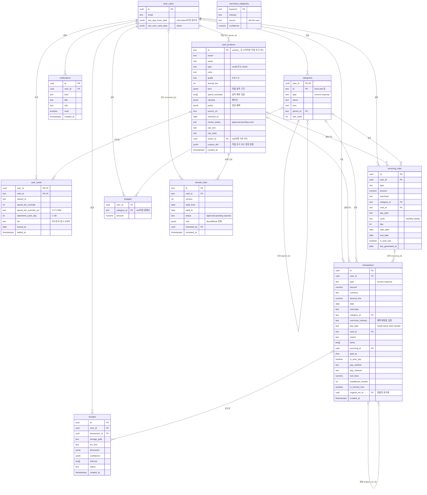
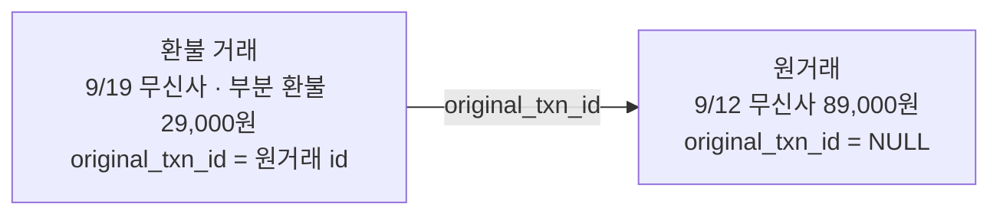
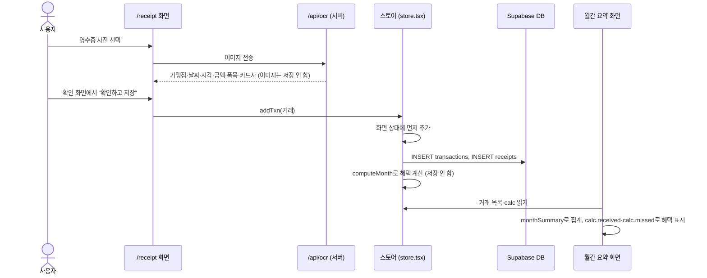

# 07. 데이터 모델과 ERD

카드셈이 무엇을 어디에 저장하는지 정리한 문서입니다. 테이블 10개의 컬럼과 관계, 권한 규칙(RLS), 마이그레이션 기록, 코드의 타입과 컬럼이 어떻게 이어지는지를 다룹니다. 마지막에 영수증 한 장이 테이블을 지나 월간 요약 숫자가 되기까지의 과정을 예시로 따라갑니다.

## 먼저 알아 둘 것

카드셈에는 저장 방식이 두 가지 있습니다.

| 모드 | 언제 | 어디에 저장하나 |
| --- | --- | --- |
| 로그인 모드 | Supabase 환경변수가 있고 로그인했을 때 | Supabase의 PostgreSQL DB (이 문서의 테이블) |
| 데모 모드 | 로그인하지 않았을 때 | 이 브라우저의 localStorage ([8장](#8-데모-모드-저장-localstorage)) |

그리고 세 가지 사실을 기억해 두면 나머지가 쉽게 읽힙니다.

1. **혜택 계산 결과는 저장하지 않습니다.** 거래·보유 카드·카드 규칙만 저장하고, 혜택은 화면을 그릴 때마다 브라우저에서 다시 계산합니다 ([04. 혜택 계산 엔진](04-benefit-engine.md)).
2. **기본 카드 7종의 정의는 아직 코드에서 읽습니다.** 앱은 `src/lib/data/cards.ts`의 `CARDS`로 계산합니다. DB의 `card_products`·`benefit_rules` 기본 카드 행은 같은 내용을 `supabase/seed.sql`로 넣어 둔 것입니다. 다만 거래와 보유 카드가 외래 키로 이 행을 가리키므로 로그인 모드에는 꼭 있어야 합니다 ([11장](#11-supabaseseedsql)).
3. **집계는 SQL이 아니라 TypeScript가 합니다.** 로그인 직후 본인 행을 전부 읽어 오고, 월간 요약은 `src/lib/stats.ts`가 메모리에서 셉니다. DB에는 뷰(view)나 함수가 없습니다.

### 용어 풀이

| 용어 | 뜻 |
| --- | --- |
| Supabase | PostgreSQL DB, 로그인(Auth), DB를 HTTP로 여는 API를 묶어 주는 호스팅 서비스 |
| PostgREST | Supabase가 테이블을 HTTP API로 여는 계층. `supabase().from("transactions").select()` 한 줄이 이 API를 거쳐 SQL이 됩니다 |
| PK (기본 키) | 행 하나를 가리키는 열. 같은 값이 두 번 들어갈 수 없습니다 |
| FK (외래 키) | 다른 테이블의 행을 가리키는 열. 가리키는 행이 없으면 DB가 저장을 거부합니다 |
| 복합 키 | 열 두 개 이상을 묶어 하나의 키로 쓰는 것. 예: `(user_id, id)` |
| CHECK | 값이 조건을 만족해야만 저장되게 하는 제약. 예: `type in ('income','expense')` |
| JSONB | JSON을 그대로 저장하는 PostgreSQL 타입 |
| `text[]` | 문자열 배열 타입 |
| `timestamptz` | 시간대를 포함한 날짜·시각 |
| RLS (Row Level Security) | 행마다 "이 사용자가 읽고 쓸 수 있나"를 DB가 검사하는 기능 ([5장](#5-권한-rls)) |
| 마이그레이션 | DB 구조를 바꾸는 SQL 파일. 순서대로 적용하면 같은 구조가 됩니다 |
| `auth.users` | Supabase Auth가 관리하는 사용자 테이블. 우리 테이블은 이 표의 `id`를 `user_id`로 가리킵니다 |

### 관련 파일

| 파일 | 역할 |
| --- | --- |
| `supabase/schema.sql` | 스키마의 최종 모양. 빈 DB에 이 파일 하나만 돌려도 됩니다 |
| `supabase/migrations/*.sql` | 같은 결과를 만드는 변경 기록 8개 ([6장](#6-마이그레이션)) |
| `supabase/seed.sql` | 기본 카드 7종·혜택 규칙 31건 |
| `src/lib/db.ts` | 테이블 행 ↔ TypeScript 타입 변환, 읽기·쓰기 함수 |
| `src/lib/types.ts` | 도메인 타입 (`Transaction`, `UserCard`, `CardProduct`, `BenefitRule` …) |
| `src/lib/store.tsx` | 앱 상태. 로그인 모드면 `db.ts`를 부르고, 데모 모드면 localStorage에 저장 |
| `src/lib/supabase.ts` | Supabase 브라우저 클라이언트 |
| `docs/erd/cardsem_erdcloud.sql` | ERDCloud에 붙여 넣을 ERD용 SQL ([10장](#10-docserdcardsem_erdcloudsql)) |

---

## 1. 테이블 목록

| # | 테이블 | 담는 것 | 누구의 데이터 | 앱에서 쓰나 | TypeScript 타입 |
| --- | --- | --- | --- | --- | --- |
| 1 | `card_products` | 카드 상품 (카드사, 이름, 실적 구간, 정성 혜택). 사용자가 직접 추가한 카드도 여기 | 기본 카드는 공용, 직접 추가 카드는 그 사용자 | 직접 추가 카드만 읽고 씀 | `CardProduct` |
| 2 | `benefit_rules` | 카드 혜택 규칙 한 조항 (JSONB) | 공용 | 앱·어드민 모두 읽고 쓰지 않음 (`seed.sql`로만 채움. 나중에 DB에서 검수할 때 쓸 자리) | `BenefitRule` |
| 3 | `user_cards` | 사용자가 가진 카드와 카드별 설정 | 사용자 | 읽고 씀 | `UserCard` |
| 4 | `categories` | 지출·수입 카테고리 (상위·하위 2단계) | 사용자 | 읽고 씀 | `Category` |
| 5 | `recurring_rules` | 반복 거래 규칙 (매월·매주) | 사용자 | 읽고 씀 | `RecurringRule` |
| 6 | `transactions` | 거래 한 건 (지출·수입·환불) | 사용자 | 읽고 씀 | `Transaction` |
| 7 | `budgets` | 월 예산 (총예산 + 카테고리 예산) | 사용자 | 읽고 씀 | `Budget` |
| 8 | `receipts` | 영수증·결제 문자·명세서 인식으로 만든 거래의 기록 (거래당 1행) | 사용자 | 씀, `id`·`transaction_id`만 읽음 | (`Transaction.receiptId`) |
| 9 | `notifications` | 서버 알림 자리 | 사용자 | 쓰지 않음 (탈퇴 때 삭제만) | 없음 |
| 10 | `merchant_categories` | 가맹점 키워드 → 업종 사전 | 공용 | 쓰지 않음 | 없음 |

알림은 저장하지 않고 `src/lib/notify.ts`가 그 달 데이터에서 매번 계산합니다. 가맹점 사전은 지금 코드(`src/lib/data/merchants.ts`)와 서버 메모리 캐시(`src/lib/ai/server.ts`)에 있습니다. 두 테이블은 나중에 옮길 자리로 만들어 둔 것입니다.

---

## 2. ERD

`auth_users`는 Supabase의 `auth.users`입니다 (Mermaid 이름에 점을 쓸 수 없어 밑줄로 적었습니다). 우리가 쓰는 열만 그렸습니다.

선 끝 기호: `||` 정확히 하나, `|o` 없거나 하나, `o{` 0개 이상.



같은 구조를 그림 파일로 만들고 싶으면 [10장](#10-docserdcardsem_erdcloudsql)의 ERDCloud용 SQL을 씁니다.

---

## 3. 테이블별 컬럼

기준은 `supabase/schema.sql`입니다. "제약"의 빈칸은 NULL을 허용한다는 뜻입니다.

### 3.1 `card_products` — 카드 상품

| 컬럼 | 타입 | 제약 | 뜻 |
| --- | --- | --- | --- |
| `id` | text | PK | 카드 id. 기본 카드는 `shinhan_mrlife`처럼 이름, 직접 추가 카드는 `custom_…` |
| `issuer` | text | NOT NULL | 카드사 (`신한카드`) |
| `name` | text | NOT NULL | 상품명 (`Mr.Life`) |
| `type` | text | NOT NULL, CHECK `credit`·`check` | 신용·체크 |
| `color` | text | | 카드 그림 색 |
| `grade` | text | CHECK `A`·`B`·`C`·`D` | 규칙 복잡도 등급. A 무실적·무한도 정률 ~ D 통합 한도·구간별 적립률 (`GRADE_DESC`) |
| `annual_fee` | int | | 연회비(원) |
| `tiers` | jsonb | NOT NULL, 기본 `[{"min":0,"max":null}]` | 전월 실적 구간 목록 (`SpendTier[]`) |
| `spend_excludes` | text[] | NOT NULL, 기본 `{}` | 전월 실적에서 빼는 업종 (`gift_card` 등) |
| `variants` | jsonb | | 고를 수 있는 혜택 패키지 (삼성 taptap O) |
| `perks` | jsonb | NOT NULL, 기본 `[]` | 정성 혜택 목록 (`Perk[]`). 계산에 쓰지 않습니다 ([06](06-perks-jev.md)) |
| `source_url` | text | | 약관 출처 |
| `checked_at` | date | | 약관을 확인한 날 |
| `review_status` | text | NOT NULL, 기본 `pending`, CHECK `approved`·`pending`·`none` | 검수 상태 |
| `raw_text` | text | | 어드민이 붙여 넣은 약관 원문 자리 (앱은 아직 채우지 않음) |
| `raw_hash` | text | | 원문 해시, 약관 변경 감지용 자리 (앱은 아직 채우지 않음) |
| `owner_id` | uuid | FK → `auth.users`, ON DELETE CASCADE | NULL = 기본 카드(관리자 관리), 값 = 그 사용자가 직접 추가한 카드 |
| `custom_def` | jsonb | | 직접 추가 카드의 정의 전체 (`CardProduct` JSON). 앱은 이 값으로 계산 |
| `created_at` | timestamptz | 기본 `now()` | 만든 시각 |

표 제약 `card_products_owner_custom`: `owner_id is null or (id like 'custom\_%' and custom_def is not null)`. 사용자 카드는 id가 `custom_`으로 시작하고 정의가 있어야 합니다. 사용자가 기본 카드 id를 미리 차지하지 못하게 하려는 것입니다.

### 3.2 `benefit_rules` — 혜택 규칙

| 컬럼 | 타입 | 제약 | 뜻 |
| --- | --- | --- | --- |
| `id` | text | PK | 규칙 id (`ml_night_restaurant`) |
| `card_id` | text | NOT NULL, FK → `card_products`, ON DELETE CASCADE | 어느 카드의 규칙인지 |
| `version` | int | NOT NULL, 기본 1 | 규칙 버전 |
| `valid_from` | date | | 유효 시작일 |
| `valid_to` | date | | 유효 종료일 |
| `status` | text | NOT NULL, 기본 `pending`, CHECK `approved`·`pending`·`rejected` | 검수 결과 |
| `rule` | jsonb | NOT NULL | `BenefitRule` 전체 (대상, 비율, 구간별 한도, 중복 규칙 …) |
| `reviewed_by` | uuid | FK → `auth.users`, ON DELETE SET NULL | 검수한 관리자. 계정을 지워도 규칙은 남습니다 |
| `reviewed_at` | timestamptz | | 검수 시각 |

색인: `card_id`에 부분 색인(`where status = 'approved'`). 승인된 규칙만 카드별로 빨리 찾기 위한 것입니다.

`rule->>'supported' = 'false'`는 "아직 계산할 수 없는 규칙"(검수 대기, 스키마로 표현 불가)이라는 뜻입니다. 정성 혜택과는 다릅니다. 정성 혜택은 `card_products.perks`에 둡니다. `rule` JSON의 각 필드 뜻은 [04. 혜택 계산 엔진](04-benefit-engine.md)과 [용어집](glossary.md)에 있습니다.

### 3.3 `user_cards` — 보유 카드

| 컬럼 | 타입 | 제약 | 뜻 |
| --- | --- | --- | --- |
| `user_id` | uuid | PK(1), NOT NULL, FK → `auth.users`, ON DELETE CASCADE | 주인 |
| `card_id` | text | PK(2), NOT NULL, FK → `card_products` | 어떤 카드 상품인지 |
| `variant_id` | text | | 고른 패키지 id (`p1`, `p2`) |
| `spend_tier_override` | int | | 사용자가 직접 고친 전월 실적(원) |
| `spend_tier_override_ym` | text | CHECK `^[0-9]{4}-[0-9]{2}$` | 보정을 적용할 달. NULL이면 예전 데이터라 모든 달에 적용 |
| `statement_cycle_day` | int | CHECK 1~28 | 청구 사이클 시작일. NULL이면 달력 월(1일~말일)로 실적을 셉니다 |
| `bin` | text | CHECK `^[0-9]{4,6}$` | 카드번호 앞 4~6자리. 영수증 카드번호와 맞춰 카드를 확정합니다. 뒷자리는 저장하지 않습니다 |
| `issued_at` | date | | 발급일 |
| `added_at` | timestamptz | 기본 `now()` | 등록 시각 |

PK가 `(user_id, card_id)`라서 한 사용자가 같은 카드 상품을 두 번 등록할 수 없습니다.

### 3.4 `categories` — 카테고리

| 컬럼 | 타입 | 제약 | 뜻 |
| --- | --- | --- | --- |
| `id` | text | PK(2), NOT NULL | `food`, `food.cafe` 같은 id. 모든 사용자가 같은 id를 씁니다 |
| `user_id` | uuid | PK(1), NOT NULL, FK → `auth.users`, ON DELETE CASCADE | 주인 |
| `type` | text | NOT NULL, CHECK `income`·`expense` | 지출용·수입용 |
| `name` | text | NOT NULL | 화면 이름 (`카페`) |
| `icon` | text | | 아이콘 이름 (`local_cafe`). NULL이면 앱이 `label`로 읽습니다 |
| `parent_id` | text | FK `(user_id, parent_id)` → `categories (user_id, id)`, ON DELETE CASCADE | 상위 카테고리. NULL이면 자신이 상위 |
| `sort_order` | int | NOT NULL, 기본 0 | 표시 순서 |

첫 로그인 때 `loadAll`이 기본 카테고리 27개(`DEFAULT_CATEGORIES`, 지출 23 + 수입 4)를 넣습니다.

### 3.5 `recurring_rules` — 반복 거래 규칙

| 컬럼 | 타입 | 제약 | 뜻 |
| --- | --- | --- | --- |
| `id` | uuid | PK, 기본 `gen_random_uuid()` | 앱이 `newId()`로 만들어 보냅니다 |
| `user_id` | uuid | NOT NULL, FK → `auth.users`, ON DELETE CASCADE | 주인 |
| `type` | text | NOT NULL, CHECK `income`·`expense` | 지출·수입 |
| `amount` | numeric | NOT NULL | 금액 |
| `merchant` | text | NOT NULL | 가맹점·내용 (`넷플릭스`, `급여`) |
| `category_id` | text | FK `(user_id, category_id)` → `categories`, ON DELETE SET NULL (`category_id`) | 카테고리 |
| `card_id` | text | FK → `card_products` | 결제 카드 |
| `pay_type` | text | NOT NULL, CHECK `credit`·`check`·`cash`·`transfer` | 결제 방식 |
| `cycle` | text | NOT NULL, CHECK `monthly`·`weekly` | 주기 |
| `day` | int | NOT NULL | 매월이면 1~31일(없는 날은 말일), 매주면 요일 0=일~6=토. 범위 검사는 앱만 합니다 |
| `start_date` | date | NOT NULL | 시작일 |
| `end_date` | date | | 종료일 |
| `is_auto_pay` | boolean | | 자동납부 여부 |
| `last_generated_at` | date | | 마지막으로 거래를 만든 회차 날짜 |

### 3.6 `transactions` — 거래

| 컬럼 | 타입 | 제약 | 뜻 |
| --- | --- | --- | --- |
| `id` | uuid | PK, 기본 `gen_random_uuid()` | 앱이 `newId()`로 만들어 보냅니다 (화면 상태와 DB가 같은 id) |
| `user_id` | uuid | NOT NULL, FK → `auth.users`, ON DELETE CASCADE | 주인 |
| `type` | text | NOT NULL, CHECK `income`·`expense` | 지출·수입. 환불도 `expense` |
| `amount` | numeric | NOT NULL | 결제 총액(할부도 총액). 환불이면 환불액(양수) |
| `currency` | text | NOT NULL, 기본 `KRW` | 통화. 앱은 `KRW`·`USD`·`JPY`만 씁니다 (DB CHECK 없음) |
| `amount_krw` | numeric | | 외화 결제의 원화 청구액 |
| `date` | date | NOT NULL | 결제일 |
| `merchant` | text | NOT NULL | 가맹점 |
| `category_id` | text | FK `(user_id, category_id)` → `categories`, ON DELETE SET NULL (`category_id`) | 가계부 카테고리 |
| `merchant_industry` | text | | 업종 키 (`cafe` 등). 혜택 매칭에만 씁니다 |
| `pay_type` | text | NOT NULL, CHECK `credit`·`check`·`cash`·`transfer` | 결제 방식 |
| `card_id` | text | FK → `card_products` | 결제 카드 |
| `memo` | text | | 메모 |
| `items` | text[] | | 품목 이름 |
| `recurring_id` | uuid | FK → `recurring_rules`, ON DELETE SET NULL | 반복 규칙으로 만든 회차면 그 규칙 |
| `paid_at` | time | | 결제 시각 |
| `is_auto_pay` | boolean | | 자동납부 여부 |
| `pay_method` | text | | 간편결제 수단 (`issuer_pay`, `samsung_pay`, `naver_pay`, `kakao_pay`, `card`) |
| `pay_channel` | text | | 결제 경로 (`in_app`, `offline`, `web`) |
| `fuel_liters` | numeric | | 주유량(L) |
| `installment_months` | int | | 할부 개월 |
| `is_interest_free` | boolean | | 무이자 여부 |
| `original_txn_id` | uuid | FK → `transactions` | 환불·부분 취소면 원래 결제 |
| `created_at` | timestamptz | 기본 `now()` | 저장 시각 |

`paid_at`부터 `fuel_liters`까지는 **조건 필드**입니다(`CondField` 5개: `paidAt`·`isAutoPay`·`payMethod`·`payChannel`·`fuelLiters`). 영수증에 없을 수 있어, 비어 있으면 사용자가 채워야 특정 혜택(심야 할인, 자동납부 적립 등)을 판정할 수 있습니다. 그런 혜택을 판정할 때만 씁니다.

색인

| 이름 | 열 | 용도 |
| --- | --- | --- |
| (자동 이름) | `(user_id, date)` | 사용자별 날짜순 읽기 |
| `transactions_recurring_once` | `(user_id, recurring_id, date)` UNIQUE | 반복 거래 회차는 규칙·날짜당 한 건 ([4.4](#44-반복-거래)) |

### 3.7 `budgets` — 예산

| 컬럼 | 타입 | 제약 | 뜻 |
| --- | --- | --- | --- |
| `user_id` | uuid | NOT NULL, FK → `auth.users`, ON DELETE CASCADE | 주인 |
| `category_id` | text | FK `(user_id, category_id)` → `categories`, ON DELETE CASCADE | NULL이면 총예산 |
| `amount` | numeric | NOT NULL | 한 달 예산(원) |

PK가 없습니다. 대신 `budgets_user_category_key UNIQUE NULLS NOT DISTINCT (user_id, category_id)`가 "사용자마다 카테고리당 한 줄, 총예산도 한 줄"을 보장합니다. `NULLS NOT DISTINCT`는 NULL끼리도 같은 값으로 본다는 뜻입니다 (PostgreSQL 15부터).

### 3.8 `receipts` — 영수증 기록

| 컬럼 | 타입 | 제약 | 뜻 |
| --- | --- | --- | --- |
| `id` | uuid | PK, 기본 `gen_random_uuid()` | 영수증 기록 id |
| `user_id` | uuid | NOT NULL, FK → `auth.users`, ON DELETE CASCADE | 주인 |
| `transaction_id` | uuid | FK → `transactions`, ON DELETE CASCADE | 이 영수증으로 만든 거래 |
| `storage_path` | text | NOT NULL | 원본 이미지 위치. 지금은 항상 `'not_stored'` (이미지를 저장하지 않음) |
| `ocr_text` | text | | 인식 원문 자리 (앱은 채우지 않음) |
| `structured` | jsonb | | 구조화 결과 자리 (앱은 채우지 않음) |
| `confidence` | jsonb | | 필드별 신뢰도 자리 (앱은 채우지 않음) |
| `inferred` | text[] | | 추론한 필드 자리 (앱은 채우지 않음) |
| `status` | text | NOT NULL, 기본 `queued`, CHECK `queued`·`processing`·`done`·`failed` | 처리 상태. 앱은 `done`만 넣습니다 |
| `created_at` | timestamptz | 기본 `now()` | 저장 시각 |

앱이 이 테이블로 하는 일은 하나입니다. "이 거래는 영수증으로 만들었다"는 표시를 남겨, 새로고침 뒤에도 거래 상세에 영수증 표시가 나오게 합니다. 인식 과정은 [05. 영수증 인식과 AI](05-receipt-ai.md)에 있습니다.

### 3.9 `notifications` — 알림 (앱 미사용)

| 컬럼 | 타입 | 제약 | 뜻 |
| --- | --- | --- | --- |
| `id` | uuid | PK, 기본 `gen_random_uuid()` | |
| `user_id` | uuid | NOT NULL, FK → `auth.users`, ON DELETE CASCADE | |
| `kind` | text | NOT NULL | 종류 |
| `title` | text | NOT NULL | 제목 |
| `sub` | text | | 보조 문구 |
| `read` | boolean | 기본 `false` | 읽음 |
| `created_at` | timestamptz | 기본 `now()` | |

서버 푸시 알림을 붙일 때 쓸 자리입니다. 지금 알림은 `src/lib/notify.ts`가 계산하고, 읽음 표시는 기기 localStorage에 둡니다.

### 3.10 `merchant_categories` — 가맹점 사전 (앱 미사용)

| 컬럼 | 타입 | 제약 | 뜻 |
| --- | --- | --- | --- |
| `keyword` | text | PK | 가맹점 키워드 (`스타벅스`) |
| `industry` | text | NOT NULL | 업종 키 (`cafe`) |
| `source` | text | NOT NULL, CHECK `dict`·`llm`·`user` | 사전·AI·사용자 중 어디서 왔나 |
| `confidence` | numeric | | 신뢰도 |

지금 사전은 `src/lib/data/merchants.ts`에, AI 분류 캐시는 서버 프로세스 메모리(`src/lib/ai/server.ts`)에 있습니다. 이 테이블은 그 캐시를 옮길 자리입니다.

---

## 4. 관계 설명

### 4.1 모든 장부는 `auth.users`에 매달린다

장부 테이블 7개(`user_cards`, `categories`, `recurring_rules`, `transactions`, `budgets`, `receipts`, `notifications`)는 모두 `user_id → auth.users(id) ON DELETE CASCADE`입니다. 계정 행이 지워지면 그 사람의 장부가 전부 지워집니다. 무엇을 지울 때 무엇이 따라가는지 정리하면 다음과 같습니다.

| 지우는 행 | 함께 일어나는 일 |
| --- | --- |
| `auth.users` (계정) | 장부 7개 테이블의 그 사람 행, 그 사람이 직접 추가한 `card_products` 행 삭제. 검수한 `benefit_rules`는 `reviewed_by`만 NULL |
| `categories` | 하위 카테고리와 그 카테고리 예산 삭제. 거래·반복 규칙은 `category_id`만 NULL |
| `recurring_rules` | 이미 만든 거래는 남고 `recurring_id`만 NULL |
| `transactions` | 딸린 `receipts` 삭제. 이 거래를 원거래로 둔 환불 행이 있으면 거부 ([4.3](#43-환불--original_txn_id)) |
| `card_products` | 딸린 `benefit_rules` 삭제. 보유 카드·거래·반복 규칙이 가리키고 있으면 거부 |

앱의 회원 탈퇴(`db.deleteAllMine`)는 `auth.users` 행을 지우지 못합니다. 서비스 키(모든 권한을 가진 서버용 키)가 필요하기 때문입니다. 그래서 FK 순서대로 직접 지웁니다: `receipts` → `transactions` → `recurring_rules` → `budgets` → `user_cards` → `notifications` → `categories` → 내 `card_products`.

### 4.2 카테고리의 복합 FK `(user_id, category_id)`

카테고리 id는 `food.cafe`처럼 사람이 읽는 이름이고, 모든 사용자가 같은 기본 id를 받습니다. 그래서 `id` 하나로는 행을 구분할 수 없어 PK를 `(user_id, id)`로 잡았습니다. 카테고리를 가리키는 쪽도 두 열을 함께 써야 합니다.

```sql
-- transactions, recurring_rules
foreign key (user_id, category_id) references categories (user_id, id) on delete set null (category_id)
-- budgets
foreign key (user_id, category_id) references categories (user_id, id) on delete cascade
-- categories 자기 자신 (하위 → 상위)
foreign key (user_id, parent_id) references categories (user_id, id) on delete cascade
```

이렇게 하면 두 가지가 같이 해결됩니다.

- 다른 사용자의 카테고리를 가리킬 수 없습니다. `user_id`가 키에 들어 있기 때문입니다.
- 카테고리를 지울 때 `SET NULL (category_id)`은 `category_id`만 비웁니다. 그냥 `SET NULL`이면 `user_id`까지 비우려다 NOT NULL에 걸립니다. 열을 지정하는 이 문법은 PostgreSQL 15부터 됩니다.

앱 쪽 동작도 맞춰 두었습니다.

- 카테고리를 지울 때 스토어가 먼저 거래·반복 규칙을 `기타`(`etc` 또는 `income.etc`)로 옮깁니다 (`db.moveCategory`). `SET NULL`은 안전망입니다.
- 그래도 `category_id`가 NULL인 행은 읽을 때 `기타`로 바꿉니다 (`db.ts`의 `catOf`).
- 없는 카테고리 id로 저장하면 FK 위반이라, 거래를 저장하기 전에 항상 `validCategory`로 확인합니다.
- `budgets.category_id`가 NULL(총예산)이면 FK 검사를 건너뜁니다. 복합 FK는 열 하나라도 NULL이면 검사하지 않기 때문입니다 (PostgreSQL 기본 `MATCH SIMPLE`).

> **주의**: 복합 FK로 다른 사용자 행을 막는 것은 카테고리뿐입니다. `transactions.original_txn_id`·`transactions.recurring_id`·`receipts.transaction_id`, 그리고 `user_cards`·`transactions`·`recurring_rules`의 `card_id`는 열 하나짜리 FK입니다. PostgreSQL의 FK 검사는 RLS를 거치지 않으므로, 이 열들은 다른 사용자 행의 id도 받습니다. 지금은 id(uuid)를 추측하기 어렵다는 것에 기대는 상태입니다. 어드민이 반영한 카드 id(`custom_<시각 base36>`)처럼 추측할 수 있는 id도 있습니다. 남이 내 직접 추가 카드를 `user_cards`로 가리키면, 내 `removeCustomCard`의 `card_products` DELETE가 FK에 걸려 거부되고 나는 그 행을 보거나 지울 수 없습니다.

### 4.3 환불 — `original_txn_id`

환불·부분 취소는 새 거래 행으로 저장합니다. `type = 'expense'`, `amount`는 환불액(양수), `original_txn_id`는 원래 결제입니다.



테스트용 고정 장부(`src/lib/data/fixtures.ts`)에 실제로 있는 예입니다. 원거래 한 건에 환불이 여러 건 붙을 수 있습니다.

- 집계: 환불한 날의 달에서 뺍니다 ([08](08-reports-stats-export.md)).
- 혜택: 원거래의 유효 금액(결제액 − 환불 합계)으로 다시 계산합니다 ([04](04-benefit-engine.md)).
- 삭제: FK에 삭제 동작이 없어(NO ACTION) 환불이 남은 원거래만 지우면 거부됩니다. 앱은 `DELETE … WHERE id IN (…) OR original_txn_id IN (…)` 한 문장으로 원거래와 환불을 함께 지웁니다 (`db.deleteTxns`). 한 문장 안에서 둘 다 지우면 FK 검사를 통과합니다.
- 수정: 원거래의 카테고리·카드·결제 방식을 바꾸면 스토어가 환불 행도 같은 값으로 바꿉니다.

### 4.4 반복 거래

`recurring_rules` 한 줄이 매월·매주 `transactions` 행을 만듭니다. 만든 거래는 `recurring_id`로 규칙을 가리킵니다.

- **언제 만드나**: 서버 작업이 아니라 앱이 데이터를 읽은 직후와 규칙을 저장할 때 `src/lib/recurring.ts`의 `materialize`가 오늘까지 밀린 회차를 만듭니다.
- **두 번 만들지 않기 (1)**: `last_generated_at` 다음 기간부터만 봅니다. 사용자가 지운 회차가 되살아나지 않습니다.
- **두 번 만들지 않기 (2)**: 두 기기가 같은 날 앱을 열어도 `transactions_recurring_once (user_id, recurring_id, date)` 유일 색인이 중복을 막습니다. 앱은 `ON CONFLICT DO NOTHING`으로 넣습니다.
- 일반 거래는 `recurring_id`가 NULL입니다. 유일 색인에서 NULL끼리는 서로 다른 값이라 일반 거래에는 영향이 없습니다.
- 저장 순서: 규칙 → 거래(`recurring_id` FK가 규칙을 요구) → `last_generated_at` 갱신.
- 규칙을 지우면 거래는 남고 `recurring_id`만 NULL이 됩니다.

### 4.5 영수증 — `receipts.transaction_id`

영수증으로 만든 거래를 저장하면 `receipts`에 한 줄을 같이 넣습니다. 읽을 때는 `receipts(id, transaction_id)`를 읽어 `Transaction.receiptId`를 채웁니다. 예전에는 `transactions.receipt_id`도 있었습니다. 같은 정보를 두 곳에 두는 중복이라 마이그레이션 `20261005080000`에서 지웠습니다. 거래를 지우면 영수증 기록도 같이 지워집니다(CASCADE).

### 4.6 직접 추가한 카드 — `card_products.owner_id`

사용자가 카드 목록에 없는 카드를 직접 만들면(CARD-02) 별도 테이블이 아니라 `card_products`에 행을 넣습니다.

| 열 | 기본 카드 | 직접 추가 카드 |
| --- | --- | --- |
| `id` | `shinhan_mrlife` | `custom_<uuid>` (어드민 반영 카드와 `crypto.randomUUID`가 없는 http 환경은 `custom_<시각 base36>`) |
| `owner_id` | NULL | 만든 사용자 |
| `custom_def` | NULL | 카드 정의 전체 (`CardProduct` JSON, 규칙 포함) |
| 누가 읽나 | 모두 | 만든 사람만 (RLS) |

같은 테이블에 두었기 때문에 `user_cards`·`transactions`·`recurring_rules`의 `card_id` FK가 그대로 성립합니다. 직접 추가 카드로 기록한 결제도 계정에 저장되고 다른 기기에서도 보입니다.

- 추가: `addCustomCard` → `card_products` upsert, 이어서 `addUserCard` → `user_cards` upsert. 쓰기 줄이 순서를 지켜 카드 행이 먼저 들어갑니다.
- 읽기: `loadAll`이 `select custom_def from card_products where owner_id = <나>`로 읽고, 스토어가 `catalog = CARDS + 직접 추가 카드`로 계산합니다.
- 삭제: `db.removeCustomCard`가 네 문장을 순서대로 보냅니다. 그 카드를 쓴 거래의 `card_id`를 NULL로 → 반복 규칙의 `card_id`를 NULL로 → `user_cards` 행 삭제 → `card_products` 행 삭제. 거래 기록은 남습니다.
- 어드민 화면의 "승인 규칙 반영"도 지금은 같은 경로(`custom_` 카드, `owner_id` = 반영한 사람)로 저장합니다.

### 4.7 카드 상품과 혜택 규칙

`benefit_rules.card_id → card_products(id) ON DELETE CASCADE`입니다. 카드를 지우면 규칙도 지워집니다. 규칙 본문은 `rule` JSONB 한 열에 `BenefitRule` 객체를 그대로 넣습니다. 규칙 모양이 카드마다 크게 달라서(정률·구간별 정률·정액·리터당, 통합 한도, 중복 규칙 등) 열로 쪼개지 않았습니다. 정성 혜택은 계산하지 않으므로 규칙이 아니라 `card_products.perks`에 둡니다.

---

## 5. 권한 (RLS)

RLS 정책은 "이 행을 이 요청이 읽고 쓸 수 있나"를 정하는 조건입니다. 10개 테이블 모두 RLS가 켜져 있습니다. 브라우저가 공개 키(anon key)로 DB에 직접 요청하므로 이 정책이 실제 보안선입니다. 다만 FK 검사는 RLS를 거치지 않습니다. 카테고리 말고는 다른 사용자 행을 가리키는 것을 막지 못합니다 ([4.2](#42-카테고리의-복합-fk-user_id-category_id)).

- `auth.uid()`: 요청을 보낸 로그인 사용자의 id (로그인 토큰에서 꺼냄).
- `auth.jwt() -> 'app_metadata' ->> 'role'`: 토큰의 `app_metadata.role` 값. `'admin'`이면 관리자입니다.

| 테이블 | 정책 이름 | 명령 | 조건 (USING) | 쓰기 조건 (WITH CHECK) |
| --- | --- | --- | --- | --- |
| `transactions`, `user_cards`, `categories`, `recurring_rules`, `budgets`, `receipts`, `notifications` | `own rows` | ALL | `auth.uid() = user_id` | `auth.uid() = user_id` |
| `card_products` | `read all` | SELECT | `owner_id is null or owner_id = auth.uid()` | |
| `card_products` | `owner write` | ALL | `owner_id = auth.uid()` | `owner_id = auth.uid()` |
| `card_products` | `admin write` | ALL | `app_metadata.role = 'admin'` | (USING과 같음) |
| `benefit_rules` | `read approved` | SELECT | `status = 'approved'` 또는 관리자 | |
| `benefit_rules` | `admin write` | ALL | 관리자 | (USING과 같음) |
| `merchant_categories` | `read all` | SELECT | `true` | |
| `merchant_categories` | `admin write` | ALL | 관리자 | (USING과 같음) |

읽는 법

- **장부는 본인 행만**: 다른 사람 행은 조회 결과에 아예 나오지 않습니다. 남의 `user_id`로 넣으려 하면 거부됩니다. 그래서 `db.ts`는 쓰기마다 `user_id`를 붙입니다. `db.deleteCard`처럼 `user_id` 조건 없이 지워도 본인 행만 지워집니다.
- **정책끼리는 OR**: 한 테이블에 정책이 여러 개면 하나만 통과해도 됩니다. 예를 들어 `card_products`는 일반 사용자가 기본 카드와 자기 카드를 읽을 수 있습니다. 쓸 수 있는 것은 자기 카드뿐입니다.
- **WITH CHECK가 없으면 USING을 씁니다**: `admin write`는 새로 넣는 행도 관리자 조건으로 검사합니다. `ALL`은 SELECT도 포함하므로 관리자는 다른 사용자의 직접 추가 카드도 읽고 고칠 수 있습니다.
- **관리자 지정**: Supabase 대시보드 Authentication → Users에서 그 사용자의 `raw_app_meta_data`에 `{"role":"admin"}`을 넣습니다. 사용자가 스스로 바꿀 수 없는 값입니다. 토큰에 담기는 값이라 새 토큰을 받은 뒤부터 반영됩니다.
- 예전에는 `auth.jwt() ->> 'role'`로 관리자를 판정했습니다. 이 값은 Postgres 역할 이름이라 로그인 사용자는 늘 `'authenticated'`입니다. 그래서 아무도 관리자가 될 수 없었습니다. 마이그레이션 `20261009075332`에서 고쳤습니다.
- 정책에 대상 역할(`TO …`)을 적지 않아 로그인하지 않은 요청(anon)에도 같은 조건이 적용됩니다. `auth.uid()`가 NULL이므로 장부는 보이지 않습니다. 기본 카드, 승인된 규칙, 가맹점 사전은 읽을 수 있습니다.
- 앱의 `/api/normalize`(약관 정규화 API)도 Supabase가 설정되어 있으면 같은 `app_metadata.role`을 확인합니다. 화면 쪽 어드민 가리기는 UI용일 뿐입니다.

---

## 6. 마이그레이션

`supabase/migrations/`의 파일을 이름(버전) 순서대로 적용하면 `supabase/schema.sql`과 같은 구조가 됩니다. 파일 이름의 버전은 원격 Supabase 프로젝트의 마이그레이션 기록과 같게 맞춥니다.

| 버전 | 파일 | 바꾼 것 |
| --- | --- | --- |
| 20261004120556 | `init_cardsem_schema.sql` | 테이블 10개, `transactions(user_id, date)` 색인, `benefit_rules` 부분 색인 생성. 장부 7개 테이블 `own rows`, `card_products`·`benefit_rules` 읽기·관리자 쓰기 정책. 이때는 `transactions.receipt_id`가 있었고 `budgets` PK가 `(user_id, category_id)`였으며 카테고리·반복 규칙 FK가 없었습니다 |
| 20261004120623 | `merchant_categories_policies.sql` | `merchant_categories` RLS 켜기, `read all`·`admin write` 정책 |
| 20261004123142 | `user_cards_bin_cycle.sql` | `user_cards.bin`(CHECK 4~6자리 숫자), `statement_cycle_day`(CHECK 1~28) 추가 |
| 20261005075515 | `fix_relations.sql` | 빠졌던 관계 보강. 거래·반복 규칙의 카테고리 복합 FK(`SET NULL (category_id)`), `transactions.recurring_id` FK, 반복 규칙 `type`·`pay_type` CHECK와 `card_id` FK, 카테고리 상위 FK. `budgets` PK를 지우고 `category_id` NULL 허용(총예산) + `UNIQUE NULLS NOT DISTINCT` + 카테고리 FK |
| 20261005080000 | `drop_transactions_receipt_id.sql` | `transactions.receipt_id` 삭제 (`if exists`). `receipts.transaction_id`와 중복이라서 |
| 20261009070630 | `account_sync.sql` | `user_cards.spend_tier_override_ym` 추가, `transactions_recurring_once` 유일 색인, `receipts.transaction_id` FK를 CASCADE로, `benefit_rules.reviewed_by` FK를 SET NULL로 |
| 20261009073948 | `custom_cards_owner.sql` | `card_products.owner_id`·`custom_def` 추가, CHECK `card_products_owner_custom`, `read all` 조건 변경, `owner write` 정책 추가 |
| 20261009075332 | `admin_policies_app_metadata.sql` | 관리자 판정을 `app_metadata.role`로 바꿈 (정책 4개) |

- 데이터를 지우는 구문은 `20261005080000`의 열 삭제 하나뿐입니다. 그래서 따로 파일을 나눴습니다.
- `20261005080000`은 원격에 대시보드 SQL 편집기로 직접 적용해서 원격 마이그레이션 기록에는 없습니다 (2026-10-09 확인: 원격 기록 7개). `supabase db push`가 이 파일을 "중간에 끼워 넣은 버전"으로 보고 거부하면 `--include-all`을 붙이거나 `supabase migration repair --status applied 20261005080000`으로 기록만 맞춥니다 (파일 첫 줄 주석과 같음).
- 새 DB를 만들 때: `schema.sql`을 한 번 돌리거나 `migrations/`를 순서대로 돌린 뒤 `seed.sql`을 넣습니다. 명령어는 [10. 개발 · 테스트 · 배포](10-development.md)에 있습니다.
- 스키마를 바꿀 때: `migrations/`에 새 파일을 추가하고 `schema.sql`과 `docs/erd/cardsem_erdcloud.sql`도 같이 고칩니다.

---

## 7. TypeScript 타입 ↔ 컬럼 매핑 (`src/lib/db.ts`)

DB는 `snake_case`, 코드는 `camelCase`입니다. `db.ts`가 양방향 변환을 맡습니다.

| 테이블 | 읽기 (행 → 타입) | 쓰기 (타입 → 행) |
| --- | --- | --- |
| `transactions` | `toTxn` | `txnRow` |
| `user_cards` | `toCard` | `cardRow` |
| `categories` | `toCat` | `catRow` |
| `budgets` | `toBudget` | `budgetRow` |
| `recurring_rules` | `toRecurring` | `recurringRow` |
| `card_products` (직접 추가 카드) | `custom_def`를 그대로 `CardProduct`로 | `upsertCustomCard` 안에서 직접 |

### 7.1 공통 변환 규칙

| 상황 | 변환 | 이유 |
| --- | --- | --- |
| NULL | 읽을 때 `undefined` (`und`), 쓸 때 `?? null` | 타입에서 선택 필드는 `undefined`로 표현 |
| `numeric` | `Number()`로 읽음 | 금액 계산을 숫자로 |
| `time` (`paid_at`) | `"14:20:00"` → `"14:20"` (`hhmm`) | 화면·엔진은 `HH:MM` |
| `timestamptz` (`added_at`) | 로컬 날짜 `YYYY-MM-DD` (`localDate`) | 앞 10자리를 자르면 UTC 날짜라 한국 0~9시에 하루 전이 됨 |
| `category_id` NULL | `etc`(지출) 또는 `income.etc`(수입) (`catOf`) | 카테고리 삭제로 비워진 행 |
| `user_id` | 쓰기 때 항상 로그인 사용자 id를 붙임, 읽기 때는 버림 | RLS의 WITH CHECK 통과 |
| `id` (uuid) | 앱이 `newId()`로 만들어 보냄 | 저장 응답을 기다리지 않고 화면과 DB가 같은 id를 씀. `crypto.randomUUID`가 없는 http 주소에서는 직접 v4 uuid를 만듦 |

### 7.2 `transactions` ↔ `Transaction`

| 컬럼 | 필드 | 비고 |
| --- | --- | --- |
| `id` | `id` | |
| `type` | `type` | |
| `amount` | `amount` | |
| `currency` | `currency` | |
| `amount_krw` | `amountKrw` | |
| `date` | `date` | |
| `merchant` | `merchant` | |
| `category_id` | `categoryId` | NULL → 기타 |
| `merchant_industry` | `merchantIndustry` | |
| `pay_type` | `payType` | |
| `card_id` | `cardId` | |
| `memo` | `memo` | |
| `items` | `items` | |
| `recurring_id` | `recurringId` | |
| `paid_at` | `paidAt` | 초 단위 버림 |
| `is_auto_pay` | `isAutoPay` | |
| `pay_method` | `payMethod` | |
| `pay_channel` | `payChannel` | |
| `fuel_liters` | `fuelLiters` | |
| `installment_months` | `installmentMonths` | |
| `is_interest_free` | `isInterestFree` | |
| `original_txn_id` | `originalTxnId` | |
| (`receipts.id`) | `receiptId` | 열이 아님. `receipts.transaction_id`로 찾아 붙임 |
| `user_id`, `created_at` | (없음) | 읽지 않음 |

`db.updateTxn`은 수정 내용(`patch`)에 들어 있는 필드만 UPDATE합니다. 들어 있지 않은 필드는 그대로 두고, 들어 있는데 값이 `undefined`인 선택 필드(예: 카드 해제의 `cardId`)는 `null`로 보내 비웁니다.

### 7.3 나머지 테이블

| 테이블 | 컬럼 → 필드 |
| --- | --- |
| `user_cards` ↔ `UserCard` | `card_id`→`cardId`, `variant_id`→`variantId`, `spend_tier_override`→`spendTierOverride`, `spend_tier_override_ym`→`spendTierOverrideYm`, `statement_cycle_day`→`statementCycleDay`, `bin`→`bin`, `issued_at`→`issuedAt`, `added_at`→`addedAt`(읽기만, DB 기본값) |
| `categories` ↔ `Category` | `id`, `type`, `name`, `icon`(NULL → `"label"`), `parent_id`→`parentId`, `sort_order`→`order` |
| `budgets` ↔ `Budget` | `category_id`→`categoryId`(NULL = 총예산), `amount` |
| `recurring_rules` ↔ `RecurringRule` | `id`, `type`, `amount`, `merchant`, `category_id`→`categoryId`(NULL → 기타), `card_id`→`cardId`, `pay_type`→`payType`, `cycle`, `day`, `start_date`→`startDate`, `end_date`→`endDate`, `is_auto_pay`→`isAutoPay`, `last_generated_at`→`lastGeneratedAt` |
| `card_products` ↔ `CardProduct` (직접 추가 카드) | 쓸 때 `id`, `owner_id`, `issuer`, `name`, `type`, `color`, `grade`, `review_status`와 `custom_def`(객체 전체). 읽을 때는 `custom_def`만 |
| `card_products` ↔ `CardProduct` (기본 카드, `seed.sql`) | `annual_fee`↔`annualFee`, `tiers`, `spend_excludes`↔`spendExcludes`, `variants`, `perks`, `source_url`↔`sourceUrl`, `checked_at`↔`checkedAt`, `review_status`↔`reviewStatus`. `rules`는 `benefit_rules` 행들로 |
| `benefit_rules` ↔ `BenefitRule` | `rule` 열에 객체 그대로. `id`·`card_id`·`valid_from`은 객체의 `id`·`cardId`·`validFrom`과 같은 값 |

### 7.4 언제 읽고 언제 쓰나

**읽기**: 로그인하면(또는 다른 계정으로 바뀌면) `loadAll(uid)`이 7개 요청을 동시에 보냅니다. RLS가 본인 행만 돌려줍니다.

```sql
-- PostgREST 요청을 SQL로 옮긴 것. RLS가 각 문장에 "user_id = auth.uid()"를 더한다고 보면 됩니다
select * from transactions order by date, id limit 1000 offset 0;      -- 1000행씩 끝까지 (readAll)
select * from user_cards order by added_at;
select * from categories order by sort_order;
select * from budgets;
select * from recurring_rules;
select custom_def from card_products where owner_id = '<내 id>' order by created_at;
select id, transaction_id from receipts order by created_at, id limit 1000 offset 0;  -- 1000행씩 끝까지
```

PostgREST는 한 번에 최대 1000행만 돌려주고 넘는 행은 오류 없이 잘립니다. 그래서 거래와 영수증은 `readAll`로 페이지를 넘겨 끝까지 읽습니다. 카테고리가 0개면(첫 로그인) 기본 카테고리 27개와 총예산 1,500,000원을 넣습니다. 두 탭이 동시에 들어와도 실패하지 않게 "이미 있으면 건너뛰기"(upsert `ignoreDuplicates`)로 넣습니다.

**쓰기**: 화면의 동작은 화면 상태를 먼저 바꾸고(낙관적 업데이트), 로그인 모드면 같은 변경을 DB에 보냅니다. 쓰기는 한 줄로 세워 순서대로 보내고, 실패하면 알림을 띄운 뒤 DB 상태로 다시 읽습니다 ([03. 구조와 데이터 흐름](03-architecture.md)).

| 스토어 동작 (`store.tsx`) | `db.ts` | DB에서 일어나는 일 |
| --- | --- | --- |
| `addTxn` | `insertTxn` | `transactions` INSERT … ON CONFLICT (user_id, recurring_id, date) DO NOTHING. `receiptId`가 있으면 `receipts` INSERT |
| `updateTxn` | `updateTxn` | 바뀐 열만 UPDATE. 원거래의 카테고리·카드·결제 방식이 바뀌면 환불 행도 UPDATE |
| `deleteTxns` | `deleteTxns` | 거래와 그 환불을 한 문장으로 DELETE. `receipts`는 CASCADE |
| `addUserCard`, `updateUserCard` | `upsertCard` | `user_cards` 행 전체 upsert |
| `removeUserCard` | `deleteCard` | `user_cards` DELETE (거래는 그대로) |
| `addCustomCard` | `upsertCustomCard` | `card_products` upsert (`owner_id` = 나) |
| `removeCustomCard` | `removeCustomCard` | 거래·반복 규칙 `card_id` NULL → `user_cards` DELETE → `card_products` DELETE |
| `setBudgets` | `setBudgets` | upsert 후 이번에 지운 예산(`removed`, `undefined`는 총예산)만 DELETE. 목록에 없는 것을 다 지우면 다른 탭·기기에서 만든 예산까지 사라져서 쓰지 않음 |
| `setCategories` | `setCategories` | 상위부터 upsert 후 이번에 지운 id(`removed`)만 DELETE |
| `deleteCategory` | `moveCategory` → `setCategories` | 거래·반복 규칙을 기타로 UPDATE → 지운 카테고리(`gone`)를 `removed`로 넘겨 DELETE (예산은 CASCADE) |
| `addRecurring`, `updateRecurring` | `upsertRecurring` (+ `insertTxns`) | 규칙 upsert → 지난 회차 거래 INSERT → `last_generated_at` 갱신 |
| `deleteRecurring` | `deleteRecurring` | 규칙 DELETE. 거래의 `recurring_id`는 SET NULL |
| `deleteAccount` | `deleteAllMine` | 본인 행 전부 DELETE ([4.1](#41-모든-장부는-authusers에-매달린다)) |

`benefit_rules`, `merchant_categories`, `notifications`(탈퇴 삭제 제외)에는 앱이 쓰지 않습니다.

---

## 8. 데모 모드 저장 (localStorage)

로그인하지 않으면 DB 대신 이 브라우저의 localStorage에 저장합니다. localStorage는 브라우저가 사이트마다 주는 작은 키-값 저장소입니다. 다른 기기나 다른 브라우저와 공유되지 않습니다.

| 키 | 저장소 | 내용 | 모드 |
| --- | --- | --- | --- |
| `cardsem-demo-v5` | localStorage | 데모 장부 전체 JSON `{ txns, userCards, budgets, categories, recurring, customCards }` | 데모만 |
| `cardsem-industry-hints:<사용자 id 또는 demo>` | localStorage | 사용자가 고친 가맹점 → 업종 기록 | 둘 다 (기기 안에서 계정별) |
| `cardsem-read-notices:<사용자 id 또는 demo>` | localStorage | 읽은 알림 id 목록 | 둘 다 |
| `cardsem-insight:<화면과 달>:<해시>` | localStorage | AI 인사이트 문장 캐시 | 둘 다 |
| `cardsem-admin-draft` | localStorage | 어드민 원문 입력 폼 임시 저장 | 어드민 |
| `cardsem-normalized` | sessionStorage | LLM 정규화 초안 (탭을 닫으면 사라짐) | 어드민 |
| `cardsem-judge:<해시>` | sessionStorage | 정성 혜택 판단(`/api/judge`) 결과 캐시 (`src/lib/ai/client.ts`의 `usePerkJudgment`) | 둘 다 |

Supabase 로그인 세션도 supabase-js 기본 동작대로 브라우저 저장소에 들어갑니다.

데모 장부가 저장·복원되는 방식

- 처음에는 빈 장부로 시작합니다. 기본 카테고리 27개와 총예산 150만 원만 있고 거래·카드·반복 규칙은 없습니다(`src/lib/store.tsx`의 `seed()`, 로그인 첫 장부와 같음). 화면에 보이는 이름은 "데모 사용자"(`DEMO_USER`)이고, "오늘"은 실제 오늘입니다.
- 화면이 뜬 뒤 한 번 `cardsem-demo-v5`를 읽어 빈 장부 위에 덮습니다. 서버 렌더링 결과와 어긋나지 않도록 브라우저에서만 읽습니다.
- 로그인하지 않았고 로딩 중이 아닐 때만 상태가 바뀔 때마다 이 키에 통째로 저장합니다. 로그인 모드의 데이터는 localStorage에 남기지 않습니다.
- 시작 장부를 바꾸면 키 이름의 버전(지금 `v5`)을 올립니다. 예전에 저장된 데모 장부를 무시하고 새 시작 장부로 시작하게 하려는 것입니다. v5에서 예시 데이터를 뺐습니다.
- 설정의 "데모 데이터 초기화"(`reset`)는 이 키와 데모 알림 읽음 기록을 지우고 빈 장부로 돌아갑니다.

두 모드의 차이

| | 데모 모드 | 로그인 모드 |
| --- | --- | --- |
| 저장 위치 | localStorage 한 키 | Supabase 테이블 |
| 데이터 모양 | TypeScript 타입 그대로 (camelCase JSON) | 테이블 행 (snake_case), `db.ts`가 변환 |
| 거래·반복 규칙 id | 모두 uuid (`newId`) | 모두 uuid |
| 직접 추가 카드 | 장부 JSON의 `customCards` | `card_products` (`owner_id` = 나) |
| "오늘" | 실제 오늘 | 실제 오늘 |
| 다른 기기 | 공유 안 됨 | 같은 계정이면 공유 |

데모 장부를 계정으로 옮기는 기능은 없습니다.

---

## 9. 예시: 영수증 한 장의 여정

사용자가 2026년 9월 19일(토) 스타벅스 영수증을 올렸을 때 어떤 행이 생기고, 혜택과 월간 요약이 어떻게 바뀌는지 따라갑니다.

**전제**: 데모 계정으로 로그인했고, 계정에 테스트용 고정 장부(`src/lib/data/fixtures.ts`)와 같은 데이터(보유 카드 3장, 7~9월 거래, 예산 6줄)가 있다고 가정합니다. 아래 숫자는 이 데이터로 엔진과 집계 함수를 실제로 돌려 확인한 값입니다.

| 보유 카드 (`user_cards`) | `statement_cycle_day` |
| --- | --- |
| `shinhan_mrlife` (신한 Mr.Life) | 10 |
| `shinhan_pointplan` (신한 Point Plan) | NULL |
| `hyundai_zero3` (현대 ZERO Edition3) | NULL |

**영수증 내용**: 스타벅스 강남역점, 2026-09-19 14:20, 아이스 아메리카노 T + 샷 추가, 6,100원, 결제 카드 "현대카드".



### 1단계: AI가 영수증을 읽는다 (DB 변화 없음)

`/api/ocr`가 이미지를 AI에 보내 정해진 형식으로 값을 받습니다. 받은 값의 일부를 예시로 보이면 다음과 같습니다 (품목 단가는 설명용으로 정한 값).

```json
{ "merchant": "스타벅스 강남역점", "industry": "cafe", "date": "2026-09-19", "paidAt": "14:20",
  "items": [{ "name": "아이스 아메리카노 T", "qty": 1, "price": 5600 }, { "name": "샷 추가", "qty": 1, "price": 500 }],
  "total": 6100, "currency": "KRW", "payMethodText": "현대카드", "cardIssuer": "현대", "cardName": null }
```

이미지는 인식에만 쓰고 어디에도 저장하지 않습니다. 결과는 브라우저 메모리(`src/lib/ai/receipt-jobs.ts`)에만 있습니다. 자세한 과정은 [05. 영수증 인식과 AI](05-receipt-ai.md)에 있습니다.

### 2단계: 확인 화면이 값을 정한다 (DB 변화 없음)

| 정할 값 | 어떻게 | 결과 |
| --- | --- | --- |
| 업종 | `resolveIndustry`: 사용자가 고친 기록 → AI 분류 → 가맹점 사전 | `cafe` (AI 분류) |
| 카테고리 | `categoryForIndustry`: 업종 → 기본 카테고리 | `food.cafe` (식비 > 카페) |
| 결제 카드 | `matchCard`: 카드번호 앞자리가 `user_cards.bin`과 맞으면 확정, 아니면 카드사·카드명으로 추론 | `hyundai_zero3` (보유 카드 중 현대카드가 한 장뿐, "AI 추론" 표시) |
| 결제 방식 | 카드 상품의 `type` | `credit` |
| 간편결제 수단 | `payMethodOf("현대카드")` | 없음 |

사용자가 "확인하고 저장"을 누르면 `addTxn`이 `validCategory`로 카테고리를 한 번 더 확인하고, `newId()`로 uuid를 만들어 화면 상태에 거래를 추가합니다.

### 3단계: DB에 두 행이 들어간다

`db.insertTxn`이 PostgREST로 보내는 요청을 SQL로 옮기면 다음과 같습니다. `<…>`는 실제 값이 들어갈 자리입니다.

```sql
-- ① 거래 한 건. upsert(ignoreDuplicates)라서 ON CONFLICT … DO NOTHING이 붙는다
insert into transactions (
  id, user_id, type, amount, currency, amount_krw, date, merchant,
  category_id, merchant_industry, pay_type, card_id, memo, items,
  recurring_id, paid_at, is_auto_pay, pay_method, pay_channel,
  fuel_liters, installment_months, is_interest_free, original_txn_id
) values (
  '<앱이 newId()로 만든 uuid>', '<데모 사용자 auth.users.id>', 'expense', 6100, 'KRW', null, '2026-09-19', '스타벅스 강남역점',
  'food.cafe', 'cafe', 'credit', 'hyundai_zero3', null, array['아이스 아메리카노 T', '샷 추가'],
  null, '14:20', null, null, null,
  null, null, null, null
)
on conflict (user_id, recurring_id, date) do nothing
returning id;

-- ② 영수증 기록. id·created_at은 DB 기본값
insert into receipts (user_id, transaction_id, storage_path, status)
values ('<데모 사용자 auth.users.id>', '<위 거래 uuid>', 'not_stored', 'done');
```

DB가 저장 전에 확인하는 것

| 확인 | 통과 조건 |
| --- | --- |
| RLS `own rows` (WITH CHECK) | `user_id`가 요청한 사용자 본인 |
| CHECK | `type`이 income·expense 중 하나, `pay_type`이 넷 중 하나 |
| FK `(user_id, category_id)` | 데모 사용자의 `categories`에 `food.cafe` 행이 있음 (첫 로그인 때 생성) |
| FK `card_id` | `card_products`에 `hyundai_zero3` 행이 있음 (`seed.sql`로 넣음) |
| 유일 색인 `transactions_recurring_once` | `recurring_id`가 NULL이라 걸리지 않음 |
| FK `receipts.transaction_id` | ①의 거래가 이미 있음 (같은 함수에서 ① 다음에 ②) |

품목은 이름만 `items`에 들어갑니다. 수량·단가, 신뢰도, 추론 여부는 저장하지 않습니다.

### 4단계: 혜택을 계산한다 (DB에 저장하지 않음)

스토어는 거래 목록이 바뀌면 `computeMonth("2026-09", 거래, 보유 카드, catalog)`를 다시 돌립니다. 이 계산에 쓰는 데이터는 다음과 같습니다.

| 데이터 | 출처 | 이 예에서 쓰는 값 |
| --- | --- | --- |
| 보유 카드와 카드별 설정 | DB `user_cards` (`loadAll`이 읽은 것) | 카드 3장, Mr.Life의 `statement_cycle_day = 10` |
| 실적 구간·실적 제외 업종 | 기본 카드는 `cards.ts`의 `CARDS` (= `card_products.tiers`, `spend_excludes`와 같은 내용) | Mr.Life 구간 0 / 30만 / 50만 / 100만 원 |
| 혜택 규칙 | 기본 카드는 `CARDS[].rules` (= `benefit_rules.rule`과 같은 JSON) | `z1`, `ml_night_restaurant`, `pp_domestic` … |
| 결제 기록 | DB `transactions` | 전월 실적과 이번 달 남은 한도 계산 |

엔진이 메모리에서 하는 일을 SQL로 옮기면 개념상 다음 조인입니다. 앱이 이 SQL을 보내지는 않습니다.

```sql
select uc.card_id, uc.statement_cycle_day, uc.spend_tier_override,
       cp.tiers, cp.spend_excludes, br.id as rule_id, br.rule
from user_cards uc
join card_products cp on cp.id = uc.card_id
join benefit_rules br on br.card_id = cp.id and br.status = 'approved'
where uc.user_id = auth.uid();
```

**전월 실적**: 카드마다 "실적 창"의 결제를 더합니다. Mr.Life는 청구 사이클이 10일이라 9월 혜택의 기준 창이 7/10~8/9입니다.

```sql
-- Mr.Life의 9월 기준 전월 실적 (원화·환불 없는 경우의 근사. 실제 계산은 engine의 monthSpend)
select sum(amount) from transactions
where user_id = auth.uid() and card_id = 'shinhan_mrlife'
  and type = 'expense' and original_txn_id is null and pay_type in ('credit', 'check')
  and date between '2026-07-10' and '2026-08-09'
  and (merchant_industry is null or merchant_industry <> all (array['gift_card']));  -- spend_excludes
-- 결과: 404,200
```

**카드별 계산** (이 결제를 각 보유 카드로 했다면):

| 카드 | 실적 창 | 전월 실적 | 구간 | 맞는 규칙 | 결과 |
| --- | --- | --- | --- | --- | --- |
| 현대 ZERO Edition3 (실제 결제 카드) | 8/1~8/31 | 106,000원 | 실적 조건 없음 | `z1` 국내외 1.2% 적립 | 6,100 × 1.2% = 73.2 → **73원** (원 단위 내림) |
| 신한 Mr.Life | 7/10~8/9 | 404,200원 | 30~50만 원 | `ml_night_restaurant` (카페, 21:00~09:00) | 14:20은 시간대 밖 → 0원 |
| 신한 Point Plan | 8/1~8/31 | 524,500원 | 40~80만 원 | `pp_domestic` (건당 3만 원 미만 0.5%) | 6,100 × 0.5% = 30.5 → 30원 |

결과: 받은 혜택 73원, 이 결제의 최적 카드도 ZERO라 놓친 혜택은 0원입니다.

`paid_at` 한 열이 결과를 바꿀 수 있습니다. 같은 영수증의 결제 시각이 08:30이었다면 Mr.Life의 심야 식음료 10%(610원)가 가장 커서, 이 결제의 놓친 혜택이 537원으로 표시됩니다. 계산 순서와 한도는 [04. 혜택 계산 엔진](04-benefit-engine.md)에 있습니다.

### 5단계: 월간 요약에 집계된다 (DB에 저장하지 않음)

월간 요약 화면은 `monthSummary(거래, "2026-09", 카테고리)`로 지출·카테고리·카드별 합계를 내고, 4단계의 `calc.received`·`calc.missed`로 혜택 숫자를 보여 줍니다. 같은 집계를 SQL로 쓰면 다음과 같습니다 (원화 거래 기준. 외화에 `amount_krw`가 비어 있으면 앱은 대략 환율로 채우므로 다를 수 있습니다).

```sql
-- 2026년 9월 상위 카테고리별 지출. 환불(original_txn_id 있음)은 빼기
select coalesce(c.parent_id, c.id, 'etc') as top_category,
       sum(case when t.original_txn_id is null then coalesce(t.amount_krw, t.amount)
                else -coalesce(t.amount_krw, t.amount) end) as amount
from transactions t
left join categories c on c.user_id = t.user_id and c.id = t.category_id
where t.user_id = auth.uid() and t.type = 'expense'
  and t.date between '2026-09-01' and '2026-09-30'
group by 1;
```

저장 전후 비교

| 항목 | 저장 전 | 저장 후 |
| --- | --- | --- |
| 9월 지출 (결제 − 환불 29,000원) | 696,100원 | 702,200원 |
| 지출 건수 (환불 제외) | 23건 | 24건 |
| 식비 (상위 카테고리) | 295,100원 | 301,200원 |
| 카페 (하위 카테고리) | 27,600원 | 33,700원 |
| 카페 예산 50,000원 사용률 | 55.2% | 67.4% |
| 총예산 1,500,000원 사용률 | 46.4% | 46.8% |
| 현대 ZERO 결제 합계 | 177,500원 | 183,600원 |
| 받은 혜택 (참고값) | 18,468원 | 18,541원 |
| 놓친 혜택 | 3,245원 | 3,245원 |

이 거래는 9월 19일 칸(일별), 스타벅스 강남역점(가맹점별), 신용카드(결제 방식별) 집계에도 더해집니다. 집계 규칙과 화면은 [08. 월간 요약 · 통계 · 엑셀 내보내기](08-reports-stats-export.md)에 있습니다.

### 정리: 이 여정에서 DB에 남는 것

| 테이블 | 바뀐 행 |
| --- | --- |
| `transactions` | 1행 추가 |
| `receipts` | 1행 추가 |
| `user_cards`, `card_products`, `benefit_rules`, `categories`, `budgets` | 변화 없음 (읽기만) |
| 혜택 금액, 월간 합계 | 저장하지 않음 (매번 계산) |

---

## 10. `docs/erd/cardsem_erdcloud.sql`

ERDCloud(웹 ERD 도구)에 붙여 넣어 ERD 그림을 만드는 용도의 SQL입니다. Supabase에서 실행하는 파일이 아닙니다.

- **방언**: ERDCloud가 읽을 수 있게 MySQL 문법으로 썼습니다.
- **타입 바꿈**: `uuid` → `CHAR(36)`, text PK → `VARCHAR(64)`, `jsonb`·`text[]` → `JSON`, `timestamptz` → `DATETIME`. 원래 PostgreSQL 타입·CHECK·기본값은 각 열의 `COMMENT`에 남겼습니다.
- **`auth_users`**: FK 선을 그리기 위해 `id` 열 하나만 있는 가짜 테이블을 둡니다.
- **MySQL에 없는 것**: `ON DELETE SET NULL (category_id)`는 해당 FK 줄 위 주석으로, `UNIQUE NULLS NOT DISTINCT`는 `UNIQUE KEY`와 주석으로 적었습니다. RLS 정책은 없습니다.
- **기준**: 파일 머리말대로 `schema.sql`(마이그레이션 `20261009073948`까지)입니다. 마지막 마이그레이션 `20261009075332`는 RLS 정책만 바꿔서 테이블 구조는 같습니다.

쓰는 법: ERDCloud에서 ERD를 새로 만들고, SQL 가져오기(import) 기능에 파일 내용을 붙여 넣습니다. 테이블 11개(10개 + `auth_users`)와 FK 관계선이 그려집니다. 이 파일은 자동으로 만들어지지 않습니다. 스키마를 바꾸면 손으로 같이 고칩니다.

---

## 11. `supabase/seed.sql`

기본 카드 카탈로그를 DB에 넣는 SQL입니다.

| 내용 | 건수 |
| --- | --- |
| `card_products` | 7종: 현대 ZERO Edition3, 신한 Mr.Life, 신한 Point Plan, 삼성 taptap O, 롯데 LOCA LIKIT 2.0, 우리 카드의정석2 SUPER (`approved`), 신한 Simple Plan+ (`pending`) |
| `benefit_rules` | 31건: 30건 `approved`, Simple Plan+의 `sp_all` 1건 `pending` (적립률 원문 확인 전이라 `supported: false`) |

- **어디서 왔나**: `src/lib/data/cards.ts`의 `CARDS`에서 만들었습니다. 그래서 앱이 계산에 쓰는 내용과 DB 행의 내용이 같습니다. 다시 만드는 방법은 [10. 개발 · 테스트 · 배포](10-development.md)에 있습니다 (파일 첫 줄 주석과 같음).
- **여러 번 돌려도 됨**: 모든 줄이 `insert … on conflict (id) do update`(upsert)라 몇 번을 실행해도 결과가 같습니다.
- **넣지 않는 것**: `owner_id`·`custom_def`(기본 카드라 NULL), `raw_text`·`raw_hash`, 사용자·장부 데이터. 예시 거래는 테스트용 고정 장부(`src/lib/data/fixtures.ts`)에만 있고 DB 시드에는 없습니다.
- **왜 꼭 필요한가**: 앱이 기본 카드 정의를 코드에서 읽더라도, `user_cards.card_id`·`transactions.card_id`·`recurring_rules.card_id`는 `card_products(id)`를 가리키는 FK입니다. 이 행이 없으면 로그인 모드에서 기본 카드를 등록하거나 그 카드로 결제를 저장할 때 FK 위반으로 거부됩니다.
- **어디서 실행하나**: Supabase 대시보드의 SQL 편집기처럼 DB 소유자 권한으로 돌립니다. 일반 사용자 권한으로는 RLS `admin write`에 막힙니다.

---

## 관련 문서

- [03. 구조와 데이터 흐름](03-architecture.md): 스토어, 낙관적 업데이트, 쓰기 줄
- [04. 혜택 계산 엔진](04-benefit-engine.md): `rule` JSON이 어떻게 혜택 금액이 되나
- [05. 영수증 인식과 AI](05-receipt-ai.md): 9장 1~2단계의 자세한 과정
- [06. 정성 혜택 판단 (Jev)](06-perks-jev.md): `card_products.perks`
- [08. 월간 요약 · 통계 · 엑셀 내보내기](08-reports-stats-export.md): 집계 규칙
- [10. 개발 · 테스트 · 배포](10-development.md): 스키마·시드 적용 명령
- [용어집](glossary.md)
