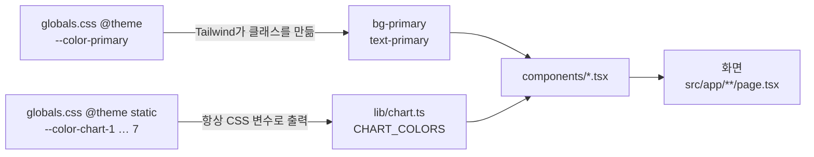
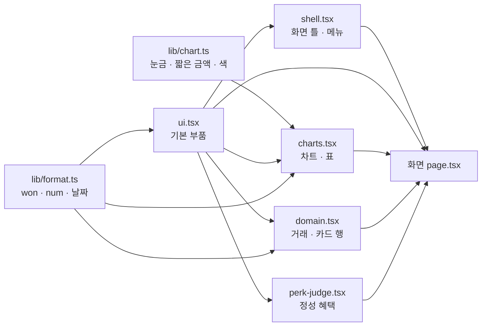
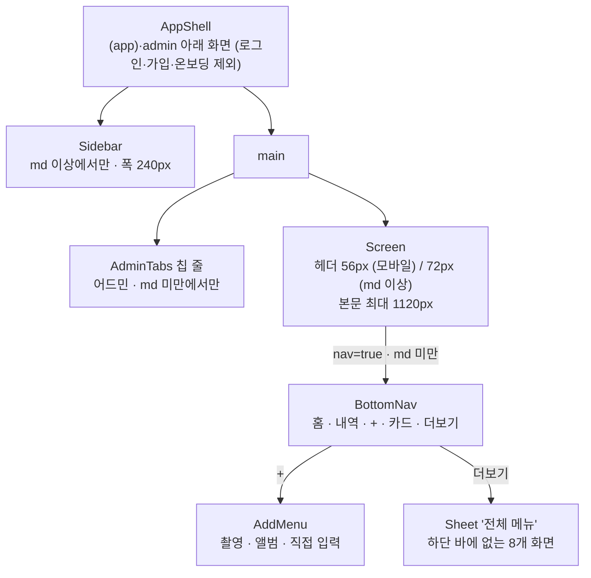

# 09. 디자인 시스템

카드셈 화면의 색·글자·간격을 정하는 **디자인 토큰**과, 여러 화면이 같이 쓰는 **공용 컴포넌트**를 정리한 문서입니다. 새 화면을 만들거나 고치기 전에 [6. 사용 규칙](#6-사용-규칙)을 먼저 읽어 주세요.

> **디자인 토큰**: 색·글자 크기·둥글기 같은 값에 이름(`--color-primary`)을 붙여 한곳에서 관리하는 방식입니다. 값을 한 번 바꾸면 그 이름을 쓰는 모든 화면이 함께 바뀝니다.

관련 코드

| 파일 | 역할 |
| --- | --- |
| `src/app/globals.css` | 토큰 정의(`@theme`), 기본 스타일, 공용 클래스 |
| `src/components/ui.tsx` | 기본 부품 (버튼, 배지, 카드, 입력칸, 시트, 표 …) |
| `src/components/shell.tsx` | 화면 틀과 메뉴 (사이드바, 하단 바, 헤더, 월 선택) |
| `src/components/charts.tsx` | 차트와 표 |
| `src/components/domain.tsx` | 거래 행, 카드 행, 혜택 배지 |
| `src/components/perk-judge.tsx` | 정성 혜택 판단 카드 |
| `src/lib/format.ts` | 금액·숫자·날짜 표기 |
| `src/lib/chart.ts` | 차트 눈금, 짧은 금액 표기, 카테고리 색 배정 |
| `src/app/layout.tsx` | 글꼴 불러오기, 브라우저 테마 색 |

토큰 값은 팀 디자인 시스템 파일(`tokens/colors.css`, `typography.css`, `layout.css`)에서 옮겨 왔습니다(`globals.css` 맨 위 주석).

---

## 1. 토큰이 클래스가 되는 방식

카드셈은 Tailwind CSS v4(4.3.3)를 씁니다. **Tailwind CSS**는 `bg-primary`, `p-4`처럼 미리 정해진 클래스 이름을 HTML에 적어 스타일을 입히는 CSS 도구입니다. 이 저장소에는 `tailwind.config.js`가 없습니다. v4에서는 설정을 CSS에 적기 때문입니다. 토큰은 `globals.css`의 `@theme { … }` 안에 CSS 변수로 적고, Tailwind가 변수 이름의 접두어를 보고 클래스를 만듭니다.

| 변수 접두어 | 만들어지는 클래스 예 |
| --- | --- |
| `--color-*` | `bg-primary`, `text-muted`, `border-line` |
| `--text-*` | `text-h3`, `text-label` (크기·줄 높이·굵기를 한 번에) |
| `--radius-*` | `rounded-md`, `rounded-btn` |
| `--shadow-*` | `shadow-1` |
| `--container-*` | `max-w-content` |
| `--spacing-*` | `h-btn-lg`, `min-h-btn-lg`, `md:h-header` |
| `--tracking-*` | `tracking-num` (글자 사이 간격) |
| `--ease-*` | `ease-out-soft` (움직임 곡선) |
| `--font-*` | `font-sans`, `font-icon` |

알아 둘 점 세 가지입니다. 모두 이 저장소의 `globals.css`를 Tailwind로 직접 컴파일해 확인했습니다.

1. **쓰인 변수만 CSS에 나옵니다.** `@theme`의 변수는 Tailwind가 훑는 파일에 그 클래스나 변수 이름이 있어야 최종 CSS에 들어갑니다. Tailwind가 훑는 범위는 `src`만이 아닙니다. git이 무시하지 않는 저장소 전체 파일(`docs/*.md`, `README.md` 포함)입니다. 차트 색은 코드에서 `var(--color-chart-${i})`처럼 이름을 조립하므로 Tailwind가 찾지 못합니다. 그래서 차트 색만 `@theme static` 블록에 두어 항상 내보냅니다.
2. **Tailwind 기본 팔레트는 지우지 않았습니다.** 카드셈이 정한 단계(예: `green-50`·`500`·`700`)만 카드셈 값이 됩니다. 정하지 않은 단계(예: `bg-green-100`, `gray-950`)를 쓰면 오류 없이 Tailwind 기본색으로 칠해집니다. 그래서 아래 표에 있는 단계만 씁니다. 지금 `src` 코드는 이 규칙을 지키고 있습니다.
   - 다만 문서에 적은 클래스 이름도 CSS에 들어갑니다. 저장소 루트 기준으로 컴파일하면 이 문서의 예시(`bg-green-100`, `w-[22px]`, `max-w-140` 등) 때문에 그 클래스와 Tailwind 기본 초록(oklch 값)이 빌드된 CSS에 생깁니다. `src`만 컴파일하면 생기지 않습니다.
   - 막으려면 `globals.css`의 `@import "tailwindcss";` 아래에 `@source not "../../docs";`를 둡니다. **`@source`**는 Tailwind가 클래스 이름을 찾을 파일 범위를 정하는 지시문이고, `not`은 그 범위에서 빼라는 뜻입니다. 이 줄을 넣고 컴파일하면 위 클래스가 사라지는 것을 확인했습니다. 지금 코드에는 이 줄이 없습니다.
3. **`text-body`는 글자 크기가 아니라 색입니다.** 글자 크기 토큰 `--text-body`(15px)와 색 토큰 `--color-body`의 이름이 겹칩니다. Tailwind는 `text-body`를 `color: var(--color-body)`로만 만듭니다. 본문 15px는 `body`의 기본 글꼴(`400 15px/1.55`)에서 물려받으므로 크기 클래스를 따로 주지 않아도 됩니다.

---

## 2. 색

### 2.1 기본 팔레트

브랜드 보라(violet)와 약간 푸른 회색(gray)입니다. 화면 코드에서는 가능하면 2.3의 **역할 이름**(`primary`, `muted` …)을 쓰고, 팔레트 단계는 역할 이름이 없을 때만 씁니다.

| 단계 | violet | gray |
| --- | --- | --- |
| 0 | - | `#ffffff` |
| 50 | `#f5f2ff` | `#f7f7fa` |
| 100 | `#ece6ff` | `#f0f0f5` |
| 200 | `#d9ceff` | `#e4e4ec` |
| 300 | `#bba8ff` | `#cfcfda` |
| 400 | `#9b7eff` | `#a6a6b6` |
| 500 | `#7e58ff` | `#7c7c8d` |
| 600 | `#6b43f2` | `#5d5d6c` |
| 700 | `#5a34d3` | `#44444f` |
| 800 | `#4829a8` | `#2c2c34` |
| 900 | `#34207a` | `#18181d` |

### 2.2 의미 색 (semantic)

네 가지 색을 세 단계로만 둡니다. **50은 연한 바탕, 500은 막대·점·아이콘, 700은 연한 바탕 위의 글자**에 씁니다. 예를 들어 성공 배지는 `bg-success-soft`(=green-50) 위에 `text-green-700` 글자입니다.

| 색 | 50 (바탕) | 500 (채움) | 700 (글자) | 뜻 |
| --- | --- | --- | --- | --- |
| green | `#eaf8f0` | `#1da466` | `#157a4c` | 성공, 받을 수 있음 |
| amber | `#fff6e8` | `#e8960c` | `#b06f05` | 주의, 놓친 혜택 |
| red | `#fdedee` | `#e5484d` | `#b92f34` | 위험, 초과, 오류 |
| blue | `#ebf2ff` | `#2e7df6` | `#1f5bc0` | 정보, 수입, 추론 |

### 2.3 역할 이름 (alias)

| 토큰 | 값 | 쓰임 |
| --- | --- | --- |
| `primary` | `#6b43f2` | 주 버튼, 선택된 칩·탭, 진행 막대 |
| `primary-hover` / `primary-active` | `#5a34d3` / `#4829a8` | 주 버튼에 마우스를 올렸을 때 / 눌렀을 때 |
| `primary-soft` / `primary-soft-2` | `#f5f2ff` / `#ece6ff` | 보조(tonal) 버튼 바탕 / 그 버튼의 hover |
| `page` | `#f7f7fa` | 화면 전체 바탕(`body`) |
| `card` | `#ffffff` | 카드 바탕 |
| `subtle` | `#f0f0f5` | 옅은 바탕 (지금 화면 코드에서는 쓰지 않음) |
| `inverse` | `#18181d` | 어두운 바탕 (지금 화면 코드에서는 쓰지 않음) |
| `line` | `#e4e4ec` | 기본 테두리, 목록 구분선 |
| `line-strong` | `#cfcfda` | 입력칸·보조 버튼·칩 테두리 |
| `line-focus` | `#7e58ff` | 키보드 포커스 테두리, 입력칸 포커스 |
| `strong` | `#18181d` | 제목, 값, 강조 글자 |
| `body` | `#44444f` | 본문 글자 (`body` 기본 글자색) |
| `muted` | `#7c7c8d` | 보조 설명, 라벨, 캡션 |
| `disabled` | `#a6a6b6` | 꺼진 버튼 글자, 입력칸 안내 문구(placeholder) |
| `link` | `#5a34d3` | 본문 안 링크(`TextLink`) |

### 2.4 도메인 색

가계부와 혜택에서 뜻이 정해진 색입니다.

| 토큰 | 값 | 쓰임 |
| --- | --- | --- |
| `income` / `income-soft` | `#2e7df6` / `#ebf2ff` | 수입·환불 금액 글자 / 수입 아이콘 바탕 |
| `expense` | `#18181d` | 지출 금액 글자 |
| `benefit` / `benefit-soft` | `#6b43f2` / `#f5f2ff` | 받은 혜택 금액 / 혜택 배지 바탕, 최적 카드 행 |
| `missed` / `missed-soft` | `#e8960c` / `#fff6e8` | 놓친 혜택 / 그 바탕 |
| `success` / `success-soft` | `#1da466` / `#eaf8f0` | 성공 |
| `warning` / `warning-soft` | `#e8960c` / `#fff6e8` | 주의 |
| `danger` / `danger-soft` | `#e5484d` / `#fdedee` | 위험 (예산 초과, 오류 알림) |
| `info` / `info-soft` | `#2e7df6` / `#ebf2ff` | 정보 (환불, 추론 배지) |

### 2.5 차트 색 (`@theme static`)

| 토큰 | 값 | 쓰임 |
| --- | --- | --- |
| `chart-1` | `#6b43f2` 보라 | 범주 1번 (브랜드 색) |
| `chart-2` | `#eb6834` 주황 | 범주 2번 |
| `chart-3` | `#1baf7a` 청록 | 범주 3번 |
| `chart-4` | `#eda100` 노랑 | 범주 4번 |
| `chart-5` | `#e87ba4` 분홍 | 범주 5번 |
| `chart-6` | `#2a78d6` 파랑 | 범주 6번 |
| `chart-7` | `#008300` 초록 | 범주 7번 |
| `chart-other` | `#a6a6b6` 회색 | 8번째 범주부터, '기타' |
| `chart-income` | `#1baf7a` 청록 | 수입 계열 |
| `chart-expense` | `#6b43f2` 보라 | 지출 계열, 한 계열 차트 |
| `chart-grid` | `#e4e4ec` | 눈금선 |
| `chart-axis` | `#cfcfda` | 0 기준선, 꺾은선 십자선 |

- 범주 7색은 **순서를 바꾸면 안 됩니다.** `globals.css` 주석에 따르면 이 순서로 흰 바탕에서 색각이상 대비 검사를 통과했습니다.
- 수입을 파랑이 아니라 청록으로 둔 이유도 같습니다. 파랑·보라 쌍은 색각이상에서 구분이 잘 안 됩니다.
- 코드에서는 `src/lib/chart.ts`의 `CHART_COLORS`(7색 배열), `CHART_OTHER`, `CHART_INCOME`, `CHART_EXPENSE`로 씁니다. 값은 `var(--color-chart-1)` 같은 CSS 변수 문자열입니다.

---

## 3. 글자

**글꼴.** 한 가지 글꼴 Pretendard만 씁니다. `src/app/layout.tsx`가 jsDelivr CDN에서 Pretendard Variable(v1.3.9, 필요한 글자만 내려받는 dynamic subset)을 불러옵니다. 글꼴 이름 목록은 `--font-sans`에 있고, Pretendard가 늦으면 시스템 글꼴(Apple SD Gothic Neo 등)이 대신합니다.

**아이콘.** Material Symbols Rounded 한 벌만 씁니다. Google Fonts에서 굵기 400, 크기축 24, 채움 0~1만 받습니다. 아이콘은 글자처럼 그립니다. `<Icon name="home" />`이 `home`이라는 글자를 쓰면 글꼴이 그 이름을 아이콘 모양으로 바꿉니다(리거처). 선택된 메뉴처럼 꽉 찬 모양이 필요하면 `fill`을 줍니다.

**글자 크기.** 클래스 하나가 크기·줄 높이·굵기를 함께 정합니다.

| 클래스 | 크기 | 줄 높이 | 굵기 | 쓰는 곳 |
| --- | --- | --- | --- | --- |
| `text-display` | 32px | 1.25 | 700 | 거래 상세의 큰 금액, `AmountBig` 입력 |
| `text-h1` | 24px | 1.3 | 700 | `PageTitle`(로그인·가입·온보딩, 탈퇴 화면 본문) |
| `text-h2` | 20px | 1.35 | 700 | 데스크톱 화면 제목, `Sheet` 제목, `MonthPicker` |
| `text-h3` | 17px | 1.4 | 600 | `CardTitle`, 모바일 화면 제목 |
| (본문) | 15px | 1.55 | 400 | `body` 기본값. `text-body`는 색 클래스임 (1장 참고) |
| `text-label` | 14px | 1.45 | 500 | md·sm 버튼, 칩, 입력 라벨, 표 |
| `text-caption` | 13px | 1.45 | - | 보조 설명(`Cap`), `Note` |
| `text-overline` | 12px | 1.4 | 600 | 배지, 표 머리글, 사이드바 묶음 제목 |
| `text-num-lg` | 28px | 1.2 | 700 | 큰 숫자 (`Num size="lg"`, 넓은 화면의 `StatTile`) |
| `text-num-md` | 20px | 1.25 | 700 | `StatTile` 숫자 |
| `text-num-sm` | 15px | 1.4 | 600 | 목록 금액 (`Num` 기본값) |
| `text-nav` | 11px | 1.2 | - | 모바일 하단 탭 라벨 |

| 클래스 | 값 | 쓰임 |
| --- | --- | --- |
| `tracking-num` | -0.01em | 숫자를 조금 촘촘하게 (`Num`, `StatTile`) |
| `tracking-title` | -0.02em | 큰 제목 |

---

## 4. 둥글기 · 그림자 · 치수 · 움직임

**둥글기 (radius).** 디자인 시스템의 표현으로 "살짝 둥글둥글"입니다.

| 클래스 | 값 | 쓰는 곳 |
| --- | --- | --- |
| `rounded-sm` | 8px | 배지, 체크박스, `Seg` 항목 |
| `rounded-btn` | 10px | md·sm 버튼, 뒤로 버튼(데스크톱), 월 이동 화살표, 로고 |
| `rounded-md` | 12px | 입력칸, lg 버튼, `Note`, 메뉴 항목, 헤더 아이콘 버튼(`TopIconButton`, 데스크톱), 시트 닫기 버튼 |
| `rounded-lg` | 16px | 카드(`Card`), `StatTile`, `Table` 상자 |
| `rounded-xl` | 20px | `Sheet`, `AddMenu` |
| `rounded-2xl` | 28px | 데스크톱의 로그인·가입·온보딩 상자 |
| `rounded-xs` | 2px | (Tailwind 기본) 범례·표의 작은 색 네모 |
| `rounded-full` | 원 | (Tailwind 기본) 칩, 진행 막대, 토글 |

**그림자.** 낮고 부드럽게 둡니다.

| 클래스 | 쓰는 곳 |
| --- | --- |
| `shadow-1` | 카드(`.card-base`), `StatTile`, 선택된 `Seg` 항목 |
| `shadow-2` | 하단 바 + 버튼, 차트 툴팁, 동기화 오류 알림, 데스크톱 로그인 상자 |
| `shadow-3` | `Sheet`, `AddMenu`처럼 화면 위에 뜨는 판 |
| `shadow-focus` | 입력칸 포커스 때 바깥쪽 3px 연보라 띠 |

**레이아웃 치수와 움직임.**

| 클래스 | 값 | 쓰임 |
| --- | --- | --- |
| `max-w-content` | 1120px | `Screen` 본문 최대 폭 |
| `h-btn-lg`, `min-h-btn-lg` | 52px | lg 버튼, `FormRow` 최소 높이 |
| `md:h-header` | 72px | 데스크톱 헤더 높이 (모바일은 `h-14` = 56px) |
| `ease-out-soft` | `cubic-bezier(0.2, 0.8, 0.2, 1)` | 버튼 눌림, `Progress`, `Toggle` |

**간격.** 따로 간격 토큰을 만들지 않고 Tailwind 기본 척도를 씁니다. 숫자 1이 4px입니다(`--spacing: 0.25rem`). 예를 들어 `gap-3` = 12px, `w-5.5` = 22px, `max-w-105` = 420px입니다. 대괄호 안에서는 `--spacing(95)`(= 380px)처럼 같은 척도를 함수로 씁니다.

**쌓임 순서 (z-index).**

| 값 | 무엇 |
| --- | --- |
| `z-10` | 차트 툴팁 |
| `z-30` | `Screen` 헤더 (스크롤해도 위에 붙음), 일괄 편집 화면(`transactions/bulk`)의 하단 고정 바 |
| `z-40` | 모바일 하단 바 |
| `z-50` | `Sheet`, `AddMenu`, 동기화 오류 알림 |

---

## 5. 기본 스타일과 공용 클래스 (`globals.css`)

`@layer`는 CSS 규칙을 층으로 나누는 기능입니다. 아래 층의 규칙은 위 층의 규칙에 항상 집니다. Tailwind v4의 순서는 `theme` → `base` → `components` → `utilities`입니다.

**`@layer base`** — 태그 기본값

- 모든 요소 `box-sizing: border-box`, 글꼴 부드럽게(antialiased).
- `body`: `400 15px/1.55` Pretendard, 글자색 `body`, 바탕 `page`.
- `a`는 색을 물려받고 밑줄 없음. `button`은 글꼴을 물려받고 손가락 커서.
- `input`·`select`·`textarea` 글자색 `strong`, placeholder는 `disabled`.
- `:focus-visible`: 2px `line-focus` 실선 테두리(outline), 2px 띄움. 키보드로 옮겼을 때만 보입니다. 그림자가 아니라 outline으로 그려서 `shadow-*` 클래스에 덮이지 않습니다.
- 숫자 입력칸의 위아래 화살표(스피너)를 없앱니다.

**`@layer components`** — 덮어쓸 수 있는 기본 모양

| 클래스 | 내용 | 쓰는 컴포넌트 |
| --- | --- | --- |
| `.input-box` | 높이 48px, `rounded-md`, `line-strong` 테두리, 흰 바탕, 좌우 14px | `Input`, `Select` |
| `.card-base` | `card` 바탕, `line` 테두리, `rounded-lg`, `shadow-1`, 세로 배치 간격 12px | `Card` |

**`@utility`** — 직접 만든 클래스

| 클래스 | 내용 |
| --- | --- |
| `msr` / `msr-fill` | Material Symbols 아이콘 글꼴 설정 / 채운 모양 |
| `pb-nav` | 아래 여백 `88px + 기기 안전 영역`. 하단 바에 내용이 가리지 않게 |
| `pb-safe` | 아래 여백 `max(기기 안전 영역, 16px)`. 아이폰 홈 표시줄 자리 |
| `bottom-above-nav` | `bottom: 96px + 기기 안전 영역`. 하단 바 바로 위에 띄우는 알림 위치 |
| `no-scrollbar` | 가로로 넘기는 칩 줄의 스크롤바 숨김 |

"기기 안전 영역"은 `env(safe-area-inset-bottom)`입니다. 노치·홈 표시줄이 있는 휴대폰에서 화면 아래 가려지는 높이입니다. `layout.tsx`의 `viewportFit: "cover"`가 이 값을 쓸 수 있게 합니다.

---

## 6. 사용 규칙

### 6.1 색과 크기는 토큰으로 (임의 px·hex 금지)

- **색**은 토큰 클래스(`bg-primary`, `text-muted`)로 씁니다. SVG나 `style`처럼 클래스를 못 쓰는 곳은 `var(--color-…)`로 씁니다. `#6b43f2` 같은 hex 값을 화면 코드에 직접 적지 않습니다.
- **크기·여백**은 토큰(`h-btn-lg`, `max-w-content`)이나 4px 척도(`w-5.5`, `max-w-180`, `--spacing(95)`)로 씁니다. `w-[22px]`처럼 대괄호에 px를 적지 않습니다.
- 계산으로 정해지는 크기는 `style`로 넘겨도 됩니다. `Icon`의 `size`, `CardChip`의 `w`·`h`, 차트 막대 폭이 그 예입니다.
- 팔레트는 2장의 표에 있는 단계만 씁니다(1장의 2번).
- 이 규칙을 강제하는 lint 규칙은 없습니다. 리뷰에서 확인합니다.

**지금 코드에 남아 있는 예외**

| 위치 | 값 | 이유 / 바꿀 값 |
| --- | --- | --- |
| `src/lib/data/cards.ts` 카드 상품의 `color` | `#2C2C34` 등 | 카드 실물 색을 담은 데이터라 예외 |
| `src/app/layout.tsx` `themeColor` | `#6B43F2` | 메타 태그라 CSS 변수를 못 씀 (값은 `primary`와 같음) |
| `src/app/login/page.tsx` 카카오 버튼 | `bg-[#FEE500]`, `text-[#191919]` | 외부 브랜드 색 (버튼은 꺼져 있음) |
| `src/app/(app)/settings/page.tsx`, `transactions/recurring/page.tsx` | `max-w-[720px]` | `max-w-180`과 같은 값 |
| `src/app/(app)/settings/withdraw/page.tsx` | `max-w-[560px]` | `max-w-140`과 같은 값 |
| `src/app/(app)/receipt/page.tsx` | `max-w-[640px]`, `rounded-[14px]` | `max-w-160`과 같은 값 / 14px 둥글기 토큰은 없음 |
| `src/app/login/page.tsx`, `src/app/signup/page.tsx` | `max-w-[420px]` | `max-w-105`와 같은 값 (온보딩은 이미 `max-w-105`) |
| `src/app/(app)/stats/share/page.tsx` | `align-[-2px]` | 색 네모의 세로 위치 맞춤 |

### 6.2 클래스 덮어쓰기

- `cx(...)`(`ui.tsx`)는 클래스 문자열을 공백으로 이어 붙이기만 합니다. 같은 속성의 클래스가 둘이면 어느 쪽이 이길지는 Tailwind가 CSS를 출력하는 순서로 정해집니다. 나중에 적었다고 이기지 않습니다.
- 그래서 `Input`·`Select`·`Card`의 기본 모양은 `@layer components`(`.input-box`, `.card-base`)에 둡니다. 이 층은 utilities보다 아래라서 호출하는 쪽의 `className`(`h-10`, `gap-0`, `bg-danger-soft` …)이 항상 이깁니다.
- 다른 컴포넌트(`Button`, `Badge` …)의 기본 클래스는 utilities 층에 있습니다. 같은 속성을 겹쳐 주지 말고 `variant`·`size`·`kind` 같은 인자로 모양을 고릅니다.

### 6.3 숫자와 날짜 표기 (`src/lib/format.ts`)

| 함수 | 쓰는 곳 | 예 |
| --- | --- | --- |
| `won(n, sign?)` | 모든 원화 금액. 반올림하고 "원"을 붙임. `sign=true`면 양수 앞에 + | `won(12345.6)` → `12,346원`, `won(500, true)` → `+500원`, `won(-500)` → `-500원` |
| `num(n)` | 금액이 아닌 숫자(건수, 글자 수), 외화 금액, 금액 입력칸의 쉼표 | `num(1234567)` → `1,234,567` |
| `compactWon(n)` (`lib/chart.ts`) | 차트 축처럼 좁은 자리 | `1234567` → `123.5만`, `120000000` → `1.2억`, `9999` → `9,999` |
| `pct1(r)` (`lib/chart.ts`) | 비율 | `pct1(0.1234)` → `12.3%` |
| `fmtMd(d)` | 짧은 날짜. 월만 숫자로 바꾸고 일은 두 자리 그대로 | `"2026-09-20"` → `9/20`, `"2026-09-05"` → `9/05` |
| `fmtDateKo(d)` | 요일 붙은 날짜 | `9. 20 (일)` |
| `fmtDateLong(d)` | 긴 날짜 (일별 머리글) | `9월 20일 일요일` |
| `fmtYm(ym)` (`lib/engine`) | 월 | `"2026-09"` → `2026년 9월` |

- **`toLocaleString()`을 로캘 없이 부르지 않습니다.** 서버(Node 기본 en-US)와 사용자 브라우저(예: de-DE)의 숫자 모양이 달라 첫 화면이 어긋납니다(하이드레이션 불일치). `won`·`num`은 `ko-KR`로 고정되어 있습니다. 지금 `settings/page.tsx`의 예산 금액과 `settings/withdraw/page.tsx`의 거래 건수가 로캘 없이 부르는 예외로 남아 있습니다.
- 금액은 `won`이 기본입니다. 다만 지금 코드에는 `num` 뒤에 "원"을 직접 붙이거나 단위를 빼는 곳이 있습니다. 이 경우는 허용합니다.
  - 규칙 설명 문장 속 한도·조건 금액: `` `월 ${num(l.monthlyCap)}원` `` (`cards/[id]/rules/page.tsx`, `cards/[id]/page.tsx`)
  - 좁은 자리에서 단위를 빼는 경우: 카드 실적의 "잔여 N / N" (`cards/page.tsx`, `home/page.tsx`)
  - `num`은 반올림하지 않으므로 정수 금액에만 씁니다.
- 금액을 줄 맞춰 보여 줄 때는 `Num` 컴포넌트(`tracking-num`, 줄바꿈 없음)를 씁니다. 표의 숫자 열은 `DataTable`이 오른쪽 정렬과 고정폭 숫자(`tabular-nums`)를 넣어 줍니다.
- `won`은 `ui.tsx`에서도 다시 내보냅니다(`import { won } from "@/components/ui"`). 같은 함수입니다.

### 6.4 화면 문구

- **안내 문장은 해요체**로 씁니다. 예: "장부를 불러오는 중이에요", "관리자만 볼 수 있어요", "데이터가 없어요", "금액·가맹점을 입력해요".
- **버튼·배지·메뉴는 명사형**으로 짧게 씁니다. 예: "등록 해제", "참고값", "놓침 1,200원", "엑셀 내보내기".
- 한 줄에 정보를 여럿 이을 때는 ` · `(가운데점)을 씁니다. 예: 거래 행 보조 줄 "9/20 · 식비 › 카페 · 신한 Mr.Life".
- AI 인사이트 문장도 해요체로 받도록 `src/lib/ai/server.ts`의 `InsightSchema`에 적혀 있습니다.

---

## 7. 공용 컴포넌트

새 화면은 아래 부품을 조합해서 만듭니다. 비슷한 부품을 화면 파일 안에 새로 만들기 전에 먼저 여기서 찾습니다.

### 7.1 `src/components/ui.tsx` — 기본 부품

**유틸**

| 이름 | 용도 |
| --- | --- |
| `cx(...)` | 클래스 문자열 이어 붙이기. `false`·`null`·`undefined`는 뺌 |
| `won` | `lib/format.ts`의 `won`을 다시 내보냄 |
| `useDialog(open, onClose)` | 모달 공통 키보드 처리: Esc로 닫기, 열 때 패널 안 첫 요소로 포커스, 닫을 때 연 버튼으로 포커스 복귀. 돌려받은 ref를 패널에 단다. 단, 패널 안 요소에 `autoFocus`가 있으면 그 요소가 먼저 포커스를 가져가 연 버튼을 기억하지 못하므로 닫을 때 복귀하지 않음 |
| `tableMinWidth(cols)` | `Table`의 최소 폭 계산: 고정 px 열의 합 + 가변 열마다 80px + 열 간격 16px씩 + 좌우 여백 40px |

**글자·아이콘**

| 이름 | 용도 |
| --- | --- |
| `Icon` | Material Symbols 아이콘 하나. `size`(기본 20), `fill`. 항상 `aria-hidden` |
| `Cap` | 13px 회색 보조 설명 |
| `Num` | 숫자 표시. `size` `sm`(15px)·`md`(20px)·`lg`(28px) |
| `PageTitle` | `h1` 제목 + 설명. `Screen` 밖 화면(로그인·가입·온보딩)에서 씀. 탈퇴 화면은 `Screen` 안 본문에서 써서 `h1`이 둘이 됨(9.6) |
| `CardTitle` | 카드 안 제목(17px) + 오른쪽 자리(`right`) |
| `AiTitle` | AI 섹션 제목: `auto_awesome` 아이콘 타일 + 제목 + 메모 |
| `TextLink` | 본문 안 "전체 보기" 같은 링크. `href`면 링크, 아니면 버튼 |
| `KV` | 키-값 줄 목록 (카드 상세의 실적 계산값·보정값, 혜택 규칙의 대상·지급·조건·한도) |

**버튼·선택**

| 이름 | 용도 |
| --- | --- |
| `Button` | 버튼. `variant` `primary`·`secondary`·`tonal`·`ghost`·`danger`·`dangerSolid`, `size` `lg`(52px)·`md`(44px)·`sm`(36px), `icon`. `href`를 주면 링크로 그림 |
| `Chip` | 둥근 칩. `on`이면 보라로 채움, `x`면 닫기 표시. `href`면 페이지 이동 링크(`aria-current`), 아니면 눌림 상태 버튼(`aria-pressed`) |
| `Seg` | 여럿 중 하나 고르기(세그먼트). `radiogroup`/`radio`로 그림 |
| `segBox`, `segItem(on)` | `Seg`의 모양 클래스. 같은 모양의 링크를 만들 때 씀(`ViewSwitch`) |
| `Toggle` | 켬/끔 스위치(`role="switch"`). `label`이 낭독 이름 |
| `Check` | 체크박스(`role="checkbox"`). `label`이 낭독 이름 |

**입력**

| 이름 | 용도 |
| --- | --- |
| `Field` | 라벨 + 입력 + 안내(`hint`)/오류(`error`). 기본은 `<label>`로 감쌈. 버튼 묶음(`Seg`)을 감쌀 때는 `group`을 줘서 `role="group"` `
`로 그림 |
| `Input` | 한 줄 입력칸. 왼쪽 `icon`, 오른쪽 `suffix`(예: "원"), `error`면 빨간 테두리·바탕과 `aria-invalid` |
| `Select` | 기본 `<select>`에 같은 상자 모양과 ▾ 아이콘 |
| `AmountBig` | 큰 금액 입력(32px). 숫자 키패드(`inputMode="numeric"`), 쉼표 자동, 끝에 "원" |
| `FormRow` | 왼쪽 라벨(80px) + 값 + 오른쪽 한 줄. 지금 화면 코드에서는 쓰지 않음 |

**표시**

| 이름 | 용도 |
| --- | --- |
| `Card` | 흰 카드 상자. 기본 안쪽 여백 `p-4 md:p-5`(`pad`로 바꿈) |
| `Badge` | 작은 상태 표시(높이 24px). `kind` `gray`·`benefit`·`missed`·`success`·`warn`·`danger`·`info`·`dark`·`primary` |
| `BadgeKind` | `Badge`의 `kind` 타입 |
| `RefBadge` | "참고값" 회색 배지. 혜택 금액이 추정치임을 알림 |
| `Progress` | 진행 막대(`role="progressbar"`). `pct`는 막대 폭만 0~100으로 잘라 그리고, `aria-valuenow`는 반올림한 원래 값(100을 넘을 수 있음, 9.6). `color` 클래스, `h` 높이(기본 8px) |
| `StatTile` | 통계 숫자 타일. `tone` `white`·`primary`(보라 채움)·`missed`(주황 테두리) |
| `Note` | 안내 상자. `tone` `gray`·`violet`·`amber`·`blue` |
| `EmptyState` | 빈 목록 안내: 아이콘 + 제목 + 설명 + 행동 버튼 |
| `IconTile` | 둥근 사각형 안 아이콘. `tone` `gray`·`primary`·`success`·`warn`·`danger`·`info` |
| `CardChip` | 카드 미니어처. 로고 대신 카드 색 한 가지로 채운 작은 사각형 |

**목록·표·모달**

| 이름 | 용도 |
| --- | --- |
| `ListRow` | 설정 화면 같은 목록 한 줄: 아이콘 타일 + 제목 + 보조 + 오른쪽. `href`/`onClick`이면 › 표시, `danger`면 빨간 제목 |
| `Table`, `TRow` | 데스크톱용 격자 표(`div`). 열 폭 목록으로 `grid-template-columns`를 만들고, 최소 폭보다 좁으면 가로 스크롤. 어드민에서 씀 |
| `Sheet` | 모달. 모바일은 아래에서 올라오는 시트, md 이상은 가운데 상자(최대 480px). `role="dialog"`, `aria-modal`, 제목이 낭독 이름 |

### 7.2 `src/components/shell.tsx` — 화면 틀과 메뉴

| 이름 | 용도 |
| --- | --- |
| `AppShell` | `(app)`·`admin` 아래 모든 화면의 바깥 틀(`src/app/(app)/layout.tsx`, `src/app/admin/layout.tsx`). 로그인·가입·온보딩은 이 틀을 거치지 않음. 사이드바 + 본문 + 동기화 오류 알림. 로그인 장부를 읽는 동안은 `Loading`, 관리자가 아닌 사용자가 어드민을 열면 "관리자만 볼 수 있어요" |
| `Sidebar` | 데스크톱 왼쪽 메뉴(md 이상, 폭 240px). `admin`이면 어드민 메뉴 |
| `BottomNav` | 모바일 하단 바(md 미만). `Screen`에 `nav`를 주면 나옴 |
| `AddMenu` | 하단 바 가운데 + 버튼이 여는 메뉴: 촬영 · 앨범 · 직접 입력 |
| `Screen` | 화면 한 장의 틀: 고정 헤더(제목·설명·뒤로·오른쪽 버튼) + 본문. 제목이 글자면 `h1`, 컨트롤이면 `div` |
| `TopIconButton` | 헤더 오른쪽 아이콘 버튼. `label`(낭독 이름)이 필수, `dot`이면 빨간 점 |
| `TopAction` | 헤더 오른쪽 글자 버튼(예: "저장", "수정", "모두 읽음") |
| `MonthPicker` | 이전 달 ‹ 월 › 다음 달. 스토어의 전역 월을 바꾸므로 모든 화면에 함께 적용. 월 글자만 `h1` |
| `ViewSwitch` | 내역 · 월간 요약 전환. 모양은 `Seg`지만 페이지 이동이라 `<nav>` 안의 링크 |
| `Loading` | 전체 화면 로딩("장부를 불러오는 중이에요", `role="status"`). 온보딩도 씀 |
| `activeHref(path, hrefs)` | 지금 경로에 맞는 메뉴 하나를 고름. 가장 길게 맞는 것이 이김 (8장) |

`AdminTabs`(모바일 어드민 메뉴 칩 줄)는 파일 안에서만 씁니다.

### 7.3 `src/components/charts.tsx` — 차트와 표

| 이름 | 용도 |
| --- | --- |
| `ColumnChart` | 세로 막대. 계열이 여럿이면 묶음 막대. `highlight`(한 칸만 진하게), `onSelect`(막대 누르면 이동) |
| `LineChart` | 꺾은선. 계열 여럿, 십자선과 한 툴팁에 모든 계열 |
| `Donut` | 도넛(부분-전체). 가운데에 합계, 조각에 올리면 그 조각 값과 비율 |
| `BarList` | 가로 막대 순위 목록. 라벨이 막대 위 한 줄에 따로 있어 세로 막대의 x축 라벨처럼 솎아 내지 않음(아주 길면 말줄임 …) |
| `DataTable` | 진짜 `<table>`. 숫자 열 오른쪽 정렬, 머리글 눌러 정렬, 합계 줄(`footer`) |
| `ViewToggle` | 카드 제목 오른쪽의 `그래프 \| 표` 전환 |
| `Legend` | 범례. 계열이 둘 이상인 차트가 자동으로 그림 |
| `ChartSeries`, `ChartDatum` | 계열(`key`, `name`, `color`)과 데이터 한 칸(`key`, `label`, `full`, `values`) 타입 |
| `DonutItem`, `Column`, `View` | 도넛 조각, 표 열 정의, `"그래프" \| "표"` 타입 |

### 7.4 `src/components/domain.tsx` — 가계부 전용 부품

| 이름 | 용도 |
| --- | --- |
| `TxnRow` | 거래 한 줄: 업종 아이콘 + 가맹점 + 보조 줄 + 금액 + 혜택 배지. `onCheck`면 행 전체가 체크박스(일괄 선택) |
| `TxnIcon` | 거래 아이콘. 환불은 `undo`, 수입은 `payments`, 지출은 업종 아이콘(업종을 모르면 카테고리 아이콘) |
| `benefitBadge(t, r)` | 거래의 혜택 상태를 배지 글자와 `kind`로 정함 (아래 표) |
| `DayHead` | 날짜 머리글("9월 20일 일요일")과 그날 합계 |
| `CardRow` | 카드 한 줄: `CardChip` + "카드사 카드명" + 보조 |
| `CompareList` | 보유 카드 비교 목록. 혜택이 큰 순, 맨 위(0원 초과)에 "최적" 배지. 해제한 카드로 결제했으면 "해제한 카드 · 받은 혜택" 줄을 더함 |

`benefitBadge`는 위에서부터 처음 맞는 줄을 고릅니다. 모든 상태가 색과 함께 글자로 나옵니다.

| 조건 | 배지 글자 | `kind` |
| --- | --- | --- |
| 수입 | (배지 없음) | - |
| 환불 | 환불 · 원거래 재계산 | `info` |
| 현금·계좌이체 | 현금·이체 · 계산 제외 | `gray` |
| 엔진 결과 없음(`r.mine` 없음, 결제 카드의 계산값이 없음) | (배지 없음) | - |
| 혜택을 받음 | 혜택 N원 | `benefit` |
| 조건 정보가 없어 계산을 건너뜀 | (조건) 입력 시 최대 N원 | `missed` |
| 한도를 다 씀 | 한도 소진 · 놓침 N원 / 한도 소진 | `missed` |
| 제외 대상 | 무이자 · 혜택 제외 / 제외 업종 | `gray` |
| 다른 카드가 더 유리 | 놓침 N원 | `missed` |
| 업종 미분류 | 업종 미분류 · 확인 필요 | `missed` |
| 그 밖 | 혜택 0원 · 대상 아님 | `gray` |

계산 방법은 [04. 혜택 계산 엔진](04-benefit-engine.md)에 있습니다.

### 7.5 `src/components/perk-judge.tsx`

| 이름 | 용도 |
| --- | --- |
| `PerkJudge({ t })` | 거래 상세의 "정성 혜택 판단" 카드. 결제 카드의 정성 혜택마다 받을 수 있는지(확률 0.5 이상이면 "받을 수 있어요")와 형태 배지(돈 `benefit`, 상품·이용권 `info`, 서비스·자격 `success`)를 보여 줌. 카드에 정성 혜택이 없으면 그리지 않음 |

판단 방식은 [06. 정성 혜택 판단 (Jev)](06-perks-jev.md)에 있습니다.

---

## 8. 차트 규칙 (요약)

자세한 이유와 화면별 쓰임은 [08. 월간 요약 · 통계 · 엑셀 내보내기 — 4. 차트를 이렇게 그린 이유](08-reports-stats-export.md#4-차트를-이렇게-그린-이유)에 있습니다. 새 차트를 넣을 때 지킬 것만 모았습니다.

- **라이브러리 없이 SVG로 그립니다.** 그리는 크기는 `ResizeObserver`로 컨테이너 폭을 재서 픽셀로 계산합니다.
- **모양 고르기.** 시간 흐름의 비교는 `ColumnChart`, 여러 계열의 추이는 `LineChart`, 부분-전체(6~8조각 이하)는 `Donut`, 순위는 `BarList`입니다.
- **모든 그래프에 같은 숫자의 표가 있습니다.** 카드 제목 오른쪽에 `ViewToggle`을 두고 표는 `DataTable`로 그립니다.
- **색.** 카테고리는 `categoryColors(categories)`로 정렬 순서에 고정된 색을 받습니다. 순위가 바뀌어도 같은 카테고리는 같은 색입니다. 8번째부터와 '기타'는 회색입니다. 한 계열 차트는 `CHART_EXPENSE`, 수입·지출 쌍은 `CHART_INCOME`·`CHART_EXPENSE`입니다.
- **표시는 얇고 조용하게.** 막대는 최대 24px, 위쪽만 4px 둥글게, 계열 사이 2px. 선은 2px, 그리드·축은 1px 실선입니다. 강조할 칸 하나만 진하게 하고 나머지는 투명도 0.4로 옅게 그립니다.
- **눈금과 라벨.** 눈금은 `niceTicks`(간격 1·2·2.5·5·10 × 10ⁿ), 축 금액은 `compactWon`입니다. x 라벨이 겹치면 솎아 내고, 마지막 라벨(보통 이번 달)은 항상 남깁니다.
- **범례.** 계열이 둘 이상이면 `Legend`를 항상 그립니다. 글자에는 계열 색을 입히지 않고 옆의 색 표시로 구분합니다.
- **툴팁은 마우스와 키보드 둘 다.** 막대·점·조각마다 `tabIndex={0}`과 값이 담긴 `aria-label`이 있습니다. 툴팁은 같은 내용이라 `aria-hidden`입니다.

---

## 9. 접근성 규칙

**접근성**은 화면 낭독기(시각장애인이 화면 글자를 소리로 듣는 프로그램), 키보드만 쓰는 사람, 색을 구분하기 어려운 사람도 같은 기능을 쓸 수 있게 하는 것입니다.

### 9.1 이름 붙이기 (`aria-label`)

- `Icon`은 항상 `aria-hidden`입니다. 그래서 **아이콘만 있는 버튼에는 반드시 `aria-label`을 줍니다.** 예: `TopIconButton`의 `label`(필수 인자), 시트 닫기 "닫기", 월 이동 "이전 달"·"다음 달", 하단 + 버튼 "거래 추가", 뒤로 가기 "뒤로".
- 메뉴 묶음에는 이름을 붙입니다: "주 메뉴", "어드민 메뉴", "보기 전환", "통계 종류".
- `Toggle`·`Check`처럼 글자가 없는 컨트롤은 `label` 인자로 이름을 줍니다.
- 차트는 `<svg role="group" aria-label="차트 이름">`이고, 막대·점·조각마다 값이 담긴 `aria-label`이 있습니다.
- 표는 `DataTable`의 `caption`(화면에는 숨김, `sr-only`)이 이름입니다. 머리글은 `scope="col"`, 정렬 중인 열은 `aria-sort`입니다.

### 9.2 키보드

- 누르는 것은 `<button>`이나 `<Link>`로 만듭니다. `div`에 `onClick`만 달지 않습니다. 그래야 Tab으로 가고 Enter·Space로 눌립니다.
- 포커스는 `:focus-visible` 2px 보라 테두리로 보입니다. 입력칸은 안쪽 `input`의 테두리를 끄고 바깥 상자가 `focus-within`으로 보라 테두리와 띠를 그립니다. `AddMenu`의 파일 고르기 줄도 `focus-within`으로 배경이 바뀝니다(파일 입력칸이 숨겨져 있어서).
- 모달(`Sheet`, `AddMenu`)은 `useDialog`로 Esc를 누르면 닫히고, 열릴 때 패널 안 첫 요소로 포커스가 가고, 닫히면 연 버튼으로 돌아옵니다. 단, 패널 안 요소에 `autoFocus`가 있으면 닫을 때 연 버튼으로 돌아오지 않습니다(9.6). 뒤쪽 어두운 배경 버튼은 `tabIndex={-1}`이라 Tab에 걸리지 않습니다.
- 일괄 선택 모드의 `TxnRow`는 행 전체가 `role="checkbox"` 버튼이라 Space·Enter로 고릅니다.
- 차트 막대·점·조각은 Tab으로 옮기면 툴팁이 뜨고, 고를 수 있는 막대는 Enter·Space로 누릅니다.

### 9.3 상태와 제목 구조

| 무엇 | 어떻게 알리나 |
| --- | --- |
| 지금 보고 있는 메뉴 | `aria-current="page"` (`Sidebar`, `BottomNav`, `ViewSwitch`, 링크형 `Chip`) |
| 눌린 칩 | `aria-pressed` (버튼형 `Chip`) |
| 여럿 중 하나 | `role="radiogroup"` + `role="radio"` + `aria-checked` (`Seg`) |
| 켬/끔, 체크 | `role="switch"` / `role="checkbox"` + `aria-checked` |
| 진행률 | `role="progressbar"` + `aria-valuenow` (`Progress`, 값이 100을 넘을 수 있음 — 9.6) |
| 불러오는 중 | `role="status"` (`Loading`) |
| 오류 | `role="alert"` (동기화 오류 알림, 어드민 권한 없음) |
| 메뉴를 여는 버튼 | `aria-haspopup="dialog"` + `aria-expanded` (하단 +, 더보기) |

- 화면마다 `h1`이 하나 있게 합니다. `Screen`은 제목이 글자면 `h1`로 그리고, 컨트롤(월 선택, 검색창)이면 `div`로 그립니다. `MonthPicker`는 월 글자만 `h1`입니다. 제목 자리가 검색창인 거래 검색 화면은 숨긴 `h1`("거래 검색")을 따로 둡니다.
- 페이지 이동 UI는 `tablist`가 아니라 `<nav>` 안의 링크로 만듭니다(`ViewSwitch`, 통계 탭). 한 화면 안에서 값을 고르는 것만 `Seg`·버튼형 `Chip`을 씁니다.

### 9.4 색만으로 의미를 전달하지 않기

색을 못 보거나 구분하기 어려운 사람도 같은 뜻을 알 수 있게, 색에는 항상 글자·기호·모양을 함께 둡니다.

| 화면 | 색 | 함께 두는 것 |
| --- | --- | --- |
| 거래 금액 | 수입 파랑 / 지출 검정 | `+` / `-` 부호 |
| 혜택 배지 | 보라·주황·회색 | "혜택 N원", "놓침 N원", "제외 업종" 같은 글자 (7.4 표) |
| 영수증 확인 | 빨강 / 파랑 | "신뢰도 낮음 · 확인 필요", "추론" 배지 |
| 알림 목록 | 읽지 않음 보라 점 | 숨긴 글자 "읽지 않음" (`sr-only`) |
| 차트 계열 | 계열 색 | 범례 글자, 툴팁·`aria-label`의 계열 이름, 표 보기 |
| 히트맵 | 보라 진하기 5단계 | 칸마다 "토요일 저녁 12,000원" 같은 `aria-label`, 표 보기 |

### 9.5 글자 대비

WCAG 2 공식으로 토큰 값끼리 계산한 대비입니다(브라우저에서 측정한 값이 아닙니다). WCAG 기준은 일반 글자 4.5:1, 큰 글자(24px 이상, 또는 굵은 18.66px 이상)와 테두리 같은 UI 요소 3:1입니다.

| 글자 / 바탕 | 대비 | 일반 글자 4.5:1 |
| --- | --- | --- |
| `strong` / 흰색 | 17.69 | 충족 |
| `body` / 흰색 | 9.61 | 충족 |
| `link`(violet-700) / 흰색 | 7.33 | 충족 |
| violet-700 / violet-50 (혜택 배지) | 6.64 | 충족 |
| `primary` / 흰색, 흰색 / `primary` (주 버튼) | 5.66 | 충족 |
| blue-700 / blue-50 (정보 배지) | 5.63 | 충족 |
| red-700 / red-50 (위험 배지) | 5.26 | 충족 |
| green-700 / green-50 (성공 배지) | 4.89 | 충족 |
| violet-100 / `primary` (보라 `StatTile`의 라벨) | 4.67 | 충족 |
| blue-700 / 흰색 | 6.33 | 충족 |
| `muted` / 흰색 | 4.10 | 미달 (큰 글자 기준은 충족) |
| amber-700 / 흰색 (`StatTile` missed 라벨, 카드 실적 "소진" 글자, 표의 놓친 혜택 열) | 4.10 | 미달 (큰 글자 기준은 충족) |
| 흰색 / `danger` (`dangerSolid` 버튼) | 3.91 | 미달 |
| `income` / 흰색 | 3.90 | 미달 |
| amber-700 / amber-50 (놓침·주의 배지) | 3.83 | 미달 |
| `muted` / gray-50 (회색 `Note`) | 3.83 | 미달 |
| `muted` / gray-100 (회색 배지) | 3.61 | 미달 |
| `disabled` / 흰색 | 2.40 | 미달 (꺼진 요소는 기준 예외) |
| `missed`(amber-500) / 흰색 | 2.39 | 미달 |
| `line-focus` / 흰색 (포커스 테두리) | 4.44 | UI 요소 3:1 충족 |

### 9.6 알려진 빈틈

지금 코드에서 위 규칙에 못 미치는 곳입니다. 고칠 때 참고합니다.

- `text-missed`(2.39:1)와 `text-income`(3.90:1)는 일반 크기 글자에 쓰기에는 대비가 낮습니다. 해당하는 곳은 다음과 같습니다.
  - 홈의 놓친 혜택 금액(15px)
  - 거래 행의 수입 금액
  - 거래 내역 위쪽 요약 줄의 "놓침" 금액(13px, 회색 화면 바탕에서 2.23:1, `transactions/page.tsx`)
  - 월간 요약 일별 표의 수입 열(`monthly/page.tsx`)
- 수입 글자의 대안은 `text-blue-700`(흰 바탕 6.33:1)입니다. amber 계열은 700도 흰 바탕에서 4.10:1이라 일반 글자의 대안이 되지 못합니다. 그런데 amber-700은 지금도 `StatTile` missed 라벨(13~14px), 카드 실적 "소진" 글자, 표의 놓친 혜택 열 같은 흰 바탕 일반 글자에 쓰입니다. `StatTile` missed의 숫자(20px 이상, 굵기 700)는 큰 글자라 3:1 기준을 충족합니다.
- `muted`(4.10:1)는 캡션 전반에 쓰여 일반 글자 기준에 조금 못 미칩니다. 회색 배지(`Badge kind="gray"`, 12px, `muted`/gray-100)는 3.61:1로 더 낮습니다. "참고값"(`RefBadge`), "제외 업종", "혜택 0원 · 대상 아님"이 모두 이 배지입니다. 회색 `Note`(`muted`/gray-50)도 3.83:1입니다.
- 탈퇴 화면(`settings/withdraw/page.tsx`)은 `<Screen title="회원 탈퇴">`의 `h1`과 본문 `PageTitle`의 `h1`이 함께 있어 `h1`이 두 개입니다. 고친다면 본문 제목을 `PageTitle` 대신 `h2`로 그립니다.
- 모달은 포커스를 패널 안에 가두지(focus trap) 않습니다. Tab을 계속 누르면 뒤쪽 화면으로 나갈 수 있습니다.
- 패널 안 요소에 `autoFocus`가 있는 모달은 닫을 때 연 버튼으로 포커스가 돌아가지 않습니다. 카드 상세의 "실적 보정" 시트(`cards/[id]/page.tsx`, 금액 입력칸에 `autoFocus`)가 그렇습니다.
- `Progress`의 `aria-valuenow`는 자르지 않은 값입니다. 예산을 넘으면(월간 요약의 카테고리 예산 등) `aria-valuenow`가 130처럼 `aria-valuemax`(100)보다 커집니다. 고친다면 `aria-valuenow`도 0~100으로 자릅니다.
- `Seg`는 라디오 역할이지만 화살표 키 이동이 없고 항목마다 Tab으로 옮깁니다.
- 헤더 알림 버튼의 빨간 점(`TopIconButton`의 `dot`)은 낭독 이름("알림")에 "읽지 않음"이 들어가지 않습니다.
- `Progress`에는 낭독 이름 인자가 없습니다. 지금은 옆에 퍼센트·상태 글자를 함께 보여 줍니다.

---

## 10. 반응형 — 모바일 하단 바와 데스크톱 사이드바

**반응형**은 화면 폭에 따라 배치를 바꾸는 것입니다. 클래스 앞에 아무것도 없으면 모바일 기준이고, `md:`가 붙으면 폭 768px 이상에서만 적용됩니다(Tailwind 기본 경계). 거의 모든 전환이 `md` 한 곳에서 일어납니다. `lg:`(1024px)는 홈의 카드 실적 위젯, `xl:`(1280px)는 카드 목록 3열과 `StatTile` 숫자 크기에만 씁니다. `sm:`은 쓰지 않습니다.

### 10.1 무엇이 바뀌나

| 부분 | 모바일 (md 미만) | 데스크톱 (md 이상) |
| --- | --- | --- |
| 메뉴 | 하단 바 + 더보기 시트 | 왼쪽 사이드바 |
| 헤더 | 높이 56px, 제목 17px, 설명 숨김 | 높이 72px, 제목 20px, 설명 보임 |
| 헤더 버튼 | 44×44px, 테두리 없음 | 40×40px(뒤로는 36px), 테두리 있음 |
| 본문 여백 | 좌우 16px, 위아래 16px, 간격 16px | 좌우 32px, 위아래 24px, 간격 20px |
| 카드 안쪽 여백 | 16px | 20px |
| `Sheet` | 아래에서 올라오는 시트(손잡이 막대) | 가운데 상자, 최대 폭 480px (둘 다 최대 높이 90vh) |
| 동기화 오류 알림 | 하단 바 바로 위 높이(`bottom-above-nav`, 96px + 기기 안전 영역), 좌우 16px 여백을 두고 폭 가득. 하단 바가 없는 화면(상세·입력)에서도 같은 높이 | 오른쪽 아래, 폭 400px |
| `MonthPicker` | "9월" | "2026년 9월" |
| `DataTable` | 카드 안쪽 여백(16px)까지 넓혀 카드 테두리 끝까지 가로 스크롤 | 카드 안에서 가로 스크롤 |
| 어드민 메뉴 | 화면 위 칩 줄(`AdminTabs`) | 사이드바 |

### 10.2 데스크톱 사이드바

`Sidebar`는 md 이상에서만 보이고, 화면 높이에 붙어 있으며(`sticky`), 메뉴가 길면 사이드바 안에서 스크롤됩니다.

| 묶음 | 메뉴 |
| --- | --- |
| (제목 없음, 자주 가는 곳) | 홈 · 거래 내역 · 월간 요약 |
| 카드·혜택 | 내 카드 |
| 분석 | 통계 · 엑셀 내보내기 |
| 아래쪽 | 어드민(데모 모드는 누구나, 로그인 모드는 관리자만) · 설정 · 사용자 이름과 카드 수 |

어드민 사이드바는 카드 상품 · 원문 입력 두 개이고, 아래쪽에 "사용자 화면"·설정 링크가 있습니다. 선택된 메뉴는 연보라 바탕, 보라 글자, 채운 아이콘입니다.

### 10.3 모바일 하단 바와 더보기

- 하단 바는 `Screen`에 `nav`를 준 화면에만 나옵니다. 지금은 홈, 거래 내역, 월간 요약, 내 카드, 통계, 설정 6개입니다. 나머지(상세·입력 화면)는 헤더의 뒤로 버튼으로 돌아갑니다.
- 5칸 격자입니다: **홈 · 내역 · + · 카드 · 더보기.** 가운데 + 버튼이 정확히 가운데에 오도록 5칸을 유지합니다.
- **+** 는 `AddMenu`를 엽니다. 촬영(카메라로 바로 찍기)과 앨범(이미지·HEIC·PDF, 여러 장)은 파일을 고르는 즉시 인식을 시작하고 `/receipt`로 갑니다. 직접 입력은 `/transactions/new`로 갑니다. 자세한 흐름은 [05. 영수증 인식과 AI](05-receipt-ai.md)에 있습니다.
- **더보기**는 "전체 메뉴" `Sheet`(4열 아이콘 격자)를 엽니다. 하단 바에 없는 화면 5개가 있습니다: 월간 요약, 통계, 엑셀 내보내기, 알림, 설정. 지금 화면이 이 중 하나면 '더보기' 탭이 켜집니다.
- 하단 바가 있는 화면은 본문 아래에 `pb-nav` 여백을 둬서 마지막 내용이 바에 가리지 않게 합니다. 바 자체는 `pb-safe`로 홈 표시줄 자리를 비웁니다.

### 10.4 켜진 메뉴 고르기 (`activeHref`)

메뉴 주소 가운데 지금 경로와 **가장 길게** 맞는 하나만 켭니다.

| 지금 경로 | 켜지는 메뉴 | 이유 |
| --- | --- | --- |
| `/settings/export` | 엑셀 내보내기 | `/settings`보다 길게 맞음 |
| `/admin/cards` | 카드 상품 | `/admin`은 이 화면으로 이동 |
| `/stats/share` | 통계 | `/stats/*`는 모두 통계 메뉴(`/stats/trend`)로 봄 |

### 10.5 메뉴에 화면을 더할 때

메뉴는 `shell.tsx` 맨 위 상수 하나로 정합니다: `NAV_GROUPS`(사이드바), `SETTINGS`, `ADMIN_NAV`, `BOTTOM`(하단 바), `MORE`(더보기). 모바일에는 사이드바가 없으므로, 사이드바에 넣은 화면은 `MORE`에도 넣어야 모바일에서 갈 수 있습니다.

---

## 11. 새 화면을 만들 때 확인할 것

- [ ] `Screen`으로 감쌌나? 메뉴 화면이면 `nav`, 하위 화면이면 `back`을 줬나?
- [ ] 색·크기를 토큰과 4px 척도로만 썼나? (hex, `[13px]` 없음)
- [ ] 금액은 `won`(허용하는 예외는 6.3), 그 밖의 숫자는 `num`으로 표기했나?
- [ ] 안내 문장은 해요체, 버튼·배지는 짧은 명사형인가?
- [ ] 아이콘만 있는 버튼에 `aria-label`이 있나?
- [ ] 색으로 나타낸 상태를 글자나 기호로도 보여 주나?
- [ ] 차트에 `그래프 | 표` 전환과 `DataTable`이 있나?
- [ ] 모바일(폭 375px)에서 가로 스크롤 없이 보이나? 사이드바에 넣었다면 `MORE`에도 넣었나?

관련 문서: [02. 기술 스택](02-tech-stack.md) · [03. 구조와 데이터 흐름](03-architecture.md) · [08. 월간 요약 · 통계 · 엑셀 내보내기](08-reports-stats-export.md) · [용어집](glossary.md)
