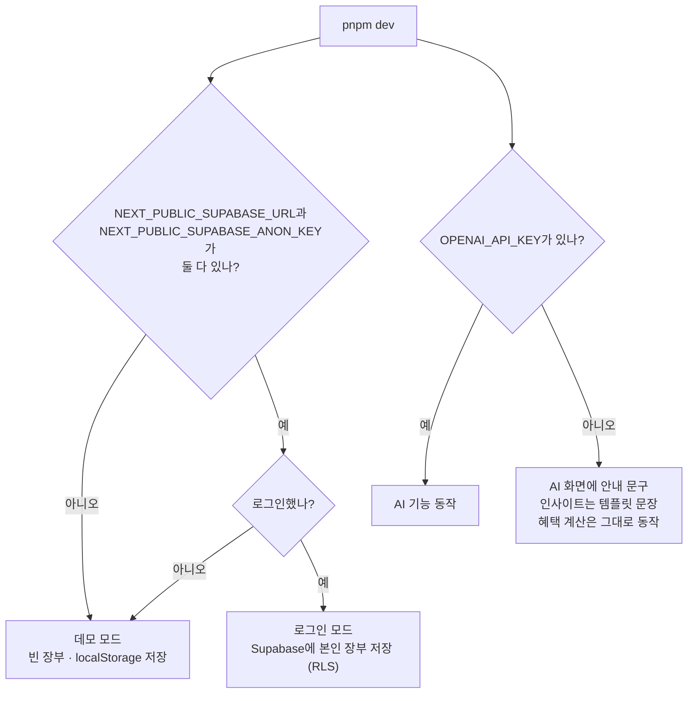
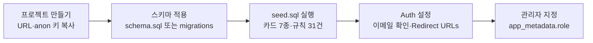
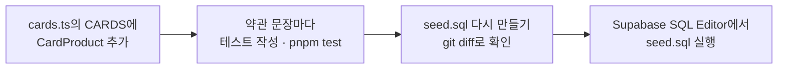
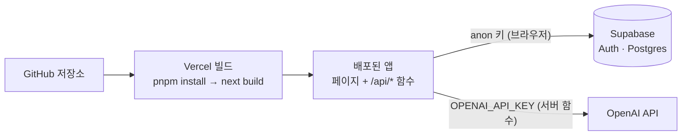

# 10. 개발 · 테스트 · 배포

내 컴퓨터에서 카드셈을 실행하고, 테스트를 돌리고, Supabase와 Vercel에 올리는 방법을 정리한 문서입니다. 명령어와 숫자는 2026-10-09 시점의 저장소 코드에서 확인한 값입니다.

| 하고 싶은 일 | 명령 / 위치 | 자세히 |
| --- | --- | --- |
| 처음 실행 | `pnpm install` → `pnpm dev` | [2장](#2-설치와-실행) |
| AI·로그인 켜기 | `.env.local`에 환경변수 | [3장](#3-환경변수) |
| DB 만들기 | `supabase/schema.sql` + `supabase/seed.sql` | [4장](#4-supabase-준비) |
| 테스트 | `pnpm test` | [5장](#5-테스트) |
| 린트·타입 검사·빌드 | `pnpm lint`, `pnpm exec next typegen && pnpm exec tsc --noEmit`, `pnpm build` | [6장](#6-린트--타입-검사--빌드) |
| 카드 추가·마이그레이션·화면 추가 | — | [7장](#7-자주-하는-작업) |
| 배포 | Vercel | [8장](#8-배포-vercel) |
| 막혔을 때 | — | [9장](#9-문제-해결-faq) |

폴더 구조와 데이터 흐름은 [03. 구조와 데이터 흐름](03-architecture.md)에, DB 테이블 설명은 [07. 데이터 모델과 ERD](07-data-model.md)에 있습니다.

---

## 1. 요구 사항

| 도구 | 버전 | 이유 |
| --- | --- | --- |
| Node.js | **22.x(22.12 이상) 또는 24.x**. 23.x·25.x는 vitest 범위 밖 | `vitest` 5.0.1이 `^22.12.0 \|\| ^24.0.0 \|\| >=26.0.0`, `@supabase/supabase-js`가 `>=22.0.0`을 요구합니다. Next.js 16만 보면 20.9 이상이지만 테스트와 Supabase 때문에 22가 필요합니다. |
| pnpm | 10 (`package.json`의 `packageManager`: `pnpm@10.19.0`) | 잠금 파일이 `pnpm-lock.yaml`입니다. `corepack enable`을 하면 지정된 버전이 자동으로 쓰입니다. |
| Git | 아무 버전 | |
| (선택) OpenAI API 키 | — | 영수증 인식·가맹점 AI 분류·인사이트·약관 정규화·정성 혜택 판단 |
| (선택) Supabase 프로젝트 | Postgres 15 이상 | 로그인과 계정별 장부 저장. 스키마가 `unique nulls not distinct`(Postgres 15부터)를 씁니다. |
| (선택) Supabase CLI | — | 마이그레이션을 명령으로 적용할 때만 |

---

## 2. 설치와 실행

```bash
git clone <저장소 주소> cardsem
cd cardsem
# Node 25 이상이면 corepack이 들어 있지 않으니 먼저: npm i -g corepack
corepack enable        # pnpm 10.19.0을 자동으로 쓰게 함 (한 번만)
pnpm install
pnpm dev               # http://localhost:3000
```

`http://localhost:3000`에 들어가면 `src/app/page.tsx`가 `/home`으로 보냅니다. 환경변수가 하나도 없어도 바로 쓸 수 있습니다.

### 실행 모드 — 데모와 로그인

카드셈은 환경변수에 따라 켜지는 기능이 다릅니다. 화면 코드는 모드를 구분하지 않고, `src/lib/store.tsx`가 데이터를 어디서 읽고 쓸지만 바꿉니다.



| 모드 | 데이터 | 오늘 날짜 | 비고 |
| --- | --- | --- | --- |
| 데모 | 빈 장부(기본 카테고리 + 총예산 150만 원, 화면 이름 "데모 사용자")로 시작해 브라우저 localStorage 키 `cardsem-demo-v5`에 저장 | 실제 오늘 | 설정 → 데모 데이터 초기화로 빈 장부로 비움 |
| 로그인 | Supabase 테이블에서 본인 행만 읽고 씀 | 실제 오늘(로컬 날짜) | 새 계정은 빈 장부로 시작 ([9.4](#94-로그인했는데-데이터가-안-보여요)) |

혜택 **금액 계산**은 어느 모드에서든 LLM이 아니라 `src/lib/engine/index.ts`의 규칙 엔진이 합니다. 그래서 OpenAI 키가 없어도 혜택·놓친 혜택·실적 숫자는 모두 나옵니다. 자세한 내용은 [04. 혜택 계산 엔진](04-benefit-engine.md)을 보세요.

### `package.json` 스크립트

| 명령 | 실제 실행 | 용도 |
| --- | --- | --- |
| `pnpm dev` | `next dev` | 개발 서버 (코드 고치면 바로 반영) |
| `pnpm build` | `next build` | 프로덕션 빌드. 타입 검사 포함, 린트는 안 함 |
| `pnpm start` | `next start` | 빌드 결과 실행 (먼저 `pnpm build`) |
| `pnpm lint` | `eslint` | 린트 |
| `pnpm test` | `vitest run` | 테스트 한 번 실행 |

---

## 3. 환경변수

`.env.local` 파일(저장소 루트)에 넣습니다. `.gitignore`가 `.env*`를 제외하므로 커밋되지 않습니다. 아래 표는 코드에서 읽는 값 전부입니다.

| 이름 | 필수 | 쓰는 곳 | 없을 때 |
| --- | --- | --- | --- |
| `NEXT_PUBLIC_SUPABASE_URL` | 로그인 모드에 필수 (아래 키와 **둘 다** 있어야 켜짐) | `src/lib/supabase.ts`에서 읽어 `SUPABASE_READY`를 정함. 이 모듈을 `src/lib/store.tsx`, `src/lib/db.ts`, `src/lib/ai/client.ts`, `src/app/login/page.tsx`, `src/app/signup/page.tsx`, `src/app/api/normalize/route.ts`가 씀 | `SUPABASE_READY = false` → 데모 모드만. 로그인 화면에서 로그인 버튼을 누르면 "Supabase 환경변수가 없어 로그인을 쓸 수 없어요. 데모로 보기를 눌러주세요"가 뜸(데모 버튼의 실제 이름은 '로그인 없이 데모 보기'). 가입 화면도 가입 버튼을 누르면 "Supabase 환경변수가 없어 가입을 쓸 수 없어요"가 뜸. `/api/normalize`는 관리자 확인 없이 열림 |
| `NEXT_PUBLIC_SUPABASE_ANON_KEY` | 위와 같음 | 위와 같음 | 위와 같음 |
| `NEXT_PUBLIC_DEMO_EMAIL` | 선택. 데모 장부를 서버에 저장할 때 | `src/lib/supabase.ts`의 `DEMO_EMAIL`(스토어가 데모 계정인지 가림), `src/app/api/demo/route.ts` | 데모 장부는 이 브라우저 localStorage에만 |
| `DEMO_PASSWORD` | 위와 같음 | `src/app/api/demo/route.ts`에서만 읽음 (`NEXT_PUBLIC_` 아님) | `/api/demo`가 503 → 브라우저 데모 |
| `OPENAI_API_KEY` | AI 기능에 필수 | 코드에 `process.env`로 직접 적혀 있지 않습니다. `src/lib/ai/server.ts`의 `new OpenAI()`가 openai SDK 기본값으로 읽습니다. `/api/ocr`, `/api/classify`, `/api/insight`, `/api/normalize`, `/api/judge`가 이 클라이언트를 씀 | 라우트가 502와 "OpenAI API 키가 없어요. .env.local에 OPENAI_API_KEY를 넣고 서버를 다시 시작해주세요."를 돌려줌. 인사이트는 화면이 만든 템플릿 문장으로 대체. `/api/classify`는 가맹점 사전에 있는 이름이면 키 없이도 답함 |
| `OPENAI_MODEL` | 선택 | `src/lib/ai/server.ts`가 모듈을 불러올 때 한 번 읽어 `MODEL` 상수로 둠. 모든 AI 호출은 이 값으로 나가므로 바꾸면 재시작해야 함. `src/lib/ai/judge.ts`도 호출할 때 읽지만, 응답에 표시할 모델 이름(`model`)에만 씀 | 기본값 `gpt-5.5` |

`.env.local` 예시입니다.

```bash
# Supabase: 대시보드의 Project Settings → API에서 복사
NEXT_PUBLIC_SUPABASE_URL=https://<프로젝트 ref>.supabase.co
NEXT_PUBLIC_SUPABASE_ANON_KEY=<anon public 키>

# OpenAI: 서버(Route Handler)에서만 읽음
OPENAI_API_KEY=sk-...
# OPENAI_MODEL=gpt-5.5
```

꼭 지킬 것

- `NEXT_PUBLIC_`으로 시작하는 값은 **브라우저 번들에 그대로 들어갑니다.** anon 키는 공개돼도 되는 키라 괜찮습니다(권한은 RLS가 막음). `service_role` 키는 RLS를 건너뛰므로 절대 `NEXT_PUBLIC_` 변수에 넣지 마세요.
- `OPENAI_API_KEY`는 `NEXT_PUBLIC_`을 붙이지 않습니다. 브라우저는 `/api/*` 라우트만 부르고, 키는 서버에만 있습니다(`src/lib/ai/client.ts` 주석).
- 값을 바꾸면 개발 서버를 다시 시작하세요. `OPENAI_MODEL`은 `server.ts`를 불러올 때 한 번만 읽고, AI 오류 문구도 재시작을 안내합니다.
- `@typesafe-ai/sdk`는 `package.json`에만 있고 `src`에서 불러오지 않습니다. 정성 혜택 판단은 OpenAI 구조화 출력으로 합니다([06. 정성 혜택 판단 (Jev)](06-perks-jev.md)).

---

## 4. Supabase 준비

로그인 모드를 쓰려면 Supabase 프로젝트에 스키마와 카드 데이터가 있어야 합니다. 새 프로젝트를 만들 때는 아래 순서를 따릅니다.



### 4.1 스키마 적용 — 두 방법 중 하나만

| | 방법 A: SQL 편집기 | 방법 B: Supabase CLI |
| --- | --- | --- |
| 파일 | `supabase/schema.sql` 하나 | `supabase/migrations/*.sql` 8개를 버전 순서대로 |
| 하는 법 | 대시보드 → SQL Editor에 `schema.sql` 전체를 붙여 넣고 한 번 실행 | `supabase link --project-ref <ref>` → `supabase db push` |
| 마이그레이션 기록 | 남지 않음 | 원격 `supabase_migrations` 기록에 버전이 남음 |
| 이럴 때 | 졸업 시연용 새 프로젝트를 빠르게 만들 때 | 앞으로 마이그레이션을 계속 쌓을 때 |

- 두 방법의 결과는 같습니다. 빈 Postgres 17에 각각 적용해 `pg_dump --schema-only`를 비교했더니 테이블 10개, 제약, 색인, RLS 정책이 모두 같았고 열 순서만 달랐습니다(`ALTER TABLE ... ADD COLUMN`으로 붙인 열이 뒤에 옴).
- **한 DB에 둘 다 돌리지 마세요.** `schema.sql`은 `if not exists` 없이 `create table`·`create policy`를 쓰므로, 이미 테이블이 있는 DB에 돌리면 "already exists" 오류가 납니다.
- 방법 A로 만든 DB에 나중에 CLI를 쓰려면, 원격 기록이 비어 있어 `db push`가 8개 파일을 처음부터 다시 돌리려 합니다. 이때는 기록만 올려 둡니다.

  ```bash
  supabase migration repair --status applied \
    20261004120556 20261004120623 20261004123142 20261005075515 \
    20261005080000 20261009070630 20261009073948 20261009075332
  ```
- 저장소에는 `supabase/config.toml`이 없습니다. CLI가 설정 파일을 찾지 못한다는 오류를 내면 `supabase init`을 먼저 한 번 실행하세요.

### 4.2 카드 데이터 넣기 — `supabase/seed.sql`

앱은 카드 카탈로그를 DB가 아니라 코드(`src/lib/data/cards.ts`의 `CARDS`)에서 읽습니다. 그런데도 `seed.sql`이 꼭 필요합니다. `user_cards.card_id`, `transactions.card_id`, `recurring_rules.card_id`가 `card_products(id)`를 외래 키(FK, 다른 테이블의 행을 가리키는 열)로 참조하기 때문입니다. 카드 행이 없으면 로그인 모드에서 카드를 등록하는 순간 FK 위반으로 저장이 거부됩니다.

- 내용: 카드 상품 7종(`card_products`)과 혜택 규칙 31건(`benefit_rules`, 승인 30건 + 검수 대기 1건 `sp_all`).
- 실행: 대시보드 SQL Editor에 `supabase/seed.sql`을 붙여 넣고 실행합니다. SQL 편집기는 `postgres` 역할로 돌아서 RLS를 거치지 않습니다. 앱의 anon 키로는 넣을 수 없습니다(기본 카드와 규칙 쓰기는 관리자만).
- 모든 행이 `insert ... on conflict (id) do update`(upsert)라서 여러 번 실행해도 결과가 같습니다. 같은 DB에 두 번 실행해 행 수가 7 / 31로 그대로인 것을 확인했습니다.
- 이 파일은 손으로 고치지 않고 `cards.ts`에서 생성합니다. 만드는 법은 [7.1](#71-새-카드-상품-추가)에 있습니다.

### 4.3 Auth 설정

카드셈은 이메일·비밀번호 로그인만 씁니다(`signInWithPassword`, `signUp`). 대시보드 Authentication 메뉴에서 다음을 확인합니다.

| 설정 | 값 | 코드에서 일어나는 일 |
| --- | --- | --- |
| Email 공급자 → **Confirm email** 끔 | 개발·시연에 편함 | `signUp`이 바로 세션을 돌려줘서 `/signup`이 `/onboarding`으로 이동 |
| Email 공급자 → **Confirm email** 켬 | 실제 운영 | 세션이 없어 `/signup`이 "메일을 확인해주세요" 화면을 보여 줌. 메일 링크를 누른 뒤 로그인. Supabase 기본 메일 발송은 시간당 보낼 수 있는 수가 적어서, 자주 가입해 보는 개발 중에는 끄는 편이 낫습니다 |
| URL Configuration → **Site URL** | 앱 주소 (`http://localhost:3000` 또는 배포 주소) | `signUp`에 `emailRedirectTo`를 주지 않으므로 인증 메일 링크는 Site URL로 돌아옵니다 |
| URL Configuration → **Redirect URLs** | `<앱 주소>/login` 추가 (예: `http://localhost:3000/login`, `https://<배포 도메인>/login`) | 비밀번호 찾기가 ``resetPasswordForEmail(email, { redirectTo: `${window.location.origin}/login` })``을 부릅니다. 목록에 없으면 링크가 `/login`으로 오지 않아 '새 비밀번호 정하기' 폼이 뜨지 않습니다 |
| (선택) 최소 비밀번호 길이 | 8 | 화면은 "8자 이상, 영문과 숫자 포함"을 클라이언트에서만 검사합니다. 서버에서도 같게 막으려면 맞춰 둡니다 |

`/login`은 주소 해시에 `type=recovery`가 있으면 새 비밀번호 폼을 띄우고, `error_code=`가 있으면 "재설정 링크가 만료됐거나 이미 쓰였어요"를 보여 줍니다.

### 4.3.1 카카오 로그인

`/login`의 카카오 버튼은 `signInWithOAuth({ provider: "kakao", options: { redirectTo: <앱 주소>/welcome } })`를 부릅니다. 카카오 인증은 Supabase가 받고, 앱은 키를 갖지 않습니다. 그래서 앱 환경변수는 늘지 않고 설정은 두 대시보드에서 합니다.

**카카오 디벨로퍼스 (developers.kakao.com)**

| 위치 | 할 일 |
| --- | --- |
| 내 애플리케이션 → 애플리케이션 추가 | 앱 이름·회사명·카테고리를 넣어 앱을 만듭니다 |
| 앱 설정 → 앱 → 플랫폼 키 | **REST API 키**를 복사합니다. Supabase의 Client ID가 됩니다 |
| 같은 REST API 키 편집 화면 | **카카오 로그인 리다이렉트 URI**에 `https://<project-ref>.supabase.co/auth/v1/callback`을 넣습니다. 앱 주소가 아니라 Supabase 주소입니다 |
| 같은 화면의 클라이언트 시크릿 | **카카오 로그인 Client Secret**을 만들고 활성화한 뒤 복사합니다. Supabase의 Client Secret이 됩니다 |
| 앱 설정 → 플랫폼 → Web | 사이트 도메인에 `http://localhost:3000`과 배포 주소를 넣습니다 |
| 제품 설정 → 카카오 로그인 → 일반 | 사용 설정 **상태 ON** |
| 제품 설정 → 카카오 로그인 → 동의항목 | `profile_nickname`(닉네임), `profile_image`(프로필 사진)를 켭니다. `account_email`(이메일)은 비즈 앱만 켤 수 있습니다 |

**Supabase 대시보드**

| 위치 | 할 일 |
| --- | --- |
| Authentication → Sign In / Providers → Kakao | Enabled ON, Client ID = REST API 키, Client Secret = 카카오 로그인 Client Secret |
| 같은 화면 | 카카오에서 `account_email`을 받지 않으면 **Allow users without an email**을 켭니다 |
| Authentication → URL Configuration → Redirect URLs | `http://localhost:3000/welcome`, `https://<배포 도메인>/welcome`을 추가합니다. 없으면 로그인 뒤 Site URL로 돌아가 가입 절차가 뜨지 않습니다 |

이메일 없이 가입한 카카오 사용자는 설정 화면의 이메일 칸이 비어 보입니다. 닉네임은 `user_metadata.nickname`과 `name`에 둡니다. `store.tsx`의 `needsProfile`은 이메일 가입이 아닌데 `nickname`이 없는 사용자를 뜻합니다.

### 4.4 관리자 지정 — `app_metadata.role`

관리자는 Supabase 사용자의 `app_metadata.role = 'admin'`으로 정합니다. 사용자가 스스로 바꿀 수 없는 값입니다(`user_metadata`와 다름). SQL Editor에서 다음처럼 지정합니다.

```sql
update auth.users
set raw_app_meta_data = raw_app_meta_data || '{"role": "admin"}'::jsonb
where email = 'admin@example.com';
```

지정한 뒤에는 그 사용자가 **로그아웃 후 다시 로그인**해야 합니다. RLS 정책은 로그인 토큰(JWT, 서명된 로그인 증표) 안의 `app_metadata`를 보는데, 토큰은 새로 받을 때 바뀝니다.

이 값을 보는 곳은 다음과 같습니다.

| 곳 | 동작 |
| --- | --- |
| RLS (`card_products`, `benefit_rules`, `merchant_categories`의 `admin write` 정책) | 관리자만 쓰기. 단 `card_products`에는 `owner write` 정책(`owner_id = auth.uid()`)도 있어, 일반 사용자도 자기 직접 추가 카드 행(`custom_` id, CHECK `card_products_owner_custom`)은 씁니다. 기본 카드(`owner_id`가 null) 쓰기는 관리자만 |
| RLS (`benefit_rules`의 `read approved` 정책) | 승인 안 된 규칙은 관리자만 읽기 |
| `/api/normalize` | 로그인 모드에서는 `Authorization: Bearer <토큰>`으로 `auth.getUser`를 불러 관리자가 아니면 403 "관리자만 쓸 수 있어요" |
| `src/components/shell.tsx` (AppShell) | 로그인 모드에서 관리자가 아니면 어드민 화면을 가리고 사이드바·설정의 어드민 링크를 숨김. 화면 가리기일 뿐이고 실제 보호는 RLS와 서버 확인 |

데모 모드(로그인 안 함)에서는 시연을 위해 어드민 화면이 누구에게나 열려 있습니다(`src/app/admin/layout.tsx` 주석).

### 4.4.1 공용 데모 계정 (선택)

데모 장부를 서버에 저장하려면 대시보드 Authentication → Users → **Add user**로 데모 계정을 만들고 **Auto Confirm User**를 켭니다. 그 이메일과 비밀번호를 `.env.local`의 `NEXT_PUBLIC_DEMO_EMAIL`, `DEMO_PASSWORD`에 넣고 서버를 다시 시작합니다. 미리 채워 두는 데이터는 없고, 첫 방문 때 `loadAll`이 새 계정처럼 기본 카테고리와 총예산 150만 원만 넣습니다. 동작 순서는 [03 3.3절](03-architecture.md#33-데모-모드와-로그인-모드)에 있습니다.

확인 방법은 다음과 같습니다.

```bash
curl -s -X POST http://localhost:3000/api/demo
```

토큰 두 개가 오면 설정된 것입니다. `{"error":"데모 계정이 설정되지 않았어요"}`(503)면 환경변수가 비어 있고, 502면 이메일·비밀번호가 맞지 않거나 메일 인증이 안 된 계정입니다.

### 4.5 원격 마이그레이션 기록과 `drop_transactions_receipt_id`

`supabase/migrations/`의 파일 이름 앞 숫자(버전)는 원격 프로젝트의 마이그레이션 기록과 같아야 합니다. 2026-10-09에 원격 기록을 조회한 결과는 다음과 같습니다.

| 버전 | 이름 | 원격 기록 | 내용 |
| --- | --- | --- | --- |
| `20261004120556` | `init_cardsem_schema` | 있음 | 테이블 10개, RLS |
| `20261004120623` | `merchant_categories_policies` | 있음 | 가맹점 사전 테이블 RLS |
| `20261004123142` | `user_cards_bin_cycle` | 있음 | `user_cards.bin`, `statement_cycle_day` |
| `20261005075515` | `fix_relations` | 있음 | 누락된 FK·CHECK, 총예산(null)을 허용하도록 `budgets` 기본키를 unique로 교체 |
| `20261005080000` | `drop_transactions_receipt_id` | **없음** | `transactions.receipt_id` 삭제 (`drop column if exists`) |
| `20261009070630` | `account_sync` | 있음 | 실적 보정 달 열, 반복 회차 유일 색인, `receipts` FK cascade, `benefit_rules.reviewed_by` FK `on delete set null`(검수자 계정을 지워도 규칙은 남김) |
| `20261009073948` | `custom_cards_owner` | 있음 | 직접 추가 카드용 `owner_id`·`custom_def`, 정책 |
| `20261009075332` | `admin_policies_app_metadata` | 있음 | 관리자 판정을 `app_metadata.role`로 |

`drop_transactions_receipt_id`는 2026-10-05에 대시보드 SQL 편집기로 원격에 직접 적용했습니다. 그래서 컬럼은 이미 없지만 기록에는 없습니다. 이 상태에서 `supabase db push`를 하면, 원격의 마지막 기록(`20261009075332`)보다 앞선 버전이 끼어 있다며 거부합니다. 둘 중 하나로 맞춥니다.

```bash
# 권장: 실제로 돌리지 않고 기록만 "적용됨"으로 올린다 (컬럼은 이미 지워져 있음)
supabase migration repair --status applied 20261005080000

# 또는: 끼어 있는 버전까지 포함해 올린다 (if exists라 다시 돌려도 오류 없음)
supabase db push --include-all
```

새 프로젝트에 방법 A·B로 처음 적용하는 경우에는 이 문제가 없습니다.

---

## 5. 테스트

```bash
pnpm test                 # 전체 한 번 (vitest run)
pnpm test engine          # 경로에 "engine"이 들어간 파일만
pnpm exec vitest          # 감시 모드 (파일을 고칠 때마다 다시 실행)
```

- 테스트 도구는 Vitest입니다. `vitest.config.ts`가 `src/**/*.test.ts`만 모읍니다. `.claude/worktrees` 같은 다른 작업 사본의 테스트를 섞지 않기 위해서입니다.
- 작성 시점(2026-10-09)에 12개 파일, 193개 테스트가 1초 안에 통과합니다. 아래 표의 건수도 이 시점 기준이라, 테스트를 더하면 달라집니다.
- 실행할 때 나오는 `(!) Your Vite config uses features that are unsupported by configLoader: 'native'` 경고는 설정 파일 형식에 대한 안내라 결과와 상관없습니다.

### 5.1 파일별로 무엇을 지키나

| 파일 | 대상 코드 | 지키는 것 | 건수 |
| --- | --- | --- | --- |
| `src/lib/engine/engine.test.ts` | `src/lib/engine/index.ts` | 실적 구간 경계(29만 9천 / 30만 / 50만), 전월 실적에서 수입·취소·제외 업종 빼기, 대상 금액 상한 → 건당 상한 순서, 자정을 넘는 시간대, 계단식·금액 구간별 적립률·리터당 할인, 요일·공휴일(2027년 포함), 무이자 할부 제외, 일·월·연 횟수와 통합 한도·통합 횟수, 중복·배타, 월 특례, 부분 환불 재계산, 실적 보정(지정한 달만), 청구 사이클 실적 창, 업종과 가맹점 AND 조건, 조건 필드 누락 안내, 해제한 카드의 과거 결제, `excludeId` 미리보기, 외화 결제는 업종과 상관없이 해외 규칙·원화 결제는 국내 규칙(LIKIT 해외 2%), 리터당 할인의 부동소수 반올림(32.3L × 60원 = 1,938원), 결제 1건 계산 평균 200ms 미만(BNF-07) | 58 |
| `src/lib/report.test.ts` | `src/lib/chart.ts`, `src/lib/stats.ts`, `src/lib/export.ts`, `src/lib/xlsx.ts` | 차트 눈금·만/억 표기·카테고리 색, `monthSummary`의 환불·외화 처리, 카드별 결제액 = 카드 결제 − 카드 환불, 예산 사용률, 카테고리 행·일별 계열·업종 미분류·증감률·증감 색, 엑셀 내보내기 숫자 = 화면·엔진 숫자(고정 장부로 대조), xlsx 열 이름·날짜 일련번호·XML 이스케이프·zip, CSV의 BOM·수식 주입 방지 | 25 |
| `src/lib/data/match-card.test.ts` | `src/lib/data/match-card.ts`, `src/lib/data/merchants.ts` | 영수증 카드 판별(BIN 앞자리 우선, 여러 장이면 확정 안 함, '삼성페이'를 삼성카드로 읽지 않음), 결제수단 문구 → 간편결제, 환불 원거래 후보·중복 판정, 모델 값 정리(날짜·시각·필드 이름), 업종 3단계(사용자 기록 → AI → 사전)와 사전 매칭 규칙 | 24 |
| `src/app/admin/admin.test.ts` | `src/app/admin/admin.ts` | 원문 대조(글머리표·띄어쓰기 무시, 나누거나 합친 조항), 근거 문장이 원문에 없거나 신뢰도가 낮을 때 경고, 어드민 카드 목록 링크·상태별 개수, 승인 카드 만들기(실적 구간 채우기), 버전 묶기, 규칙 JSON 수정 검증 | 18 |
| `src/lib/recurring.test.ts` | `src/lib/recurring.ts`, `src/lib/db.ts` | 반복 회차 날짜(말일·윤년·요일·시작/종료일), 밀린 회차 만들기와 중복 방지, `newId`(http 주소에서도 uuid v4), `validCategory`, 가짜 Supabase로 확인한 DB 요청: `setBudgets`는 upsert하고 이번에 지운 예산만 삭제, 1000행 넘는 `loadAll` 페이지 넘김, 반복 회차 upsert, 직접 추가 카드 저장·삭제 순서 | 17 |
| `src/lib/data/txn-rules.test.ts` | `src/lib/data/txn-rules.ts`, 엔진 `previewTxn` | 환불 가능액, 합계 부호(수입·환불 +, 지출 −), 순지출, 거래 검색과 강조 조각, 결제가 속한 실적 창, 수정 화면 예상 혜택 = 저장된 계산값 | 16 |
| `src/app/(app)/cards/card-stats.test.ts` | `src/app/(app)/cards/card-stats.ts`, `spendProgress`(`src/lib/data/cards.ts`) | 사이클 카드의 '지금 쌓는 실적 창', 업종별 혜택 합 = 카드 혜택 합, 환불 반영 달, 직접 추가 카드 계산, Point Plan 배달앱·taptap O 소셜커머스 규칙 데이터, 카드 해제 확인 문구 | 12 |
| `src/lib/notify.test.ts` | `src/lib/notify.ts` | 실적 구간 90% 알림(사이클 카드는 진행 중인 창 기준), 놓친 혜택 1,000원 이상 상위 3건, 같은 상황이면 같은 알림 id | 7 |
| `src/lib/ai/judge.test.ts` | `src/lib/ai/judge.core.ts` | 정성 혜택 판단에 보내는 상태(사람이 읽는 라벨, 외화는 원화 환산), 답 해석(0.5 기준, 돈이면 `perk.value`, 아니면 `perk.detail`). 네트워크 없음 | 5 |
| `src/lib/data/cards.test.ts` | `src/lib/data/cards.ts` | Point Plan 데이터가 약관대로인지: 12월 통합 한도 특례, SOL페이 추가 적립 제외 업종, 자동납부 영역별 월 1건, 음식점·배달앱 통합 횟수 | 4 |
| `src/lib/ai/receipt-jobs.test.ts` | `src/lib/ai/receipt-jobs.ts` | 영수증 인식 작업 목록: 늦게 온 응답 버리기, 음수 금액 → 양수 + 취소, 사용자가 바뀌면 이전 작업 지우기, 다음 확인 순서 | 4 |
| `src/lib/data/deleteCategory.test.ts` | `src/lib/data/merchants.ts`의 `deleteCategory` | 상위 카테고리 삭제 시 하위까지 지우고 거래·반복 거래는 '기타'로, 예산은 삭제. '기타'는 못 지움 | 3 |

많은 테스트가 테스트용 고정 장부 `src/lib/data/fixtures.ts`(`SEED_TXNS`, `SEED_USER_CARDS`, `SEED_BUDGETS`, `TODAY` = 2026-09-20)를 기준으로 숫자를 대조합니다. 앱(데모 포함)은 이 파일을 쓰지 않습니다. `fixtures.ts`를 바꾸면 여러 파일의 기대값이 함께 바뀔 수 있습니다.

### 5.2 테스트가 다루지 않는 것

- **React 화면**: DOM 환경(jsdom 등)을 설치하지 않았습니다. 테스트는 Node에서 도는 순수 함수만 봅니다. 그래서 계산·집계 로직은 화면 파일이 아니라 `.ts` 파일로 빼 두고 테스트합니다(예: `card-stats.ts`, `admin.ts`).
- **실제 OpenAI 호출**과 `src/app/api/*/route.ts`.
- **실제 Supabase와 RLS 정책**: `recurring.test.ts`는 `vi.mock("./supabase", ...)`로 호출을 기록하는 가짜 클라이언트를 씁니다. 정책은 [4.4](#44-관리자-지정--app_metadatarole)처럼 실제 프로젝트에서 확인해야 합니다.

### 5.3 테스트를 새로 쓸 때 주의

1. **`@/` 별칭으로 값을 불러오지 마세요.** `vitest.config.ts`에 별칭 설정이 없어서 `import { num } from "@/lib/format"`은 `Cannot find package '@/lib/format'`으로 실패합니다. 테스트와, 테스트가 불러오는 모듈은 상대 경로(`../lib/engine`)를 씁니다. 타입만 불러오는 `import type { ... } from "@/..."`는 실행 전에 지워지므로 괜찮습니다(`src/lib/labels.ts`가 그 예).
2. **`server-only`를 불러오는 모듈은 테스트에서 import할 수 없습니다.** `src/lib/ai/server.ts`, `src/lib/ai/judge.ts`가 그렇습니다. 그래서 판단 로직의 순수 부분을 `judge.core.ts`로 나눠 테스트합니다.
3. 브라우저 전역(`fetch`, `URL.createObjectURL`)이 필요하면 `vi.stubGlobal`로 바꿉니다(`receipt-jobs.test.ts` 참고).

---

## 6. 린트 · 타입 검사 · 빌드

```bash
pnpm lint                                     # ESLint
pnpm exec next typegen && pnpm exec tsc --noEmit   # 타입 검사만 (빠름)
pnpm build                                    # 프로덕션 빌드 (타입 검사 포함)
pnpm start                                    # 빌드 결과 실행
```

| 검사 | 설정 | 알아 둘 점 |
| --- | --- | --- |
| 린트 | `eslint.config.mjs` (ESLint 9 flat config, `eslint-config-next`의 `core-web-vitals` + `typescript`) | Next.js 16에서는 `next lint`가 없어졌고 `next build`도 린트를 하지 않습니다. 따로 `pnpm lint`를 돌려야 합니다. `.next/`, `out/`, `build/`, `next-env.d.ts`, `.claude/`는 검사하지 않습니다 |
| 타입 검사 | `tsconfig.json` (`strict: true`, 별칭 `@/*` → `./src/*`) | 레이아웃이 쓰는 `LayoutProps` 같은 전역 타입은 Next가 `.next/types`에 생성합니다. 처음 받은 저장소처럼 `.next`가 없으면 `tsc`가 이 이름을 못 찾으므로 `next typegen`을 먼저 돌립니다. `.claude/`는 제외합니다 |
| 빌드 | `next build` | 테스트 파일을 포함한 프로젝트 전체를 타입 검사합니다. `useSearchParams`를 `Suspense` 없이 쓴 페이지가 있으면 여기서 실패합니다([9.2](#92-빌드할-때-missing-suspense-boundary-오류가-나요)) |

배포 전 권장 순서는 `pnpm test` → `pnpm lint` → `pnpm build`입니다.

`react-hooks/set-state-in-effect` 규칙은 `useEffect` 안의 `setState`를 경고합니다. 이 저장소는 "마운트 후 localStorage를 한 번 읽어 반영"처럼 일부러 그렇게 하는 곳에만 `// eslint-disable-next-line react-hooks/set-state-in-effect`를 붙였습니다(`src/lib/store.tsx`, `src/lib/ai/client.ts`, `src/app/login/page.tsx`, `src/app/admin/input/page.tsx`).

---

## 7. 자주 하는 작업

### 7.1 새 카드 상품 추가



**1단계 — `src/lib/data/cards.ts`의 `CARDS` 배열에 추가합니다.** 타입은 `src/lib/types.ts`의 `CardProduct`, `BenefitRule`입니다. 필드 뜻은 [04. 혜택 계산 엔진](04-benefit-engine.md)과 [용어집](glossary.md)에 있습니다. 지금 있는 카드(`hyundai_zero3`, `shinhan_mrlife`, `shinhan_pointplan`, `samsung_taptap_o`, `lotte_likit2`, `woori_super2`, `shinhan_simpleplan`)를 복사해 고치는 것이 가장 빠릅니다.

| 확인할 것 | 이유 |
| --- | --- |
| 카드 `id`는 `custom_`으로 시작하면 안 됨 | `custom_`은 사용자가 직접 추가한 카드 표시입니다(`isCustomCardId`). DB CHECK(`card_products_owner_custom`)도 이 접두사를 사용자 카드용으로 씁니다 |
| 규칙 `id`는 **모든 카드를 통틀어** 겹치지 않게 | `benefit_rules.id`가 기본키라서, 겹치면 `seed.sql`의 upsert가 다른 카드의 규칙을 덮어씁니다 |
| 규칙의 `cardId` = 카드 `id` | |
| `tiers`(실적 구간)는 겹치지 않게, `min` 이상 `max` 미만 | `resolveTier`가 처음 맞는 구간 하나만 고릅니다. 실적 조건이 없으면 `[{ min: 0, max: null }]` |
| 규칙마다 `limitsByTier`에 혜택이 있는 구간을 적기 | 그 구간 행이 없으면 엔진이 '구간에 혜택 없음'으로 보고 건너뜁니다 |
| `spendExcludes`(실적 제외 업종)와 규칙의 `target.excludes`(혜택 제외)는 다른 것 | 하나는 실적 계산, 하나는 혜택 계산에 쓰입니다 |
| `rawText`에 근거 약관 문장 | 카드 규칙 화면과 계산 근거에 그대로 보입니다 |
| 금액으로 셈할 수 없는 혜택은 `rules`가 아니라 `perks` | 계산에 들어가지 않습니다([06. 정성 혜택 판단 (Jev)](06-perks-jev.md)) |
| 아직 검수하지 않은 카드는 `reviewStatus: "pending"`, 계산 못 하는 규칙은 `supported: false` | `shinhan_simpleplan`이 예입니다 |

**2단계 — 테스트를 씁니다.** 약관 문장 하나에 기대값 하나를 맞춥니다. `src/lib/data/` 아래에 새 테스트 파일을 만들거나, `cards.test.ts`에 `describe`를 더합니다(이 경우 이미 있는 import와 `uc`·`tx` 이름이 겹치지 않게 합니다). 아래는 LOCA LIKIT 2.0으로 확인한 틀입니다(국내 10,000원 × 1.2% = 120원, 해외 50,000원 × 2.0% = 1,000원 — 실제로 통과함).

```ts
// 예: src/lib/data/lotte-likit.test.ts (새 파일)
import { describe, expect, it } from "vitest";
import { calcCard, emptyLedger } from "../engine";
import { cardById } from "./cards";
import type { Transaction, UserCard } from "../types";

const card = cardById("lotte_likit2")!; // ← 새 카드 id로
const uc: UserCard = { cardId: card.id, addedAt: "2026-09-01" };
const tx = (p: Partial<Transaction>): Transaction => ({
  id: "x", type: "expense", amount: 10000, currency: "KRW", date: "2026-09-21",
  merchant: "테스트", categoryId: "etc", payType: "credit", cardId: card.id, ...p,
});

describe("LOCA LIKIT 2.0", () => {
  it("국내 1.2%, 해외 2.0%", () => {
    // calcCard(거래, 카드, 보유 카드, 전월 실적, 원장, 계산 달, 그 달 거래, 원장에 반영할지)
    expect(calcCard(tx({ merchant: "스타벅스" }), card, uc, 0, emptyLedger(), "2026-09", [], false).total).toBe(120);
    expect(calcCard(tx({ merchant: "AMAZON", merchantIndustry: "overseas", amount: 50000 }), card, uc, 0, emptyLedger(), "2026-09", [], false).total).toBe(1000);
  });
});
```

한도·횟수를 확인하려면 원장 하나(`const L = emptyLedger()`)를 여러 번의 `calcCard(..., L, ..., true)`에 넘겨 차감되는 것을 봅니다(`cards.test.ts`의 Point Plan 예시). 그다음 `pnpm test`가 전부 통과하는지 봅니다. 새 카드가 고정 장부의 보유 카드(`SEED_USER_CARDS`)에 들어가지 않는 한 기존 테스트의 숫자는 바뀌지 않습니다.

**3단계 — `supabase/seed.sql`을 다시 만듭니다.** 생성 스크립트는 저장소에 두지 않습니다. 아래 내용을 `src/gen-seed.test.ts`로 잠깐 만들어 실행하고 지웁니다(Vitest로 돌리는 이유: `cards.ts`가 확장자 없는 TypeScript import를 써서 Node로 바로 실행할 수 없음). 이 스크립트는 지금의 `seed.sql`과 바이트 단위로 같은 파일을 만드는 것을 확인했습니다.

```ts
// src/gen-seed.test.ts — 실행 후 지울 것
import { it } from "vitest";
import { writeFileSync } from "node:fs";
import { CARDS } from "./lib/data/cards";

const q = (s: string | null | undefined) => (s == null ? "null" : `'${s.replace(/'/g, "''")}'`);
const j = (v: unknown) => (v == null ? "null" : `${q(JSON.stringify(v))}::jsonb`);

it("seed.sql 만들기", () => {
  const out = [
    "-- 카드 상품·혜택 규칙 시드. src/lib/data/cards.ts에서 생성 (앱은 cards.ts를 읽고, 이 테이블은 어드민 검수·조회용).",
    "-- 다시 만들기: docs/10-development.md 참고. 여러 번 실행해도 같은 결과(upsert).",
  ];
  for (const c of CARDS) {
    out.push(`insert into card_products (id, issuer, name, type, color, grade, annual_fee, tiers, spend_excludes, variants, perks, source_url, checked_at, review_status) values (${q(c.id)}, ${q(c.issuer)}, ${q(c.name)}, ${q(c.type)}, ${q(c.color)}, ${q(c.grade)}, ${c.annualFee ?? "null"}, ${j(c.tiers)}, array[${c.spendExcludes.map(q).join(",")}]::text[], ${j(c.variants)}, ${j(c.perks ?? [])}, ${q(c.sourceUrl)}, ${q(c.checkedAt)}, ${q(c.reviewStatus)}) on conflict (id) do update set issuer=excluded.issuer, name=excluded.name, type=excluded.type, color=excluded.color, grade=excluded.grade, annual_fee=excluded.annual_fee, tiers=excluded.tiers, spend_excludes=excluded.spend_excludes, variants=excluded.variants, perks=excluded.perks, source_url=excluded.source_url, checked_at=excluded.checked_at, review_status=excluded.review_status;`);
    for (const r of c.rules) {
      out.push(`insert into benefit_rules (id, card_id, valid_from, status, rule) values (${q(r.id)}, ${q(c.id)}, ${q(r.validFrom)}, ${q(c.reviewStatus === "approved" ? "approved" : "pending")}, ${j(r)}) on conflict (id) do update set card_id=excluded.card_id, valid_from=excluded.valid_from, status=excluded.status, rule=excluded.rule;`);
    }
  }
  writeFileSync("supabase/seed.sql", out.join("\n") + "\n");
});
```

```bash
pnpm test gen-seed          # supabase/seed.sql을 새로 씀
rm src/gen-seed.test.ts     # 스크립트는 저장소에 남기지 않음
git diff supabase/seed.sql  # 새 카드 줄만 늘었는지 확인
```

**4단계 — DB에 반영합니다.** Supabase SQL Editor에서 새 `seed.sql`을 실행합니다. upsert라 기존 카드는 그대로 덮어쓰고 새 카드만 늘어납니다. 이 단계를 빼먹으면 로그인 모드에서 새 카드를 등록할 때 FK 오류가 납니다([9.4](#94-로그인했는데-데이터가-안-보여요)).

> `seed.sql`은 카드와 규칙을 넣고 고치기만 합니다. `cards.ts`에서 카드나 규칙을 **지운** 경우 DB 행은 남으니, 필요하면 SQL로 따로 지웁니다.

### 7.2 마이그레이션 추가

1. **파일 만들기**: `supabase/migrations/<YYYYMMDDHHMMSS>_<이름>.sql`. CLI가 있으면 `supabase migration new <이름>`이 시각이 붙은 빈 파일을 만듭니다. 첫 줄에 무엇을 왜 바꾸는지 주석을 답니다(기존 파일들처럼).
2. **데이터를 지우지 않는 변경을 우선**합니다. `add column if not exists`, `create unique index if not exists`처럼 다시 돌려도 안전하게 씁니다. 열 삭제 같은 파괴적 구문은 따로 파일로 나눕니다(`fix_relations`와 `drop_transactions_receipt_id`를 나눈 이유).
3. **`supabase/schema.sql`도 같이 고칩니다.** `schema.sql` 머리 주석의 규칙입니다. 이 파일은 "빈 DB에 한 번 돌리면 최종 모양"이어야 합니다. 제약 이름도 마이그레이션과 같게 둡니다.
4. **코드 매핑을 맞춥니다.** 열을 더했다면 `src/lib/types.ts`의 타입과 `src/lib/db.ts`의 변환 함수(DB 행 → 타입 `toTxn`·`toCard`·…, 타입 → DB 행 `txnRow`·`cardRow`·…)를 함께 고칩니다. 거래 열이면 `db.updateTxn`의 `keys` 목록에도 넣어야 수정이 저장됩니다.
5. **문서를 맞춥니다.** `docs/erd/cardsem_erdcloud.sql`(ERDCloud용 MySQL 방언 사본)과 [07. 데이터 모델과 ERD](07-data-model.md).
6. **원격에 적용하고 버전을 맞춥니다.**
   - CLI: `supabase db push`. 파일 이름의 버전이 그대로 기록됩니다.
   - Supabase MCP의 `apply_migration`이나 대시보드로 적용했다면: 원격 기록의 버전은 **적용한 시각**으로 정해집니다. `list_migrations`(또는 `supabase migration list`)로 실제 버전을 확인하고, 로컬 파일 이름과 첫 줄 주석의 버전을 그 값으로 바꿉니다. 다르면 다음 `db push`가 실패합니다.
   - SQL 편집기로 직접 돌렸다면 기록이 남지 않으니 `supabase migration repair --status applied <버전>`으로 올립니다([4.5](#45-원격-마이그레이션-기록과-drop_transactions_receipt_id)).

### 7.3 새 화면 추가

| 할 일 | 방법 |
| --- | --- |
| 파일 위치 | 사용자 화면은 `src/app/(app)/<경로>/page.tsx`. `(app)/layout.tsx`가 자동으로 `AppShell`(사이드바·하단 탭)로 감쌉니다. 어드민 화면은 `src/app/admin/` 아래 |
| 클라이언트 컴포넌트 | 장부 데이터(`useStore()`)를 쓰면 파일 맨 위에 `"use client"`. 스토어가 React 컨텍스트라 서버 컴포넌트에서는 못 씁니다 |
| 화면 틀 | `src/components/shell.tsx`의 `<Screen title=… desc=… back nav>`. `nav`를 주면 모바일 하단 탭이 보입니다 |
| 메뉴에 넣기 | `shell.tsx` 맨 위 상수. 데스크톱 사이드바는 `NAV_GROUPS`, 모바일 '더보기'는 `MORE`, 어드민 화면은 `ADMIN_NAV`(사이드바와 모바일 어드민 칩 줄 `AdminTabs`가 함께 씀). 모바일 하단 탭의 고정 4칸(홈·내역·+·카드)은 `BOTTOM` |
| 오늘 날짜 | `new Date()`가 아니라 `useStore().today`. 로컬 날짜(`ymd`)로 맞춰 둔 값이라, `toISOString()`처럼 UTC로 만들면 한국 0~9시에 하루 어긋납니다 |
| 숫자 표시 | `src/lib/format.ts`의 `won()`(금액), `num()`(천 단위 쉼표). 로캘을 `ko-KR`로 고정해 서버와 브라우저의 첫 렌더 결과가 같습니다(하이드레이션 불일치 방지) |
| 브라우저 저장소 | `localStorage`·`sessionStorage`는 `useEffect` 안이나 `useSyncExternalStore`로만 읽습니다(서버 렌더 때는 없음) |
| 주소 쿼리 (`?id=`) | `useSearchParams`를 쓰는 컴포넌트는 반드시 `<Suspense>`로 감쌉니다. 아래 코드 참고 |
| 색·크기 | `src/app/globals.css`의 `@theme` 토큰(`bg-primary`, `text-strong`, `rounded-btn`, `max-w-content`, `text-nav` …)과 `src/components/ui.tsx`의 공용 컴포넌트를 씁니다. 클래스 이름은 코드에서 조립하지 말고 완성된 문자열로 씁니다([9.3](#93-tailwind-클래스나-css-변수가-적용되지-않아요)). 자세한 목록은 [09. 디자인 시스템](09-design-system.md) |
| 계산 로직 | 화면 파일이 아니라 별도 `.ts` 파일로 빼고 테스트를 붙입니다(상대 경로 import, [5.3](#53-테스트를-새로-쓸-때-주의)) |

`useSearchParams` 쓰는 법 — `src/app/(app)/transactions/page.tsx`와 같은 모양입니다.

```tsx
"use client";
import { Suspense } from "react";
import { useSearchParams } from "next/navigation";

function Inner() {
  const id = useSearchParams().get("id");
  return <p>{id}</p>;
}

/* useSearchParams는 Suspense 안에서 (없으면 next build의 정적 렌더가 실패) */
export default function Page() {
  return <Suspense><Inner /></Suspense>;
}
```

지금 이 모양을 쓰는 화면은 `transactions`, `transactions/new`, `transactions/refund`, `settings/export`, `admin/input`, `admin/rules`입니다.

---

## 8. 배포 (Vercel)

카드셈은 별도 서버 없이 Next.js 앱 하나로 배포됩니다. 데이터는 Supabase, AI는 OpenAI가 맡습니다.



**1. 프로젝트 가져오기.** Vercel에서 저장소를 Import합니다. 프레임워크는 Next.js로 자동 인식되고, `pnpm-lock.yaml`이 있어 pnpm으로 설치합니다. 빌드 명령은 `package.json`의 `next build`입니다. Project Settings의 Node.js 버전은 22.x 이상으로 둡니다([1장](#1-요구-사항)).

**2. 환경변수.** Project Settings → Environment Variables에 넣습니다.

| 이름 | Production | Preview | 메모 |
| --- | --- | --- | --- |
| `NEXT_PUBLIC_SUPABASE_URL` | 넣음 | 넣음 | 빌드할 때 브라우저 번들에 박힙니다. **값을 바꾸면 다시 배포**해야 반영됩니다 |
| `NEXT_PUBLIC_SUPABASE_ANON_KEY` | 넣음 | 넣음 | 위와 같음. `service_role` 키 금지 |
| `OPENAI_API_KEY` | 넣음 | 선택 | 서버 함수에서만 읽음. Preview에서 비용을 아끼려면 빼도 됩니다(AI 화면에 안내 문구) |
| `OPENAI_MODEL` | 선택 | 선택 | 없으면 `gpt-5.5` |
| `NEXT_PUBLIC_DEMO_EMAIL`, `DEMO_PASSWORD` | 선택 | 선택 | 공용 데모 계정([4.4.1](#441-공용-데모-계정-선택)). `DEMO_PASSWORD`는 서버 함수에서만 읽음 |

Supabase 변수를 빼고 배포하면 로그인 없는 데모 사이트가 됩니다. 이때는 `/admin`과 `/api/normalize`도 누구에게나 열립니다.

AI 라우트 중 로그인 확인이 있는 곳은 `/api/normalize`(관리자만) 하나입니다. `/api/ocr`, `/api/classify`, `/api/insight`, `/api/judge`는 Supabase를 설정해도 로그인 없이 부를 수 있어서, 주소를 아는 사람은 서버의 OpenAI 키로 요청을 보낼 수 있습니다. 공개 주소로 배포한다면 OpenAI 대시보드에서 사용 한도(예산)를 걸어 둡니다.

**3. Supabase Auth 주소.** Authentication → URL Configuration에서 Site URL을 배포 주소로 바꾸고, Redirect URLs에 `https://<배포 도메인>/login`을 추가합니다. 로컬 개발도 계속하려면 `http://localhost:3000/login`도 남겨 둡니다([4.3](#43-auth-설정)).

**4. 알아 둘 제한.**

| 항목 | 내용 |
| --- | --- |
| 함수 실행 시간 | `/api/ocr`는 `maxDuration = 90`, `/api/normalize`는 `120`(초)을 선언합니다. Vercel 플랜마다 허용하는 최대값이 다르니 플랜 한도를 확인합니다 |
| 요청 크기 | `/api/ocr`는 12MB까지 받도록 검사하지만, Vercel 함수에는 플랫폼의 요청 본문 크기 제한(문서 기준 4.5MB)이 먼저 걸립니다. 넘으면 플랫폼이 413을 돌려주고, `src/lib/ai/client.ts`가 이를 "파일이 너무 커요"로 보여 줍니다 |
| 가맹점 분류 캐시 | `/api/classify`의 LLM 결과 캐시는 프로세스 메모리(`classifyCache`)입니다. 서버리스 함수는 인스턴스마다 따로라 캐시가 공유되지 않고 사라질 수 있습니다 |
| HEIC 변환 | `heic-convert`는 순수 JS라 네이티브 의존성 설치가 필요 없습니다 |

**5. 배포 후 확인.** `/login`에서 가입·로그인 → 카드 등록(여기서 실패하면 `seed.sql` 누락) → 거래 추가 → 새로고침 후에도 남아 있는지 → 영수증 한 장 인식 순서로 봅니다.

---

## 9. 문제 해결 FAQ

### 9.1 Windows에서 `.env.local`을 만들었는데 키를 못 읽어요

Windows PowerShell 5.1에서 `echo OPENAI_API_KEY=sk-... > .env.local`처럼 `>`로 저장하면 파일이 **UTF-16**으로 저장됩니다. Next.js의 환경변수 로더(`@next/env`)는 UTF-16 파일에서 아무 값도 읽지 못합니다(직접 확인함). 증상은 AI 기능을 쓸 때 나오는 "OpenAI API 키가 없어요" 안내나, 로그인 버튼을 눌렀을 때 나오는 "Supabase 환경변수가 없어…"입니다.

UTF-8로 다시 저장하면 됩니다. BOM(파일 앞 표식)이 붙은 UTF-8은 문제없이 읽힙니다.

```powershell
Set-Content -Path .env.local -Encoding utf8 -Value @(
  "NEXT_PUBLIC_SUPABASE_URL=https://<ref>.supabase.co",
  "NEXT_PUBLIC_SUPABASE_ANON_KEY=<anon 키>",
  "OPENAI_API_KEY=sk-..."
)
```

메모장이나 VS Code로 만들 때는 오른쪽 아래 인코딩이 "UTF-8"인지 봅니다. 저장한 뒤 개발 서버를 다시 시작합니다.

### 9.2 빌드할 때 Missing Suspense boundary 오류가 나요

```
useSearchParams() should be wrapped in a suspense boundary at page "/…".
Read more: https://nextjs.org/docs/messages/missing-suspense-with-csr-bailout
```

`pnpm dev`에서는 화면이 요청마다 렌더되어 이 문제가 드러나지 않고, `pnpm build`의 정적 렌더에서만 실패합니다(Next.js 문서 `use-search-params.md`). `useSearchParams`를 부르는 컴포넌트를 `<Suspense>`로 감싸면 됩니다. 코드는 [7.3](#73-새-화면-추가)에 있습니다.

### 9.3 Tailwind 클래스나 CSS 변수가 적용되지 않아요

Tailwind v4는 소스 파일을 **글자 그대로** 훑어서 쓰인 클래스만 CSS로 만듭니다. 세 가지 경우를 조심합니다.

1. **클래스 이름을 조립한 경우.** `` `bg-${tone}-soft` ``처럼 만든 이름은 파일에 완성된 모양으로 없어서 CSS가 생기지 않습니다. 완성된 문자열을 표로 두고 고릅니다.

   ```ts
   // src/components/ui.tsx의 방식
   const badgeK: Record<BadgeKind, string> = {
     success: "bg-success-soft text-green-700",
     danger: "bg-danger-soft text-red-700",
     // …
   };
   ```

2. **CSS 변수 이름을 조립한 경우.** Tailwind는 `@theme` 토큰 중 쓰인 것만 CSS 변수로 내보냅니다. 차트 색은 `src/lib/chart.ts`에서 `` `var(--color-chart-${i})` ``로 이름을 조립하므로, `globals.css`에서 `@theme static { … }`으로 따로 선언해 항상 내보내게 했습니다. 이런 식으로 쓰는 새 토큰도 `@theme static`에 넣습니다.

3. **호출부 `className`이 기본값을 못 이기는 경우.** `cx()`는 클래스를 이어 붙이기만 해서, 같은 층(utilities)에 있으면 Tailwind 출력 순서에 따라 컴포넌트 기본값이 이길 수 있습니다. 그래서 `Input`·`Select`·`Card`의 덮어쓸 수 있는 기본값은 `globals.css`의 `@layer components`(`.input-box`, `.card-base`)에 두었습니다. 새 공용 컴포넌트도 같은 방법을 씁니다. 자세한 내용은 [09. 디자인 시스템](09-design-system.md).

### 9.4 로그인했는데 데이터가 안 보여요

위에서부터 차례로 확인합니다.

| 증상 | 원인 | 해결 |
| --- | --- | --- |
| 거래·카드가 하나도 없음 (카테고리와 총예산 150만 원만 있음) | **정상입니다.** 새 계정은 데모와 같은 빈 장부로 시작합니다. 첫 로그인 때 `loadAll`이 기본 카테고리와 총예산만 넣어 줍니다 | 카드 등록부터 시작합니다 |
| 넣은 거래가 목록에 없음 | 로그인하면 선택한 달이 **실제 오늘의 달**로 바뀝니다. 데모는 2026년 9월입니다 | 화면 위 월 선택(MonthPicker)으로 거래가 있는 달로 이동합니다 |
| 화면 아래 "장부를 불러오지 못했어요: …" 알림 | DB 읽기 실패. 뒤에 붙은 문구가 테이블을 찾지 못했다는 내용(`relation … does not exist`, `Could not find the table …`)이면 스키마가 없는 것입니다. 이 상태에서는 쓰기도 막힙니다("장부를 아직 불러오지 못해 저장하지 않았어요") | [4.1](#41-스키마-적용--두-방법-중-하나만)로 스키마를 적용하고 새로고침합니다 |
| 카드를 등록하면 잠시 뒤 사라지고 `violates foreign key constraint "user_cards_card_id_fkey"` 알림 | `card_products`에 카드 행이 없음. 쓰기가 실패하면 스토어가 DB 상태로 다시 읽어 화면을 되돌립니다 | [4.2](#42-카드-데이터-넣기--supabaseseedsql)의 `seed.sql`을 실행합니다 |
| 가입했는데 로그인이 안 됨, "이메일 인증이 아직이에요…" | Confirm email이 켜져 있음 | 메일의 링크를 누르거나, 개발 중이면 [4.3](#43-auth-설정)에서 끕니다 |
| 다른 컴퓨터에서 본 데이터와 다름 | `.env.local`의 URL·키가 다른 Supabase 프로젝트를 가리킴 | 팀원끼리 같은 프로젝트 값을 쓰는지 확인하고 서버를 재시작합니다 |
| 로딩 스피너("장부를 불러오는 중이에요")가 안 끝남 | 세션 확인이나 첫 읽기가 끝나지 않음 | 브라우저 개발자 도구의 네트워크 탭에서 `supabase.co` 요청의 오류를 봅니다 |

쓰기에 실패하면 스토어가 오류 메시지를 남기고, 보내는 중인 쓰기가 끝난 뒤 DB 상태로 다시 읽어 화면을 되돌립니다. 그래서 "잠깐 보였다가 사라지는" 데이터는 저장에 실패한 것입니다. 알림 문구에 원인이 적혀 있습니다. 스토어 동작은 [03. 구조와 데이터 흐름](03-architecture.md)에 있습니다.

### 9.5 AI 기능에서 오류 문구가 나와요

서버 라우트의 오류는 `src/lib/ai/server.ts`의 `aiErrorMessage`가 한국어로 바꿉니다(상태 코드 502). 브라우저 쪽 문구는 `src/lib/ai/client.ts`의 `post`가 만듭니다.

| 문구 | 원인 | 해결 |
| --- | --- | --- |
| OpenAI API 키가 없어요. .env.local에 OPENAI_API_KEY를 넣고 서버를 다시 시작해주세요. | 키가 비어 있음. openai SDK가 `Missing credentials … OPENAI_API_KEY …` 오류를 던짐 | `.env.local`(배포는 Vercel 환경변수)에 키를 넣고 재시작·재배포. Windows면 [9.1](#91-windows에서-envlocal을-만들었는데-키를-못-읽어요) |
| OpenAI API 키가 올바르지 않아요. .env.local의 OPENAI_API_KEY를 확인하고 서버를 다시 시작해주세요. | 401 인증 실패. 키 오타, 폐기된 키 | 키를 다시 복사 |
| 요청이 많아요. 잠시 후 다시 시도해주세요. | 429. 요청 속도 제한 외에 **크레딧 소진**도 OpenAI가 429로 돌려줘서 같은 문구가 나옵니다 | 잠시 뒤 재시도. 계속되면 OpenAI 계정의 결제·한도 확인 |
| AI 서버에 연결하지 못했어요. | 네트워크·프록시·방화벽 | 서버가 `api.openai.com`에 나갈 수 있는지 확인 |
| AI 오류 (404): … 같은 형식 | 그 밖의 API 오류. 404는 대개 `OPENAI_MODEL`의 모델 이름이 틀렸거나 계정이 그 모델을 못 쓰는 경우 | `OPENAI_MODEL`을 지우거나 쓸 수 있는 모델로 |
| 관리자만 쓸 수 있어요 | `/api/normalize`(로그인 모드)에서 관리자가 아님 | [4.4](#44-관리자-지정--app_metadatarole)로 지정한 뒤 다시 로그인 |
| 파일이 너무 커요 / 12MB 이하 파일만 받아요 | 플랫폼(413) 또는 라우트의 크기 제한 | 사진을 줄여 다시 올림 |
| JPEG·PNG·WebP·GIF·HEIC 이미지 또는 PDF만 받아요 | 지원하지 않는 파일 형식 | |
| 네트워크 연결을 확인해주세요 | 브라우저가 `/api/*`에 요청을 보내지 못함 | 개발 서버가 켜져 있는지 확인 |

키가 없거나 AI가 실패해도 혜택 계산, 장부, 통계는 그대로 동작합니다. 영수증 인식 흐름과 각 라우트는 [05. 영수증 인식과 AI](05-receipt-ai.md)를 보세요.

### 9.6 그 밖에

| 증상 | 원인과 해결 |
| --- | --- |
| 테스트에서 `Cannot find package '@/…'` | Vitest에 `@/` 별칭이 없습니다. 상대 경로로 import합니다([5.3](#53-테스트를-새로-쓸-때-주의)) |
| 테스트에서 `This module cannot be imported from a Client Component module` | `server-only`를 불러오는 모듈(`src/lib/ai/server.ts`, `judge.ts`)을 import했습니다. 순수 부분을 다른 파일로 나눕니다 |
| `tsc --noEmit`에서 `Cannot find name 'LayoutProps'` | `.next/types`가 아직 없습니다. `pnpm exec next typegen`을 먼저 실행합니다 |
| `supabase db push`가 "Found local migration files to be inserted before the last migration…"으로 거부 | 원격 기록에 없는 이전 버전 파일이 있습니다. [4.5](#45-원격-마이그레이션-기록과-drop_transactions_receipt_id)의 `migration repair` |
| 데모 화면이 예전 데이터로 보임 | 이 브라우저의 localStorage(`cardsem-demo-v5`)에 저장된 상태입니다. 설정 → 데모 데이터 초기화. 데모의 시작 장부를 바꾼 개발자는 `src/lib/store.tsx`의 `KEY` 버전을 올려 저장된 데모 상태를 무효화합니다 |
